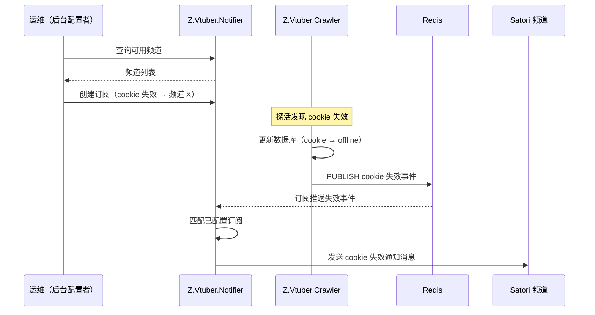

# Cookie 失效通知

**功能名称**: Cookie 失效通知
**PRD 版本**: v1.0
**创建日期**: 2026-09-04
**作者**: Deliay

## 背景与目标

### 1.1 背景

爬虫服务（Z.Vtuber.Crawler）依赖 bilibili cookie 池执行采集任务。cookie 会因登录态过期、风控等原因失效：探活任务发现失效后会将 cookie 标记为 offline 并更新数据库。但失效事件目前只体现在数据库状态中，运维人员无法及时感知，往往在采集数据异常后排查才发现 cookie 早已失效，恢复滞后。

### 1.2 目标

- 新增独立通知服务 **Z.Vtuber.Notifier**（C# 编写），接入 Satori 客户端（[Satori.NET](https://github.com/bsdayo/Satori.NET)），具备向 Satori 频道发送消息的能力；
- cookie 失效时，crawler 除更新数据库外，向 Redis 发布一条失效事件；通知服务订阅该事件，按已配置的通知订阅将「cookie 失效」通知推送到指定 Satori 频道；
- 通知服务提供配置 API：查询 Satori 中可用的频道、管理通知订阅（将通知类型绑定到目标频道），供后台配置使用；
- 通知服务纳入 Aspire 编排，提供 Dockerfile 与 GitHub Action 镜像构建 workflow。

### 1.3 成功标准

- cookie 被判定失效后，已配置订阅的 Satori 频道在秒级内收到一条包含失效账号信息的通知消息；
- 未配置任何订阅时，失效事件不产生任何外发消息，系统其余行为不变；
- 通过配置 API 可查询可用频道、创建/查询/删除通知订阅，配置创建后即时生效；
- 未注入 `Z_VTUBER_SATORI_ENDPOINT` 环境变量时，通知服务启动失败并给出明确错误；
- 通知服务可在 Aspire 中一键启动，镜像可通过 GitHub Action 构建推送。

## 用户分析

### 2.1 目标用户

- **运维人员（后台配置者）**：在后台配置通知订阅、选择接收通知的 Satori 频道，是配置 API 的使用者；
- **运维人员（通知接收者）**：在 IM（Satori 接入的聊天平台）频道中接收 cookie 失效通知，及时更换/补充 cookie。

### 2.2 用户场景

| 场景 | 用户角色 | 目标 | 痛点 |
|--|--|--|--|
| 配置失效通知投递目标 | 后台配置者 | 查看可用频道并把「cookie 失效」通知绑定到指定频道 | 无配置入口，通知无从投递 |
| 及时感知 cookie 失效 | 通知接收者 | cookie 失效后第一时间在 IM 频道收到提醒 | 失效只落库，无人感知，采集中断后才发现 |
| 调整/停用通知 | 后台配置者 | 频道变更或通知打扰时可修改、删除订阅 | — |

## 功能需求

### 3.1 功能概述

新增通知服务 Z.Vtuber.Notifier：启动时连接 Satori 服务器（endpoint 由环境变量 `Z_VTUBER_SATORI_ENDPOINT` 注入，缺失则启动失败）；提供配置 API 用于查询可用频道与管理通知订阅；订阅 Redis 中 crawler 发布的 cookie 失效事件，命中已配置的订阅时通过 Satori 客户端向目标频道发送通知消息。当前支持的通知类型为「cookie 失效」，通知类型集合可扩展。

### 3.2 功能列表

#### 功能点 1: 通知服务接入 Satori

- **描述**: 新增 C# 服务 Z.Vtuber.Notifier，使用 Satori.NET 客户端连接 Satori 服务器；服务器地址通过环境变量 `Z_VTUBER_SATORI_ENDPOINT` 注入，未配置时服务启动失败（fail-fast）。服务纳入 Aspire 编排，并提供 Dockerfile 与 GitHub Action 镜像构建 workflow。
- **用户价值**: 获得独立、可部署的通知投递能力，与现有 api/crawler 解耦。
- **验收标准**:
  - [ ] 注入合法 `Z_VTUBER_SATORI_ENDPOINT` 时服务正常启动并通过健康检查；
  - [ ] 未注入该环境变量时服务启动失败，日志中明确指出缺失的配置项；
  - [ ] Aspire 编排中可同时启动 notifier 与既有服务（mongo、redis、api、crawler）；
  - [ ] GitHub Action 可构建并推送 `z-vtuber-notifier` 镜像。

#### 功能点 2: 可用频道查询 API

- **描述**: 通知服务提供配置 API，返回 Satori 客户端当前可用的频道列表（含所属群组/平台信息），供后台配置通知订阅时选择目标频道。
- **用户价值**: 配置者无需手工打听频道 ID，从列表中直接选择。
- **验收标准**:
  - [ ] 调用频道查询 API 可获取 Satori 机器人可见的频道列表，每个频道包含平台、群组、频道 ID、频道名称等定位信息；
  - [ ] Satori 服务器不可用或机器人未登录时，API 返回明确的错误提示而非静默空列表。

#### 功能点 3: 通知订阅配置 API

- **描述**: 通知服务提供通知订阅的创建、查询、删除 API。一条订阅 = 通知类型（当前为「cookie 失效」）+ 目标频道（平台 + 频道 ID）。配置持久化保存，服务重启后不丢失，创建后即时生效。
- **用户价值**: 通知投递目标可在后台灵活配置与调整。
- **验收标准**:
  - [ ] 可创建订阅：指定通知类型与目标频道（频道信息来自功能点 2 的查询结果）；
  - [ ] 可查询当前全部订阅列表，可删除指定订阅；
  - [ ] 同一通知类型允许配置多条订阅（投递到多个频道）；同一频道重复配置同一通知类型被拒绝或幂等处理；
  - [ ] 订阅配置在服务重启后仍然有效；新建/删除订阅后，后续事件按最新配置投递。

#### 功能点 4: Cookie 失效事件发布与通知投递

- **描述**: cookie 失效时（crawler 将 cookie 标记为 offline 的既有路径），crawler 除更新数据库外，向 Redis 发布一条失效事件（含失效 cookie 的账号信息、失效时间）；通知服务订阅该事件，检查是否存在对应通知类型的已启用订阅：存在则通过 Satori 客户端向各目标频道发送通知消息，不存在则忽略。
- **用户价值**: cookie 失效秒级触达 IM 频道，运维可及时介入。
- **验收标准**:
  - [ ] cookie 被标记失效后，已配置订阅的频道收到一条通知消息，消息内容包含失效账号标识（昵称/MID）、失效时间等可读信息；
  - [ ] 配置了多条订阅（多个频道）时，各频道均收到通知；
  - [ ] 未配置订阅时事件被忽略，不报错、不产生外发消息；
  - [ ] 通知消息不包含 cookie 原始内容等敏感信息；
  - [ ] Redis 事件发布失败不影响 crawler 既有数据库更新与采集流程（fire-and-forget）。

### 3.3 用户操作流程

### 3.4 页面/界面描述

本需求不包含前端页面交付；后台通过通知服务提供的配置 API 完成频道查询与订阅管理。后续如需管理界面，另行立项基于该 API 实现。

### 3.5 异常与边界情况

| 情况 | 预期行为 |
|------|---------|
| 未配置 `Z_VTUBER_SATORI_ENDPOINT` | 通知服务启动失败，日志明确指出缺失配置 |
| Satori 服务器不可达/连接断开 | 服务保持运行并按客户端重连机制恢复；频道查询 API 返回明确错误 |
| 无任何通知订阅时收到失效事件 | 事件被忽略，不产生外发消息，不报错 |
| 订阅指向的频道已失效（机器人退出群组等） | 该条投递失败并记录日志，不影响其他订阅的投递 |
| Redis 发布/订阅链路异常 | crawler 侧发布失败仅记录日志，不影响数据库更新；通知服务侧断线后自动重订阅 |
| 同一 cookie 短时间内多次触发失效 | 以 cookie 状态变更为准；重复事件可重复投递（当前频率低，暂不做去重） |
| 通知类型取值为未知类型 | 配置 API 拒绝创建，返回参数错误 |

## 四、非功能需求

### 4.1 性能要求

- cookie 失效为低频事件（个位数/天量级），通知链路从失效判定到频道消息到达应在秒级完成；
- 通知服务常驻资源占用应与既有 crawler 相当或更低。

### 4.2 安全性要求

- 通知消息与事件 payload 不得包含 cookie 原始字符串等敏感凭证，仅包含账号昵称、MID 等可读标识；
- Satori endpoint/token 通过环境变量注入，不写入代码与配置仓库；
- 配置 API 当前与既有后台接口保持一致（内网部署，无鉴权），后续接入统一鉴权时另行扩展。

### 4.3 兼容性要求

- crawler 既有行为不变：cookie 状态更新、采集流程不受事件发布影响；
- 既有 api、crawler 服务与数据库结构无破坏性变更；新增配置数据使用独立集合；
- 通知类型集合可扩展，「cookie 失效」为首个类型。

## 五、依赖与约束

### 5.1 依赖

- 既有 crawler cookie 池与探活能力（cookie 失效判定与状态更新）——本需求在其失效路径上增加事件发布；
- Redis（既有 `messaging` 实例）作为事件发布/订阅通道；
- 外部 Satori 服务器（部署与账号接入不在本需求范围内，假定已可用）；
- [Satori.NET](https://github.com/bsdayo/Satori.NET) 客户端库。

### 5.2 约束

- 通知服务以 C#/.NET 编写，命名以 Z.Vtuber 开头；
- Satori endpoint 必须通过环境变量 `Z_VTUBER_SATORI_ENDPOINT` 注入且缺失即启动失败；
- Redis 事件为 fire-and-forget 语义，数据库仍是 cookie 状态的唯一事实源；
- 当前仅交付配置 API，不交付前端管理界面。

## 六、相关文档

- 技术提案: `docs/engineering/proposals/20260904-proposal-cookie-invalid-notification.md`
