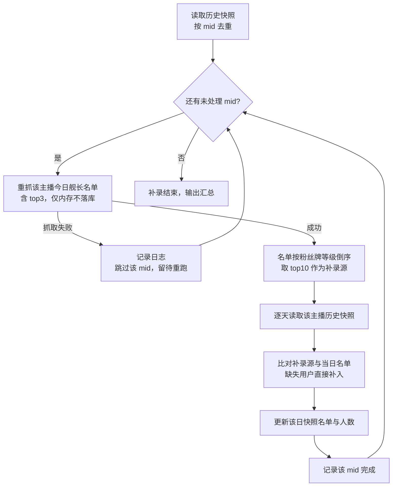

# 舰长 Top3 历史补录

**功能名称**: 舰长 Top3 历史补录
**PRD 版本**: v1.0
**创建日期**: 2026-09-04
**作者**: Deliay

## 背景与目标

### 1.1 背景

「舰长数据抓取」（`docs/product/draft/20260831-live-guard-crawl-prd.md`）上线初期只落库了分页名单，接口返回的 top3（大航海贡献前三）被丢弃，导致已沉淀的历史快照缺失这部分头部用户数据。「舰长 Top3 落库」（`docs/product/draft/20260903-live-guard-top3-prd.md`）已修复增量抓取，但当时判断「历史值不可还原，不回填」。

经进一步分析，历史 top3 数据是可以近似补上的：大航海贡献榜前列的用户与「粉丝牌等级最高的头部用户」高度重合，而粉丝牌等级是长期积累数据，当前接口返回的名单与 top3 中仍包含这些用户。因此可用「今日重抓名单 → 按粉丝牌等级取 top10 → 逐天比对历史快照 → 缺则补齐」的方式补录，把历史快照中缺失的头部用户补回来。

### 1.2 目标

- 提供一次性的历史补录能力：对历史快照涉及的全部主播（mid）逐个处理；
- 每个主播重新抓取今日舰长名单（含 top3），抓取结果仅在内存中使用，**不作为当日快照写入**；
- 取今日名单中粉丝牌等级最高的前 10 名用户作为补录源；
- 将该主播的每一天历史快照与补录源比对，名单中缺失的用户直接补入该日快照；
- 补录过程可中断、可重跑，已补齐的数据不被破坏。

### 1.3 成功标准

- 历史快照涉及的全部 mid 均被处理（含抓取失败的记录与重跑后的最终覆盖）；
- 处理成功的主播：其每一天历史快照的名单中包含补录源 top10 中应出现的用户（按 uid 去重，不重复添加）；
- 补录只增不改：历史快照中既有条目不删除、不修改；
- 补录脚本重跑幂等：重复执行不产生重复条目，已完成的 mid 不重复消耗抓取资源；
- 正常抓取链路（每日定时抓取、补抓）行为无回归。

## 用户分析

### 2.1 目标用户

- **数据订阅方（调用方）**：需要主播大航海头部付费用户历史序列的接入方；
- **运营/管理员（Deliay）**：执行并确认补录结果，关注数据完整性与补录过程可控。

### 2.2 用户场景

| 场景 | 用户角色 | 目标 | 痛点 |
|--|--|--|--|
| 回溯主播历史头部付费用户 | 数据订阅方 | 历史每日快照中包含头部用户数据 | 历史快照缺失 top3 时期的头部用户，序列不完整 |
| 修复存量数据完整性 | 运营/管理员 | 一次性把历史快照缺失的头部用户补齐 | 手工逐条核对不现实，需要自动化、可重跑的补录手段 |

## 功能需求

### 3.1 功能概述

一次性补录脚本：从历史快照中取出全部去重的 mid 逐个处理——重新抓取该主播今日舰长名单（含 top3，仅内存、不落库），按粉丝牌等级倒序取前 10 名作为补录源，再将该主播的每一天历史快照与补录源比对，缺失的用户直接补入对应日期的名单。

### 3.2 功能列表

#### 功能点 1: 补录源生成（今日名单重抓）

- **描述**: 从历史快照中按 mid 去重，得到全部待处理主播。对每个主播重新抓取今日舰长名单，抓取结果必须包含接口返回的 top3；抓取结果只保存在内存中用于生成补录源，**不写入当日快照**（当日快照仍由正常抓取链路生成）。将合并去重后的今日名单按粉丝牌等级倒序排序，取前 10 名作为该主播的补录源。
- **用户价值**: 用最低成本（每个主播一次重抓）获得尽可能接近历史 top3 的头部用户集合，粉丝牌等级长期积累的特性保证了补录源的可靠性。
- **验收标准**:
  - [ ] 历史快照中每个去重 mid 都被列入处理范围；
  - [ ] 每个主播仅重抓一次今日名单，结果含 top3；
  - [ ] 重抓结果不写入当日快照，不影响正常抓取链路；
  - [ ] 补录源为按粉丝牌等级倒序的前 10 名用户；名单不足 10 人时取全部。

#### 功能点 2: 历史快照逐天补齐

- **描述**: 对每个主播，取出其历史已抓取的每日快照，逐天将快照名单与补录源比对：补录源中 uid 不在当日名单中的用户，直接补入该日名单；已存在的用户不做任何改动。补齐后该日名单人数（GuardCount）同步更新。
- **用户价值**: 历史每日快照的头部用户数据完整补回，订阅方可按天回看；只增不改的语义保证既有数据零风险。
- **验收标准**:
  - [ ] 补录源中缺失于某日快照的用户被补入该日快照；
  - [ ] 同一 uid 在单日名单中只出现一次，不重复添加；
  - [ ] 历史快照中既有条目不删除、不修改；
  - [ ] 补齐后 GuardCount 与名单实际人数一致；
  - [ ] 当日（补录执行当天）快照不在补录范围内——当日数据由正常抓取链路生成，含真实 top3。

#### 功能点 3: 断点续跑与幂等

- **描述**: 补录以 mid 为粒度记录完成进度；脚本中断或失败后重跑时，已完成的 mid 直接跳过，未完成的 mid 继续处理。任意 mid 可安全重跑：补齐逻辑按 uid 去重，重复执行不产生重复数据。
- **用户价值**: 补录过程可控、可恢复，抓取失败可修复后重跑，无需人工跟踪进度。
- **验收标准**:
  - [ ] 重跑时已完成的 mid 被跳过，不重复发起抓取请求；
  - [ ] 任一 mid 重跑后快照数据与首次成功执行结果一致（幂等）；
  - [ ] 单个 mid 抓取失败不影响其他 mid 的处理，失败 mid 记录日志并可在重跑时补上。

### 3.3 用户操作流程

补录为一次性后台操作，无用户交互界面。执行流程：

### 3.4 页面/界面描述

本需求不涉及页面/界面变更。补录过程与结果通过运行日志体现（每个 mid 的处理结果、补入条数、失败原因、最终汇总）。

### 3.5 异常与边界情况

| 情况 | 预期行为 |
|------|---------|
| 主播今日舰长名单抓取失败（接口异常/风控退避） | 该 mid 本次跳过并记录日志，不影响其他 mid；重跑时可补上 |
| 主播已无限定 roomId（无法重抓） | 该 mid 跳过并记录日志，标记为待人工关注，不阻断整体流程 |
| 今日名单不足 10 人 | 取全部名单作为补录源 |
| 粉丝牌等级相同 | 按大航海等级次之、uid 次序保证排序稳定，避免重跑结果抖动 |
| 补录源用户已存在于某日快照 | 跳过该用户，不修改既有条目 |
| 补录执行当天的快照 | 不处理；当日快照由正常抓取链路生成，本身含真实 top3 |
| 脚本中途被终止 | 已完成的 mid 有进度记录，重跑自动跳过；未完成的 mid 继续处理 |
| 某主播历史快照为空（无天数） | 实际不会发生（mid 来自历史快照去重），防御性跳过即可 |

## 四、非功能需求

### 4.1 性能要求

- 每个 mid 仅重抓一次今日名单，总抓取请求数 ≈ mid 数 × 页数，与正常一日抓取量同量级；
- 页间延迟、风控退避等抓取纪律与正常抓取链路保持一致，不因补录提高请求频率；
- 历史快照读取/更新按 mid 分批进行，不一次性载入全量数据。

### 4.2 安全性要求

- 无新增凭证/权限处理；复用既有抓取凭证池；
- 补录只更新历史快照名单，不触碰订阅、帐号、事件等其他数据。

### 4.3 兼容性要求

- 快照实体结构不变，补入条目与既有条目结构一致；
- 补录期间正常抓取链路（每日定时抓取、凌晨补抓）可并行运行，互不影响（补录不处理当日快照）；
- 既有快照消费方（上船查询等）读取兼容：补入后名单人数可能增加，消费方按名单内容读取不受影响。

## 五、依赖与约束

### 5.1 依赖

- 既有「舰长数据抓取」链路（`docs/product/draft/20260831-live-guard-crawl-prd.md`）与「舰长 Top3 落库」（`docs/product/draft/20260903-live-guard-top3-prd.md`）——补录复用其抓取能力与名单合并口径；
- 舰长名单接口当前可用，且历史 top3 用户仍出现在今日名单（含 top3）中——这是补录可行的前提假设，已在需求分析中确认。

### 5.2 约束

- 补录为一次性操作，执行完成并确认结果后即告结束，不作为常驻功能；
- 重抓结果不落库为当日快照，当日快照仅由正常抓取链路产生；
- 补录只增不改：不删除、不修改历史快照中任何既有条目；
- 补录源固定为「今日名单按粉丝牌等级倒序 top10」，不对更早历史榜单做额外推断；
- 补录值是近似数据：补入条目的用户信息（昵称、大航海等级、粉丝牌）取自今日抓取结果，与历史当日实况可能存在差异，属需求方可接受的口径。

## 六、相关文档

- 技术提案: `docs/engineering/proposals/20260904-proposal-live-guard-top3-backfill.md`
- 关联 PRD: `docs/product/draft/20260831-live-guard-crawl-prd.md`（舰长数据抓取）
- 关联 PRD: `docs/product/draft/20260903-live-guard-top3-prd.md`（舰长 Top3 落库）
