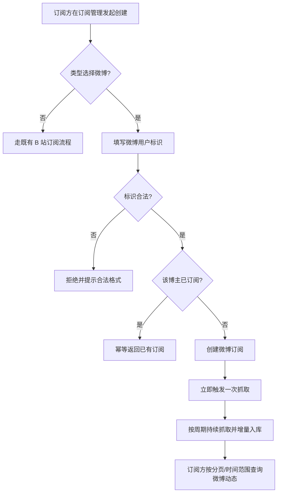

# 微博动态抓取

**功能名称**: 微博动态抓取
**PRD 版本**: v1.0
**创建日期**: 2026-09-09
**作者**: Deliay

## 背景与目标

### 1.1 背景

目前平台的数据抓取能力仅覆盖 B 站（空间动态、直播弹幕、舰长等），订阅管理中也只支持 B 站主播一类订阅目标。随着使用场景扩展，订阅方提出了对**微博动态**的抓取需求：希望像订阅 B 站主播一样，订阅微博博主后持续获取其发布的微博动态，并可通过对外接口查询。

### 1.2 目标

- 订阅管理中可以直接新增「微博」类型的订阅，订阅目标为微博博主；
- 微博动态由平台**原生实现**抓取（不引入第三方抓取服务或外部进程），抓取行为与现有动态抓取逻辑一致：周期轮询、增量入库、新订阅即时补抓、命中风控自动退避；
- 提供对外查询能力，订阅方可查询已抓取入库的微博动态（数据格式按微博原始结构提供，不要求与 B 站动态一致）。

### 1.3 成功标准

- 在订阅管理中添加微博博主订阅后，其新发布的微博动态在抓取周期内持续入库，无人工干预；
- 未订阅的博主不产生任何抓取请求与数据写入；取消订阅后抓取停止；
- 微博动态可通过对外接口按分页与时间范围查询，查询结果与微博原始内容一致；
- 抓取触发微博侧访问限制时自动退避并恢复，不长期中断、不产生重复数据。

## 用户分析

### 2.1 目标用户

- **数据订阅方（调用方）**：需要微博博主动态数据的接入方，是本次功能的主要使用者；
- **运营/管理员（Deliay）**：维护订阅配置与抓取健康度。

### 2.2 用户场景

| 场景 | 用户角色 | 目标 | 痛点 |
|--|--|--|--|
| 订阅微博博主动态 | 数据订阅方 | 在订阅管理中直接添加微博类型订阅 | 当前仅支持 B 站，无法接入微博数据源 |
| 查询微博动态 | 数据订阅方 | 按分页/时间范围拉取已抓取的微博 | 无对外查询能力，数据取不出 |
| 控制抓取范围 | 运营/管理员 | 只抓已订阅的博主，随时可取消 | 担心无效抓取消耗风控额度 |

## 功能需求

### 3.1 功能概述

在现有订阅体系中新增「微博」类型：订阅微博博主后，系统按与现有动态抓取一致的行为周期抓取其微博动态并增量入库，同时提供微博订阅管理与微博动态查询的对外能力。

### 3.2 功能列表

#### 功能点 1: 订阅管理新增「微博」类型

- **描述**: 在订阅管理中可以直接创建「微博」类型的订阅，订阅目标为微博博主（以其微博用户标识指定）。微博订阅与 B 站订阅在同一订阅管理体系内展示与维护，可查看、可取消。
- **用户价值**: 订阅方无需新工具即可接入微博数据源，订阅入口统一。
- **验收标准**:
  - [ ] 订阅管理中可选择「微博」类型并填写微博用户标识完成订阅创建；
  - [ ] 订阅列表中可区分微博订阅与 B 站订阅；
  - [ ] 同一微博用户重复订阅幂等，不产生重复配置与重复抓取；
  - [ ] 取消微博订阅后，该博主的抓取停止，其他订阅不受影响；
  - [ ] 微博用户标识非法（缺失、非正数）时订阅被拒绝并给出明确提示。

#### 功能点 2: 微博动态周期抓取

- **描述**: 对已订阅的微博博主按固定周期抓取其微博动态列表，增量入库：已抓取的微博不重复写入，新微博按发布时间识别并入库。抓取行为与现有动态抓取逻辑一致：周期轮询、新订阅即时触发一次抓取、命中访问限制时自动退避并按策略恢复。
- **用户价值**: 订阅后数据持续、准确、自动地累积，订阅方无需关心抓取细节。
- **验收标准**:
  - [ ] 订阅微博博主后，其微博动态在抓取周期内持续入库；
  - [ ] 新增微博订阅后立即触发一次抓取，无需等待下一个周期；
  - [ ] 同一条微博多次抓取不产生重复数据；
  - [ ] 未订阅的博主不产生任何抓取请求；
  - [ ] 抓取触发微博侧访问限制时自动退避，恢复后继续抓取且不产生数据缺口；
  - [ ] 抓取凭证（访客凭证）失效时自动重建，无需人工介入。

#### 功能点 3: 微博动态对外查询

- **描述**: 提供对外查询能力，订阅方可按博主查询其已入库的微博动态，支持分页与发布时间范围过滤。返回内容按微博原始结构提供（正文、发布时间、图片、转发关系、互动计数等），不要求与 B 站动态的 payload 一致。
- **用户价值**: 订阅方可以稳定、完整地取回已抓取数据，按自身需要消费微博格式内容。
- **验收标准**:
  - [ ] 可按微博用户标识分页查询其微博动态，默认按发布时间倒序；
  - [ ] 支持按发布时间范围过滤，时间范围非法（起晚于止）时返回明确错误；
  - [ ] 查询结果包含微博正文、发布时间、图片、转发原微博、互动计数等核心字段；
  - [ ] 未订阅或无数据的博主查询返回空结果而非错误。

### 3.3 用户操作流程

### 3.4 页面/界面描述

| 页面 | 描述 | 关键元素 |
|------|------|---------|
| 订阅管理 | 新增订阅时可选择「微博」类型；列表中可区分订阅来源平台 | 类型选择中的「微博」选项、微博用户标识输入框、列表中的平台标识 |

### 3.5 异常与边界情况

| 情况 | 预期行为 |
|------|---------|
| 微博用户标识非法或不存在 | 订阅创建时拒绝非法格式；已订阅博主不存在/不可见时抓取跳过并等待下轮，不产生错误数据 |
| 重复订阅同一博主 | 幂等成功，不产生重复配置与重复抓取 |
| 触发微博访问限制 | 自动退避后按策略恢复，恢复期间不产生数据缺口（恢复后补齐漏抓微博） |
| 访客凭证失效 | 自动重建凭证并重试，无需人工介入 |
| 博主删除微博 | 已入库数据保留，不做删除同步 |
| 取消订阅后重新订阅 | 重新订阅后继续增量抓取，历史已入库数据保留可查 |

## 四、非功能需求

### 4.1 性能要求

- 单博主微博动态抓取时效不劣于现有 B 站动态抓取；
- 抓取频率需控制在微博侧可接受范围内，避免因接入微博影响既有 B 站抓取的稳定性。

### 4.2 安全性要求

- 微博抓取使用访客凭证，不涉及用户登录凭证的录入与存储；
- 对外查询能力沿用现有内网免鉴权约定，本期不新增鉴权机制。

### 4.3 兼容性要求

- 既有 B 站订阅、抓取与查询能力完全不受影响；
- 既有数据无需迁移。

## 五、依赖与约束

### 5.1 依赖

- 现有订阅管理与动态抓取链路（微博复用其调度、退避与入库模式）；
- 微博移动端公开接口的可用性。

### 5.2 约束

- 微博抓取必须由平台原生实现，不引入第三方抓取服务或外部运行时；
- 本期仅支持微博动态（博文时间线）一种数据类型，热搜、评论、粉丝等不在本期范围；
- 微博与 B 站的订阅、数据与查询相互隔离，互不干扰。

## 六、相关文档

- 技术提案：`docs/engineering/proposals/20260909-proposal-weibo-crawler.md`
