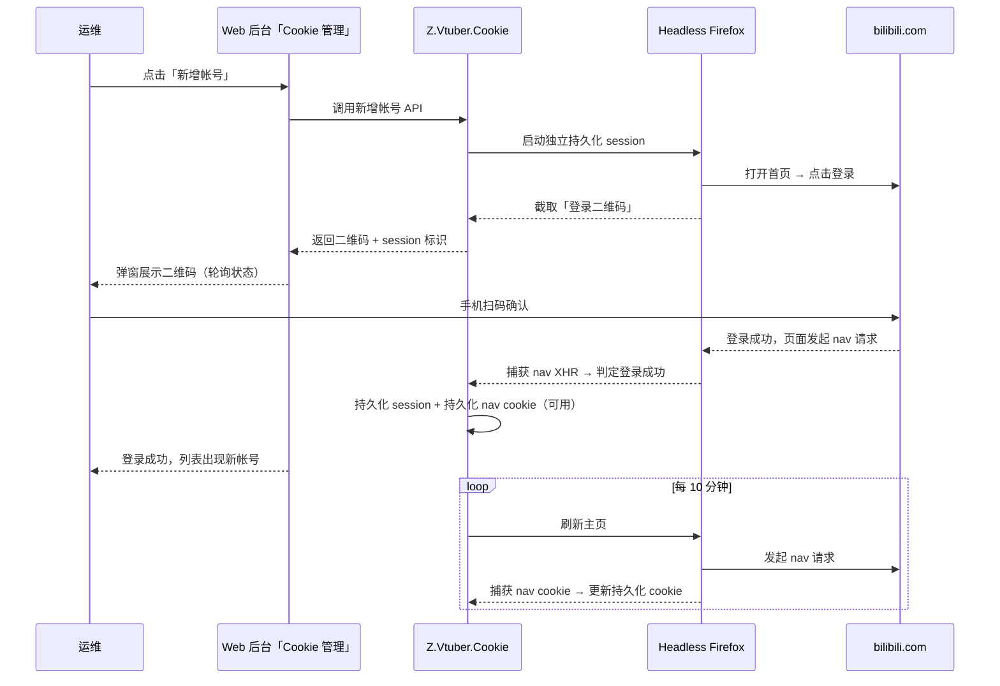
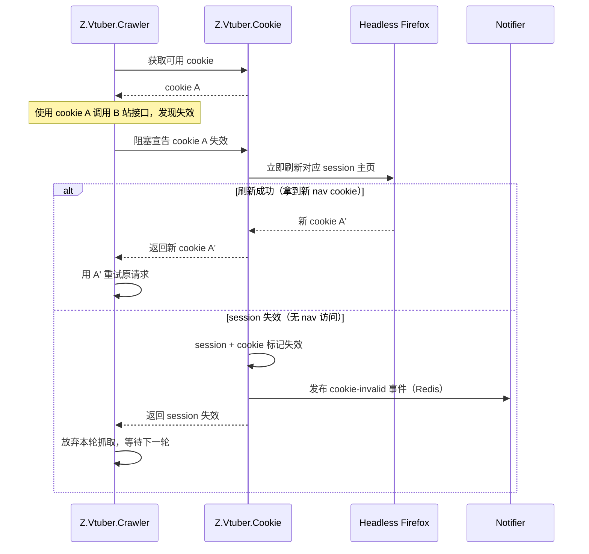

# 无头浏览器 Cookie 服务（z-vtuber-cookie）

**功能名称**: 无头浏览器 Cookie 服务
**PRD 版本**: v1.0
**创建日期**: 2026-09-11
**作者**: Deliay

## 背景与目标

### 1.1 背景

爬虫服务（Z.Vtuber.Crawler）依赖 bilibili cookie 池执行采集任务。当前 cookie 的获取完全依靠**人工**：运维在浏览器手动登录 B 站、从开发者工具复制 cookie 字符串，再在 Web 管理后台「Cookie 管理」页粘贴录入（`POST /api/b/cookie`）。cookie 失效后虽有失效通知（见 `20260904-cookie-invalid-notification-prd.md`），但通知只「告知」不「修复」——仍需人工重新登录、复制、粘贴，恢复链路长且完全依赖人肉操作。

### 1.2 目标

- 新增独立 Cookie 服务 **Z.Vtuber.Cookie**（镜像 `zero-tools/z-vtuber-cookie`），基于 **Playwright + headless Firefox** 托管 B 站帐号浏览器 session；
- 提供「新增帐号」能力：调起 headless Firefox 访问 bilibili.com 并截取登录二维码返回，扫码登录成功后持久化浏览器 session，并以 nav 接口请求携带的 cookie 作为该帐号对外提供的 cookie；
- 对每个登录成功的 session，每 10 分钟定时刷新 B 站主页并采集 nav 接口 cookie 进行保鲜；找不到 nav 接口访问则判定 session 失效，其 cookie 同步失效；
- 外部使用方（crawler 等）发现 cookie 失效时可阻塞式宣告失效，服务立即刷新对应 session：拿到新 cookie 则返回供调用方重试，session 失效则明确返回；
- crawler 改为调用 Cookie 服务 API 获取 cookie；Web 管理后台「Cookie 管理」页改为从 Cookie 服务获取可用 cookie 列表，并提供扫码新增帐号入口。

### 1.3 成功标准

- 运维在后台点击「新增帐号」即可获得登录二维码，手机扫码后无需任何手工复制操作，该帐号 cookie 自动进入可用池；
- 已登录帐号的 cookie 每 10 分钟自动刷新，长时间运行不因 cookie 过期而失效；
- cookie 被使用方宣告失效后，若 session 仍有效，调用方在一次阻塞调用内即可拿到新 cookie 并重试成功；若 session 失效，调用方收到明确失败信号，且运维经既有失效通知链路感知；
- crawler 不再直接读写 cookie 数据库集合，cookie 的获取与失效宣告全部经由 Cookie 服务 API；
- 服务重启后已登录 session 不丢失，无需重新扫码；
- Cookie 服务纳入 Aspire 编排，提供 Dockerfile 与 GitHub Action 镜像构建 workflow。

## 用户分析

### 2.1 目标用户

- **运维人员**：在后台扫码新增 B 站帐号、查看各帐号 session 与 cookie 状态，不再需要手工复制 cookie；
- **crawler 服务（程序调用方）**：通过 API 获取可用 cookie、宣告 cookie 失效并获取刷新结果。

### 2.2 用户场景

| 场景 | 用户角色 | 目标 | 痛点 |
|--|--|--|--|
| 新增 B 站帐号 cookie | 运维 | 扫码即完成 cookie 录入 | 需手动登录 + 开发者工具复制 cookie，门槛高、易出错 |
| cookie 日常保鲜 | Cookie 服务（自动） | 已登录帐号 cookie 持续有效 | cookie 自然过期后采集中断，需人工更换 |
| cookie 失效自愈 | crawler | 宣告失效后立即拿到新 cookie 继续任务 | 失效后只能等人工更换，采集中断时间长 |
| 查看 cookie 可用状态 | 运维 | 在后台看到各帐号 session/cookie 实时状态 | 仅有 active/offline 状态，无 session 维度信息 |

## 功能需求

### 3.1 功能概述

新增 Cookie 服务 Z.Vtuber.Cookie（C#/.NET 10，Playwright headless Firefox）。服务对外提供两组 API：**帐号管理**（新增帐号取二维码、查询登录状态、列出/删除帐号 session）与 **cookie 分发**（获取可用 cookie、阻塞式宣告失效）。内部维护每个帐号的独立 headless Firefox 持久化 session，并以每 10 分钟一次的定时任务刷新主页、采集 nav 接口 cookie 保鲜。crawler 的 cookie 获取与失效宣告迁移至该服务 API；Web 管理后台「Cookie 管理」页改造为面向「帐号 session」的管理视图，新增扫码登录入口。

### 3.2 功能列表

#### 功能点 1: 新增帐号（扫码登录）

- **描述**: Cookie 服务提供「新增帐号 API」。调用后服务调起一个独立的 headless Firefox session（独立浏览器上下文、独立持久化目录），访问 https://www.bilibili.com，点击登录按钮，定位页面中 `alt="登录二维码"` 的二维码元素并截图，将二维码图片（base64 PNG）与本次 session 标识返回。用户手机扫码确认后，服务通过监听该 session 的 XHR 请求检测是否出现 B 站 nav 接口（`/x/web-interface/nav`）访问来判定登录成功。登录成功后：持久化该浏览器 session（持久化目录落盘，服务重启后可恢复）；同时以 nav 接口请求中携带的 cookie 作为该帐号对外提供的 cookie 持久化入库（状态可用）。
- **用户价值**: 扫码即完成 cookie 录入，彻底告别手工复制。
- **验收标准**:
  - [ ] 调用新增帐号 API 后返回二维码图片与 session 标识，二维码可被 B 站 App 正常识别；
  - [ ] 扫码确认后，服务在秒级内检测到 nav 接口访问并判定登录成功；
  - [ ] 登录成功后该帐号的 cookie 进入可用池，crawler 可立即取用；
  - [ ] 服务重启后已登录 session 自动恢复，无需重新扫码；
  - [ ] 二维码过期或超时未扫码时 session 标记为过期并可清理，不泄漏浏览器资源。

#### 功能点 2: 定时刷新保活

- **描述**: 对每个登录成功的 session，内置定时任务每 10 分钟刷新一次 B 站主页，监听其 nav 接口访问并以该请求携带的 cookie 更新持久化的对外 cookie。若刷新过程中找不到 nav 接口访问（超时未出现），判定该 session 失效：session 标记失效，其对应 cookie 同步标记失效，并经既有 Redis `cookie-invalid` 事件通道发布失效事件（供 notifier 通知运维）。
- **用户价值**: cookie 持续保鲜；session 失效可被自动发现并通知。
- **验收标准**:
  - [ ] 每个 active session 每 10 分钟执行一次主页刷新，成功后持久化 cookie 被更新；
  - [ ] 刷新时找不到 nav 接口访问的 session 被标记失效，其 cookie 不再对外分发；
  - [ ] session 失效时发布既有格式的 cookie 失效事件，通知链路行为与现状一致；
  - [ ] 单个 session 刷新异常（浏览器崩溃、网络超时等）不影响其他 session 的刷新与对外服务。

#### 功能点 3: cookie 获取 API（供 crawler 使用）

- **描述**: Cookie 服务提供「获取可用 cookie」API，crawler 改为调用该 API 获取抓取用 cookie（替代当前直接读库 round-robin 的 `CookiePoolService.NextAsync` 路径）。返回 cookie 标识与 cookie 内容；无可用 cookie 时返回明确的失败信号。
- **用户价值**: cookie 池的唯一事实源收敛到 Cookie 服务，session 与 cookie 状态联动由服务内部保证。
- **验收标准**:
  - [ ] crawler 经 API 获取到可用 cookie 并可正常完成 B 站接口调用；
  - [ ] 多个可用 cookie 时按既有 round-robin 语义分发；
  - [ ] 无可用 cookie 时返回明确失败，crawler 按既有暂停/等待语义处理。

#### 功能点 4: 阻塞式失效宣告与即时刷新

- **描述**: 外部使用方（crawler）在使用 cookie 过程中发现 cookie 失效时，阻塞调用 Cookie 服务的「宣告失效」API。服务收到宣告后立即对对应 session 触发一次主页刷新（不等定时周期）：刷新成功拿到新 nav cookie 时，更新持久化 cookie 并在响应中返回新 cookie，调用方用新 cookie 重试原请求；刷新后仍无 nav 接口访问（session 失效）时，session 与 cookie 标记失效、发布失效事件，响应明确返回 session 失效，调用方放弃本轮抓取、等待下一轮取其他 cookie。同一 session 的并发宣告需去重/串行化，避免重复刷新。
- **用户价值**: cookie 失效从「人工更换」升级为「秒级自愈」，采集中断时间大幅缩短。
- **验收标准**:
  - [ ] 宣告失效后 session 仍有效时，响应返回新 cookie，crawler 重试原请求成功；
  - [ ] 宣告失效后 session 已失效时，响应明确指示 session 失效，cookie 下线并触发失效通知；
  - [ ] 同一 session 的并发宣告只触发一次实际刷新，其余调用等待同一结果；
  - [ ] 宣告接口有明确超时上限，不会无限阻塞调用方。

#### 功能点 5: 后台「Cookie 管理」页改造

- **描述**: Web 管理后台「Cookie 管理」页改造为 Cookie 服务的管理视图：列表展示各帐号 session（昵称/MID、session 状态、cookie 状态、最近刷新/最近校验时间）；新增「新增帐号」按钮——点击后调用新增帐号 API 并弹出二维码展示弹窗，轮询登录状态，扫码成功后提示并刷新列表；二维码过期可重新生成。页面数据经 nginx 同源代理访问 Cookie 服务。
- **用户价值**: 运维在一个页面完成帐号接入与状态观察。
- **验收标准**:
  - [ ] 「Cookie 管理」页展示帐号 session 列表，含昵称/状态/时间信息，无帐号时展示空态；
  - [ ] 点击「新增帐号」弹出二维码弹窗，二维码清晰可扫；
  - [ ] 扫码登录成功后弹窗提示成功并自动关闭/刷新列表，新帐号出现在列表中；
  - [ ] 二维码过期或登录超时给出明确提示与重试入口；
  - [ ] Cookie 服务不可用时页面展示明确的加载失败提示而非白屏。

### 3.3 用户操作流程

### 3.4 页面/界面描述

Web 管理后台（`apps/web`）「Cookie 管理」页在原位置改造：

- **帐号 session 列表**：表格展示帐号，列为昵称（MID）、session 状态（待扫码/正常/已失效）、cookie 状态（可用/失效）、最近刷新时间；无帐号时展示空态提示；
- **新增帐号按钮**：页面顶部操作位，点击后弹出二维码弹窗；
- **二维码弹窗**：展示二维码图片与「请使用 bilibili App 扫码登录」提示；弹窗内实时反映登录状态（待扫码 → 登录成功/已过期）；过期时提供「重新生成」；
- 页面风格与既有页面保持一致（侧边栏布局、表格与操作按钮样式）。

### 3.5 异常与边界情况

| 情况 | 预期行为 |
|------|---------|
| 二维码超时未扫码（B 站二维码约 180 秒过期） | session 标记过期，弹窗提示并可重新生成；浏览器上下文被释放 |
| 扫码后未确认/取消登录 | 无 nav 接口访问，最终按超时处理，不产生 cookie |
| 定时刷新时 B 站不可达 | 本次刷新失败记日志并计入重试，不立即判 session 失效；连续失败达到阈值后再判定失效 |
| 同一 session 并发收到多个失效宣告 | 串行化处理，只触发一次实际刷新，所有调用方获得同一结果 |
| 服务重启 | 已登录 session 从持久化目录恢复，浏览器上下文按需惰性重建；待扫码中的 session 不恢复（需重新发起） |
| Playwright/Firefox 进程异常退出 | 对应 session 记日志并标记异常，不影响其他 session；服务自身保持可用 |
| cookie 池无任何可用 cookie | 获取 API 返回明确失败；crawler 按既有语义暂停等待 |
| 宣告失效接口超时 | 调用方按失败处理（等同本轮放弃），服务侧刷新流程不受影响 |

## 四、非功能需求

### 4.1 性能要求

- 每个活跃 session 常驻一个 headless Firefox 浏览器上下文，服务内存占用随帐号数线性增长，单 session 预期数百 MB 量级；帐号规模预期为个位数；
- 失效宣告接口为阻塞式，正常路径（刷新成功）应在秒级~十数秒内返回，并设置明确超时上限；
- 定时刷新错峰执行，避免多 session 同时刷新造成资源尖峰。

### 4.2 安全性要求

- cookie 原文与浏览器 session 持久化目录属于敏感数据：API 响应、日志、Redis 事件 payload 均不得包含 cookie 原文（仅分发接口对授权内网调用方返回）；持久化目录仅存于服务挂载卷；
- 服务部署于内网，API 与既有后台接口一致（无鉴权），后续接入统一鉴权时另行扩展；
- 二维码图片仅包含 B 站登录二维码内容，不附带其他页面信息。

### 4.3 兼容性要求

- 失效事件沿用既有 Redis `cookie-invalid` 频道与 `CookieInvalidEvent` 格式，notifier 无需改动；
- MongoDB 既有 `bilibili_cookies` 集合结构兼容性演进（新增 session 关联字段），历史数据可迁移或由首批扫码帐号自然替代；
- 既有 api 服务的 `/api/b/cookie` 端点在本期保留（兼容），web 页面切换数据源后可考虑后续下线；
- 浏览器仅用于登录与主页保活刷新，不用于数据抓取（抓取仍走 crawler 既有 HTTP 通道）。

## 五、依赖与约束

### 5.1 依赖

- Playwright（.NET 绑定）与 Firefox（headless）——新增依赖，需在部署镜像中内置；
- MongoDB（既有实例）：cookie 与 session 状态持久化；
- Redis（既有 `messaging` 实例）：cookie 失效事件发布；
- 既有 notifier 失效通知链路（消费 `cookie-invalid` 事件，无需改动）。

### 5.2 约束

- Cookie 服务以 C#/.NET 编写，命名以 Z.Vtuber 开头；
- B 站登录态检测以 nav 接口 XHR 为准，不依赖页面 DOM 文案等易变因素；
- 浏览器 session 必须相互隔离（独立持久化上下文），禁止多帐号共用上下文；
- 宣告失效接口必须阻塞至刷新出结果或超时，不得返回中间态让调用方自行轮询；
- 前端「Cookie 管理」页基于 Cookie 服务 API 实现，不引入新的后端聚合层。

## 六、相关文档

- 技术提案: `docs/engineering/proposals/20260911-proposal-cookie-service.md`
- 前置需求: `docs/product/draft/20260904-cookie-invalid-notification-prd.md`（Cookie 失效通知）
