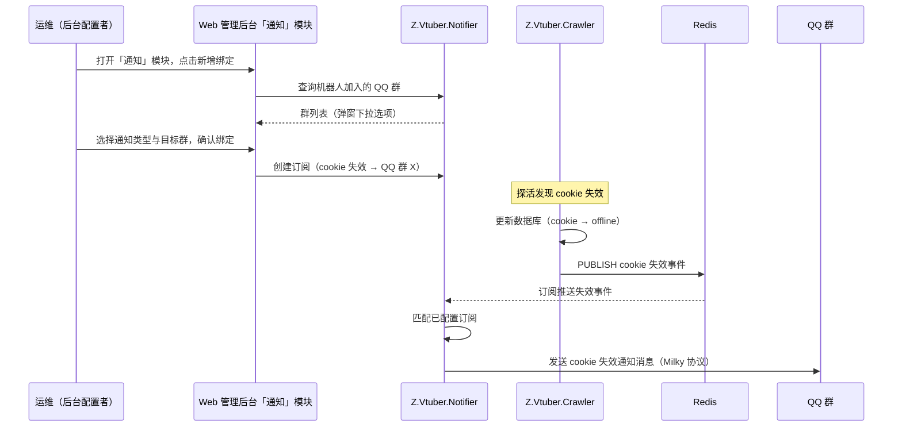

# 通知服务接入 Milky 协议（替换 Satori）

**功能名称**: 通知服务接入 Milky 协议（替换 Satori）
**PRD 版本**: v1.0
**创建日期**: 2026-09-11
**作者**: Workflow Agent（代起草）

## 背景与目标

### 1.1 背景

通知服务（Z.Vtuber.Notifier）当前通过 [Satori 协议](https://satori.js.org/zh-CN/protocol/) 将「cookie 失效」等通知投递到 Satori 频道（见 [[20260904-cookie-invalid-notification-prd]]）。现决定停用 Satori 接入，改用 [Milky 协议](https://milky.ntqqrev.org/)（面向 QQ 的机器人协议），接入实现统一使用 [Milky.Net](https://github.com/frg2089/Milky.Net) 包，不再自研协议直连。

Satori 与 Milky 的通知目标模型不同：Satori 以「平台 / 群组 / 频道」定位投递目标，Milky 面向 QQ，以「QQ 群」为投递目标。因此本次替换不仅是协议层更换，通知目标的选取、展示与绑定也随之从「频道」切换为「QQ 群」。

### 1.2 目标

- 通知服务的对外消息投递由 Satori 协议整体替换为 Milky 协议，通过 Milky.Net 包接入，代码中不再保留 Satori 协议实现；
- 通知投递目标从「Satori 频道」切换为「QQ 群」：配置者可查询机器人加入的 QQ 群列表，并将通知绑定到指定群；
- 通知服务接入地址等配置环境变量由 Satori 系列（`Z_VTUBER_SATORI_*`）替换为 Milky 系列（`Z_VTUBER_MILKY_*`），缺少必需配置时服务启动失败并给出明确错误（fail-fast 语义不变）；
- Web 管理后台「通知」模块适配：频道下拉选择改为 QQ 群下拉选择，绑定列表展示目标群；
- 存量 Satori 订阅数据与 QQ 群无对应关系、不可迁移：升级后旧绑定失效并被清理，配置者需在后台重新绑定；
- 通知事件来源（crawler 经 Redis 发布 cookie 失效事件）与投递语义（fire-and-forget、单条失败不影响其余）保持不变。

### 1.3 成功标准

- 配置 Milky 接入地址后，通知服务正常启动并通过健康检查；未注入必需环境变量时启动失败并明确指出缺失配置项；
- 通过配置能力可查询机器人当前加入的 QQ 群列表（含群号、群名），机器人不可达或不可用时返回明确错误而非静默空列表；
- 可将「cookie 失效」通知绑定到一个或多个 QQ 群，cookie 被判定失效后秒级在目标群收到通知消息；
- 后台「通知」模块以 QQ 群为维度完成绑定的新增、查看与删除，交互体验与既有版本一致；
- 存量 Satori 订阅不再生效且不再展示；升级后在后台重新绑定即可恢复通知能力；
- 部署侧将环境变量从 Satori 系列切换为 Milky 系列后，整套链路（Aspire 本地与镜像部署）可用。

## 用户分析

### 2.1 目标用户

- **运维人员（后台配置者）**：在后台「通知」模块查询 QQ 群、绑定/解绑通知，是配置能力的使用者；
- **运维人员（通知接收者）**：在 QQ 群中接收 cookie 失效通知，及时更换/补充 cookie。

### 2.2 用户场景

| 场景 | 用户角色 | 目标 | 痛点 |
|--|--|--|--|
| 配置失效通知投递目标 | 后台配置者 | 在「通知」模块查看机器人加入的 QQ 群，并把「cookie 失效」通知绑定到指定群 | 协议更换后需以 QQ 群为维度重新配置 |
| 及时感知 cookie 失效 | 通知接收者 | cookie 失效后第一时间在 QQ 群收到提醒 | 投递协议更换期间通知不能中断太久 |
| 升级后恢复通知 | 后台配置者 | 部署新版本后在后台重新绑定目标群 | 旧 Satori 绑定已失效，需明确告知需重新配置 |
| 调整/停用通知 | 后台配置者 | 群变更或通知打扰时可修改、删除绑定 | — |

## 功能需求

### 3.1 功能概述

通知服务的消息投递协议由 Satori 替换为 Milky：启动时连接 Milky 服务器（接入地址由环境变量 `Z_VTUBER_MILKY_ENDPOINT` 注入，缺失则启动失败）；提供配置能力用于查询机器人加入的 QQ 群与管理通知订阅（通知类型 + 目标群）；订阅 Redis 中 crawler 发布的 cookie 失效事件，命中已配置订阅时通过 Milky 协议向目标 QQ 群发送通知消息。Web 管理后台「通知」模块同步以 QQ 群为维度展示与操作绑定。事件发布侧（crawler）与事件语义不变。

### 3.2 功能列表

#### 功能点 1: 通知服务接入 Milky

- **描述**: 通知服务改用 Milky 协议对外投递消息，接入实现统一使用 Milky.Net 包（不再保留自研的 Satori 协议直连实现）。服务器地址通过环境变量 `Z_VTUBER_MILKY_ENDPOINT` 注入，未配置时服务启动失败（fail-fast）；访问凭证通过 `Z_VTUBER_MILKY_ACCESS_TOKEN` 按需配置。原 Satori 系列环境变量（`Z_VTUBER_SATORI_ENDPOINT` / `Z_VTUBER_SATORI_TOKEN` / `Z_VTUBER_SATORI_PLATFORM` / `Z_VTUBER_SATORI_SELF_ID`）全部废弃。
- **用户价值**: 通知能力切换到团队选定的 QQ 机器人协议栈，接入实现由成熟包承担，降低自研协议的维护成本。
- **验收标准**:
  - [ ] 注入合法 `Z_VTUBER_MILKY_ENDPOINT` 时服务正常启动并通过健康检查；
  - [ ] 未注入该环境变量时服务启动失败，日志中明确指出缺失的配置项；
  - [ ] 服务代码与构建产物中不再包含 Satori 协议实现，Satori 系列环境变量不再被读取；
  - [ ] Aspire 编排注入 Milky 配置后可一键启动 notifier 与既有服务。

#### 功能点 2: 可用 QQ 群查询

- **描述**: 通知服务提供可用群查询能力，返回机器人当前加入的 QQ 群列表（群号、群名），供后台配置通知绑定时选择目标群；原「Satori 频道列表」查询能力同步下线。
- **用户价值**: 配置者无需手工打听群号，从列表中直接选择。
- **验收标准**:
  - [ ] 可获取机器人当前加入的 QQ 群列表，每个群包含群号、群名等定位与展示信息；
  - [ ] Milky 服务器不可用或机器人未登录时，返回明确的错误提示而非静默空列表；
  - [ ] 原频道查询能力（Satori）不再提供。

#### 功能点 3: 通知订阅绑定（目标为 QQ 群）

- **描述**: 通知订阅的创建、查询、删除能力保留，但绑定的投递目标由「平台 + 频道」改为「QQ 群」。一条订阅 = 通知类型（当前为「cookie 失效」）+ 目标 QQ 群。配置持久化保存，重启不丢失，创建后即时生效；同一通知类型允许绑定多个群，同一群重复绑定同一类型按幂等处理。
- **用户价值**: 通知投递目标以 QQ 群为维度灵活配置与调整。
- **验收标准**:
  - [ ] 可创建订阅：指定通知类型与目标 QQ 群（群信息来自功能点 2 的查询结果）；
  - [ ] 可查询当前全部订阅列表、可删除指定订阅；列表中目标展示为群号/群名；
  - [ ] 同一群重复绑定同一通知类型被拒绝或幂等处理；配置重启后仍然有效；
  - [ ] 存量 Satori 订阅在升级后不再生效、不再出现在订阅列表中。

#### 功能点 4: Cookie 失效通知投递到 QQ 群

- **描述**: cookie 失效事件的发布（crawler 侧）与订阅（通知服务侧）链路不变；命中订阅时，通知消息由「发送到 Satori 频道」改为「发送到目标 QQ 群」，消息文案内容与格式保持不变。
- **用户价值**: cookie 失效秒级触达 QQ 群，运维可及时介入。
- **验收标准**:
  - [ ] cookie 被判定失效后，已绑定订阅的 QQ 群收到一条通知消息，内容包含失效账号标识（昵称/MID）、失效时间等可读信息；
  - [ ] 绑定多个群时各群均收到通知；未绑定订阅时事件被忽略，不产生外发消息；
  - [ ] 单个群投递失败（机器人退群等）仅记录日志，不影响其他群的投递；
  - [ ] 通知消息不包含 cookie 原始内容等敏感信息；
  - [ ] Redis 事件发布失败不影响 crawler 既有数据库更新与采集流程（fire-and-forget）。

#### 功能点 5: 后台「通知」模块适配

- **描述**: Web 管理后台「通知」模块的整体结构与交互（绑定列表 + 新增绑定弹窗 + 删除二次确认）保持不变，但目标维度从「平台 / 群组 / 频道」改为「QQ 群」：列表展示通知类型、目标群（群名 / 群号）、绑定时间；新增绑定弹窗中的频道下拉改为 QQ 群下拉（选项展示群名与群号），数据来自功能点 2 的查询能力。
- **用户价值**: 配置者在后台以 QQ 群为维度完成绑定管理，操作习惯无缝迁移。
- **验收标准**:
  - [ ] 绑定列表展示目标群的群名/群号，不再出现平台、频道等 Satori 概念；
  - [ ] 新增绑定弹窗的群下拉从群查询能力加载，加载失败时弹窗内展示错误提示与重试入口，不静默空白；
  - [ ] 确认绑定后弹窗关闭、列表刷新；重复绑定给出提示（或服务端幂等处理）；
  - [ ] 删除绑定需二次确认，删除后列表即时刷新；
  - [ ] 通知服务不可用时，页面展示明确的加载失败提示而非白屏。

### 3.3 用户操作流程

### 3.4 页面/界面描述

后台「通知」模块页面结构沿用既有版本，仅目标维度调整：

- **通知绑定列表**：表格列为通知类型（「Cookie 失效」）、目标群（群名 / 群号）、绑定时间，行内提供删除操作；无绑定时展示空态提示；
- **新增绑定弹窗**：通知类型选择（当前仅「Cookie 失效」）+ 目标群下拉（打开弹窗时加载，选项展示「群名（群号）」），确认/取消操作；加载群列表失败时弹窗内展示错误与重试入口；
- **删除确认**：点击删除后弹出二次确认，确认后删除并刷新列表。

页面风格与既有版本保持一致，不新增布局与组件形态。

### 3.5 异常与边界情况

| 情况 | 预期行为 |
|------|---------|
| 未配置 `Z_VTUBER_MILKY_ENDPOINT` | 通知服务启动失败，日志明确指出缺失配置 |
| Milky 服务器不可达 / 机器人未登录 | 群查询返回明确错误；通知投递失败记录日志，恢复后自行可用 |
| 存量 Satori 订阅数据 | 升级后失效并清理，列表不展示；配置者重新绑定后恢复通知 |
| 仍注入旧的 `Z_VTUBER_SATORI_*` 环境变量 | 不被读取；因缺少 `Z_VTUBER_MILKY_ENDPOINT` 启动失败并给出明确提示 |
| 无任何通知订阅时收到失效事件 | 事件被忽略，不产生外发消息，不报错 |
| 订阅指向的群已失效（机器人退群等） | 该条投递失败并记录日志，不影响其他订阅的投递 |
| Redis 发布/订阅链路异常 | crawler 侧发布失败仅记录日志，不影响数据库更新；通知服务侧断线后自动重订阅 |
| 同一 cookie 短时间内多次触发失效 | 以 cookie 状态变更为准；重复事件可重复投递（沿用既有策略，暂不去重） |
| 通知类型取值为未知类型 | 配置能力拒绝创建，返回参数错误 |
| 前端加载绑定列表/群列表失败 | 页面/弹窗内展示明确错误提示与重试入口，不白屏、不静默空白 |

## 四、非功能需求

### 4.1 性能要求

- 沿用既有指标：cookie 失效为低频事件，通知链路从失效判定到群消息到达应在秒级完成；
- 通知服务常驻资源占用与既有版本相当。

### 4.2 安全性要求

- 通知消息与事件 payload 不得包含 cookie 原始字符串等敏感凭证，仅包含账号昵称、MID 等可读标识；
- Milky 接入地址与访问凭证通过环境变量注入，不写入代码与配置仓库；
- 配置能力当前与既有后台接口保持一致（内网部署，无鉴权），后续接入统一鉴权时另行扩展。

### 4.3 兼容性要求

- 本次为**不兼容升级**：投递协议（Satori → Milky）、配置环境变量（`Z_VTUBER_SATORI_*` → `Z_VTUBER_MILKY_*`）、通知目标维度（频道 → QQ 群）同时切换；部署侧需同步更新环境变量并重新绑定通知；
- 存量 Satori 订阅数据不可迁移，升级后失效并清理；
- crawler、api 服务与事件通道（Redis）行为不变，无破坏性变更；
- 通知类型集合可扩展，「cookie 失效」仍为当前唯一类型。

## 五、依赖与约束

### 5.1 依赖

- 既有 crawler cookie 池与探活能力，以及既有的 cookie 失效事件发布/订阅链路（Redis）——本需求只替换投递协议，不改动事件链路；
- 外部 Milky 服务器（QQ 机器人协议端，部署与账号接入不在本需求范围内，假定已可用且机器人已加入目标群）；
- [Milky 协议](https://milky.ntqqrev.org/) 与 [Milky.Net](https://github.com/frg2089/Milky.Net) 包——接入实现统一使用该包，不再自研协议直连。

### 5.2 约束

- 通知服务的 Milky 接入必须使用 Milky.Net 包实现，不允许继续保留 Satori 自研实现或新引入其他协议 SDK；
- Milky 接入地址必须通过环境变量 `Z_VTUBER_MILKY_ENDPOINT` 注入且缺失即启动失败；
- Redis 事件为 fire-and-forget 语义，数据库仍是 cookie 状态的唯一事实源；
- 前端「通知」模块基于通知服务的配置能力实现，不引入新的后端聚合层；
- 通知投递目标本期限定为 QQ 群；私聊通知、多平台投递不在本期范围。

## 六、相关文档

- 技术提案: `docs/engineering/proposals/20260911-proposal-notifier-milky.md`
- 前序需求（通知服务首版）: [[20260904-cookie-invalid-notification-prd]]
