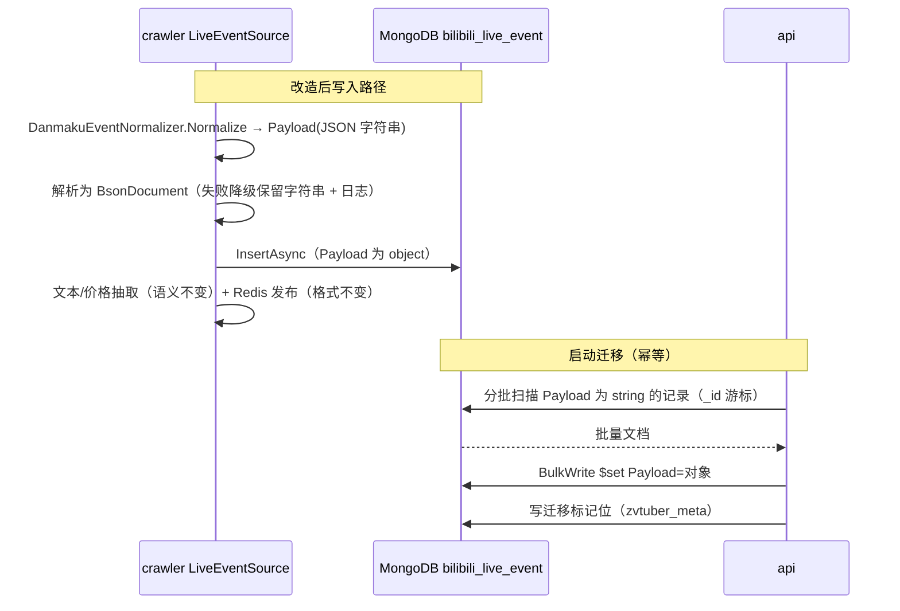

# 直播事件 Payload 结构化存储（live-event-payload-object）

**功能名称**: 直播事件 Payload 结构化存储
**PRD 版本**: v1.0
**创建日期**: 2026-09-13
**作者**: Deliay

## 背景与目标

### 1.1 背景

直播间事件（弹幕、礼物、醒目留言、上舰等）由 crawler 的 `LiveEventSource` 采集，规范化后持久化到 MongoDB `bilibili_live_event` 集合。当前 `LiveEventRecord.Payload` 字段是**字符串类型的 JSON**（`string`），即原始报文 JSON 被整体作为一个字符串写入文档。

这带来几个问题：

- **不可查询**：Payload 内的字段（如礼物 id、用户 uid、弹幕内容）在 MongoDB 侧无法直接索引/过滤/聚合，任何按 Payload 内字段的查询都必须先把字符串读回应用层再 `JsonDocument` 解析；
- **重复解析**：写入侧（`GiftPriceExtractor`、`LiveEventTextExtractor`）与读取侧（api 的 `BilibiliLiveController.ToEventDto` 经 `ParseRaw`）都在对同一字符串反复做 JSON 反序列化；
- **语义不一致**：对外 API 契约（`contracts/bilibili-crawler.openapi.yaml`）中 `payload` 已声明为 `type: object`，api 返回的也是解析后的对象——只有持久化层仍是字符串，存储与契约语义脱节。

### 1.2 目标

- 持久化时写入对应的对象：新产生的直播事件写入 `bilibili_live_event` 时，`Payload` 以 **BSON 文档对象**存储，而非字符串；
- 历史数据处理：提供幂等迁移，把存量记录的 Payload 字符串解析为对象写回；
- 对外行为不变：API 响应、Redis `live-event:{roomId}` 频道消息格式、文本索引/价格抽取逻辑在迁移前后保持一致，上游使用方无感知。

### 1.3 成功标准

- 新写入的事件文档中 `Payload` 字段在 MongoDB 中为 object 类型（`db.bilibili_live_event.find()` 中可直接展开子字段）；
- 历史数据迁移完成后，集合中不再存在 string 类型的 `Payload`（无法解析的脏数据除外，且有明确统计与日志）；
- 迁移幂等：服务重启或多实例并发启动不重复处理、不产生错误；
- api 的事件查询/搜索/SSE 接口返回结构与现状一致，web 端无改动；
- 迁移期间服务可用：写入新事件与读取历史事件均不中断。

## 用户分析

### 2.1 目标用户

- **平台维护者（运维/开发）**：数据模型与查询能力改善的直接受益者；
- **下游功能（程序使用方）**：api 事件接口、文本搜索、价格聚合等读取 `bilibili_live_event` 的既有与后续功能。

### 2.2 用户场景

| 场景 | 用户角色 | 目标 | 痛点 |
|--|--|--|--|
| 按 Payload 内字段查询事件 | 开发/运维 | 直接在 MongoDB 中过滤/聚合事件内容 | Payload 是字符串，必须先读回应用层解析 |
| 读取事件详情 | api 服务 | 返回 payload 对象 | 每次请求都重新 `JsonNode.Parse` 字符串 |
| 部署迁移 | 运维 | 升级后历史数据自动转为对象 | 手工跑脚本风险高，需服务内幂等迁移 |

## 功能需求

### 3.1 功能概述

调整 `LiveEventRecord` 持久化模型：crawler 写入 `bilibili_live_event` 时将规范化后的 Payload JSON 解析为 BSON 文档对象存储；新增幂等启动迁移，对存量 string 类型 Payload 逐批解析回写为对象。抽取器（文本/价格）与 Redis 发布保持现状语义，api 读取路径适配对象模型但响应不变。

### 3.2 功能列表

#### 功能点 1: 新事件以对象持久化

- **描述**: crawler 的 `LiveEventSource` 在构建 `LiveEventRecord` 时，将 Payload 字符串解析为 BSON 文档（`BsonDocument`）写入；解析失败的异常报文降级为保留原字符串并记日志（不阻断采集）。实体 `LiveEventRecord.Payload` 类型由 `string` 调整为可容纳文档的类型，并对历史 string 数据保持反序列化容错（迁移完成前的过渡窗口内读旧数据不报错）。
- **用户价值**: 事件内容在数据库中成为一等可查询结构。
- **验收标准**:
  - [ ] 新写入的 `bilibili_live_event` 文档 `Payload` 为 object 类型，子字段可直接查询；
  - [ ] 各事件类型（danmaku/gift/gift_v2/super_chat/guard_buy/interact 等）均能正确以对象落库；
  - [ ] 极端异常报文（非合法 JSON）不阻断采集，降级保留字符串并记日志；
  - [ ] 文本索引抽取与价格抽取结果与改造前一致（同一报文产出相同的 text index 与 Price）。

#### 功能点 2: 历史数据迁移

- **描述**: 在 `MongoDbInitializer` 新增幂等迁移（api 与 crawler 启动时均执行，经 `zvtuber_meta` 标记位保证只跑一次）：按 `_id` 游标分批扫描 `Payload` 仍为 string 的记录，解析为对象后 `$set` 回写；无法解析的记录跳过并计数/记日志；迁移完成后写入标记位。
- **用户价值**: 存量数据无需手工脚本即可随版本发布自动完成结构化。
- **验收标准**:
  - [ ] 迁移完成后集合中 string 类型 `Payload` 仅剩无法解析的脏数据（如有），且日志中有明确计数；
  - [ ] 迁移幂等：重复执行不产生重复写入或错误，多实例并发启动安全；
  - [ ] 迁移分批执行，不长时间阻塞集合、不影响在线读写；
  - [ ] `gift_v2` 类型的嵌套结构（`{data, raw}`，其中 `raw` 为字符串原文）按现状保留——仅外层转为对象。

#### 功能点 3: 读取路径适配（对外不变）

- **描述**: api 的 `BilibiliLiveController.ToEventDto` 适配对象类型的 Payload（不再对字符串做 `JsonNode.Parse`，改为从 BSON 文档转换为 JSON 节点）；响应结构与契约（`payload: type: object`）保持不变。Redis `live-event:{roomId}` 频道消息格式不变。
- **用户价值**: 上游使用方零感知、零改动。
- **验收标准**:
  - [ ] `/event/range`、`/event/search`、SSE `/event/subscribe` 返回的 `payload` 结构与改造前一致；
  - [ ] 迁移过渡期内，读取尚未迁移的历史 string 数据仍能正常返回（容错）；
  - [ ] OpenAPI 契约与 web 生成类型无变更。

### 3.3 用户操作流程

### 3.4 页面/界面描述

无前端改动。

### 3.5 异常与边界情况

| 情况 | 预期行为 |
|------|---------|
| 新报文 Payload 不是合法 JSON | 降级以原字符串落库并记日志，采集中断不发生 |
| 历史数据中存在无法解析的 Payload 字符串 | 迁移跳过该记录、计数并记日志，迁移标记仍可完成 |
| 迁移执行到一半服务重启 | 标记位未写入，重启后重新扫描（已转对象的记录被过滤跳过），幂等无重复副作用 |
| api 与 crawler 同时启动触发迁移 | 标记位 upsert 并发安全；两实例扫描同样的过滤条件，重复 `$set` 同值无害 |
| 迁移完成前读取到旧 string 数据 | 实体反序列化容错，api 正常返回解析后的对象 |
| `gift_v2` 嵌套 `raw` 字段 | 仅外层 JSON 转对象，`raw` 内的字符串原文保留不动 |
| 大集合迁移耗时 | 分批（每批 500）+ `_id` 游标，逐批提交，不锁集合 |

## 四、非功能需求

### 4.1 性能要求

- 写入路径新增一次 JSON→BSON 解析，单事件开销与现状抽取器的多次 `JsonDocument` 解析同量级，不得引入显著吞吐回退；
- 迁移批处理对在线读写的影响可忽略（小批量 + 游标，无全表锁）。

### 4.2 可扩展性要求

- Payload 转对象后，后续按内容字段建索引/聚合（如按礼物 id 统计）成为可能，但本需求不新增任何索引。

### 4.3 安全性要求

- 无新增敏感面；事件内容本就含用户昵称等公开弹幕数据，存储格式变化不改变其可见性边界。

### 4.4 兼容性要求

- 对外 API 契约不变（`payload` 本就是 object）；
- Redis `live-event:{roomId}` 消息格式不变；
- 既有索引不变（现索引均不涉及 Payload）；
- 文本索引集合 `bilibili_live_event_text_index`、Price 字段等派生数据无需重建（抽取语义不变）。

## 五、依赖与约束

### 5.1 依赖

- MongoDB 既有实例与 `zvtuber` 库；
- 既有幂等迁移框架（`MongoDbInitializer` + `zvtuber_meta` 标记位），范本：`BackfillGiftPriceAsync`、`BackfillLiveEventTextIndexAsync`。

### 5.2 约束

- 迁移必须是服务内幂等启动迁移，不接受手工脚本；
- 抽取器（`LiveEventTextExtractor`、`GiftPriceExtractor`）的输入语义与产出结果不得变化；
- 不改动 `contracts/bilibili-crawler.openapi.yaml` 与 web 端代码；
- 遵循 common/crawler/api 的归属约定：实体与迁移在 `servers/common`，写入路径在 `servers/crawler`，读取适配在 `servers/api`。

## 六、相关文档

- 技术提案: `docs/engineering/proposals/20260913-proposal-live-event-payload-object.md`
- 迁移范本: `docs/engineering/proposals/20260815-proposal-bilibili-live-history.md`、`docs/engineering/proposals/20260819-proposal-live-event-text-search.md`
