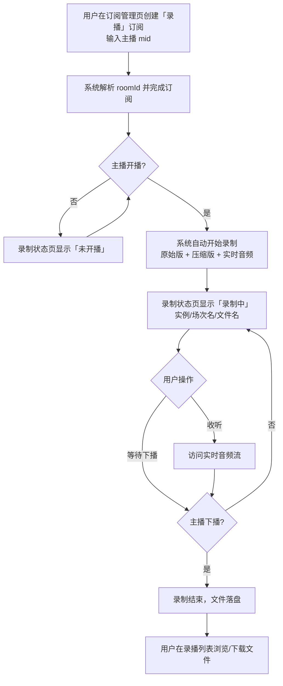

# B站直播录播功能

**功能名称**: B站直播录播
**PRD 版本**: v1.0
**创建日期**: 2026-09-13
**作者**: Z.Vtuber Workflow Agent

## 背景与目标

### 1.1 背景

平台已支持 B 站主播的动态、弹幕、舰队等订阅与数据采集，但缺少对直播内容本身的留存能力。用户希望在主播开播时自动录制直播流，形成可回看的录播文件，并能在直播进行中实时收听音频。

### 1.2 目标

- 用户可对 B 站主播创建「录播」类型订阅，订阅后主播开播即自动录制，下播自动结束；
- 每场直播产出原始画质录播文件与压缩版录播文件，文件名规范、可检索、可下载；
- 直播进行中可通过页面实时收听该场直播的音频；
- 用户可在页面直观看到每个订阅主播当前的录制状态；
- 服务部署/升级（滚动更新）过程中录制不中断、不重复，同一时刻同一直播间只有一个录制任务在执行。

### 1.3 成功标准

- 创建录播订阅后，主播开播 1 分钟内自动开始录制，下播后录播文件完整可下载；
- 每场直播同时产出原始版与压缩版两个文件，压缩版体积约为原始版的 90% 码率对应水平；
- 录制状态页面状态（未开播 / 录制中 / 录制出错）与实际一致，并展示录制所在实例、场次名称与文件名；
- 服务滚动更新期间，同一直播间不出现两个实例同时写文件，接管延迟在可接受范围内（分钟级以内）；
- 实时音频流在无人收听时不占用额外内存，收听端网络缓慢时不会造成服务内存持续上涨。

## 用户分析

### 2.1 目标用户

平台运营者 / 主播内容归档用户（自用场景）。

### 2.2 用户场景

| 场景 | 用户角色 | 目标 | 痛点 |
|--|--|--|--|
| 关注的主播开播时自动留档 | 运营者 | 开播即录，无需人工值守 | 人工录制易遗漏、时间不确定 |
| 回看历史直播 | 运营者 | 浏览并下载某主播的历史录播 | 直播结束即无法回看 |
| 节省存储空间 | 运营者 | 有一份体积更小的压缩版用于日常回看，原始版用于归档 | 原始流体积大，长期留存成本高 |
| 直播进行中只听声音 | 运营者 | 不开视频画面实时收听直播音频 | 拉视频流耗电耗流量 |
| 升级服务不影响录制 | 运营者 | 发布新版本时录制无缝接管 | 部署窗口导致录播断档或文件冲突 |

## 功能需求

### 3.1 功能概述

为 B 站主播提供「录播」类型订阅；订阅生效后系统自动在主播开播时录制直播流，产出规范的录播文件，支持录制状态查看、历史录播列表与下载、直播中的实时音频收听。

### 3.2 功能列表

#### 功能点 1: 录播类型订阅

- **描述**: 订阅管理平台的「B站」订阅新增「录播」类型。用户输入主播 mid 创建订阅，系统与弹幕订阅一致地通过主播基础信息解析 roomId 后完成订阅；支持取消订阅。
- **用户价值**: 以最小操作（只填 mid）开启自动录制。
- **验收标准**:
  - [ ] 订阅管理页 B 站订阅类型中可选「录播」，输入 mid 可成功创建；
  - [ ] 列表中可看到录播订阅并可取消；
  - [ ] 已订阅主播开播后自动进入录制流程。

#### 功能点 2: 开播自动录制与双版本文件产出

- **描述**: 主播开播时自动开始录制，下播自动结束并落盘。每场直播产出：
  - 原始版：原始流原样封装的录播文件（对应 RAW）；
  - 压缩版：以原始流码率的 90% 为目标码率重新压缩的录播文件（对应 AV1）。
  录制过程自动适配平台返回的不同流形式（直连流或 m3u8 列表流），用户无感知。
- **用户价值**: 一次录制同时满足「归档保真」与「日常省空间回看」两类诉求。
- **验收标准**:
  - [ ] 开播自动录制、下播自动停止，无需人工介入；
  - [ ] 每场直播产出原始版与压缩版两个文件，压缩版码率约为原始版的 90%；
  - [ ] 两种流形式（直连流、m3u8）均可正常录制。

#### 功能点 3: 录播文件命名规范

- **描述**: 录播文件统一命名：`[{编码标识大写}][{RoomId}][{主播名称}] {直播日期(yyyy-mm-dd)}-{直播场次名称}.flv`，其中场次名称中的非法文件名字符会被清理。示例：`[RAW][123456][某主播] 2026-09-13-晚间歌回.flv`、`[AV1][123456][某主播] 2026-09-13-晚间歌回.flv`。
- **用户价值**: 文件名自解释，按主播/日期/场次即可定位文件，原始版与压缩版一目了然。
- **验收标准**:
  - [ ] 文件名包含编码标识、RoomId、主播名称、日期、场次名称；
  - [ ] 同一场次的原始版与压缩版仅编码标识不同；
  - [ ] 场次名称含特殊字符时文件名合法且不截断关键信息。

#### 功能点 4: 录制状态页面

- **描述**: Web 新增「录制状态」页面，按订阅主播展示当前录制状态：「未开播」「录制中」「录制出错」；同时展示执行录制的服务实例标识（hostname）、当前录制场次名称与当前录制文件名。状态自动刷新。
- **用户价值**: 一页掌握所有录播订阅的运行状况，出错可被及时发现。
- **验收标准**:
  - [ ] 页面展示每个录播订阅主播的状态（未开播/录制中/录制出错）；
  - [ ] 录制中展示实例标识、场次名称与文件名；
  - [ ] 状态与实际录制情况一致（开播后变为录制中，下播后回到未开播）。

#### 功能点 5: 录播文件浏览与下载

- **描述**: 用户可查看指定主播（按 roomId）的历史录播文件列表，并下载其中任意一场录播文件。
- **用户价值**: 历史录播可检索、可取回。
- **验收标准**:
  - [ ] 可列出指定主播的全部录播文件名；
  - [ ] 可下载列表中的任意文件，下载内容完整可播放；
  - [ ] 未开播/无录播的主播返回空列表而非错误。

#### 功能点 6: 实时音频流

- **描述**: 主播直播进行中，用户可访问实时音频流接口收听该场直播的音频。未在录制时访问返回 404。无人收听时不额外占用资源；收听端接收缓慢时系统会丢弃来不及发送的数据，保证服务内存稳定。
- **用户价值**: 低成本的「只听声音」陪伴式使用方式。
- **验收标准**:
  - [ ] 录制中访问实时音频流可持续收到音频数据；
  - [ ] 未在录制时访问返回 404；
  - [ ] 无人收听或服务运行长时间后，服务内存无明显增长。

#### 功能点 7: 录制高可用（单实例录制与无缝接管）

- **描述**: 同一直播间同一时刻只有一个服务实例在录制。服务滚动更新时，旧实例停止录制并释放占用后，新实例立即接管录制，不会出现双实例同时写文件，也不会长时间无人录制。
- **用户价值**: 发布升级不造成录播断档或文件损坏。
- **验收标准**:
  - [ ] 任意时刻同一直播间只有一个录制任务在执行；
  - [ ] 滚动更新场景下，新实例在旧实例下线后立即接管；
  - [ ] 接管过程不产生损坏/重复文件。

### 3.3 用户操作流程

### 3.4 页面/界面描述

| 页面 | 描述 | 关键元素 |
|------|------|---------|
| 订阅管理页（既有页面扩展） | B 站订阅类型新增「录播」选项 | 类型选择、mid 输入框、订阅列表（含录播类型标识） |
| 录制状态页（新增） | 展示全部录播订阅的当前状态 | 状态标签（未开播/录制中/录制出错）、实例标识、场次名称、文件名 |
| 录播文件入口（录制状态页或订阅页内） | 查看并下载某主播历史录播 | 文件列表、下载入口、实时音频入口 |

### 3.5 异常与边界情况

| 情况 | 预期行为 |
|------|---------|
| 订阅的 mid 不存在或无法解析 | 创建订阅失败并提示用户 |
| 录制过程中服务实例宕机/被升级替换 | 另一实例接管录制；同一直播间不会双写 |
| 录制过程网络中断/流地址失效 | 状态置为「录制出错」，自动尝试恢复或等待下一场 |
| 未在录制时访问实时音频流 | 返回 404 |
| 收听端网络极慢 | 丢弃来不及发送的音频数据，服务内存保持稳定 |
| 场次名称包含文件系统非法字符 | 清理后生成合法文件名 |
| 同一主播重复创建录播订阅 | 幂等处理，不产生重复订阅 |

## 四、非功能需求

### 4.1 性能要求

- 实时音频无人收听时零额外缓冲；收听时缓冲有上限，超限丢弃；
- 开播检测到开始录制的延迟在 1 分钟以内；
- 长时间（7×24）运行内存稳定，无持续增长。

### 4.2 安全性要求

- 拉取平台直播流所需的凭据由平台统一的凭据管理能力提供，不在页面或配置中明文暴露。

### 4.3 兼容性要求

- 与既有订阅管理、弹幕等功能互不影响；既有类型订阅行为不变。

## 五、依赖与约束

### 5.1 依赖

- 主播基础信息解析 roomId 的能力（与弹幕订阅一致）；
- 平台统一的凭据（Cookie）管理能力，用于获取直播流地址；
- 部署环境具备视频压缩所需的编码能力。

### 5.2 约束

- 同一直播间同一时刻只允许一个录制任务；
- 录播文件为 .flv 封装；
- 压缩版目标码率为原始流的 90%。

## 六、相关文档

- 技术提案：[[20260913-proposal-live-recording]]（docs/engineering/proposals/20260913-proposal-live-recording.md）
