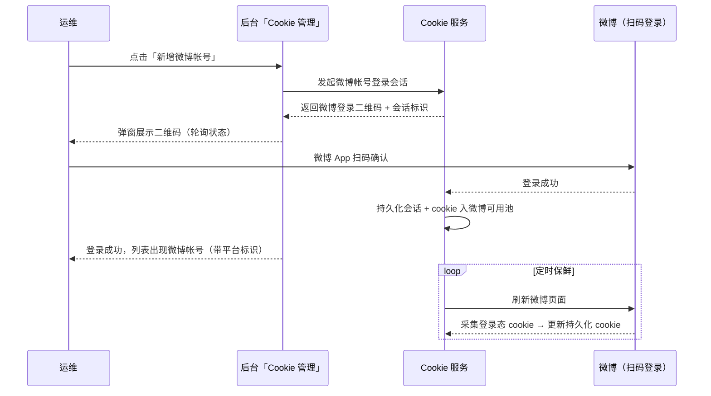
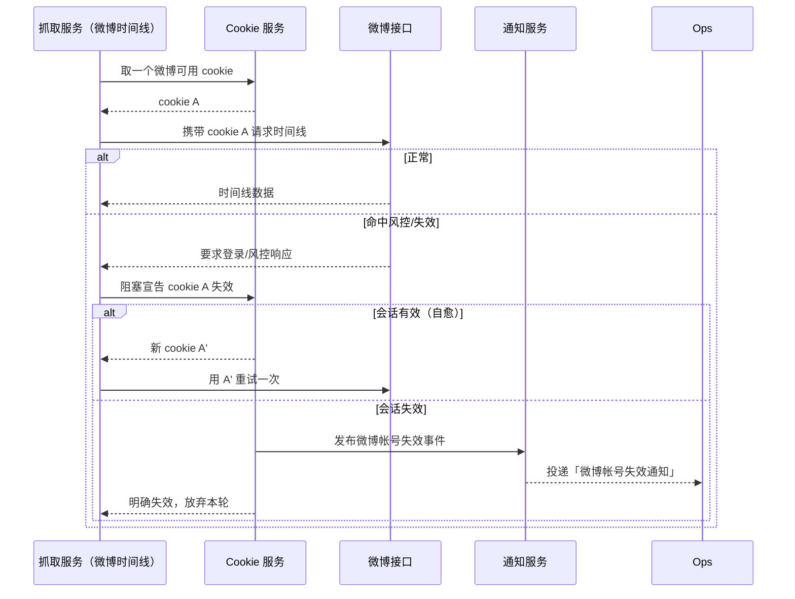

# 微博 Cookie 抓取（weibo-cookie-crawl）

**功能名称**: 微博 Cookie 抓取
**PRD 版本**: v1.0
**创建日期**: 2026-09-13
**作者**: Deliay

## 背景与目标

### 1.1 背景

微博时间线抓取（见 `20260909-weibo-crawler-prd.md`）目前使用**匿名访客凭证**：抓取服务向微博访客接口申请临时凭证后请求数据。匿名凭证存在天然缺陷——额度低、易触发风控、随时可能被微博收紧策略，导致时间线抓取中断；且凭证与真实帐号无关，失效后无法感知与告警。

Bilibili 侧已有成熟的解决方案：无头浏览器 Cookie 服务（见 `20260911-cookie-service-prd.md`）实现了「扫码登录拿 cookie、定时刷新保鲜、失效自动下线并通知、使用方宣告失效后秒级自愈」的完整闭环。本期将同一套技术架构复制到微博，让微博抓取也使用真实登录帐号的 cookie。

### 1.2 目标

- Cookie 服务支持接入**微博帐号**：运维扫码登录微博，cookie 自动入池、定时保鲜、失效自愈，体验与 Bilibili 帐号完全一致；
- 微博时间线抓取改用**登录态 cookie** 请求，替代匿名访客凭证作为主凭证，并配套风险控制（频率控制、风控识别、失效自愈）；
- 帐号失效通知按平台拆分：新增「**bilibili帐号失效通知**」「**微博帐号失效通知**」两种通知类型，帐号失效时按类型投递；
- 后台「Cookie 管理」页的「新增帐号」按钮拆分为「**新增微博帐号**」「**新增Bilibili帐号**」，帐号列表可区分平台。

### 1.3 成功标准

- 运维点击「新增微博帐号」即可获得微博登录二维码，手机扫码后 cookie 自动进入微博 cookie 可用池，全程无需手工复制；
- 微博帐号的 cookie 定时自动刷新，长时间运行不因 cookie 过期而失效；失效被宣告后可秒级自愈或明确下线；
- 微博时间线抓取默认携带登录态 cookie 完成请求，命中风控时按既定策略退避/冷却/自愈，不因匿名凭证额度问题中断；
- 微博帐号失效时，订阅了「微博帐号失效通知」的群收到通知；Bilibili 帐号失效通知行为与现状一致（仅类型名称与订阅维度按平台区分）；
- 无可用微博登录 cookie 时抓取不报错崩溃，有明确的降级/等待行为。

## 用户分析

### 2.1 目标用户

- **运维人员**：在后台扫码接入微博帐号、观察各平台帐号与 cookie 状态、配置失效通知订阅；
- **抓取服务（程序调用方）**：按平台获取登录态 cookie、宣告失效并获取刷新结果。

### 2.2 用户场景

| 场景 | 用户角色 | 目标 | 痛点 |
|--|--|--|--|
| 接入微博帐号 | 运维 | 扫码即完成微博 cookie 录入 | 匿名访客凭证额度低、易风控，无帐号体系可管理 |
| 微博时间线持续抓取 | 抓取服务（自动） | 使用稳定登录态 cookie 抓取 | 匿名凭证随时可能被平台收紧，中断无感知 |
| 微博 cookie 失效自愈 | 抓取服务 | 宣告失效后立即拿到新 cookie 继续任务 | 失效后只能等运维人工介入 |
| 帐号失效告警 | 运维 | 按平台订阅失效通知，快速定位哪个平台的帐号掉了 | 失效通知不区分平台，需人工排查 |

## 功能需求

### 3.1 功能概述

将现有「无头浏览器 Cookie 服务」从仅支持 Bilibili 扩展为**多平台**（本期支持 Bilibili + 微博）：帐号扫码登录、cookie 池分发、定时保鲜、失效宣告自愈全套能力对微博开放；微博时间线抓取切换为登录态 cookie 并完善风控策略；失效通知按平台拆分为两种通知类型；后台帐号管理界面按平台区分入口与展示。

### 3.2 功能列表

#### 功能点 1: 新增微博帐号（扫码登录）

- **描述**: Cookie 服务支持创建微博帐号登录会话：调起独立的无头浏览器会话访问微博登录入口，截取登录二维码返回；用户使用微博 App 扫码确认后，服务检测到登录成功，持久化浏览器会话并将该帐号的登录 cookie 写入微博 cookie 可用池。登录成功判定以微博登录态接口（而非页面文案）为准。
- **用户价值**: 微博 cookie 录入与 Bilibili 一样扫码即完成，告别匿名凭证与手工复制。
- **验收标准**:
  - [ ] 点击「新增微博帐号」返回可扫的微博登录二维码与状态查询标识；
  - [ ] 扫码确认后秒级判定登录成功，cookie 进入微博可用池；
  - [ ] 服务重启后已登录微博会话自动恢复，无需重新扫码；
  - [ ] 二维码过期或超时未扫码时会话标记过期并释放资源；
  - [ ] 同时登录中的会话数达上限时给出明确提示。

#### 功能点 2: 微博 cookie 定时保鲜与失效自愈

- **描述**: 与 Bilibili 帐号同一套机制：对每个微博登录会话定时刷新微博页面并采集登录态 cookie 保鲜；连续多次刷新失败判定会话失效，cookie 同步下线并发布失效事件。抓取服务使用 cookie 时发现失效可阻塞式宣告：会话仍有效则立即刷新返回新 cookie 供重试；会话已失效则明确返回并触发通知。
- **用户价值**: 微博 cookie 持续保鲜；失效可自动发现并秒级自愈。
- **验收标准**:
  - [ ] 每个活跃微博会话按既定周期自动刷新，成功后持久化 cookie 更新；
  - [ ] 定时路径连续失败达到阈值后判定会话失效，cookie 不再对外分发；
  - [ ] 宣告失效后会话有效时返回新 cookie、调用方重试成功；会话失效时明确返回失效信号；
  - [ ] 同一会话的并发刷新/宣告只触发一次实际刷新；
  - [ ] 微博与 Bilibili 两套帐号互不影响（状态、池、锁均按平台隔离）。

#### 功能点 3: 微博时间线登录态抓取与风险控制

- **描述**: 微博时间线抓取从匿名访客凭证切换为登录态 cookie：每次抓取前从 Cookie 服务按微博平台取用一个可用 cookie，请求微博移动端时间线接口时以标准 cookie 头方式携带。风险控制策略：沿用既有的抓取间隔、单轮翻页上限与指数退避；命中风控信号（要求登录、跳转登录页、接口返回未授权/风控错误）时，先对 cookie 宣告失效尝试自愈重试一次，仍失败则按既有退避等待下一轮；无可用登录 cookie 时回退匿名访客模式继续抓取并记录告警，保证功能可用性。
- **用户价值**: 抓取额度与稳定性大幅提升，风控与失效有明确的自动化处置链路。
- **验收标准**:
  - [ ] 存在可用微博登录 cookie 时，时间线请求携带该 cookie 完成抓取；
  - [ ] 命中风控时按策略退避、宣告失效并最多重试一次，不产生请求风暴；
  - [ ] 无可用登录 cookie 时回退匿名访客模式，抓取不中断并留有可观测的告警日志；
  - [ ] cookie 按平台取用，微博抓取不会拿到 Bilibili cookie（反之亦然）；
  - [ ] 单 cookie 的使用具备频率约束（冷却/互斥），多帐号轮询分摊请求量。

#### 功能点 4: 分平台帐号失效通知

- **描述**: 通知类型在既有「Cookie 失效通知」基础上按平台拆分为「**bilibili帐号失效通知**」「**微博帐号失效通知**」：Bilibili 帐号失效投递前者，微博帐号失效投递后者。通知中心新增绑定时可选择两种类型；既有的失效通知绑定自动归入「bilibili帐号失效通知」，行为不变。通知文案中包含平台与帐号信息。
- **用户价值**: 运维可以按平台订阅告警，快速定位问题平台与帐号。
- **验收标准**:
  - [ ] 通知中心新增绑定时可选择「bilibili帐号失效通知」或「微博帐号失效通知」；
  - [ ] 微博帐号失效时仅投递订阅了微博类型的群，Bilibili 帐号失效时仅投递订阅了 bilibili 类型的群；
  - [ ] 既有通知绑定自动迁移为 bilibili 类型，原失效通知行为不回归；
  - [ ] 通知文案包含平台名称与帐号标识信息。

#### 功能点 5: 后台「Cookie 管理」页按平台改造

- **描述**: 「Cookie 管理」页原「新增帐号」按钮拆分为「**新增微博帐号**」「**新增Bilibili帐号**」两个按钮，分别走对应平台的扫码登录流程（弹窗、轮询、过期重试体验一致）；帐号列表增加平台标识（标签或分组），可直观区分微博与 Bilibili 帐号；删除帐号、状态展示等既有能力对两个平台一致可用。
- **用户价值**: 运维在一个页面管理两个平台的帐号，入口清晰不混淆。
- **验收标准**:
  - [ ] 页面展示「新增微博帐号」「新增Bilibili帐号」两个按钮，各自弹出对应平台的扫码弹窗；
  - [ ] 帐号列表中每个帐号有明确的平台标识；
  - [ ] 任一平台扫码登录成功后列表自动刷新出现新帐号；
  - [ ] Cookie 服务不可用时页面展示明确的加载失败提示而非白屏。

### 3.3 用户操作流程

### 3.4 页面/界面描述

| 页面 | 描述 | 关键元素 |
|------|------|---------|
| Cookie 管理 | 按平台管理帐号会话与 cookie 状态 | 「新增微博帐号」「新增Bilibili帐号」按钮；帐号列表（平台标签、昵称、会话状态、cookie 状态、最近刷新时间）；扫码弹窗 |
| 通知中心 | 配置分平台的失效通知绑定 | 新增绑定弹窗的通知类型下拉含「bilibili帐号失效通知」「微博帐号失效通知」；绑定列表展示类型 |

### 3.5 异常与边界情况

| 情况 | 预期行为 |
|------|---------|
| 微博二维码超时未扫码 | 会话标记过期，弹窗提示并可重新生成；浏览器资源被释放 |
| 扫码后取消/未确认登录 | 无登录态信号，按超时处理，不产生 cookie |
| 微博侧不可达（刷新/登录时） | 本次刷新失败计数并容错，连续失败达阈值后才判失效 |
| 微博 cookie 池无可用 cookie | 时间线抓取回退匿名访客模式并记录告警；取用方按等待语义处理 |
| 同一微博帐号并发宣告失效 | 串行化处理，只触发一次实际刷新，所有调用方获得同一结果 |
| 微博 App 扫码登录需要二次验证（如短信/滑块） | 超出无头浏览器自动处理能力，会话按超时过期处理，提示运维重试或更换帐号 |
| 服务重启 | 已登录会话从持久化数据恢复；待扫码会话不恢复需重新发起 |
| 既有 bilibili 通知绑定 | 自动迁移为「bilibili帐号失效通知」类型，通知行为不变 |

## 四、非功能需求

### 4.1 性能要求

- 每个微博活跃会话常驻一个无头浏览器上下文，资源占用与 Bilibili 会话同量级；帐号规模预期为个位数；
- 微博抓取请求频率沿用既有限制（抓取间隔、翻页上限、指数退避），接入登录 cookie 后不提高请求频率；
- 失效宣告接口为阻塞式，正常路径秒级~十数秒返回，有明确超时上限。

### 4.2 安全性要求

- 微博 cookie 原文与浏览器会话数据属于敏感数据：列表类接口、日志、事件消息均不得包含 cookie 原文（仅分发给授权的抓取服务）；
- 服务部署于内网，鉴权策略与既有服务一致；
- 二维码图片仅包含微博登录二维码内容，不附带其他页面信息。

### 4.3 兼容性要求

- Bilibili 帐号体系（登录、保鲜、自愈、通知）行为零回归；
- 微博抓取既有订阅数据与时间线数据不受影响，切换登录 cookie 对上层查询透明；
- 匿名访客凭证模式保留为无可用登录 cookie 时的降级路径，可随时经配置回退；
- 既有失效通知绑定平滑迁移，不丢订阅。

## 五、依赖与约束

### 5.1 依赖

- 既有 Cookie 服务（扫码登录/保鲜/自愈机制，本期做多平台扩展）；
- 既有微博时间线抓取链路与风控识别能力；
- 既有通知服务与通知订阅配置链路；
- 运维提供可用的微博帐号（用于扫码登录）。

### 5.2 约束

- 登录成功与保鲜判定以微博登录态接口信号为准，不依赖页面 DOM 文案等易变因素；
- 浏览器仅用于登录与低频保活刷新，不参与数据抓取（抓取仍走既有 HTTP 通道）；
- 浏览器会话按帐号相互隔离，禁止多帐号共用；
- 微博与 Bilibili 的 cookie 池、会话状态、互斥锁按平台隔离，互不串用；
- 宣告失效接口必须阻塞至刷新出结果或超时，不得返回中间态；
- 接入登录 cookie 不得提高对微博接口的请求频率。

## 六、相关文档

- 技术提案: `docs/engineering/proposals/20260913-proposal-weibo-cookie-crawl.md`
- 前置需求: `docs/product/draft/20260911-cookie-service-prd.md`（无头浏览器 Cookie 服务）
- 前置需求: `docs/product/draft/20260909-weibo-crawler-prd.md`（微博时间线抓取）
- 前置需求: `docs/product/draft/20260904-cookie-invalid-notification-prd.md`（Cookie 失效通知）
