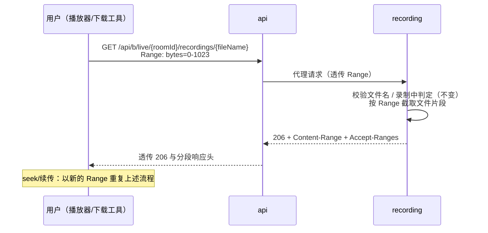

# 录播文件下载支持 Range 分段下载（recording-download-range）

**功能名称**: 录播文件下载支持 Range
**PRD 版本**: v1.0
**创建日期**: 2026-09-14
**作者**: Z.Vtuber Workflow Agent

## 背景与目标

### 1.1 背景

「B站直播录播」功能（PRD：`docs/product/draft/20260913-live-recording-prd.md`）已上线，录播文件经「`GET /api/b/live/{roomId}/recordings/{fileName}`」对外提供下载。

录播文件（尤其 RAW 原画）体积普遍在数百 MB 至数 GB。当前下载接口只支持「从头下整个文件」：

- 播放器/媒体工具打开录播 URL 时无法拖动进度条——每次 seek 都必须从头重新拉流；
- 下载中断后无法断点续传，数 GB 的文件一旦失败只能全部重下；
- 想截取/校验文件某一片段时只能先下载完整文件。

### 1.2 目标

- 录播下载接口支持标准 HTTP Range 请求：客户端可指定字节区间下载文件片段；
- 不支持 Range 的旧客户端行为完全不变（仍返回完整文件）；
- 对非法/越界的 Range 请求给出明确的标准错误响应。

### 1.3 成功标准

- 带 `Range: bytes=<start>-<end>` 请求下载接口，返回 206 与对应字节内容，且 `Content-Range` 头部与实际返回区间一致；
- 响应携带 `Accept-Ranges: bytes`，客户端可据此探知服务端支持分段下载；
- 区间越界（如起始位置超过文件大小）返回 416；
- 不带 Range 的请求、录制中文件 400、文件不存在 404、非法文件名 400 等既有行为全部不回归。

## 用户分析

### 2.1 目标用户

平台运营者 / 主播内容归档用户（自用场景），以及调用该接口的下载/播放工具。

### 2.2 用户场景

| 场景 | 用户角色 | 目标 | 痛点 |
|--|--|--|--|
| 在线播放录播并拖动进度 | 运营者 | 在播放器中直接打开录播 URL 并随意 seek | 不支持分段，seek 即重新从头加载 |
| 大文件断点续传 | 运营者 | 下载中断后从中断位置继续 | 失败后只能从头重下数 GB 文件 |
| 下载工具多线程加速 | 运营者 | aria2/IDM 等工具分片并发下载 | 服务端不支持 Range，无法分片 |
| 抽取文件片段校验 | 运营者 | 只取文件头部若干字节确认编码/完整性 | 必须下载完整文件 |

## 功能需求

### 3.1 功能概述

录播文件下载接口支持 HTTP Range（字节区间）请求：请求带 `Range` 头时返回对应片段（206），不带时返回完整文件（200，现状不变），区间无法满足时返回 416。

### 3.2 功能列表

#### 功能点 1: 单区间 Range 下载

- **描述**: 「`GET /api/b/live/{roomId}/recordings/{fileName}`」接受 `Range: bytes=<start>-<end>`、`bytes=<start>-`、`bytes=-<suffix>` 三种标准单区间形式：
  - 区间合法时返回 206 Partial Content，响应体为对应字节片段；
  - 响应携带 `Content-Range: bytes <start>-<end>/<total>`、`Accept-Ranges: bytes` 与正确的 `Content-Length`；
  - 不带 `Range` 头的请求仍返回 200 完整文件（现状不变），响应同样携带 `Accept-Ranges: bytes`，便于客户端探知能力。
- **用户价值**: 播放器可拖动进度条，下载工具可断点续传与分片下载。
- **验收标准**:
  - [ ] `Range: bytes=0-1023` 返回 206，响应体恰为文件前 1024 字节，`Content-Range: bytes 0-1023/<total>`；
  - [ ] `Range: bytes=<start>-`（省略结尾）与 `Range: bytes=-<suffix>`（尾部 N 字节）语义正确；
  - [ ] 不带 Range 返回 200 完整文件且带 `Accept-Ranges: bytes`；
  - [ ] 经 api 代理后上述状态码与 `Content-Range`/`Accept-Ranges`/`Content-Length` 头部完整保留。

#### 功能点 2: 越界与非法区间返回 416

- **描述**: 区间无法满足时（起始位置 ≥ 文件大小、区间为空等）返回 416 Range Not Satisfiable，并携带 `Content-Range: bytes */<total>` 提示文件实际大小。
- **用户价值**: 客户端获得明确的标准错误，而非拿到错误数据或被改写为服务端故障。
- **验收标准**:
  - [ ] 起始位置超出文件大小时返回 416，`Content-Range: bytes */<total>` 中 total 与文件实际大小一致；
  - [ ] 416 响应经 api 代理后不被改写为 502；
  - [ ] 格式非法的 Range 头按 HTTP 语义处理（视为无 Range 返回 200 或按标准忽略），不得返回 5xx。

#### 功能点 3: 既有行为不回归

- **描述**: Range 支持不得影响既有约束：录制中文件仍 400（含经代理透传）、文件不存在仍 404、非法文件名仍 400、recording 不可达仍 502。
- **用户价值**: 下载安全语义不被新能力削弱。
- **验收标准**:
  - [ ] 带 Range 请求录制中文件仍返回 400；
  - [ ] 带 Range 请求不存在文件仍返回 404；
  - [ ] 带 Range 且文件名非法仍返回 400。

### 3.3 用户操作流程

### 3.4 页面/界面描述

无页面变更。web 录制状态页的下载链接保持不变，Range 能力由浏览器/播放器/下载工具在访问下载 URL 时自动使用。

### 3.5 异常与边界情况

| 情况 | 预期行为 |
|------|---------|
| 不带 Range | 200 完整文件（现状不变），带 `Accept-Ranges: bytes` |
| 单区间合法 | 206 + 片段 + `Content-Range` |
| 区间越界 / 空区间 | 416 + `Content-Range: bytes */<total>` |
| Range 头格式非法 | 按 HTTP 标准忽略该头，返回 200 完整文件；不得 5xx |
| 多重区间（multipart/byteranges） | 不支持，按标准回退为 200 完整文件；不返回 multipart 响应 |
| 带 Range 请求录制中文件 | 400「文件正在录制中无法下载」（与现状一致） |
| 带 Range 请求不存在文件 / 非法文件名 | 404 / 400（与现状一致） |
| recording 服务不可达 | 502（与现状一致） |
| 下载中途客户端断开 | 服务端正常终止响应，不产生错误日志噪音（与现状一致） |

## 四、非功能需求

### 4.1 性能要求

- Range 请求只读取并传输所请求的字节区间，不得为分段请求而整文件载入内存或全量读取；
- 分段下载链路的吞吐与内存占用与现有流式下载同量级。

### 4.2 安全性要求

- 沿用既有平文件名校验与路径穿越防护，Range 处理不引入新的文件访问面；
- 416 响应仅暴露文件总大小（合法下载者本即可获知），不泄露服务器路径等内部信息。

### 4.3 兼容性要求

- 完全向后兼容：不带 Range 的客户端行为不变；
- 契约 `contracts/recording.openapi.yaml` 与 `contracts/bilibili-crawler.openapi.yaml` 同步补充 Range/206/416 语义；
- 多重区间本期不支持（标准允许回退整文件，客户端可退化为单区间或整文件下载）。

## 五、依赖与约束

### 5.1 依赖

- 既有录播下载链路（recording 下载端点 + api 流式代理，已合入 main）。

### 5.2 约束

- 遵循契约式开发：先改契约，再改实现；
- 遵循归属约定：文件读取与 Range 响应在 `servers/recording`，请求头/响应头透传在 `servers/api`；
- 不改动录制流程与状态上报语义；web 端无变更。

## 六、相关文档

- 技术提案: `docs/engineering/proposals/20260914-proposal-recording-download-range.md`
- 录播功能 PRD: `docs/product/draft/20260913-live-recording-prd.md`
- 录播列表元信息 PRD: `docs/product/draft/20260914-recording-file-list-metadata-prd.md`
