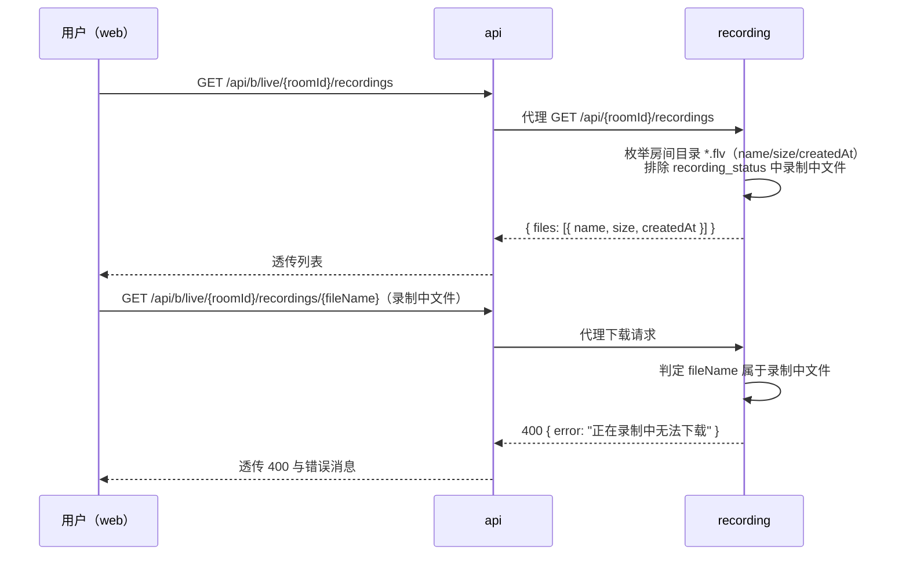

# 录播文件列表接口提供更多信息（recording-file-list-metadata）

**功能名称**: 录播文件列表接口提供更多信息
**PRD 版本**: v1.0
**创建日期**: 2026-09-14
**作者**: Z.Vtuber Workflow Agent

## 背景与目标

### 1.1 背景

「B站直播录播」功能（PRD：`docs/product/draft/20260913-live-recording-prd.md`）已上线：recording 服务产出 RAW/AV1 录播文件，api 代理提供「`GET /api/b/live/{roomId}/recordings`」（文件列表）与「`GET /api/b/live/{roomId}/recordings/{fileName}`」（文件下载），web 录制状态页展示并可下载录播文件。

当前实现有两个问题：

- **列表信息过少**：列表接口仅返回文件名字符串数组（`{ files: string[] }`），用户在页面上无法获知每个录播文件的大小与产出时间，无法判断文件是否完整录制、占用多少存储；
- **录制中文件可被下载**：正在录制中的文件（ffmpeg 仍在写入）也会出现在列表里并可被下载，下载到的是一个不完整、且内容还在持续变化的文件，对用户没有价值还容易误判为「文件损坏」。

### 1.2 目标

- 录播文件列表接口提供文件元信息：响应结构改为 `{ files: Array<{ name, size, createdAt }> }`，包含文件名、文件大小（字节）与创建时间；
- 正在录制的文件不出现在列表中；
- 通过下载接口访问正在录制的文件时返回 400，并明确提示「这个文件正在录制中无法下载」。

### 1.3 成功标准

- 调用「`GET /api/b/live/{roomId}/recordings`」返回的每个元素均含 `name`、`size`、`createdAt` 三个字段，数值与磁盘上实际文件一致；
- 某房间正在录制时，其当前场次的录播文件（RAW 与 AV1）均不出现在列表中；录制结束后（下播/录制终止）文件出现在列表中且可正常下载；
- 录制进行中直接请求「`GET /api/b/live/{roomId}/recordings/{fileName}`」访问该文件，返回 400，错误消息明确表达「文件正在录制中，无法下载」；
- web 录制状态页适配新响应结构，文件列表正常展示并显示文件大小，不再出现录制中的文件。

## 用户分析

### 2.1 目标用户

平台运营者 / 主播内容归档用户（自用场景）。

### 2.2 用户场景

| 场景 | 用户角色 | 目标 | 痛点 |
|--|--|--|--|
| 浏览历史录播 | 运营者 | 看到每个文件的大小与产出时间，评估存储占用与录制时长 | 列表只有文件名，无大小信息 |
| 下载录播归档 | 运营者 | 下载到完整的录播文件 | 录制中的文件也能下载，拿到不完整文件 |
| 直播进行中查看录播页 | 运营者 | 列表只呈现可安全下载的已完成文件 | 录制中文件混入列表，无法区分是否可下载 |

## 功能需求

### 3.1 功能概述

升级录播文件列表与下载接口：列表返回文件元信息对象数组（含大小与创建时间）；以 recording 服务的录制状态（`recording_status` 集合）为准判定「正在录制的文件」，将其从列表中排除，并对录制中文件的下载请求返回 400。api 代理层透传新结构与 400 响应；web 录制状态页适配新结构并展示文件大小。

### 3.2 功能列表

#### 功能点 1: 列表接口返回文件元信息

- **描述**: 「`GET /api/b/live/{roomId}/recordings`」响应由 `{ files: string[] }` 改为 `{ files: Array<{ name, size, createdAt }> }`：
  - `name`：文件名（现状不变，仅平文件名）；
  - `size`：文件大小，单位字节，整数；
  - `createdAt`：文件创建时间（ISO 8601，UTC）。
  列表排序维持按文件名升序。无录播时返回空数组（现状不变）。
- **用户价值**: 用户可直接看到每个录播文件的大小与时间，无需登录服务器查看。
- **验收标准**:
  - [ ] 响应每个元素含 `name`/`size`/`createdAt` 三字段，`size` 与磁盘文件实际字节数一致；
  - [ ] `createdAt` 为合法 ISO 8601 时间且与文件创建时间一致；
  - [ ] 排序与现状一致（文件名升序）；空目录仍返回 `{ "files": [] }`。

#### 功能点 2: 录制中文件不出现在列表中

- **描述**: 录制中的文件（当前场次正在写入的 RAW/AV1 文件）不出现在列表接口的 `files` 中。判定依据：recording 服务以 `recording_status` 集合中该房间的状态记录为准——状态为「录制中」且心跳未过期时，其记录的文件名列表即为录制中文件。录制结束后文件自动出现在列表中。
- **用户价值**: 列表即「可下载清单」，所见即可下得。
- **验收标准**:
  - [ ] 房间录制进行中，列表不包含当前场次的任何产出文件；
  - [ ] 房间未在录制（或录制状态已过期失效）时，历史文件完整出现在列表中；
  - [ ] 录制结束（下播/异常终止）后，该场次文件出现在列表中。

#### 功能点 3: 录制中文件下载返回 400

- **描述**: 对「`GET /api/b/live/{roomId}/recordings/{fileName}`」，当 `fileName` 指向正在录制的文件时，返回 400，响应体中的错误消息明确表达「这个文件正在录制中无法下载」（语义即可，具体文案以实现为准）。已完成的文件下载行为不变（200 流式下载、不存在 404、非法文件名 400）。
- **用户价值**: 明确的错误提示替代「下载到一个不完整文件」的静默错误。
- **验收标准**:
  - [ ] 录制中文件的下载请求经 api 代理后返回 400（而非 502 或 200）；
  - [ ] 400 响应体含错误消息，语义为「文件正在录制中无法下载」；
  - [ ] 录制结束后同一文件可正常 200 下载；
  - [ ] 文件不存在仍返回 404，非法文件名仍返回 400，行为不回归。

#### 功能点 4: web 录制状态页适配

- **描述**: web 端适配列表接口新结构：录播文件列表按 `name` 渲染下载链接，并展示格式化后的文件大小（如 `1.2 GB`）；类型定义经契约 codegen 重新生成。录制中文件本就由功能点 2 排除，页面无需额外处理。
- **用户价值**: 页面直观呈现文件大小，且不出现录制中的文件。
- **验收标准**:
  - [ ] 录制状态页文件列表正常渲染，展示文件名与格式化大小；
  - [ ] 下载链接行为不变；录制中的房间列表里不出现当前场次文件。

### 3.3 用户操作流程

### 3.4 页面/界面描述

录制状态页（既有页面）录播文件列表：每行展示文件名、格式化文件大小与下载入口；创建时间是否展示由实现期按页面空间决定（不做强制要求）。

### 3.5 异常与边界情况

| 情况 | 预期行为 |
|------|---------|
| 房间从未录制 / 目录不存在 | 列表返回 `{ "files": [] }`（现状不变） |
| 房间正在录制，目录中已有当前场次的半成品文件 | 这些文件不出现在列表中；按文件名直接下载返回 400 |
| 录制状态记录心跳过期（实例崩溃残留「录制中」状态） | 视为未在录制，文件正常出现在列表并可下载（与 recording-status 接口的陈旧退化口径一致） |
| 上一场次已完成文件与当前场次文件同时存在于目录 | 仅当前场次（录制中）文件被排除，历史文件正常列出 |
| 读取文件元信息失败（如文件在枚举瞬间被删除） | 跳过该文件，不影响其余文件返回 |
| 录制中文件下载请求经 api 代理 | api 透传 recording 的 400 与错误消息，不得改写为 502 |
| 滚动更新/多实例：另一实例正在录制本房间 | 以共享的 `recording_status` 集合判定，任一实例录制中均排除/拒绝，行为一致 |

## 四、非功能需求

### 4.1 性能要求

- 列表接口新增的开销仅为逐文件 `stat` 与一次状态记录读取，单房间文件数量级（数十至数百）下响应时间与现状同量级；
- 下载接口的录制中判定为一次单文档读取，不得引入可感知延迟。

### 4.2 可扩展性要求

- 文件元信息以对象承载，后续如需追加字段（如时长、码率）可在对象上增量扩展，不再变更数组元素类型。

### 4.3 安全性要求

- 沿用既有平文件名校验与路径穿越防护，不新增文件访问面；
- 错误消息不泄露服务器绝对路径等内部信息。

### 4.4 兼容性要求

- 列表接口响应结构为**破坏性变更**（`files` 元素由 string 变为 object）；消费方为本仓库 web 端，同步适配随本需求一并交付，无第三方消费者；
- 下载接口对已完成文件的行为完全不变；新增 400 场景此前等价于「下载到不完整文件」，无既有合法依赖；
- 契约 `contracts/recording.openapi.yaml` 与 `contracts/bilibili-crawler.openapi.yaml` 同步更新，web 生成类型随之重新生成。

## 五、依赖与约束

### 5.1 依赖

- 既有录播功能全貌（`feat/live-recording` 已合入 main）：recording 服务的文件枚举/下载、`recording_status` 集合与心跳上报、api 代理层、web 录制状态页；
- 「录制中」判定依赖 `RecordingStatusRecord.Files` 准确记录当前场次产出文件名（现状已满足：场次编排上报 RAW/AV1 文件名，终态保留已产出文件名）。

### 5.2 约束

- 遵循契约式开发：先改契约，再改实现，web 类型经 codegen 生成；
- 遵循归属约定：状态读取实体/仓储在 `servers/common`，录制中判定与文件元信息在 `servers/recording`，代理透传在 `servers/api`，展示适配在 `apps/web`；
- 不改动录制流程本身（ffmpeg 输出、锁、状态上报语义不变）。

## 六、相关文档

- 技术提案: `docs/engineering/proposals/20260914-proposal-recording-file-list-metadata.md`
- 录播功能 PRD: `docs/product/draft/20260913-live-recording-prd.md`
- 录播功能技术提案: `docs/engineering/proposals/20260913-proposal-live-recording.md`
