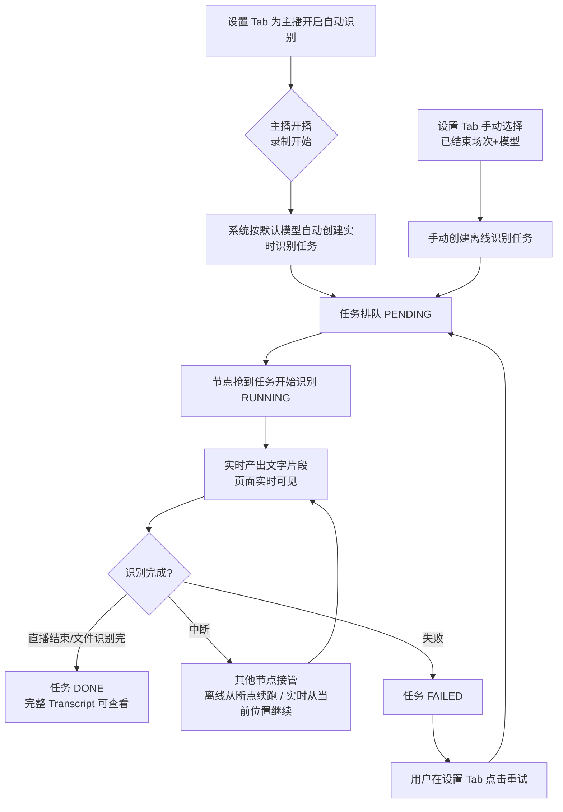

# 直播录播语音转写（Transcript）

**功能名称**: 直播录播语音转写
**PRD 版本**: v1.0
**创建日期**: 2026-09-16
**作者**: Z.Vtuber Workflow Agent

## 背景与目标

### 1.1 背景

平台已具备 B 站直播录播能力，每场直播产出可回看的录播文件。但录播只有音视频，缺少文字化的内容沉淀：用户无法快速检索某场直播中说了什么，也无法基于文字内容做后续加工（摘录、搜索、二次创作）。需要引入语音转写能力，将录播音频识别为带时间轴的文字片段（Segments）。

### 1.2 目标

- 每场直播录播可生成一份或多份转写结果（Transcript），同一场录播下「模型 + Transcript」唯一，即同一模型对同一场录播只有一份结果；不同模型可各出一份；
- 用户可对指定主播启用「自动识别」：该主播开播（录制开始）时，系统自动创建一个识别任务并即刻开始实时识别，直播进行中即可看到实时产出的文字片段；直播结束后任务自然完成，形成该场完整 Transcript。历史录播不追溯处理；
- 用户可对任意一场录播手动发起识别（即使未启用自动识别），手动发起时需选择一个模型；
- 识别任务支持断点续跑：服务重启或宕机后，任务从上次识别到的位置继续，不重头开始、不丢失已识别内容；
- 同一时刻一个识别任务只允许在一个服务节点上运行，节点异常死亡后任务能被其他节点接管；
- 用户可在页面上查看任务进度与实时识别出的文字片段，可对失败任务进行重试；
- 用户可维护可用的识别模型配置（启用/禁用、默认模型、最大并发）。

### 1.3 成功标准

- 对已启用自动识别的主播，开播后 1 分钟内自动开始实时识别，直播进行中页面可持续看到新识别出的文字片段；下播后该场 Transcript 完整可查；
- 识别任务中断（服务重启/宕机）后被自动接管，从断点位置续跑，已识别的文字片段不重复、不丢失；
- 同一任务在任意时刻最多被一个节点执行；
- 页面可看到进行中的任务及其实时产出的文字片段，失败任务可一键重试；
- 默认可用模型为 qwen-fun-asr-streaming，配置 API Key 后即可识别；新模型可在页面添加并设为默认。

## 用户分析

### 2.1 目标用户

平台运营者 / 主播内容归档用户（自用场景）。

### 2.2 用户场景

| 场景 | 用户角色 | 目标 | 痛点 |
|--|--|--|--|
| 主播开播即自动获得实时文字记录 | 运营者 | 启用一次后每场直播开播即转写，直播中可看实时文字，下播即有完整文稿 | 人工发起繁琐易遗漏；下播后才能看到文字太滞后 |
| 对某场重要直播单独转写 | 运营者 | 手动选一场录播、选一个模型发起识别 | 未开启自动识别的主播无法转写 |
| 跟踪识别进度 | 运营者 | 实时看到任务跑到哪、已识别出什么文字 | 长任务黑盒，不知是否正常 |
| 任务失败后恢复 | 运营者 | 失败任务一键重试 | 失败即丢，需要重新发起 |
| 长录播识别中断 | 运营者 | 服务重启后从断点继续 | 重头识别浪费配额与时间 |
| 对比不同模型效果 | 运营者 | 同一场录播用不同模型各出一份转写 | 单一模型无法横向比较 |

## 功能需求

### 3.1 功能概述

为直播增加语音转写能力：直播场次被结构化归档（主播、场次名、录播文件），用户可按主播启用自动识别——开播即开始实时识别，直播进行中文字片段实时产出；也可对任意已归档场次手动发起识别。识别任务进入队列由后台服务逐个处理，支持断点续跑与失败重试；识别产出的带时间轴文字片段实时可见，并沉淀为该场直播的 Transcript。

### 3.2 功能列表

#### 功能点 1: 录播场次归档

- **描述**: 每次开始录播时，系统将该场录播记录为一条「录播场次」：包含场次标题、主播（room_id、mid）与产出的录播文件列表。存量历史录播通过一次性数据清洗补齐归档（按录播文件的创建时间与既有直播场次数据按 RoomId + 时间匹配）。
- **用户价值**: 录播从「磁盘上的文件」变成「可检索、可关联的场次」，是转写、下载、后续内容加工的索引基础。
- **验收标准**:
  - [ ] 新开播的录播自动产生归档记录，标题/主播/文件齐全；
  - [ ] 存量录播经清洗后可在归档中查到，场次归属（主播 + 场次）匹配正确；
  - [ ] 同一场录播的原始版与压缩版文件归属同一条归档。

#### 功能点 2: 按主播启用自动识别（开播即实时识别）

- **描述**: 在设置中可选择某个主播启用自动识别。启用后，该主播开播（录制开始）时，系统自动按当前默认模型创建一个识别任务并即刻开始实时识别：识别源为直播的实时音频，直播进行中文字片段持续产出、页面实时可见；主播下播（录制结束）后任务自动完成，形成该场完整 Transcript。启用之前的历史录播不自动补跑。
- **用户价值**: 一次配置，持续关注的主播每场直播开播即有实时文字记录，无需等下播。
- **验收标准**:
  - [ ] 可对任意主播开启/关闭自动识别；
  - [ ] 开启后该主播开播自动出现识别任务并开始实时产出片段，模型为当前默认模型；
  - [ ] 下播后任务自动完成，Transcript 覆盖整场直播（除识别服务中断期间的缺口）；
  - [ ] 开启前的历史录播不产生自动任务；
  - [ ] 识别服务临时不可用期间开播的直播，在服务恢复后仍能补建任务继续识别，不遗漏整场。

#### 功能点 3: 手动发起识别

- **描述**: 用户可选择某主播的某一场已结束直播的录播，手动发起识别（对录播文件离线识别）。发起时必须选择一个模型；同一场直播 + 同一模型只允许存在一份转写（重复发起被拒绝或指向已有任务）。未启用自动识别的主播也可手动发起。进行中直播的实时识别由「自动识别」承载，手动发起面向已结束场次。
- **用户价值**: 按需转写，灵活补跑或换模型重跑。
- **验收标准**:
  - [ ] 可选择主播 → 场次 → 模型发起识别，任务进入队列；
  - [ ] 同一场直播同一模型重复发起不产生第二份转写（含该场已有实时识别任务的情况）；
  - [ ] 同一场直播可用不同模型各发起一次，产出多份转写。

#### 功能点 4: 识别任务队列与断点续跑

- **描述**: 识别任务按创建顺序排队处理，任务状态为 PENDING / RUNNING / DONE / FAILED。任务分两种形态：实时任务（开播自动创建，以直播实时音频为源）与离线任务（手动发起，以录播文件为源）。一个任务同一时刻只允许在一个节点运行；节点通过持锁表明自己在处理，锁需自行续期，锁丢失视为该节点已死亡。有定时巡检扫描 PENDING 任务和「RUNNING 但无人持锁」的任务继续处理。任务记录识别位置（断点），识别以「句」为单位产出，断点始终落在句尾，已入库的文字片段不重写。中断续跑语义按形态区分：离线任务从断点精确续跑；实时任务被接管后从直播的当前位置继续识别（中断期间的直播内容不回溯补识别）；若接管时直播已结束，则从断点起对录播文件补齐剩余部分后完成。
- **用户价值**: 实时识别与长录播识别都稳定可靠，服务升级/宕机不丢已有进度。
- **验收标准**:
  - [ ] 多节点部署时同一任务仅一个节点在执行；
  - [ ] 节点宕机后其任务被其他节点接管：离线任务从断点续跑，实时任务从直播当前位置继续；
  - [ ] 续跑后已识别的文字片段不重复；
  - [ ] 实时任务在直播结束后自动完成；离线任务完成后结果覆盖整场录播音频。

#### 功能点 5: Transcripts 页面 - 任务列表 Tab

- **描述**: Web 新增「Transcripts」导航。任务列表 Tab 展示识别任务（进行中优先），可查看单个任务的实时识别片段：片段带起止时间与文字内容，任务运行中片段实时追加展示。
- **用户价值**: 一页掌握所有识别任务的进度与产出。
- **验收标准**:
  - [ ] 任务列表展示任务状态、主播/场次、模型、进度位置；
  - [ ] 进行中的任务可实时看到新识别出的片段，无需刷新页面；
  - [ ] 已完成任务可查看完整文字片段列表。

#### 功能点 6: Transcripts 页面 - 设置 Tab

- **描述**: 设置 Tab 分两个区块：
  - 识别设置：管理各主播的自动识别开关；手动选择主播的某场直播发起识别；查看某场直播已有的识别任务，并对 FAILED 任务重试（重试后任务重新进入处理）。
  - 模型设置：列出全部已配置模型，支持「添加模型」。模型公共属性：启用/禁用、设为默认、最大并发。当前仅内置 qwen-fun-asr-streaming（阿里云 FunASR 流式识别），需配置 API Key，类型为 streaming。
- **用户价值**: 识别行为与模型资源集中管理。
- **验收标准**:
  - [ ] 自动识别开关按主播展示并可切换；
  - [ ] 手动发起入口可选场次与模型；
  - [ ] FAILED 任务可重试，重试后任务重新被处理；
  - [ ] 模型可添加、启用/禁用、设默认、设置最大并发；禁用或删除中的模型不能被新任务选择。

### 3.3 用户操作流程

### 3.4 页面/界面描述

| 页面 | 描述 | 关键元素 |
|------|------|---------|
| Transcripts - 任务列表 Tab（新增） | 识别任务总览与实时片段 | 任务列表（状态/场次/模型/进度）、任务详情片段流（时间轴 + 文字，实时追加） |
| Transcripts - 设置 Tab / 识别设置（新增） | 自动识别与手动发起 | 主播自动识别开关列表、场次选择器、模型选择器、某场直播的任务列表、FAILED 重试按钮 |
| Transcripts - 设置 Tab / 模型设置（新增） | 模型配置管理 | 模型列表（名称/类型/启用/默认/最大并发）、添加模型按钮、模型编辑表单（含 API Key） |

### 3.5 异常与边界情况

| 情况 | 预期行为 |
|------|---------|
| 识别节点宕机/升级 | 任务锁过期后被其他节点接管：离线任务从断点续跑；实时任务从直播当前位置继续，中断期间内容不回溯 |
| 实时识别中断期间直播仍在进行 | 接管后继续识别后续内容，中断窗口形成缺口，不补识别 |
| 实时任务接管/开始时直播已结束 | 从断点起对录播文件补齐剩余部分后完成，保证整场覆盖 |
| 录播文件缺失或不可读 | 任务置为 FAILED，标注原因，可重试 |
| 模型 API Key 失效/配额耗尽 | 任务置为 FAILED 并标注原因；修复后可重试 |
| 同一场直播 + 同一模型重复发起 | 不产生第二份转写，提示已有任务/结果 |
| 模型被禁用 | 进行中的任务继续完成；新任务不可再选该模型 |
| 识别服务恢复时发现漏掉的开播/结束事件 | 自动补建任务继续识别（自动识别开启的场次不遗漏整场） |
| 断点续跑时上次写入的末尾片段 | 已入库片段不重复写入 |
| 无音频轨或音频过短的录播 | 任务正常结束（DONE），结果可为空片段列表 |

## 四、非功能需求

### 4.1 性能要求

- 单任务识别速度不低于实时倍速的 1x（1 小时录播识别耗时不超过 1 小时）；
- 实时片段从识别产出到页面可见的延迟在秒级；
- 7×24 运行内存稳定，任务数量增长不导致巡检明显变慢。

### 4.2 安全性要求

- 模型 API Key 等凭据仅服务端存储与使用，不在页面响应中回显明文。

### 4.3 兼容性要求

- 不影响既有录播、弹幕、订阅等功能；未启用识别的行为与现状一致。

## 五、依赖与约束

### 5.1 依赖

- 既有直播录播能力（录播文件产出、录制开始/结束状态变更、直播中实时音频收听）；
- 阿里云 FunASR 流式识别服务（qwen-fun-asr-streaming）及有效 API Key。

### 5.2 约束

- 同一场直播 + 同一模型仅一份转写；
- 一个识别任务同一时刻仅在一个节点运行；
- 断点以句为单位，续跑从句尾开始；
- 实时识别中断期间的直播内容不回溯补识别；
- 历史录播不自动补跑，仅可手动发起。

## 六、相关文档

- 技术提案：[[20260916-proposal-recording-transcript]]（docs/engineering/proposals/20260916-proposal-recording-transcript.md）
- 关联 PRD：[[20260913-live-recording-prd]]（docs/product/draft/20260913-live-recording-prd.md）
