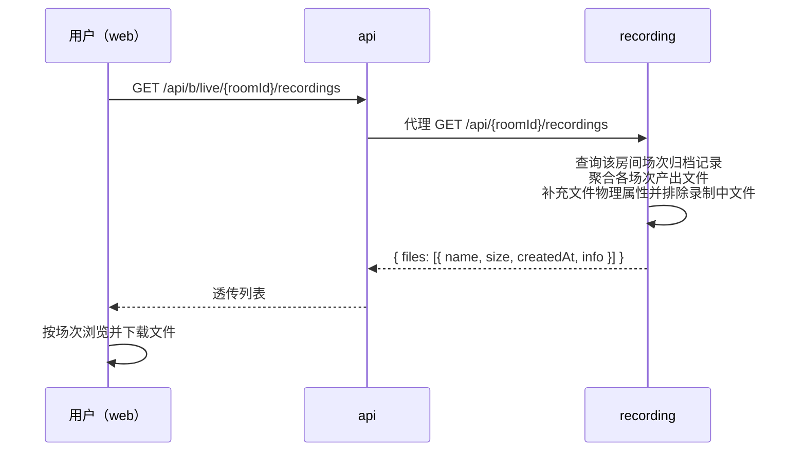

# 录播列表接口获取数据方式更新（recording-list-info）

**功能名称**: 录播列表接口获取数据方式更新
**PRD 版本**: v1.0
**创建日期**: 2026-09-17
**作者**: Z.Vtuber Workflow Agent

## 背景与目标

### 1.1 背景

「B站直播录播」功能已上线并持续迭代：recording 服务在每场直播录制时向 `recordings` 集合归档一条场次记录（含房间号、主播 mid、场次标题、产出文件名列表、开播/结束时间），存量历史文件也已通过一次性清洗迁移完成归档（PRD：`docs/product/draft/20260913-live-recording-prd.md`、`docs/product/draft/20260916-recording-transcript-prd.md`）。

但录播文件列表接口「`GET /api/b/live/{roomId}/recordings`」目前仍通过**枚举磁盘目录**的方式取数，仅返回文件的物理属性（`name`、`size`、`createdAt`）。这带来两个问题：

- **列表缺乏场次语义**：用户在页面上只能看到一串文件名，无法知道每个文件属于哪一场直播、那场直播的标题与起止时间，浏览与归档效率低；
- **双数据源口径不一致**：文件归档信息已存在于场次记录中，列表却从磁盘重新枚举，文件与场次的对应关系需要用户自行从文件名推断。

### 1.2 目标

- 录播列表接口的数据源切换为 `recordings` 场次归档表：按房间查询场次记录，聚合各场次的产出文件列表；
- 列表中每个文件在原有 `name`、`size`、`createdAt` 基础上增加 `info` 字段，填入该文件所属场次的归档信息（场次标识、标题、主播、开播/结束时间）；
- web 录制状态页适配新结构，展示文件所属场次信息。

### 1.3 成功标准

- 调用「`GET /api/b/live/{roomId}/recordings`」返回的每个元素均含 `name`、`size`、`createdAt`、`info` 字段，其中 `info` 与该文件所属场次的归档记录一致；
- 列表完整覆盖该房间全部已归档场次的产出文件；录制进行中的文件仍不出现在列表中（现状语义不变）；
- web 录制状态页正常渲染新结构，可辨识每个文件所属的直播场次。

## 用户分析

### 2.1 目标用户

平台运营者 / 主播内容归档用户（自用场景）。

### 2.2 用户场景

| 场景 | 用户角色 | 目标 | 痛点 |
|--|--|--|--|
| 浏览历史录播 | 运营者 | 知道每个文件属于哪场直播（标题、时间） | 列表只有文件名与物理属性，无场次信息 |
| 下载特定场次录播 | 运营者 | 按场次定位并下载文件 | 需从文件名自行推断场次归属 |
| 核对录播完整性 | 运营者 | 对照场次起止时间确认文件是否完整录制 | 无场次起止时间可参考 |

## 功能需求

### 3.1 功能概述

将录播文件列表接口的取数方式由「枚举磁盘目录」改为「查询场次归档记录并聚合其产出文件」，并为每个文件扩展所属场次的归档信息（`info`）；文件大小与创建时间等物理属性仍如实提供。api 代理层透传新结构；web 录制状态页适配并展示场次信息。

### 3.2 功能列表

#### 功能点 1: 列表数据源切换为场次归档

- **描述**: 「`GET /api/b/live/{roomId}/recordings`」不再枚举磁盘目录，改为查询该房间的录播场次归档记录，聚合各场次的产出文件形成列表：
  - 列表覆盖该房间全部已归档场次的产出文件；
  - 文件的 `size`、`createdAt` 仍提供且与磁盘实际文件一致；
  - 归档记录中的文件若磁盘上已不存在（被外部清理），则不出现在列表中；
  - 磁盘上存在但未归档到任何场次的文件，不再出现在列表中；
  - 排序由「文件名升序」调整为「按场次开播时间倒序，同一场次内按文件名升序」，最新场次在前。
- **用户价值**: 列表即「场次归档视图」，与录制链路的归档数据同源，口径一致。
- **验收标准**:
  - [ ] 列表内容来自场次归档记录，覆盖该房间全部已归档场次的产出文件；
  - [ ] 每个文件的 `size`/`createdAt` 与磁盘实际一致；
  - [ ] 磁盘缺失的文件不出现；排序为场次开播时间倒序、场内文件名升序；
  - [ ] 无录播时仍返回 `{ "files": [] }`。

#### 功能点 2: 文件扩展所属场次信息（info）

- **描述**: 列表中每个文件元素新增 `info` 字段，填入该文件所属场次的归档信息：
  - `recordingId`：场次归档记录标识；
  - `title`：场次标题（直播标题）；
  - `mid`：主播 mid；
  - `startedAt`：场次开播（录制开始）时间（ISO 8601，UTC）；
  - `endedAt`：场次结束时间（ISO 8601，UTC；未正常收尾的场次为 null）。
- **用户价值**: 用户可直接看到每个文件属于哪场直播、直播标题与起止时间，无需推断。
- **验收标准**:
  - [ ] 每个文件元素均含 `info` 字段，内容与该文件所属场次的归档记录一致；
  - [ ] 同一场次的多个文件（RAW 与 AV1）具有相同的 `info`；
  - [ ] 未正常收尾场次的文件 `info.endedAt` 为 null，其余字段正常。

#### 功能点 3: 录制中文件排除语义不变

- **描述**: 正在录制中的文件（当前场次正在写入的 RAW/AV1 文件）仍不出现在列表中，判定口径与现状一致（以录制状态为准）；录制结束后文件随场次归档出现在列表中。下载接口行为完全不变。
- **用户价值**: 列表仍为「可安全下载清单」，本次仅变更取数方式与信息量，不改变可用性语义。
- **验收标准**:
  - [ ] 房间录制进行中，列表不包含当前场次的任何产出文件；
  - [ ] 录制结束（下播/异常终止）后，该场次文件出现在列表中且 `info` 完整；
  - [ ] 下载接口（含录制中文件 400、Range 分段下载）行为不回归。

#### 功能点 4: web 录制状态页适配

- **描述**: web 端适配列表接口新结构：录播文件列表在文件名与大小之外，展示所属场次信息（场次标题，开播/结束时间按页面空间展示）；类型定义经契约 codegen 重新生成。
- **用户价值**: 页面直观呈现文件的场次归属，浏览与归档更高效。
- **验收标准**:
  - [ ] 录制状态页文件列表正常渲染，展示文件名、格式化大小与所属场次标题；
  - [ ] 下载链接行为不变；录制中的房间列表里不出现当前场次文件。

### 3.3 用户操作流程

### 3.4 页面/界面描述

录制状态页（既有页面）录播文件列表：每行展示文件名、格式化文件大小、所属场次标题与下载入口；场次开播/结束时间是否展示由实现期按页面空间决定（不做强制要求）。

### 3.5 异常与边界情况

| 情况 | 预期行为 |
|------|---------|
| 房间从未录制 / 无场次归档记录 | 列表返回 `{ "files": [] }`（现状不变） |
| 归档记录中的文件磁盘上已不存在 | 该文件不出现在列表中，不影响其余文件返回 |
| 磁盘上存在但未归档到任何场次的文件 | 不出现在列表中（数据源以场次归档为准） |
| 房间正在录制 | 当前场次文件不出现在列表中；历史场次文件正常列出且含 `info` |
| 场次未正常收尾（结束时间缺失） | 该场次文件正常列出，`info.endedAt` 为 null |
| 同一场次含 RAW 与 AV1 两个文件 | 两个文件均列出，`info` 相同，场内按文件名升序 |
| 读取文件物理属性失败（如文件在查询期间被删除） | 跳过该文件，不影响整体响应 |
| recording 服务不可达 | api 代理返回 502（现状不变） |

## 四、非功能需求

### 4.1 性能要求

- 列表接口为一次按房间的场次记录查询（已有按房间的索引）加逐文件物理属性读取，单房间场次数量级（数十至数百）下响应时间与现状同量级。

### 4.2 可扩展性要求

- `info` 以对象承载场次信息，后续如需追加字段（如时长、转写状态）可在对象上增量扩展，不再变更数组元素类型。

### 4.3 安全性要求

- 沿用既有平文件名校验与路径穿越防护，不新增文件访问面；
- `info` 仅包含场次归档的公开元信息（标题、主播标识、起止时间），不泄露内部实现细节。

### 4.4 兼容性要求

- 列表接口响应结构为**破坏性变更**（`files` 元素新增 `info` 字段且排序规则调整）；消费方为本仓库 web 端，同步适配随本需求一并交付，无第三方消费者；
- 下载接口行为完全不变；
- 契约 `contracts/recording.openapi.yaml` 与 `contracts/bilibili-crawler.openapi.yaml` 同步更新，web 生成类型随之重新生成。

## 五、依赖与约束

### 5.1 依赖

- 既有录播功能全貌：recording 服务的场次归档写入（开播归档、结束回写）、存量清洗迁移（历史文件已归档）、录制状态心跳、api 代理层、web 录制状态页；
- 列表完整性依赖「每场录制的产出文件均已归档到场次记录」——现状已满足（场次编排开播即归档文件名，存量文件经清洗迁移归档）。

### 5.2 约束

- 遵循契约式开发：先改契约，再改实现，web 类型经 codegen 生成；
- 不改动录制流程本身（ffmpeg 输出、锁、状态上报、归档写入语义不变）；
- 不改动下载接口与音频流接口。

## 六、相关文档

- 技术提案: `docs/engineering/proposals/20260917-proposal-recording-list-info.md`
- 录播功能 PRD: `docs/product/draft/20260913-live-recording-prd.md`
- 录播文件列表元信息 PRD: `docs/product/draft/20260914-recording-file-list-metadata-prd.md`
- 录播转写 PRD: `docs/product/draft/20260916-recording-transcript-prd.md`
