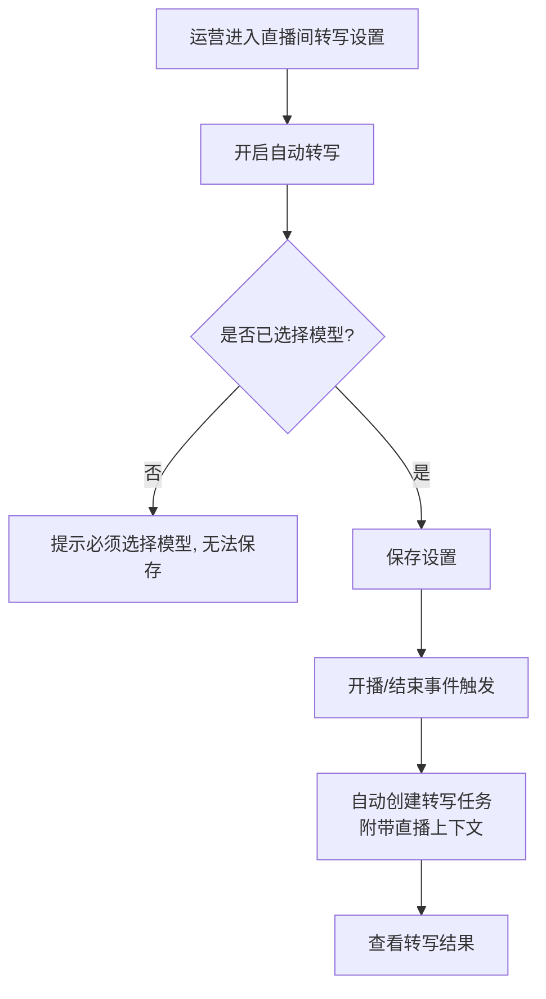

# Transcript 识别优化（显式模型 + 识别上下文）

**功能名称**: Transcript 识别优化
**PRD 版本**: v1.0
**创建日期**: 2026-09-17
**作者**: AI Agent

## 背景与目标

### 1.1 背景

Transcript（直播转写）功能上线后暴露出两个问题：

1. **存在"默认模型"兜底逻辑**：开启自动转写的直播间在未显式选择模型时，系统会使用一个兜底模型发起转写。兜底模型的计费与效果都不在用户预期之内，会产生意外费用。
2. **识别准确率不足**：直播场景中有大量专有名词（主播名称、观众昵称、粉丝牌名称、SuperChat 用语），通用识别模型对这些词的识别错误率较高。所使用的识别服务支持在发起识别时提前提供上下文（词表），可以利用直播周边的已有数据提升准确率。

本文档是对 [[20260916-recording-transcript-prd]] 的修订与增强，其中"按默认模型自动创建任务"的既有口径以本文档为准。

### 1.2 目标

1. 彻底移除"默认模型"概念：任何转写任务都必须绑定一个用户显式配置的模型，未配置模型时不得发起转写、不得产生任何识别计费。
2. 创建转写任务时，自动汇集当场直播的周边信息（主播名、舰长名单、SuperChat 相关信息）作为识别上下文提供给模型，提升专有名词识别准确率。

### 1.3 成功标准

- 系统中不再存在任何使用"默认/兜底模型"创建的转写任务；未显式配置模型的直播间不会触发自动转写。
- 抽取包含舰长名单、SuperChat 用户名的直播场次，开启上下文后的转写结果中这些专有名词的识别正确率较开启前有明显提升（人工抽测对比）。

## 用户分析

### 2.1 目标用户

- 站内运营/管理员：配置各直播间的自动转写与识别模型，关注识别效果与成本。

### 2.2 用户场景

| 场景 | 用户角色 | 目标 | 痛点 |
|--|--|--|--|
| 为直播间开启自动转写 | 运营 | 开播后自动获得转写结果 | 忘记选模型时被兜底模型扣费 |
| 查看转写结果 | 运营 | 转写文本可读、专有名词正确 | 主播名、观众昵称、SC 内容错识别 |
| 控制识别成本 | 运营 | 每一笔识别费用都对应自己选择的模型 | 兜底模型产生意外计费 |

## 功能需求

### 3.1 功能概述

一是强制所有转写任务显式绑定识别模型、移除默认模型兜底；二是在发起识别时自动附带当场直播的周边信息作为上下文，提高识别准确率。

### 3.2 功能列表

#### 功能点 1: 强制显式选择识别模型

- **描述**:
  - 开启某个直播间的自动转写时，必须同时选择一个识别模型；未选择模型则无法完成开启。
  - 手动发起转写时维持"必须选择模型"的既有要求。
  - 系统中移除"默认模型"的设置与概念，模型列表不再有默认标记。
  - 每个模型配置必须明确其实际使用的识别模型，不存在缺省值。
- **用户价值**: 每一笔识别费用都对应用户显式选择的模型，杜绝意外计费。
- **验收标准**:
  - [ ] 未选择模型时无法开启直播间的自动转写，界面有明确提示
  - [ ] 模型管理界面不再出现"设为默认"相关入口
  - [ ] 未配置模型的直播间在开播/结束时不会创建转写任务，且用户能感知到未生效

#### 功能点 2: 存量配置迁移

- **描述**: 升级前已开启自动转写、但未绑定模型的直播间配置，升级后进入"待完善"状态：自动转写暂停生效，用户在设置页补充选择模型后恢复。
- **用户价值**: 存量配置平滑过渡，不会在升级后继续产生兜底模型计费。
- **验收标准**:
  - [ ] 存量未绑定模型的自动转写配置升级后不再触发任务创建
  - [ ] 用户在设置页可识别并补全这些配置

#### 功能点 3: 识别上下文（周边信息热词）

- **描述**: 创建转写任务时，系统自动收集以下周边信息，去重后作为识别上下文提供给识别模型：
  1. 主播的名称
  2. 最新一天舰长的名字（一行一个名字）
  3. 当场直播期间发过 SuperChat 的用户名字及其粉丝牌（一行一个名字、一行一个粉丝牌）
  4. 当场直播期间发过的 SuperChat 内容（一行一条）
- **用户价值**: 专有名词识别准确率提升，转写结果更可用。
- **验收标准**:
  - [ ] 转写任务使用的上下文包含上述四类信息中可获取的部分
  - [ ] 信息按上述优先级排列；识别服务对上下文长度有限制时，优先保留高优先级内容，低优先级内容被舍弃
  - [ ] 上下文信息去重（同一名称/内容不重复出现）
  - [ ] 某类信息缺失（如无舰长快照、当场无 SC）时使用其余可用信息，不影响转写正常进行

### 3.3 用户操作流程

### 3.4 页面/界面描述

| 页面 | 描述 | 关键元素 |
|------|------|---------|
| 直播间转写设置 | 开启/关闭自动转写 | 模型选择（必填）、待完善状态提示 |
| 模型管理 | 管理识别模型 | 模型名称与实际识别模型均必填，无"默认"标记 |

### 3.5 异常与边界情况

| 情况 | 预期行为 |
|------|---------|
| 开启自动转写但未选模型 | 保存被拒绝并提示 |
| 存量配置未绑定模型 | 自动转写暂停生效，设置页显示待完善 |
| 所选模型被停用或删除 | 自动转写不再创建任务，设置页提示重新选择 |
| 上下文来源数据全部缺失 | 不附带上下文，转写正常进行 |
| 上下文超出识别服务长度限制 | 按优先级从高到低保留，超出部分舍弃 |

## 四、非功能需求

### 4.1 性能要求

上下文的收集与组装不应明显延迟转写任务的启动（秒级以内）。

### 4.2 安全性要求

识别上下文仅包含直播公开信息（主播名、观众昵称、粉丝牌、SC 内容），不包含敏感数据；上下文仅用于发起识别，不对外展示。

### 4.3 兼容性要求

存量未绑定模型的自动转写配置按功能点 2 迁移；已有转写任务与转写结果不受影响。

## 五、依赖与约束

### 5.1 依赖

- 识别服务需支持在发起识别时传入上下文（词表）能力，并对上下文长度有上限约束。
- 直播周边数据（主播信息、舰长名单、SuperChat 事件）由既有采集能力提供。

### 5.2 约束

- 上下文长度受识别服务限制，必须按优先级截断，不得超出上限。
- 直播进行中的实时转写在任务启动时取当时可用的周边信息快照；开播时尚未出现的 SC 不纳入。

## 六、相关文档

- [[20260916-recording-transcript-prd]]（本需求修订其"默认模型"口径）
