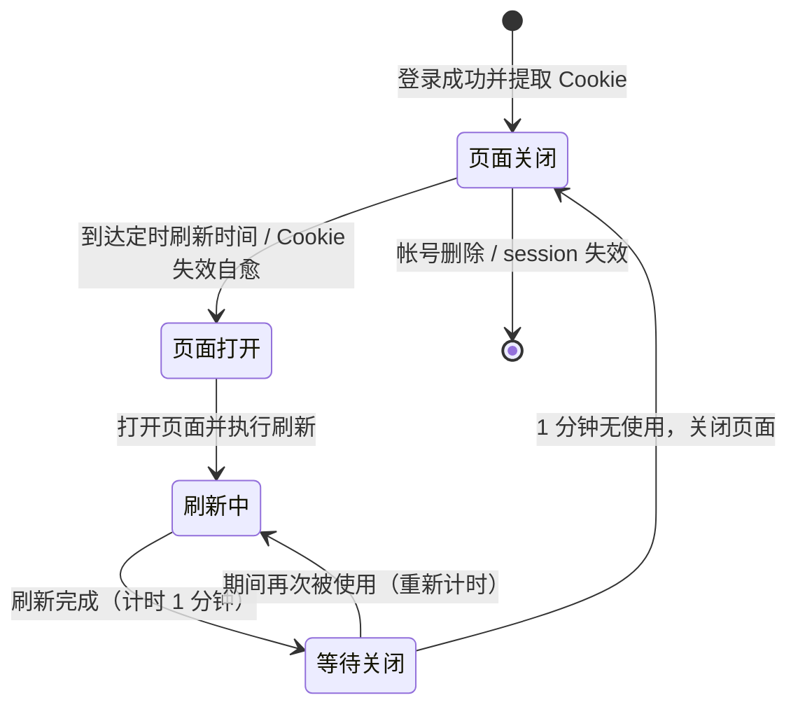

# 无头浏览器页面生命周期优化

**功能名称**: 无头浏览器页面生命周期优化
**PRD 版本**: v1.0
**创建日期**: 2026-09-18
**作者**: Deliay

## 背景与目标

### 1.1 背景

Cookie 管理服务通过无头浏览器维护各平台帐号的登录态：帐号扫码登录成功后，浏览器页面一直保持打开状态，供后续的定时刷新与失效自愈刷新复用。随着接入帐号数量增加，大量页面 7×24 小时常驻内存，而这些页面平均每 10 分钟才真正使用一次，造成大量内存浪费，限制了单实例可承载的帐号规模。

### 1.2 目标

- 无头浏览器页面改为「按需打开、用后延时关闭」：不再随帐号登录成功而长期常驻；
- 每次刷新（定时刷新、Cookie 失效触发的自愈刷新）时自动打开页面，刷新完成 1 分钟后关闭页面，下次刷新时再重新打开；
- 保留既有行为：每个 session 每 10 分钟进行一次刷新；Cookie 失效时自动打开页面进行一次阻塞式自愈刷新；
- 帐号登录态不因页面关闭而丢失（浏览器用户数据已持久化在磁盘，重新打开页面后登录态保持）。

### 1.3 成功标准

- 帐号登录成功且无需扫码的活跃 session，其浏览器页面在两次刷新之间处于关闭状态，内存占用随空闲时间显著下降；
- 定时刷新周期（每 10 分钟）与刷新成功率不因页面按需打开而下降；
- Cookie 失效自愈仍能同步返回新 Cookie，调用方感知不到行为变化（延迟在既有超时预算内）；
- 扫码登录中的 session 页面保持打开，扫码流程不受影响。

## 用户分析

### 2.1 目标用户

- **运维人员**：关注服务资源占用与稳定性，间接受益于内存占用下降；
- **平台维护者**：关心单实例可维护的帐号规模上限。

本功能为内部资源优化，无直接终端用户交互。

### 2.2 用户场景

| 场景 | 用户角色 | 目标 | 痛点 |
|--|--|--|--|
| 部署 Cookie 服务 | 运维人员 | 控制服务常驻内存占用 | 每个活跃帐号常驻一个浏览器页面，内存随帐号数线性增长 |
| 扩容接入更多帐号 | 平台维护者 | 单实例承载更多 session | 常驻页面挤占内存，成为帐号规模瓶颈 |

## 功能需求

### 3.1 功能概述

将无头浏览器页面的生命周期从「登录后常驻」改为「按需打开、用后延时关闭」：任何需要页面的操作（定时刷新、失效自愈刷新）在发生时自动打开页面，操作完成 1 分钟后自动关闭页面释放内存，期间有新的使用则顺延关闭时间。

### 3.2 功能列表

#### 功能点 1: 定时刷新按需打开页面、用后延时关闭

- **描述**: 每个活跃 session 保持每 10 分钟刷新一次的既有节奏。到达刷新时间时，若该 session 的浏览器页面已关闭，则自动打开页面并完成刷新；刷新完成 1 分钟后关闭页面。两次刷新之间页面处于关闭状态。
- **用户价值**: 页面只在刷新前后短暂存在，常驻内存大幅下降。
- **验收标准**:
  - [ ] 活跃 session 仍按每 10 分钟一次的节奏完成刷新，刷新成功率不下降；
  - [ ] 刷新完成后约 1 分钟页面被关闭，内存随之释放；
  - [ ] 下一次刷新时页面被重新打开，登录态保持（不要求重新扫码）。

#### 功能点 2: Cookie 失效自愈刷新按需打开页面、用后延时关闭

- **描述**: 保留既有「Cookie 失效时自动打开一次页面并进行刷新」的阻塞式自愈能力。页面已关闭时自动重新打开完成刷新，刷新完成 1 分钟后关闭页面；调用方仍然同步等待并拿到新 Cookie。
- **用户价值**: 自愈能力不变，自愈路径也不再遗留常驻页面。
- **验收标准**:
  - [ ] Cookie 失效上报后，服务自动打开页面完成刷新并同步返回新 Cookie，整体耗时在既有超时预算内；
  - [ ] 自愈刷新完成后约 1 分钟页面被关闭；
  - [ ] 自愈失败时的失效判定、下线与通知行为与现状一致。

#### 功能点 3: 延时关闭期间的使用顺延

- **描述**: 页面在「1 分钟后关闭」的等待期间若被再次使用（如定时刷新与失效自愈接连发生），关闭时间相应顺延，避免反复开关页面。
- **用户价值**: 避免短时间内连续触发刷新时页面反复打开/关闭带来的抖动与性能浪费。
- **验收标准**:
  - [ ] 页面等待关闭期间发生新的使用时，从最后一次使用起重新计时 1 分钟；
  - [ ] 不会出现页面在使用中被关闭导致刷新失败的情况。

#### 功能点 4: 扫码登录流程不受影响

- **描述**: 处于扫码登录中的 session，其页面必须保持打开直至登录成功或二维码过期；登录成功提取 Cookie 后，页面同样纳入「用后延时关闭」管理。
- **用户价值**: 优化不影响新帐号接入流程。
- **验收标准**:
  - [ ] 扫码登录全流程（展示二维码、等待扫码、登录成功）不受页面关闭机制影响；
  - [ ] 登录成功并完成首次 Cookie 提取后，页面在约 1 分钟后关闭；
  - [ ] 登录过期/帐号删除时页面立即关闭（既有行为不变）。

### 3.3 用户操作流程

本功能无用户交互界面，核心流程为系统内部页面生命周期流转：

### 3.4 页面/界面描述

本功能不涉及任何页面/界面变更。Cookie 管理后台的帐号列表、状态展示保持现状。

### 3.5 异常与边界情况

| 情况 | 预期行为 |
|------|---------|
| 刷新时页面已关闭 | 自动重新打开页面完成刷新，登录态从磁盘持久化数据恢复，不要求重新扫码 |
| 刷新进行中到达关闭时间 | 关闭动作顺延，不允许关闭正在使用中的页面 |
| 定时刷新与失效自愈同时触发同一 session | 二者串行执行（沿用既有互斥机制），页面只打开一次，关闭时间从最后一次使用起算 |
| 页面重新打开失败（浏览器启动异常等） | 计为一次刷新失败，沿用既有连续失败计数与失效判定策略 |
| 刷新后 1 分钟内 session 被判定失效或帐号被删除 | 立即关闭页面，不再等待延时 |
| 服务重启 | 重启后所有页面处于关闭状态，随首次刷新按需打开 |
| 扫码登录中的 session 到达关闭时间 | 不适用：扫码登录期间页面保持打开，不参与延时关闭 |

## 四、非功能需求

### 4.1 性能要求

- 活跃 session 的空闲内存占用显著下降：两次刷新之间不应持有浏览器页面；
- 页面重新打开（冷启动）引入的额外耗时应控制在秒级，且包含页面冷启动在内的单次自愈刷新总耗时不超过既有超时预算（60 秒）。

### 4.2 安全性要求

- 浏览器用户数据目录的磁盘持久化内容与权限不变，本需求不引入新的凭证暴露面。

### 4.3 兼容性要求

- 对外 API 与事件契约无任何变更，调用方（爬虫服务等）无需改动；
- 既有刷新节奏（每 10 分钟）、失效自愈语义、失败计数与失效判定策略保持不变；
- 双平台（bilibili / weibo）行为一致。

## 五、依赖与约束

### 5.1 依赖

- 既有 Cookie 管理服务的扫码登录、定时刷新与失效自愈能力——本需求仅调整其浏览器页面的持有策略。

### 5.2 约束

- 「刷新完成 1 分钟后关闭」的延时时长应可配置，默认 1 分钟；
- 不改变 Cookie 状态的唯一事实源（数据库），页面生命周期仅为内存资源管理手段。

## 六、相关文档

- 技术提案: `docs/engineering/proposals/20260918-proposal-cookie-page-lifecycle.md`
- 关联 PRD: `docs/product/draft/20260911-cookie-service-prd.md`
