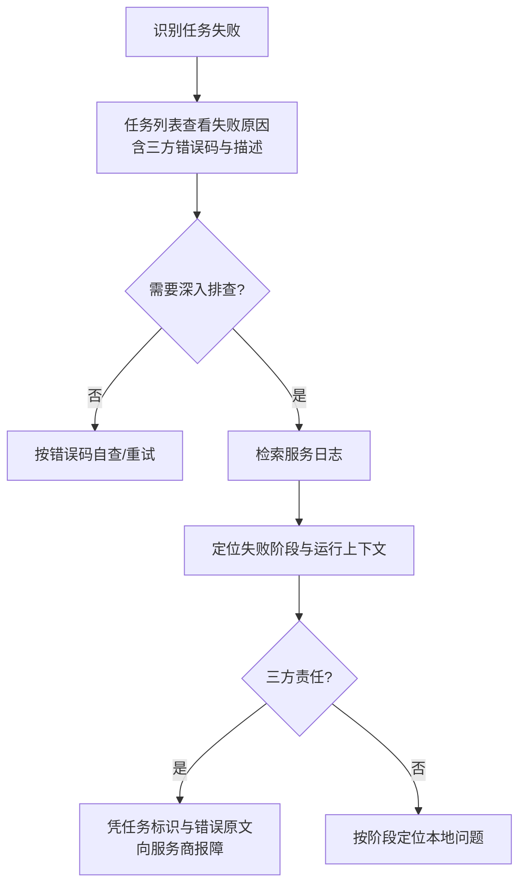

# 转写三方识别报错可观测性优化

**功能名称**: 转写三方识别报错可观测性优化
**PRD 版本**: v1.0
**创建日期**: 2026-09-18
**作者**: Z.Vtuber Workflow Agent

## 背景与目标

### 1.1 背景

录播转写功能（见 [[20260916-recording-transcript-prd]]）的识别能力依赖三方识别服务（阿里云 FunASR）。线上出现识别任务失败，但日志中只有一行简略错误（如 `FunASR task failed (CLIENT_ERROR): request timeout after 23 seconds`）：

- 三方返回的原始错误内容未被完整记录，错误码之外的细节全部丢失；
- 无法判断失败发生在哪个阶段（建立连接、启动识别、识别过程中、收尾）；
- 日志中没有可用于向三方服务商报障的关联标识，也没有任务当时的运行上下文（运行了多久、发送了多少音频、已识别多少内容）；
- 连接、启动阶段的失败甚至完全没有日志。

结果是：任务失败后无法区分是网络问题、音频内容问题、配额限流还是三方服务故障，也无法向服务商提供有效报障信息，问题无法排查。

### 1.2 目标

- 三方识别服务返回失败时，日志完整记录三方错误信息（错误码、错误描述、原始返回内容、关联标识）；
- 识别链路的每个阶段（连接、启动、识别、收尾）失败时都有明确日志，能直接定位失败阶段；
- 失败日志携带任务运行上下文（任务标识、识别模型、运行时长、已发送音频量、已识别句数）；
- 任务详情中的失败原因对三方错误可读、含错误码，便于用户自查。

### 1.3 成功标准

- 任意一次三方识别失败，仅凭服务日志即可回答：失败阶段、三方错误码与原始描述、任务当时的运行上下文；
- 连接失败、启动超时、识别中被三方拒绝、连接异常断开四类典型失败，日志均可明确区分；
- 日志中有可提交给三方服务商的关联标识（任务标识），报障无需复现；
- 日志内容不含密钥等敏感信息；
- 任务详情展示的失败原因包含三方错误码与描述。

## 用户分析

### 2.1 目标用户

平台运营者 / 运维排查人员（自用场景）。

### 2.2 用户场景

| 场景 | 用户角色 | 目标 | 痛点 |
|--|--|--|--|
| 识别任务失败后排查原因 | 运营者 | 从日志判断失败原因与责任方 | 只有一行简略错误，无法定位 |
| 向三方服务商报障 | 运营者 | 提供关联标识与错误原文 | 日志缺少标识与原始返回，需复现才能报障 |
| 查看任务失败原因 | 运营者 | 在任务详情看到可读的失败原因 | 失败原因不含三方错误细节 |
| 区分失败类型 | 运营者 | 判断是网络/配额/内容/三方故障 | 各阶段失败日志缺失或雷同 |

## 功能需求

### 3.1 功能概述

增强转写识别链路在三方服务交互中的可观测性：三方返回失败时完整记录错误原文与关联标识，识别各阶段失败均有可区分的日志，失败日志携带任务运行上下文，任务详情的失败原因包含三方错误码与描述。

### 3.2 功能列表

#### 功能点 1: 三方失败错误完整记录

- **描述**: 三方识别服务返回失败时，日志除错误码与错误描述外，完整记录三方返回的原始内容（超长时合理截断）与该次识别的任务标识，确保凭日志即可向服务商报障。
- **用户价值**: 无需复现即可拿到三方报障所需的全部信息。
- **验收标准**:
  - [ ] 三方返回失败时，日志含错误码、错误描述、原始返回内容、识别任务标识；
  - [ ] 原始内容超长时被截断并明确标注截断；
  - [ ] 日志不包含密钥等敏感信息。

#### 功能点 2: 识别各阶段失败可区分

- **描述**: 识别链路按「建立连接 → 启动识别 → 识别中 → 收尾」划分阶段，任一阶段失败都有日志且阶段可辨识；此前完全无日志的阶段（连接失败、启动超时）补齐日志。
- **用户价值**: 一眼定位失败阶段，缩小排查范围。
- **验收标准**:
  - [ ] 连接失败、启动超时、识别中被三方拒绝、连接异常断开，四类失败日志互相可区分；
  - [ ] 每条失败日志明确标注所处阶段；
  - [ ] 连接异常断开日志保留断开状态与描述。

#### 功能点 3: 失败日志携带运行上下文

- **描述**: 识别失败日志携带任务运行上下文：任务标识、识别模型、已运行时长、已发送音频量、已识别句数。
- **用户价值**: 判断失败是否与音频体量、运行时长相关（如限流、超时模式）。
- **验收标准**:
  - [ ] 失败日志含任务标识、识别模型、运行时长、已发送音频量、已识别句数；
  - [ ] 正常结束与失败结束的统计口径一致，可对照。

#### 功能点 4: 任务详情失败原因可读

- **描述**: 任务详情展示的失败原因，在三方错误场景下包含三方错误码与错误描述，与日志中的信息一致。
- **用户价值**: 不翻日志即可在页面上初步判断失败原因。
- **验收标准**:
  - [ ] 三方错误导致的失败，任务详情失败原因含错误码与描述；
  - [ ] 非三方错误（如音频源失败）的失败原因保持原有可读性。

### 3.3 用户操作流程

### 3.4 页面/界面描述

| 页面 | 描述 | 关键元素 |
|------|------|---------|
| Transcripts - 任务列表 | 失败任务的失败原因含三方错误码与描述 | 任务状态、失败原因文案 |

### 3.5 异常与边界情况

| 情况 | 预期行为 |
|------|---------|
| 三方返回内容超长 | 日志截断记录并标注，不撑爆日志 |
| 三方返回非预期格式 | 日志记录原始内容，解析失败不影响错误传达 |
| 连接阶段即失败 | 有明确阶段日志，不带误导性的运行统计 |
| 密钥等敏感信息 | 不出现在任何日志与失败原因中 |
| 失败原因过长 | 任务详情展示完整可读，不做破坏性截断 |

## 四、非功能需求

### 4.1 性能要求

- 日志增强不改变识别链路的吞吐与延迟；原始内容记录有截断上限，避免大报文开销。

### 4.2 安全性要求

- 任何日志与失败原因不得包含三方服务密钥、完整请求头等敏感信息。

### 4.3 兼容性要求

- 不影响既有转写功能与任务状态流转；
- 既有任务的失败记录无需迁移。

## 五、依赖与约束

### 5.1 依赖

- 既有录播转写能力（识别任务、失败状态记录）；
- 三方识别服务（阿里云 FunASR）的错误返回约定。

### 5.2 约束

- 仅增强可观测性，不改变识别重试、状态流转等既有行为；
- 日志量级受控，识别中的逐句日志维持现有节流策略。

## 六、相关文档

- 技术提案：[[20260918-proposal-transcript-asr-error-observability]]（docs/engineering/proposals/20260918-proposal-transcript-asr-error-observability.md）
- 关联 PRD：[[20260916-recording-transcript-prd]]（docs/product/draft/20260916-recording-transcript-prd.md）
