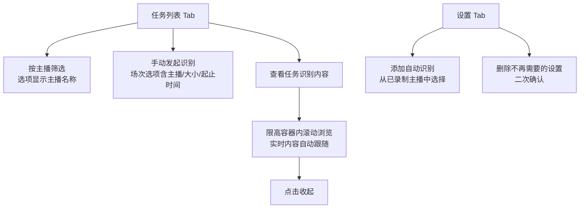

# 转写功能体验修复与任务恢复

**功能名称**: 转写功能体验修复与任务恢复
**PRD 版本**: v1.0
**创建日期**: 2026-09-18
**作者**: Z.Vtuber Workflow Agent

## 背景与目标

### 1.1 背景

录播转写功能（见 [[20260916-recording-transcript-prd]]）上线使用后，暴露三类问题：

- **Web 操作体验问题**：手动发起识别时，录播场次选项只有场次名，看不出是哪场直播；主播选择只有房间号没有主播名；添加自动识别需要手工输入房间号且无法删除已添加的设置；任务列表「查看」展开识别内容后无法收起，长内容还会撑破整个页面。
- **录播数据准确性问题**：网络异常时可能出现「录制已开始、但没有产出任何实际录播文件」的空录播，这类场次仍然会出现在录播查询结果中，造成干扰。
- **任务可靠性问题**：识别任务正在运行时服务宕机，任务会永久停留在「进行中」，服务重启后也不会被恢复，日志中看不到任何对该任务的处理。

### 1.2 目标

- 手动发起识别时，场次与主播选择器信息完整、可辨识（主播名称、录播大小、场次名、起止时间）；
- 自动识别设置从「已被录制的主播列表」中选择，且支持删除不再需要的设置；
- 任务详情可收起，识别内容在限定高度的容器内滚动查看，不再撑破页面；
- 查询录播数据时，所有文件都实际不存在的空录播场次不出现在结果中；
- 服务宕机/重启后，中断的识别任务被自动恢复，从断点继续识别，无需人工干预。

### 1.3 成功标准

- 用户仅凭场次选项文案即可辨识主播与场次时间，无需额外查资料即可完成手动发起识别；
- 空录播（所有文件均不存在）不再出现在任何录播查询结果与场次选择器中；
- 模拟服务宕机后，处于「进行中」的任务在服务恢复后 1 分钟内被自动接管续跑，已识别内容不重复、不丢失；
- 失败任务点击重试后能被正常恢复执行。

## 用户分析

### 2.1 目标用户

平台运营者 / 主播内容归档用户（自用场景）。

### 2.2 用户场景

| 场景 | 用户角色 | 目标 | 痛点 |
|--|--|--|--|
| 手动发起某场直播的识别 | 运营者 | 从场次列表中快速找到目标场次 | 选项只有场次名，同名场次无法区分主播与时间 |
| 按主播筛选查看任务 | 运营者 | 选择目标主播 | 选项只有房间号数字，不知道是谁 |
| 为主播开启自动识别 | 运营者 | 从已录制的主播中选择 | 需要自己记住并手输房间号，易出错 |
| 清理不再关注的自动识别 | 运营者 | 删除某主播的自动识别设置 | 只能禁用不能删除，列表越积越多 |
| 查看识别内容 | 运营者 | 看完后收起，长内容滚动浏览 | 无法收起，内容撑破整个页面 |
| 浏览录播场次 | 运营者 | 只看到真实有文件的场次 | 网络异常产生的空录播混杂其中 |
| 服务升级/宕机后恢复 | 运营者 | 任务自动续跑 | 任务永久卡在「进行中」，无人处理 |

## 功能需求

### 3.1 功能概述

对转写功能做一轮体验修复与可靠性增强：补全手动发起识别与主播选择的信息展示、自动识别设置改为选择式并支持删除、任务详情支持收起与限高滚动、查询录播数据时过滤无文件的空录播场次、修复中断任务在服务恢复后不被接管的问题。

### 3.2 功能列表

#### 功能点 1: 手动发起识别的场次选项信息补全

- **描述**: 手动发起识别的录播场次选项按模板 `[{主播名称}][{录播大小}] {场次名} - {开始时间} - {结束时间}` 展示，其中开始/结束时间格式为 `yyyy-mm-dd-HH-mm`，录播大小为人类可读单位（如 GB/MB）。进行中的场次没有结束时间，对应位置显示「进行中」。
- **用户价值**: 一眼辨识场次属于哪位主播、什么时候、多大体量，选错率降为零。
- **验收标准**:
  - [ ] 场次选项严格按模板展示：主播名称、录播大小、场次名、开始时间、结束时间齐全；
  - [ ] 时间格式为 `yyyy-mm-dd-HH-mm`；录播大小为人类可读单位；
  - [ ] 进行中场次结束时间位置显示「进行中」。

#### 功能点 2: 主播选择显示主播名称

- **描述**: 任务列表中「按主播筛选」的选择器，选项展示主播名称（附房间号），不再只显示房间号数字。
- **用户价值**: 不需要记忆房间号与主播的对应关系。
- **验收标准**:
  - [ ] 主播选项展示主播名称与房间号；
  - [ ] 主播资料缺失时有合理兜底（显示房间号），不出现空白选项。

#### 功能点 3: 自动识别设置改为选择主播并支持删除

- **描述**: 添加自动识别时，房间号手工输入框改为下拉选择，候选为「已被录制过的主播列表」（展示主播名称）；已添加的自动识别设置除启用/禁用外，新增「删除」操作，删除需二次确认。删除后该主播不再自动创建识别任务；该主播已存在的识别任务不受影响。
- **用户价值**: 配置零出错，列表可清理。
- **验收标准**:
  - [ ] 添加自动识别时从已录制主播列表中选择，选项展示主播名称；
  - [ ] 候选列表为空时给出明确提示；
  - [ ] 每条设置可删除，删除有二次确认，删除后从列表消失；
  - [ ] 删除设置不影响该主播已存在的识别任务。

#### 功能点 4: 任务详情收起与限高滚动

- **描述**: 任务列表「查看」展开识别内容后，提供「收起」按钮可将其收起；展开内容放入限定最大高度的容器中，内容超出时在容器内滚动显示，不再撑开整个页面。
- **用户价值**: 页面布局稳定，长识别结果浏览体验可控。
- **验收标准**:
  - [ ] 展开后有明确的收起入口，点击后详情区域完全收起；
  - [ ] 详情容器有最大高度限制，超出部分容器内滚动；
  - [ ] 任务进行中实时追加新内容时，用户停留在底部则自动跟随滚动。

#### 功能点 5: 无文件空录播过滤

- **描述**: 查询录播数据时（录播场次列表、按主播查询场次等所有对外返回），归档记录中所有录播文件实际都不存在的场次被过滤，不出现在返回结果中；这类场次也不会出现在手动发起识别的场次选择器中。
- **用户价值**: 录播数据真实可信，不被网络异常产生的空壳场次干扰。
- **验收标准**:
  - [ ] 所有文件均不存在的场次不出现在任何录播查询结果中；
  - [ ] 文件部分存在的场次正常返回，大小按实际存在的文件统计；
  - [ ] 正常有文件的场次不受影响。

#### 功能点 6: 中断任务自动恢复

- **描述**: 识别任务处于「进行中」时服务宕机或重启，服务恢复后该任务被自动接管，从断点位置继续识别（不重头开始、不丢失已识别内容）；手动重试失败任务同样能正常恢复执行。
- **用户价值**: 服务升级、宕机不再需要人工处理僵尸任务。
- **验收标准**:
  - [ ] 服务宕机后重启，「进行中」任务在 1 分钟内被自动接管续跑；
  - [ ] 接管后从断点继续，已识别内容不重复、不丢失；
  - [ ] 中断任务不占用模型并发额度，不阻塞同模型其他排队任务；
  - [ ] 失败任务重试后能被正常接管执行。

### 3.3 用户操作流程

### 3.4 页面/界面描述

| 页面 | 描述 | 关键元素 |
|------|------|---------|
| Transcripts - 任务列表 Tab | 场次/主播选择信息补全，详情可收起 | 场次选择器（模板文案）、主播选择器（主播名称）、详情容器（收起按钮 + 限高滚动） |
| Transcripts - 设置 Tab / 识别设置 | 自动识别改选择式、支持删除 | 主播下拉选择器、每条设置的删除按钮（二次确认） |

### 3.5 异常与边界情况

| 情况 | 预期行为 |
|------|---------|
| 进行中的场次无结束时间 | 场次选项结束时间位置显示「进行中」 |
| 主播资料缺失（无名称） | 选项兜底显示房间号，不出现空白 |
| 网络异常产生的空录播 | 不出现在任何录播查询结果与选择器中 |
| 场次部分文件被清理 | 场次正常显示，大小按实际存在文件统计 |
| 删除自动识别设置时该主播有进行中任务 | 设置被删除，进行中任务继续完成 |
| 已录制主播候选列表为空 | 给出明确提示，不允许提交 |
| 服务宕机时任务进行中 | 服务恢复后自动接管续跑，无需人工干预 |
| 同一模型有多个中断任务 | 全部被自动接管，不互相阻塞、不饿死排队任务 |

## 四、非功能需求

### 4.1 性能要求

- 录播场次查询引入文件存在性过滤后，响应时间保持在秒级以内，不随场次数量显著退化；
- 中断任务在服务恢复后 1 分钟内被接管。

### 4.2 安全性要求

- 无新增凭据或敏感信息暴露。

### 4.3 兼容性要求

- 不影响既有录播、转写、弹幕、订阅等功能；
- 已有的识别任务、设置数据无需人工迁移。

## 五、依赖与约束

### 5.1 依赖

- 既有直播录播能力（录播文件落盘与归档）；
- 既有转写能力（任务队列、断点续跑、实时片段推送）。

### 5.2 约束

- 文件存在性以录播存储的实际状态为准；
- 中断任务恢复必须从断点续跑，不重头识别；
- 删除自动识别设置为不可逆操作，需二次确认。

## 六、相关文档

- 技术提案：[[20260918-proposal-transcript-fixes]]（docs/engineering/proposals/20260918-proposal-transcript-fixes.md）
- 关联 PRD：[[20260916-recording-transcript-prd]]（docs/product/draft/20260916-recording-transcript-prd.md）
