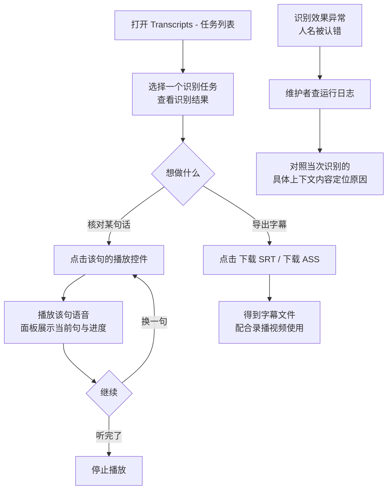

# Transcript 展示优化

**功能名称**: Transcript 展示优化
**PRD 版本**: v1.0
**创建日期**: 2026-09-22
**作者**: Z.Vtuber Workflow Agent

## 背景与目标

### 1.1 背景

平台已具备直播录播语音转写能力（见 [[20260916-recording-transcript-prd]]）：识别任务产出带起止时间的文字片段，页面可持续查看识别结果。但当前识别结果「只有文字」，沉淀价值没有被释放：

- **无法回听核对**：想确认某句识别是否准确（尤其是人名、专有名词），只能凭印象回忆，用户必须自己去录播文件里手动拖时间轴找那一句，而文字片段明明带了精确到毫秒的起止时间；
- **无法导出使用**：转写结果本是天然的字幕 / 文稿素材，但页面不提供任何导出途径，想给录播配字幕只能一句句手工复制，时间轴还要自己算；
- **识别效果不可核查**：识别把人名认错时（例如舰长名、主播名），无法确认当时送给识别服务的参考信息（识别上下文）是否正确、是否遗漏，排障只能靠猜和复现。

### 1.2 目标

- 识别结果中的每个文字片段都能一键回听该句语音，播放的语音区间与片段展示的起止时间一致；
- 识别结果可一键下载为字幕文件（SRT / ASS 两种格式），字幕时间轴与录播视频对齐，可直接配合录播视频使用；
- 识别任务提交识别时，系统在运行日志中记录本次识别所使用的**具体**上下文内容与关键提交信息，使识别效果可核查、可排障。

### 1.3 成功标准

- 任意一条文字片段点击播放后 2 秒内能听到该句语音，听到的内容与展示文字对应；
- 下载的字幕文件在常见播放器中加载录播视频后，字幕出现时刻与实际说话时刻一致、中文无乱码；
- 识别出错的场次，维护者能直接从运行日志看到当次识别使用的具体上下文内容与提交信息，无需复现问题。

## 用户分析

### 2.1 目标用户

平台运营者 / 主播内容归档用户（自用场景），以及需要排查识别效果问题的维护者。

### 2.2 用户场景

| 场景 | 用户角色 | 目标 | 痛点 |
|--|--|--|--|
| 核对识别文字是否准确 | 运营者 | 听到某句话的原声，与识别文字比对 | 无法回听，只能凭记忆；去录播里手动找某句话极费时 |
| 摘取某段语音素材 | 运营者 | 听某几句的原声做二次创作素材 | 需要自己在录播文件里反复拖动进度条定位 |
| 给录播配字幕 | 运营者 | 拿到一份时间轴准确的字幕文件 | 页面只能复制纯文字，时间轴要人工换算，工作量大且易错 |
| 导出文稿存档 | 运营者 | 把整场转写结果存档、分享 | 手工复制整场文字，格式与时间信息丢失 |
| 排查识别效果差的原因 | 维护者 | 确认识别时使用了哪些参考信息（人名等上下文） | 上下文内容不可见，无法判断是参考信息错还是识别能力问题 |

## 功能需求

### 3.1 功能概述

在 Transcripts 页面的识别结果展示上补齐「声音」与「出口」两块能力：每个文字片段可一键试听该句语音（时间区间与展示一致），整场识别结果可一键下载为 SRT / ASS 字幕文件；同时识别任务在提交识别时把本次使用的具体上下文写入运行日志，使识别效果可核查。

### 3.2 功能列表

#### 功能点 1: 识别片段语音试听

- **描述**: 识别结果展示中，每个文字片段提供「播放」控件，点击即播放该句对应的语音片段——语音取自该场录播的音频，播放区间与该句展示的起止时间一致。识别结果面板提供统一的播放控件，展示当前正在播放的句子、播放进度，并可停止播放；点击另一句即切换到该句播放，同一时刻只播放一句。
- **用户价值**: 「文字对不对、声音是什么」一键可查，回听核对与素材摘取从「手动拖时间轴」变成「点一下」。
- **验收标准**:
  - [ ] 每个有文字的片段均展示播放控件，点击后播放该句语音；
  - [ ] 播放的语音区间与该句展示的起止时间一致（听得到的是这句话本身）；
  - [ ] 面板展示当前播放句与播放进度，可停止；点击其他片段即切换播放该句；
  - [ ] 播放完成或停止后界面回到常态，不残留播放状态；
  - [ ] 历史任务（本次上线前已识别完成的结果）同样支持试听。

#### 功能点 2: 字幕文件下载（SRT / ASS）

- **描述**: 识别结果展示提供「下载 SRT」与「下载 ASS」两个下载入口，下载得到该识别任务的完整字幕文件：一条识别片段对应一条字幕，字幕起止时间与片段一致（即与录播视频时间轴对齐），字幕文字为识别结果原文。下载文件名包含场次标题与识别模型，便于归档区分。
- **用户价值**: 转写结果从「页面上的文字」变成「可直接使用的字幕资产」，配字幕、导文稿不再需要人工换算时间轴。
- **验收标准**:
  - [ ] 下载入口提供 SRT 与 ASS 两种格式；
  - [ ] 字幕条目与识别片段一一对应，起止时间、文字与页面展示一致；
  - [ ] 下载的字幕文件可在常见播放器中加载录播视频后正常使用，中文不乱码；
  - [ ] 文件名含场次标题与识别模型，缺失时有可辨识的兜底名称；
  - [ ] 识别进行中的任务下载得到「已识别部分」的字幕，任务无识别片段时下载入口置灰。

#### 功能点 3: 识别提交上下文日志

- **描述**: 识别任务提交识别时，系统在运行日志中记录本次识别使用的**具体**上下文内容（用于辅助识别的人名、场次相关信息），而不只是条数；同时在识别任务创建（提交）时记录关键提交信息（场次、识别文件、模型、任务来源）。上下文内容超长时记录截断标识，日志中不出现模型 API Key 等凭据。
- **用户价值**: 识别效果问题（如人名识别错误）可直接对照日志核查参考信息，排障从「复现猜测」变成「看一眼日志」。
- **验收标准**:
  - [ ] 任务提交识别时，日志中可见本次使用的具体上下文内容（不是只有条数）；
  - [ ] 上下文为空时明确记录「空上下文」，超长时有截断标识且不丢总量信息；
  - [ ] 任务创建时日志可见关键提交信息（场次、文件、模型、来源）；
  - [ ] 日志不出现 API Key 等敏感凭据。

### 3.3 用户操作流程

### 3.4 页面/界面描述

| 页面 | 描述 | 关键元素 |
|------|------|---------|
| Transcripts - 任务列表 Tab / 识别结果（变更） | 识别结果展示增加试听与导出能力 | 片段行播放控件、统一播放控件（当前播放句 + 进度 + 停止）、「下载 SRT」「下载 ASS」按钮 |

识别结果区域布局示意（自上而下）：识别结果标题行（含下载按钮与「收起」）→ 统一播放控件（当前播放句、进度、停止）→ 片段列表（每行：起止时间 + 播放控件 + 文字）。

### 3.5 异常与边界情况

| 情况 | 预期行为 |
|------|---------|
| 直播进行中（该场录播尚未落盘完成） | 已产出的文字片段正常展示，播放控件提示「音频暂不可用」，可稍后再试 |
| 录播文件已被清理 / 不存在 | 播放失败并提示音频不可用，不影响文字展示与字幕下载 |
| 片段播放中切换到另一句 | 停止当前句，直接播放新选中句 |
| 切换查看其他任务 / 收起识别结果 / 离开页面 | 停止播放，不残留后台声音 |
| 音频实际长度短于片段展示的结束时间 | 播放到音频实际结尾即结束 |
| 任务无任何识别片段 | 下载入口置灰并提示暂无识别结果 |
| 任务识别进行中下载字幕 | 得到已识别部分的字幕（条目可能持续增加，重新下载可得最新） |
| 上下文为空（无任何参考信息可用） | 日志明确记录空上下文，识别照常进行 |
| 上下文超长 | 日志记录截断后的内容并带截断标识与原始长度 |
| 场次标题含特殊字符 | 下载文件名做安全化处理，不影响下载 |

## 四、非功能需求

### 4.1 性能要求

- 点击播放到出声不超过 2 秒，且不因录播时长变长（如 3 小时录播）而变慢；
- 试听只传输所听句子的音频，不做整场音频下载，页面内存与流量开销小；
- 试听与下载不影响识别任务的正常运行与其他页面功能。

### 4.2 安全性要求

- 试听与字幕下载沿用现有访问路径与权限口径，不新增公开访问面；
- 运行日志中不得出现模型 API Key 等敏感凭据。

### 4.3 兼容性要求

- 不影响既有录播下载、实时音频收听与识别任务流程；
- 本次上线前已产出的识别结果同样支持试听与字幕下载；
- 字幕文件兼容常见播放器（时间轴基准与录播视频一致）。

## 五、依赖与约束

### 5.1 依赖

- 既有直播录播能力（录播文件及其音频，试听的语音来源）；
- 既有语音转写能力（带起止时间的文字片段，字幕与试听定位的依据）；
- 运行环境具备音频转码能力（试听片段输出浏览器可直接播放的音频）。

### 5.2 约束

- 试听以「句」为单位，播放区间即片段起止时间，不提供跨句连续播放（后续增强）；
- 字幕时间轴以录播时间轴为准；识别服务中断窗口造成的缺口不回溯补录，字幕不包含未识别内容；
- 直播进行中的场次暂不支持试听（录播文件尚未落盘完成）；
- 识别上下文仅记录于运行日志用于核查，不做持久化存档（沿用既有决策）。

## 六、相关文档

- 技术提案：[[20260922-proposal-transcript-display-optimization]]（docs/engineering/proposals/20260922-proposal-transcript-display-optimization.md）
- 关联 PRD：[[20260916-recording-transcript-prd]]（docs/product/draft/20260916-recording-transcript-prd.md）
- 关联 PRD：[[20260917-transcript-model-context-prd]]（docs/product/draft/20260917-transcript-model-context-prd.md）
- 关联 PRD：[[20260914-recording-download-range-prd]]（docs/product/draft/20260914-recording-download-range-prd.md）
