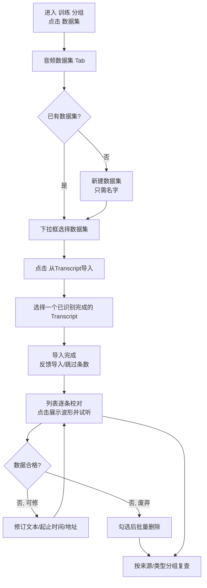

# AI 训练 - 音频数据集（第一期）

**功能名称**: 训练 - 音频数据集
**PRD 版本**: v1.0
**创建日期**: 2026-09-27
**作者**: Z.Vtuber Workflow Agent

## 背景与目标

### 1.1 背景

平台已积累大量直播录播与语音转写识别结果（见 [[20260916-recording-transcript-prd]]、[[20260927-transcript-playback-offset-prd]]），识别结果带起止时间、可逐句试听、时间轴可经播放偏移校正。这些识别结果是语音类 AI 训练的高质量语料来源，但目前缺少把识别结果沉淀为**可管理、可校对、可维护的训练数据**的工具。

AI 训练模块分期建设。**第一期只完成「数据集」模块**：以「音频数据集」为起点，支持把识别完成的 Transcript 导入数据集，进行查看、修订与试听校对，为后续情感识别、二次 ASR 识别等数据加工能力打下数据组织基础。

### 1.2 目标

- Web 端提供「训练」功能分组与「数据集」入口；
- 支持音频数据集的新建（只需名字）、重命名与删除；
- 支持将识别完成的 Transcript 一键导入为音频数据，导入时间与识别结果展示/试听口径一致（尊重播放偏移设置）；
- 支持音频数据的列表查看、字段修订（音频地址/文本/开始时间/结束时间）、多选批量删除、按来源/类型分组浏览，以及点击单条数据后的波形展示与播放校对；
- 信息组织方式为未来扩展（更多 Tab、更多音频类型、情感识别、二次 ASR 等）预留空间。

### 1.3 成功标准

- 用户可在页面上完成「新建数据集 → 导入 Transcript → 逐条试听校对并修订 → 批量删除不合格数据」的完整闭环，无需借助外部工具；
- 导入的音频数据试听内容与文本对应（与识别结果页的试听口径一致）；
- 同一数据集下音频标识唯一，重复导入同一 Transcript 不产生重复数据。

## 用户分析

### 2.1 目标用户

平台运营者 / 训练数据维护者（自用场景）。

### 2.2 用户场景

| 场景 | 用户角色 | 目标 | 痛点 |
|--|--|--|--|
| 整理训练语料 | 数据维护者 | 把识别完成的 Transcript 沉淀为训练数据集 | 识别结果散落在各场次识别任务中，无法汇总管理 |
| 校对训练数据 | 数据维护者 | 逐条试听并修订文本与起止时间 | 缺少「试听 + 编辑」一体的工具，校对成本高 |
| 清理脏数据 | 数据维护者 | 按来源/类型浏览并批量删除不合格音频数据 | 无分组与批量操作，逐条处理效率低 |

## 功能需求

### 3.1 功能概述

Web 端新增「训练」分组下的「数据集」页面：页面以多 Tab 组织（本期仅「音频数据集」一个 Tab），提供音频数据集管理（下拉选择、新建、重命名、删除）、从 Transcript 导入、音频数据列表（七字段展示、四项可编辑、多选删除、分组浏览）与波形试听校对能力。

### 3.2 功能列表

#### 功能点 1: 训练分组与数据集入口

- **描述**: Web 导航新增「训练」label 分组，分组下提供「数据集」入口。数据集页面为多 Tab 结构，本期仅一个 Tab「音频数据集」，后续可扩展更多 Tab（如其他模态数据集）。
- **用户价值**: 训练相关能力有独立、可扩展的入口，不与既有功能混杂。
- **验收标准**:
  - [ ] 导航中出现「训练」label 分组，分组下含「数据集」入口；
  - [ ] 进入「数据集」后为多 Tab 页面，且当前仅有「音频数据集」Tab。

#### 功能点 2: 音频数据集管理

- **描述**: 「音频数据集」Tab 顶部以下拉框呈现全部音频数据集，选择其一作为当前数据集；提供新建、重命名、删除能力：新建只需填写名字；重命名作用于当前选中的数据集；删除需二次确认，删除后数据集内全部音频数据一并清除。同一类型下数据集名字唯一。
- **用户价值**: 数据集作为训练语料的组织单元，可按用途自由创建与维护。
- **验收标准**:
  - [ ] 下拉框列出全部音频数据集并可切换选中；
  - [ ] 新建只需输入名字即可创建；
  - [ ] 可对当前数据集重命名；
  - [ ] 删除需二次确认，删除后该数据集及其数据不再可见；
  - [ ] 新建/重命名重名时提示且不生效。

#### 功能点 3: 从 Transcript 导入

- **描述**: 选定某个音频数据集后，显示「从 Transcript 导入」按钮；点击后可选择一个**已识别完成**的 Transcript（识别任务），确认导入后将该 Transcript 识别到的全部片段复制进当前数据集：每个片段生成一条音频数据——音频类型为「transcript」（音频来自内网录播音频预览地址）、音频来源对应该 Transcript、开始/结束时间与文本取自识别结果。**导入的时间尊重该 Transcript 的播放偏移（offset）设置**，即与识别结果页的展示/试听口径一致。导入按音频标识去重：已存在于当前数据集的音频标识跳过，不重复导入；导入完成后反馈导入条数与跳过条数。
- **用户价值**: 一键把识别结果沉淀为训练数据，且与已校正的时间轴口径一致，无需手工搬运。
- **验收标准**:
  - [ ] 未选定数据集时不显示导入入口；
  - [ ] 仅可选择识别完成的 Transcript；
  - [ ] 导入后每条音频数据的类型/来源/地址/标识/起止时间/文本与识别结果一致；
  - [ ] 设置了播放偏移的 Transcript，导入的起止时间为偏移后口径；
  - [ ] 重复导入同一 Transcript 不产生重复数据，并反馈导入/跳过数量。

#### 功能点 4: 音频数据列表与字段编辑

- **描述**: 当前数据集下的音频数据以列表展示，每条包含七个字段：
  - **音频类型**：本期支持「transcript」，从内网的录播音频预览地址获得音频；
  - **音频来源**：音频的来源信息（transcript 类型对应该 Transcript 的标识）；
  - **音频地址**：访问该音频的地址；transcript 类型只显示 uri，且可修改 uri；
  - **音频标识**：这条音频的唯一标识符，带类型前缀（如 transcript 类型取识别片段标识并加前缀）；**同一数据集下音频标识唯一**；
  - **开始时间**：基于「音频地址」的音频开始时间，默认 0 分 0 秒；
  - **结束时间**：基于「音频地址」的音频结束时间，默认为空，空代表到音频末尾；
  - **文本**：这条音频数据对应的文本。

  可编辑字段：音频地址、文本、开始时间、结束时间。
- **用户价值**: 训练数据的关键字段可视、可修订，文本与时间轴可校对到可用质量。
- **验收标准**:
  - [ ] 列表完整展示上述七个字段；
  - [ ] 音频地址、文本、开始时间、结束时间可修改并保存生效；
  - [ ] 结束时间可置空（表示到音频末尾）；
  - [ ] 音频标识在数据集内唯一且不可编辑；
  - [ ] 非法时间（负值、结束早于开始）提示且不保存。

#### 功能点 5: 波形展示与播放

- **描述**: 点击一条音频数据后，展示其波形，并可在波形上播放该条音频（按开始/结束时间圈定的区间）。
- **用户价值**: 波形让「这段音频说了什么、边界在哪」一目了然，试听校对更高效。
- **验收标准**:
  - [ ] 点击列表项后展示该条音频的波形；
  - [ ] 可播放/停止，播放区间与开始/结束时间一致；
  - [ ] 结束时间为空时播放到音频末尾（或可用的预览上限）；
  - [ ] 音频地址失效时提示音频不可用，不影响列表其他操作。

#### 功能点 6: 多选与批量删除

- **描述**: 列表支持多选，多选后可批量删除，删除需确认。
- **用户价值**: 快速清理不合格数据。
- **验收标准**:
  - [ ] 可勾选多条音频数据并一键删除；
  - [ ] 删除需确认，删除后列表刷新。

#### 功能点 7: 分组浏览

- **描述**: 列表支持按「音频来源」、按「音频类型」分组展示；分组支持勾选该分组下全部项目，与多选、批量删除联动。
- **用户价值**: 按来源/类型审视数据分布，整组勾选处理更高效。
- **验收标准**:
  - [ ] 可在不分组/按来源/按类型之间切换；
  - [ ] 分组头支持勾选/取消勾选该分组下全部项目；
  - [ ] 分组勾选后可直接批量删除。

### 3.3 用户操作流程

### 3.4 页面/界面描述

| 页面 | 描述 | 关键元素 |
|------|------|---------|
| 训练 - 数据集（新增） | 多 Tab 的数据集管理页，本期仅「音频数据集」Tab | Tab 栏；数据集下拉框 + 新建/重命名/删除按钮；「从 Transcript 导入」按钮；音频数据列表（勾选框 + 七字段）；分组切换（不分组/按来源/按类型）；点击条目后的波形试听区 |

界面说明：数据集下拉框与新建/重命名/删除操作位于 Tab 内容顶部；选定数据集后展示「从 Transcript 导入」按钮与音频数据列表；点击某条数据在列表下方（或侧栏）展示波形与播放控制。

### 3.5 异常与边界情况

| 情况 | 预期行为 |
|------|---------|
| 新建/重命名数据集重名 | 提示名字已存在且不生效 |
| 删除数据集 | 二次确认，明确提示数据一并清除、不可恢复 |
| 导入未识别完成的 Transcript | 该 Transcript 不可被选择 |
| 重复导入同一 Transcript | 按音频标识去重跳过，反馈导入/跳过数量 |
| 编辑时间为非法值（负数、结束早于开始） | 提示输入无效且不保存 |
| 音频地址失效无法播放 | 波形/播放区提示音频不可用，不影响其他数据操作 |
| 数据集为空 | 列表展示空态提示，引导从 Transcript 导入 |
| 导入的 Transcript 缺少可用音频地址 | 对应条目照常导入，试听时提示音频不可用，可手工修订地址 |

## 四、非功能需求

### 4.1 性能要求

- 单数据集数千条音频数据量级下，列表浏览、勾选、分组切换流畅；
- 大批量导入（整场识别片段）过程不阻塞页面其他操作，完成后有明确结果反馈。

### 4.2 安全性要求

- 沿用现有管理后台访问口径，不新增公开访问面。

### 4.3 兼容性要求

- 不影响既有录播、识别结果展示、试听与字幕导出功能；
- 数据集与音频数据的信息组织为未来扩展预留空间：更多 Tab（其他模态）、更多音频类型、以及情感识别/二次 ASR 等加工结果的承载。

## 五、依赖与约束

### 5.1 依赖

- 既有语音转写能力：识别完成的 Transcript 及其播放偏移设置（导入的数据源）；
- 内网录播音频预览能力（音频数据的试听来源）。

### 5.2 约束

- 本期仅实现「音频数据集」一个 Tab 与「transcript」一种音频类型；
- 情感识别、二次 ASR 识别等数据加工能力不在本期范围，但数据组织需为其预留扩展；
- 本模块只做训练数据的组织与维护，不涉及模型训练本身。

## 六、相关文档

- 技术提案：[[20260927-proposal-training-audio-dataset]]（docs/engineering/proposals/20260927-proposal-training-audio-dataset.md）
- 关联 PRD：[[20260916-recording-transcript-prd]]（docs/product/draft/20260916-recording-transcript-prd.md）
- 关联 PRD：[[20260927-transcript-playback-offset-prd]]（docs/product/draft/20260927-transcript-playback-offset-prd.md）
