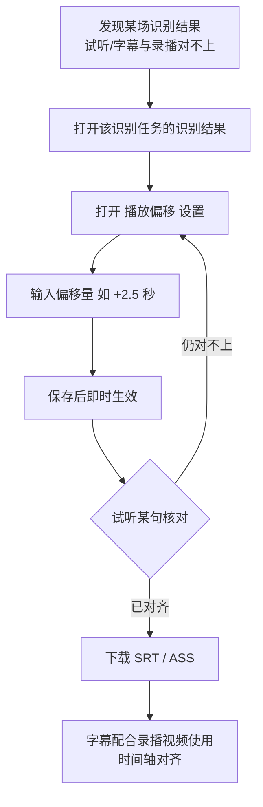

# 识别结果播放偏移（Offset）

**功能名称**: 识别结果播放偏移
**PRD 版本**: v1.0
**创建日期**: 2026-09-27
**作者**: Z.Vtuber Workflow Agent

## 背景与目标

### 1.1 背景

平台已具备直播录播语音转写与识别结果消费能力（见 [[20260916-recording-transcript-prd]]、[[20260922-transcript-display-optimization-prd]]）：识别结果带起止时间展示、可逐句试听语音、可导出 SRT/ASS 字幕。

但实际使用中会出现**识别时间轴与录播内容不对齐**的情况：识别用的音频来源（如直播实时音频流）与最终录播文件之间存在固定的时间差，导致整场识别结果整体超前或滞后于录播实际内容——表现为点击某句试听时听到的不是这句话、导出的字幕配上录播视频后整体提前或延后出现。这类偏移是**系统性的固定偏差**，逐句修改不现实，用户需要一个「整体平移」的校正手段。

### 1.2 目标

- 支持针对**单场识别任务**设置播放偏移（offset），偏移值可为正（整体后移）或为负（整体前移）；
- 设置偏移后，识别结果的展示时间、语音试听、SRT/ASS 字幕导出三处口径一致地按偏移后时间生效；
- 偏移可随时调整、即时生效，不需要重新识别，也不影响其他识别任务。

### 1.3 成功标准

- 存在时间轴偏差的场次，用户调整偏移后试听内容与文字对应、导出字幕与录播视频对齐（试听试听偏差主观不可感知，字幕偏差在 1 秒内）；
- 未设置偏移的识别任务（含全部历史任务）展示、试听、导出行为与现状完全一致；
- 偏移调整即时生效：修改后无需重新识别、无需等待，重新查看识别结果与重新下载字幕即为新口径。

## 用户分析

### 2.1 目标用户

平台运营者 / 主播内容归档用户（自用场景）。

### 2.2 用户场景

| 场景 | 用户角色 | 目标 | 痛点 |
|--|--|--|--|
| 校正识别结果与录播的时间差 | 运营者 | 让识别结果的时间轴对齐录播实际内容 | 识别时间轴整体超前/滞后，试听对不上、字幕错位，且无法校正 |
| 试听核对识别准确性 | 运营者 | 听到的语音与文字对应 | 时间轴偏差时，点击某句听到的是其他句子，无法核对 |
| 导出可用字幕 | 运营者 | 导出的 SRT/ASS 字幕与录播视频时间对齐 | 字幕整体偏移，需要借助外部工具逐条平移时间轴 |

## 功能需求

### 3.1 功能概述

为识别任务提供「播放偏移」设置：以任务为单位设置一个可正可负的时间偏移量，设置后该任务识别结果的展示时间、语音试听区间、SRT/ASS 字幕导出时间轴统一按偏移后时间生效；偏移可随时修改、即时生效，不影响识别数据本身与其他任务。

### 3.2 功能列表

#### 功能点 1: 识别任务播放偏移设置

- **描述**: 在识别任务的识别结果展示中提供「播放偏移」设置入口，用户可输入一个时间偏移量（精确到 0.1 秒，支持正负值与清零）。偏移语义为「识别结果时间整体向录播时间轴后移的量」：正值表示识别结果整体提前了、需要后移；负值表示识别结果整体滞后了、需要前移。设置即时保存生效，可随时修改，并展示当前已生效的偏移值；未设置过的任务偏移为 0（即现状行为）。
- **用户价值**: 系统性时间轴偏差从「无法处理」变成「调一个数」，一次校正全场生效。
- **验收标准**:
  - [ ] 每个识别任务均可独立设置播放偏移，互不影响；
  - [ ] 偏移支持正值、负值与 0，精度 0.1 秒；
  - [ ] 设置后即时生效并持久保存，再次打开识别结果可见当前偏移值；
  - [ ] 修改偏移不需要重新识别，已识别内容保留不变。

#### 功能点 2: 偏移统一作用于展示与试听

- **描述**: 设置偏移后，该任务识别结果中每个片段的展示起止时间按偏移后时间展示；点击片段试听时，播放的语音区间同样按偏移后时间定位，保证「看到的时间、听到的内容」一致。
- **用户价值**: 校正后试听核对能力恢复可用——点哪句听哪句。
- **验收标准**:
  - [ ] 设置偏移后，识别结果展示的起止时间按新口径展示；
  - [ ] 试听播放的语音区间与偏移后展示时间一致（点哪句听哪句）；
  - [ ] 修改偏移后再次试听，播放区间按新偏移生效；
  - [ ] 识别进行中的任务设置偏移后，新产生的识别片段同样按偏移口径展示与试听。

#### 功能点 3: 偏移作用于 SRT/ASS 字幕导出

- **描述**: 导出的 SRT/ASS 字幕文件时间轴按偏移后时间生成，使字幕直接对齐录播视频；重新下载即得新口径字幕。
- **用户价值**: 导出的字幕开箱即用，不再需要外部工具二次平移时间轴。
- **验收标准**:
  - [ ] 设置偏移后下载的 SRT/ASS 字幕，各条目起止时间按偏移后时间生成；
  - [ ] 修改偏移后重新下载，字幕时间轴按新偏移生成；
  - [ ] 未设置偏移的任务导出字幕与现状完全一致。

### 3.3 用户操作流程

### 3.4 页面/界面描述

| 页面 | 描述 | 关键元素 |
|------|------|---------|
| Transcripts - 任务列表 Tab / 识别结果（变更） | 识别结果展示增加播放偏移设置能力 | 播放偏移设置入口（输入框：偏移量/秒，支持负值；当前生效值展示；保存）、片段起止时间按偏移后口径展示 |

界面说明：识别结果标题行附近提供「播放偏移」设置入口，点击后展示偏移输入与说明（正值=识别提前需后移，负值=识别滞后需前移），保存后立即作用于当前展示的片段时间与后续试听、下载。

### 3.5 异常与边界情况

| 情况 | 预期行为 |
|------|---------|
| 偏移使部分片段时间小于 0（前移超过句首） | 试听从 0 开始播放；导出字幕该条目时间钳制为 0，不报错 |
| 偏移使片段时间超出录播实际结尾 | 试听听不到内容（播放到音频结尾即止）；字幕按偏移后时间正常导出 |
| 输入非法值（非数字 / 超出合理范围） | 提示输入无效且不生效，当前偏移保持不变 |
| 识别进行中修改偏移 | 已展示与后续新产生的片段均按新偏移展示、试听、导出 |
| 从未设置偏移的任务（含历史任务） | 偏移为 0，展示、试听、导出与现状完全一致 |
| 修改偏移后页面已有旧口径内容 | 切换/重新打开识别结果后为新口径，不出现同一句话重复展示 |
| 极端大偏移（如超过 24 小时） | 超出可设置范围，提示并拒绝保存 |

## 四、非功能需求

### 4.1 性能要求

- 偏移设置保存与生效无感知延迟（秒级内），不触发重新识别；
- 修改偏移后查看识别结果、试听、下载的响应速度与现状一致。

### 4.2 安全性要求

- 偏移设置沿用现有管理后台访问口径，不新增公开访问面。

### 4.3 兼容性要求

- 本次上线前已存在的识别任务无需任何数据处理，行为与现状一致；
- 偏移不影响识别任务本身的运行（不影响识别中任务与后续新任务的识别结果产出）；
- 不影响既有录播下载、实时收听、试听与字幕导出在无偏移场景下的行为。

## 五、依赖与约束

### 5.1 依赖

- 既有语音转写能力（识别任务与带起止时间的识别片段）；
- 既有识别片段试听与 SRT/ASS 字幕导出能力（偏移的作用对象）。

### 5.2 约束

- 偏移以识别任务为单位，不提供片段级、场次级的其他粒度；
- 偏移为整体平移，不解决非线性的时间轴漂移（如变速）；
- 偏移作用于展示、试听与导出口径，不改动识别产出的原始数据（清除偏移即恢复原始口径）。

## 六、相关文档

- 技术提案：[[20260927-proposal-transcript-playback-offset]]（docs/engineering/proposals/20260927-proposal-transcript-playback-offset.md）
- 关联 PRD：[[20260916-recording-transcript-prd]]（docs/product/draft/20260916-recording-transcript-prd.md）
- 关联 PRD：[[20260922-transcript-display-optimization-prd]]（docs/product/draft/20260922-transcript-display-optimization-prd.md）
