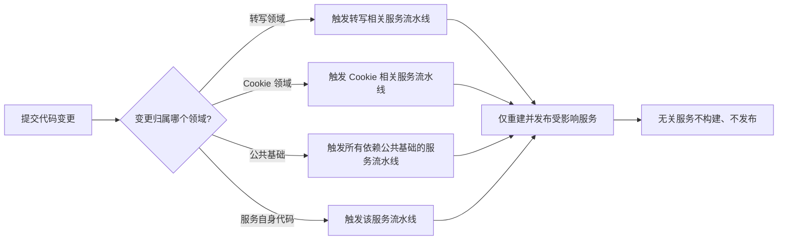

# Common 公共模型按领域拆分

**功能名称**: Common 公共模型按领域拆分
**PRD 版本**: v1.0
**创建日期**: 2026-09-28
**作者**: Z.Vtuber Workflow Agent

## 背景与目标

### 1.1 背景

平台各后端服务（API、抓取、Cookie、通知、录播、转写、训练等）共享同一份公共模型：数据实体与数据访问定义、共享服务与共享事件模型都沉淀在同一个公共工程里，作为「公共类型单一来源」避免多份维护口径漂移（见 [[20260901-api-crawler-split-prd]]）。

但这份公共模型已经横跨多个业务领域：B 站直播、Cookie、微博、录播、转写、训练、通知……而自动化流水线以「公共工程」为粒度监听变更：**只要公共工程里有任何一处修改，全部服务的镜像流水线都会被触发重建、重新发布**。例如：只修改了 Transcript（转写）相关的模型，Cookie、抓取等完全不受影响的服务也要跟着重新构建一遍。这带来几类问题：

- **构建浪费**：一次小改动触发 8 条镜像流水线同时构建，构建资源与排队时间都被无关构建占用；
- **发布面扩大**：无关服务被重新发布，线上抖动面与回滚面随之扩大，小改动的风险不成比例；
- **反馈变慢**：改一个领域的模型，要等所有服务的镜像都构建完，开发者得到反馈的周期被无关构建拉长；
- **边界模糊**：公共工程内部虽已按领域沉淀，但缺少边界约束，任何领域的类型都能被随意跨用，越改越耦合，最终形成「改一处、动全身」的公共泥球。

### 1.2 目标

- 把公共模型**按业务领域拆分**为可独立引用的单元，领域内聚、归属唯一，跨领域只保留必要的依赖；
- 每个服务**只引用自己实际使用的领域**，不再依赖「一整块公共工程」；
- 自动化构建的触发范围与服务的真实依赖一致：**修改某领域的模型，只重建真正依赖该领域的服务**；
- 拆分对使用者完全无感：对外接口、数据口径、既有数据与拆分前一致。

### 1.3 成功标准

- 典型场景可复现验证：**修改 Transcript 相关模型后，Cookie、抓取等不含转写领域的服务流水线不被触发**，转写相关服务正常重建；
- 每个服务的构建触发范围与其实际引用的领域一一对应，可按清单核对；
- 全量单元测试通过，全部服务镜像可正常构建发布；
- 对外接口行为与数据完全不变，既有数据无需迁移。

## 用户分析

### 2.1 目标用户

- **平台维护者（Deliay）**：负责构建、发布与运维，是构建/发布面收窄的直接受益人；
- **后端开发者**：日常改动公共模型与服务，受益于更短的构建反馈周期与更清晰的领域边界。

### 2.2 用户场景

| 场景 | 用户角色 | 目标 | 痛点 |
|--|--|--|--|
| 修改转写相关模型 | 平台维护者/开发者 | 只重建转写相关服务 | 现在全部服务都被重建、重新发布 |
| 修改 Cookie 相关模型 | 平台维护者/开发者 | 只重建 Cookie 相关服务 | 抓取、录播等无关服务被牵连重建 |
| 修改录播相关模型 | 平台维护者/开发者 | 只重建录播相关服务 | 转写之外的服务被牵连，发布面过大 |
| 发布一个小修复 | 平台维护者 | 发布面最小、影响面可控 | 一次公共改动引发全线重新发布 |
| 新增一个业务领域 | 开发者 | 新领域可独立成块、独立触发 | 新模型只能塞进公共工程，牵动所有服务 |

## 功能需求

### 3.1 功能概述

把共享的公共模型按业务领域（公共基础、B 站直播、Cookie、微博、录播、转写、训练、通知）拆分为可独立引用的单元；每个服务只引用自己用到的领域；自动化构建的触发范围随之收窄到与真实依赖一致。

### 3.2 功能点

#### 功能点 1: 公共模型按领域分组

- **描述**: 把公共模型按业务领域划分为互不混淆的分组：各领域通用的「公共基础」，以及 B 站直播、Cookie、微博、录播、转写、训练、通知等领域。每个模型只归属一个领域，领域内部自洽，领域之间只保留必要的依赖方向（例如转写依赖录播的场次信息），不允许互相缠绕。
- **用户价值**: 公共模型不再是一块「改一处动全身」的整体，改动的影响范围可以被明确预期。
- **验收标准**:
  - [ ] 每个公共模型都有唯一的领域归属，并有可查阅的归属清单；
  - [ ] 领域之间不存在循环依赖；
  - [ ] 领域划分与现有服务的业务边界一致，无「跨两个领域」的模糊模型。

#### 功能点 2: 服务按需引用领域

- **描述**: 每个服务只引用自己实际使用的领域单元，不再引用整块公共工程；引用清单与服务真实使用的内容一致，多余引用需清理。
- **用户价值**: 服务之间的改动互相隔离，某领域的修改不会波及不使用它的服务。
- **验收标准**:
  - [ ] 每个服务的领域引用清单与其实际使用一致，无多余引用；
  - [ ] 不存在「被所有服务全量依赖」的公共单元（仅公共基础被广泛引用）；
  - [ ] 拆分后各服务的功能行为与拆分前一致。

#### 功能点 3: 自动化构建触发范围收窄

- **描述**: 各服务镜像流水线的触发范围，从「公共工程任意变更」收窄为「该服务实际依赖的领域变更」。
- **用户价值**: 只构建需要构建的服务，构建更快、发布面更小、反馈更及时。
- **验收标准**:
  - [ ] 修改 Transcript 相关模型，只触发转写相关服务的流水线；
  - [ ] 同一变更下，Cookie、抓取等不含转写领域的服务流水线**不被触发**；
  - [ ] 修改被多方共用的公共基础时，所有依赖它的服务仍能正确触发，不遗漏；
  - [ ] 服务自身代码变更仍照常触发该服务流水线。

#### 功能点 4: 拆分对使用者无感

- **描述**: 拆分过程不改变任何对外行为：接口、数据口径、既有数据与索引完全沿用，前端与调用方无需配合改造；开发与本地编排体验不劣于拆分前。
- **用户价值**: 风险可控，拆分可以随时进行而不影响线上使用。
- **验收标准**:
  - [ ] 全部对外接口的契约与行为回归通过；
  - [ ] 既有数据无需迁移即可被各服务正常读写；
  - [ ] 本地开发编排可正常拉起全部服务。

### 3.3 用户操作流程

### 3.4 页面/界面描述

本需求不涉及页面与界面变更，管理后台及各查询界面保持现状。

### 3.5 异常与边界情况

| 情况 | 预期行为 |
|------|---------|
| 修改的模型被多个领域共用（公共基础） | 依赖它的服务全部正常触发重建，不遗漏 |
| 一次变更同时涉及多个领域 | 各自触发对应领域的服务，不牵连其他服务 |
| 服务引用了自己并不使用的领域 | 评审时可依据领域清单发现并纠正 |
| 新增业务领域 | 按同样的规则新增领域单元与触发范围，不影响既有领域 |
| 拆分后首次部署 | 沿用既有数据与索引，无需迁移、无需人工处理历史数据 |
| 拆分过程中出现行为差异 | 以「对外行为完全不变」为准回退修正，不允许带差异上线 |

## 四、非功能需求

### 4.1 性能要求

- 运行时性能不因拆分而变化（纯结构变更，不引入新的运行时调用）；
- 单领域变更触发的流水线数量显著下降：从「全部服务」降为「该领域实际依赖的服务」，构建反馈周期随之缩短。

### 4.2 安全性要求

- 不改变任何凭证（Cookie）的存储、脱敏与访问面；
- 后台沿用内网免鉴权约定，本期不新增鉴权机制。

### 4.3 兼容性要求

- 对外 API 契约与行为完全不变，前端与管理后台无需配合改造；
- 既有数据库集合、索引与历史数据完全沿用，不做任何迁移；
- 本地开发编排（Aspire）可同时拉起全部服务，开发体验不劣于拆分前。

## 五、依赖与约束

### 5.1 依赖

- 现有各后端服务与镜像构建流水线均正常运行；
- 现有服务之间的业务领域边界（直播 / Cookie / 微博 / 录播 / 转写 / 训练 / 通知）已经成形，可作为领域划分依据。

### 5.2 约束

- 本期为**纯结构性拆分**：不新增业务功能、不改变任何对外行为；
- 拆分过程中保持主干随时可构建、测试全绿；
- 拆分粒度以「业务领域」为准，不追求过度细分，避免为拆而拆；
- 公共类型仍维持「单一来源」，禁止在多个领域重复维护同一份模型。

## 六、相关文档

- 技术提案：`docs/engineering/proposals/20260928-proposal-common-split.md`
- 关联 PRD：`docs/product/draft/20260901-api-crawler-split-prd.md`
- 现有契约：`contracts/*.yaml`（本期不变更）
