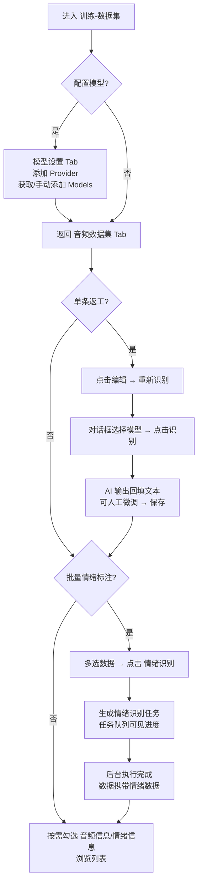

# AI 训练 - 数据集工具优化（模型接入 / 重新识别 / 情绪识别 / 列表展示优化）

**功能名称**: 训练 - 数据集工具优化
**PRD 版本**: v1.0
**创建日期**: 2026-09-28
**作者**: Z.Vtuber Workflow Agent

## 背景与目标

### 1.1 背景

AI 训练模块第一期已完成「音频数据集」（见 [[20260927-training-audio-dataset-prd]]）：识别完成的 Transcript 可导入数据集，支持逐条校对、修订与批量清理。但在实际维护训练语料的过程中，仍有三类高频诉求未被满足：

1. **缺少统一的模型接入管理**：后续的重新识别、情绪识别等 AI 加工能力都依赖大模型，目前没有一个地方统一维护「用哪家服务、哪个模型、什么密钥」；
2. **单条数据识别结果无法返工**：导入的音频数据文本来自首次识别，质量不佳的条目只能手工逐字修订，无法借助更强的模型对单条音频「重新识别」；
3. **缺少情绪维度标注**：语音类训练（尤其是 TTS/语音合成）需要情绪标注数据，目前数据集只有文本，没有情绪信息，且人工标注成本极高，需要 AI 批量产出情绪结构化数据。

同时，随着数据字段增多（音频信息 + 情绪信息），数据集列表需要更灵活的信息展示控制。

### 1.2 目标

- 「训练-数据集」页面新增「模型设置」Tab，支持接入 OpenAI-like 与 Claude-like 两类模型服务，统一管理 Providers 与 Models；
- 数据集单条数据支持「重新识别」：在编辑对话框内选择模型对音频重新识别，AI 输出回填文本，确认后保存；
- 支持多选数据后提交「情绪识别」任务，后台排队执行，每条数据产出一组结构化情绪数据；
- 「数据集」页面提供「任务队列」视图，可见情绪识别任务的排队与执行情况；
- 数据集列表展示优化：可按需展示/隐藏「音频信息」与「情绪信息」两组字段。

### 1.3 成功标准

- 用户可在「模型设置」Tab 完成「添加 Provider → 获取模型列表 → 模型可用于识别」的完整配置闭环；
- 用户可对单条数据完成「编辑 → 重新识别 → 识别回填文本 → 保存」的闭环，识别文本与音频内容对应；
- 用户可多选数据提交情绪识别任务，并在「任务队列」中看到任务从排队到完成的过程；完成后每条数据带有完整的情绪结构化数据（情绪控制权重、情绪描述与八种情绪维度）；
- 列表默认突出情绪信息，音频信息可按需展开，展示控制在分组切换之前、位置明显。

## 用户分析

### 2.1 目标用户

平台运营者 / 训练数据维护者（自用场景）。

### 2.2 用户场景

| 场景 | 用户角色 | 目标 | 痛点 |
|--|--|--|--|
| 配置 AI 模型 | 数据维护者 | 统一维护可用的大模型服务与模型清单 | 无统一入口，密钥与模型信息散落 |
| 返工低质量识别文本 | 数据维护者 | 对单条音频用更强模型重新识别并替换文本 | 只能手工逐字修订，成本高 |
| 批量标注情绪 | 数据维护者 | 让 AI 批量为数据产出结构化情绪数据 | 人工标注情绪成本极高且不一致 |
| 跟踪批量加工进度 | 数据维护者 | 查看情绪识别任务排队与完成情况 | 后台执行不可见，不知道做到哪了 |
| 审视数据字段 | 数据维护者 | 按需查看音频信息或情绪信息 | 字段一多列表臃肿，重点不突出 |

## 功能需求

### 3.1 功能概述

「训练-数据集」页面新增「模型设置」Tab（Providers/Models 两级管理，支持 OpenAI-like 与 Claude-like）；音频数据的内联编辑增加「重新识别」入口，弹出对话框选择模型对音频重新识别并回填文本；列表多选后可提交「情绪识别」后台任务，任务在「任务队列」中可见，完成后数据携带结构化情绪数据；列表展示增加「音频信息」「情绪信息」两组字段的显隐控制。

### 3.2 功能列表

#### 功能点 1: 「模型设置」Tab

- **描述**: 「训练-数据集」页面在「音频数据集」之外新增「模型设置」Tab。Tab 内分两个区块：
  - **Providers**：列表管理模型服务商，字段包括：名称、模型类型（OpenAI / Claude）、Endpoint、API key；支持新增、编辑、删除。API key 属于敏感信息，保存后不回显。
  - **Models**：列表管理可用模型，展示使用 slug 形式 `{provider}/{model}`（如 `openai/gpt-4o-audio`）。
    - 添加 Provider 后，可从其 Endpoint 获取该服务商的模型列表，一键纳入 Models；
    - 也可手动添加 Model，添加时 Provider 字段通过下拉框从已有 Providers 中选择；
    - 支持删除 Model。
- **用户价值**: 所有 AI 加工能力共用的模型配置有了统一、可见的管理入口，换模型/换服务商不再依赖改配置或改代码。
- **验收标准**:
  - [ ] 「模型设置」Tab 与「音频数据集」Tab 并列展示；
  - [ ] Providers 可新增/编辑/删除，字段含名称、模型类型（OpenAI / Claude）、Endpoint、API key；
  - [ ] API key 保存后不在界面回显；
  - [ ] 添加 Provider 后可从 Endpoint 获取模型列表并加入 Models；
  - [ ] 可手动添加 Model，Provider 字段为下拉选择已有 Providers；
  - [ ] Models 以 `{provider}/{model}` slug 形式展示；
  - [ ] 删除 Provider 时其下 Models 的处理有明确提示（一并移除或阻止删除并说明原因）。

#### 功能点 2: 单条数据「重新识别」

- **描述**: 在音频数据列表中点击某条数据「编辑」进入内联编辑态后，除既有「保存」「取消」外，增加「重新识别」按钮。点击后弹出对话框，包含：
  - 「model选择」下拉框（选项来自「模型设置」中已配置的 Models，以 slug 展示）；
  - 「文本」文本框（初始为当前文本，识别完成后回填 AI 输出）；
  - 「识别」「保存」「取消」三个按钮。
- 点击「识别」：将该条数据的音频连同识别 prompt 提交给所选模型，要求模型输出 JSON 结构的识别结果；识别完成后把识别文本回填到对话框「文本」框。识别过程中有明确加载状态，防止重复提交。
- 点击「保存」：与内联编辑的保存行为一致（保存文本等字段并关闭对话框）；「取消」放弃修改。
- **用户价值**: 质量不佳的识别文本可用更强模型单条返工，「试听校对 → 重新识别 → 微调 → 保存」在一个对话框内完成。
- **验收标准**:
  - [ ] 内联编辑态出现「重新识别」按钮，点击弹出对话框；
  - [ ] model 下拉框列出已配置 Models（slug 展示），未配置任何模型时给出引导提示；
  - [ ] 点击「识别」后展示加载状态，完成后文本回填到「文本」框，可继续人工微调；
  - [ ] 识别失败（模型不可用、输出非法等）有明确错误提示，原文本不被破坏；
  - [ ] 「保存」与内联编辑保存行为一致；「取消」不产生任何修改。

#### 功能点 3: 批量「情绪识别」与任务队列

- **描述**:
  - 音频数据列表多选数据后，工具栏「情绪识别」按钮变为可点击（未多选时不可用）；点击后弹出确认框，「model选择」为下拉框（选项来自「模型设置」已配置的 Models，slug 展示，必选），确认后将所选数据提交为「情绪识别任务」，由后台排队执行识别，无需用户等待；
  - 「数据集」页面增加「任务队列」区域，展示「情绪识别任务」队列及每个任务的执行情况（状态、进度、成功/失败数量、所用模型、创建时间等），并自动刷新；
    - **任务粒度口径**：实现为**条目级任务**（每条数据一个任务，含状态/尝试次数/错误），批次提交是一次性回执（`{created, skipped}`）并在队列顶部以全局状态计数 chips 汇总（待处理/执行中/已完成/失败）；「批次进度」以这组 counts 体现，不额外维护 batchId 分组。
    - **模型可用性**：提交与执行均校验所选 model 的启用状态——停用模型提交返回 400 `model disabled`；已入队但尚未执行的任务在 Runner 执行时同样校验，停用则置 FAILED `model disabled`，与单条「重新识别」同口径。
  - 每条数据识别完成后对应一组结构化情绪数据，字段为：
    - 情绪控制权重（Emotion control weight）
    - 情绪描述（Emotion description）
    - 开心（Happy）
    - 愤怒（Angry）
    - 悲伤（Sad）
    - 恐惧（Afraid）
    - 厌恶（Disgusted）
    - 忧郁（Melancholic）
    - 惊讶（Surprised）
    - 平静（Calm）
  - 情绪数据由 AI 按 prompt 要求产出上述结构；同一数据重复识别时以最新结果覆盖；
  - 数据集的数据列表可将识别出的情绪数据作为列展示（见功能点 4）。
- **用户价值**: 情绪标注从「逐条人工」变为「批量提交、后台执行、队列可见」，数据加工进度透明可追踪。
- **验收标准**:
  - [ ] 未多选数据时「情绪识别」按钮不可点击，多选后可点击；
  - [ ] 点击后弹出确认框，model 为必选下拉（slug 展示），确认后才提交、取消不产生任务；
  - [ ] 提交后生成情绪识别任务，并在「任务队列」中立即可见；
  - [ ] 任务队列展示任务状态（排队中/执行中/完成/失败）与进度，且随执行自动更新；
  - [ ] 任务完成后，每条数据具备上述十个字段的完整情绪数据；
  - [ ] 单条数据识别失败不影响任务内其他数据，任务结果中可见失败数量；
  - [ ] 同一数据重复识别以最新结果覆盖。

#### 功能点 4: 数据集列表展示优化

- **描述**: 在列表的分组切换控件**前面**增加「展示类型」控制，包含两个勾选框：
  - 「音频信息」：勾选后展示音频类型、音频来源、音频地址、音频标识、开始时间、结束时间六列，**默认不勾选（隐藏）**；
  - 「情绪信息」：勾选后展示情绪控制权重、情绪描述、开心、愤怒、悲伤、恐惧、厌恶、忧郁、惊讶、平静十列，**默认勾选（展示）**。
- 文本列与操作列始终展示，不受勾选影响；尚未识别情绪的数据，情绪列展示为空态（如「-」）。
- **用户价值**: 列表默认聚焦最新加工成果（情绪信息），历史字段按需展开，信息密度可控。
- **验收标准**:
  - [ ] 分组切换控件前出现「音频信息」「情绪信息」两个勾选框；
  - [ ] 默认状态：音频信息隐藏、情绪信息展示；
  - [ ] 勾选/取消勾选即时生效，列随之展示/隐藏；
  - [ ] 无情绪数据的数据行，情绪列为空态展示；
  - [ ] 既有编辑、多选、分组、波形试听能力不受展示控制影响。

### 3.3 用户操作流程

### 3.4 页面/界面描述

| 页面 | 描述 | 关键元素 |
|------|------|---------|
| 训练-数据集 / 模型设置 Tab（新增） | 模型服务与模型清单管理 | Providers 列表（名称/模型类型/Endpoint/API key + 新增/编辑/删除）；「从 Endpoint 获取模型」入口；Models 列表（slug 展示 + 手动添加：Provider 下拉 + 模型名 + 删除） |
| 训练-数据集 / 音频数据集 Tab（变更） | 数据列表与批量加工 | 工具栏：「情绪识别」按钮（多选后可用，点击弹出确认框选择 model）；展示类型勾选框（音频信息/情绪信息，位于分组切换前）；任务队列区域（任务状态/进度/模型/时间，自动刷新） |
| 重新识别对话框（新增） | 单条数据 AI 返工 | model 选择下拉框（slug）；文本框；识别/保存/取消按钮；识别加载状态与错误提示 |

界面说明：任务队列位于「音频数据集」Tab 内列表附近（如列表上方或下方独立区块），不影响既有数据集选择器与导入入口；情绪列默认展示使列表宽度增加，列宽策略沿用既有「限宽截断 + 悬浮完整值」的做法。

### 3.5 异常与边界情况

| 情况 | 预期行为 |
|------|---------|
| 未配置任何 Provider/Model | 重新识别对话框的模型下拉为空，给出「请先在模型设置中配置」的引导提示；「情绪识别」提交时提示需先配置模型 |
| Provider 的 Endpoint 不可达 / 密钥错误 | 获取模型列表失败并提示原因；识别调用失败提示模型服务不可用 |
| 识别时模型输出非预期 JSON | 视为识别失败，提示「识别结果格式异常」，原文本/原情绪数据不被破坏 |
| 音频地址失效（重新识别/情绪识别时） | 该条识别失败并提示音频不可用；批量任务中记为失败条目，不影响其他数据 |
| 批量任务中部分数据识别失败 | 任务继续执行其余数据，任务结果展示成功/失败数量 |
| 同一数据同时被重新识别与情绪任务处理 | 各写各的字段（文本 / 情绪数据），互不覆盖 |
| 删除 Provider | 提示其下 Models 将一并移除（或阻止删除并要求先清理 Models），已被任务引用的模型在任务队列中仍可见其 slug |
| 任务执行中刷新/离开页面 | 任务后台继续执行，回到页面后任务队列展示最新状态 |
| 情绪列默认展示导致列过宽 | 情绪数值列限窄宽、描述列截断悬浮完整值，与既有列宽策略一致 |

## 四、非功能需求

### 4.1 性能要求

- 情绪识别为后台批量执行，提交任务不阻塞页面操作；任务队列状态自动刷新（秒级轮询即可）；
- 单条重新识别为同步等待模型返回，需有明确加载状态；超时（如 2 分钟）给出失败提示；
- 批量任务按条顺序或低并发执行，避免触发模型服务限流。

### 4.2 安全性要求

- API key 属于敏感信息：仅写入、不回显，界面与接口均不返回完整密钥；
- 沿用现有管理后台访问口径，不新增公开访问面。

### 4.3 兼容性要求

- 不影响既有数据集管理、导入、编辑、多选删除、分组与波形试听功能；
- 情绪数据作为数据的扩展信息承载，不改变既有字段语义；
- 「模型设置」中的模型类型为开放设计，后续可扩展更多服务商类型。

## 五、依赖与约束

### 5.1 依赖

- 既有音频数据集能力（第一期）：数据集/条目管理、音频试听地址（重新识别与情绪识别的音频来源）；
- 外部大模型服务：OpenAI-like / Claude-like 兼容 Endpoint，需支持音频输入（base64）与 JSON 结构化输出。

### 5.2 约束

- 情绪识别的后台执行能力在训练服务内实现，不新建独立服务；
- 本期情绪维度固定为上述十字段结构；
- 重新识别本期只回填「文本」，不改动起止时间与音频地址；
- 不涉及模型训练本身。

## 六、相关文档

- 技术提案：[[20260928-proposal-training-dataset-emotion]]（docs/engineering/proposals/20260928-proposal-training-dataset-emotion.md）
- 关联 PRD：[[20260927-training-audio-dataset-prd]]（docs/product/draft/20260927-training-audio-dataset-prd.md）
- 关联 PRD：[[20260916-recording-transcript-prd]]（docs/product/draft/20260916-recording-transcript-prd.md）
