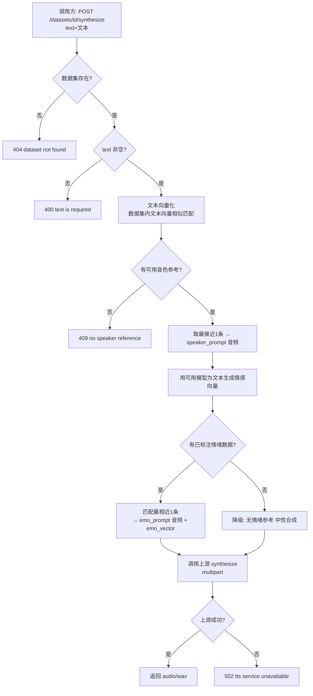

# AI 训练 - 音频生成（数据集语音合成）

**功能名称**: 训练 - 音频生成（数据集语音合成）
**PRD 版本**: v1.0
**创建日期**: 2026-09-29
**作者**: Z.Vtuber Workflow Agent

## 背景与目标

### 1.1 背景

内网已上线音频生成（TTS）接口「`https://tts.internal.fffdan.com/synthesize`」（FastAPI，对应项目 [`Deliay/index-tts-api`](https://github.com/Deliay/index-tts-api)，封装 IndexTTS-2.5 零样本语音合成），支持**音色克隆**（`speaker_prompt` 参考音频）与**情绪控制**（`emo_prompt` 情绪参考音频 / `emo_vector` 八维情绪向量 / `emo_text` 情绪描述）。

与此同时，AI 训练模块已具备可用的训练语料与加工成果（见 [[20260927-training-audio-dataset-prd]]、[[20260928-training-dataset-emotion-prd]]）：

- **音频数据集**内每条数据具备「音频地址 + 起止时间 + 文本」，可作为音色克隆的参考音频来源；
- **情绪识别**已为数据产出结构化情绪数据（情绪控制权重、情绪描述与开心/愤怒/悲伤/恐惧/厌恶/忧郁/惊讶/平静八维强度），可作为情绪控制的参考。

但目前缺少把这些**训练数据 + 上游 TTS** 串起来、面向调用方**按需生成音频**的能力：调用方只有文本，无法自行挑选合适的音色参考与情绪参考，也不了解上游 `multipart` 合成契约。本需求提供统一的**音频生成接口**：给定一个数据集与一段文本，自动从该数据集挑选最贴近的音色参考与情绪参考，调用上游合成并返回音频。

### 1.2 目标

- training 服务提供音频生成接口 `POST /api/training/datasets/{id}/synthesize`，输入 `{ text: "文本" }`，返回合成音频数据（WAV）；z-vtuber（`servers/api`）在既有「数据集 API」代理面（`/api/training/**`）内暴露该接口；
- **音色参考自动匹配**：按文本对数据集进行**向量相似匹配**，返回最接近的 1 条，用其音频作为 `speaker_prompt`（克隆音色）；
- **情绪参考自动匹配**：用可用模型为输入文本生成**情感向量**，与数据集内（已标注情绪的）数据匹配最相近的 1 条，用其作为 `emo_prompt`（情绪参考音频）与 `emo_vector`（情绪向量）；
- 按匹配到的数据调用上游 `synthesize` 接口并**返回音频数据**。

### 1.3 成功标准

- 调用方传入某数据集与文本，即可得到一段用该数据集音色克隆、并带匹配情绪倾向的 WAV 音频，无需自行挑选参考、无需了解上游契约；
- 音色参考与情绪参考的选取**可预期、可复现**（同一数据集 + 同一文本 → 同一参考与同一匹配结果）；
- 关键异常（数据集不存在、数据集无可用音色参考、文本为空、上游不可用等）返回明确错误码，不返回损坏音频。

## 用户分析

### 2.1 目标用户

平台运营者 / 语音合成能力调用方（自用场景，如下游 VTuber 台词播报、语音试听等）。

### 2.2 用户场景

| 场景 | 用户角色 | 目标 | 痛点 |
|--|--|--|--|
| 按文本生成克隆语音 | 能力调用方 | 给定数据集与文本，生成该音色的语音 | 自行挑音色参考/情绪参考、拼 multipart 契约成本高 |
| 带情绪的台词合成 | 能力调用方 | 让合成语音带有贴近文本的情绪 | 手工选情绪参考与八维向量门槛高 |
| 复用训练语料 | 数据维护者 | 让已校对/已标注的数据集直接服务合成 | 数据与 TTS 之间缺少桥梁 |

## 功能需求

### 3.1 功能概述

training 服务在「数据集」之上新增**音频生成接口**：以某个数据集为参考池，对输入文本自动匹配音色参考（文本向量相似）与情绪参考（情感向量相似），调用上游 index-tts-api `synthesize` 合成并返回音频。数据集 API 通过 z-vtuber 代理统一暴露。

### 3.2 功能列表

#### 功能点 1: 音频生成接口

- **描述**: training 提供 `POST /api/training/datasets/{datasetId}/synthesize`，请求体 `{ "text": "文本" }`（`text` 必填；可选 `lang` 语种、`modelId` 情绪生成所用模型），成功返回合成音频（`audio/wav`）。
- **用户价值**: 一个接口完成「文本 → 克隆语音」，屏蔽参考挑选与上游合成细节。
- **验收标准**:
  - [ ] 传入数据集 id 与 `text` 返回 `audio/wav` 音频数据；
  - [ ] `text` 缺失/为空返回 400，数据集不存在返回 404；
  - [ ] `lang` 缺省为中文（可配置），`modelId` 缺省使用可用的默认情绪模型；
  - [ ] 该接口经 z-vtuber `/api/training/**` 代理同样可访问（与既有数据集 API 同口径）。

#### 功能点 2: 音色参考自动匹配（speaker_prompt）

- **描述**: 将输入文本向量化，与该数据集内各数据的文本向量做相似度匹配，取**最接近的 1 条**，用其音频作为 `speaker_prompt`（克隆音色参考）。仅考虑有可用文本向量的数据；匹配在数据集内进行。
- **用户价值**: 自动选取与输入文本最贴近的一条语料作为音色参考，免去人工挑选。
- **验收标准**:
  - [ ] 匹配结果为数据集内与输入文本最相似的 1 条（按向量相似度）；
  - [ ] 同一数据集 + 同一文本 → 稳定命中同一参考；
  - [ ] 数据集内无任何可用音色参考时返回明确错误（不返回音频）。

#### 功能点 3: 情绪参考自动匹配（emo_prompt / emo_vector）

- **描述**: 用可用模型为输入文本生成**情感向量**（八维强度），与该数据集内（已具备情绪标注的）数据的情绪向量匹配**最相近的 1 条**，用其音频作为 `emo_prompt`、其情绪向量作为 `emo_vector`（并带情绪描述 `emo_text` 与情绪强度 `emo_alpha`）。
- **用户价值**: 让合成语音带上贴近文本内容的情绪倾向，且情绪参考与情绪向量自洽。
- **验收标准**:
  - [ ] 用可用模型为输入文本生成情感向量；
  - [ ] 匹配到数据集内情绪向量最相近的 1 条，用其作为 `emo_prompt` 与 `emo_vector`；
  - [ ] 数据集内无已标注情绪的数据时降级为「无情绪参考」（中性合成）并仍返回音频。

#### 功能点 4: 上游合成与音频返回

- **描述**: 按上游 index-tts-api `synthesize` 契约（`multipart/form-data`）提交 `text`、`lang`、`speaker_prompt`、`emo_prompt`/`emo_vector` 等，返回合成音频数据（WAV）透传给调用方；失败返回明确错误码。
- **用户价值**: 复用内网已上线的 IndexTTS-2.5 能力，稳定产出克隆音频。
- **验收标准**:
  - [ ] 提交字段符合上游契约，`speaker_prompt` 必带、情绪字段按匹配结果带或不带；
  - [ ] 成功返回上游 WAV 音频（`audio/wav`）；
  - [ ] 上游不可用/出错返回 502，不返回损坏音频。

### 3.3 用户操作流程

### 3.4 接口/交互描述

本需求为**后端音频生成能力**，不新增 Web 页面；对外交互即 REST 接口（详见技术提案 §3 API 设计）。

| 项 | 描述 |
|------|------|
| 接口 | `POST /api/training/datasets/{datasetId}/synthesize`（training 服务；z-vtuber `/api/training/**` 代理暴露） |
| 请求 | `{ "text": "文本" }`（必填）；可选 `lang`、`modelId` |
| 响应 | 成功 `200 audio/wav`（合成音频）；错误 `{"error": "..."}` |
| 参考选取 | 音色参考 = 数据集内文本向量最相似 1 条；情绪参考 = 数据集内情感向量最相近 1 条（可用模型为文本生成情感向量后匹配） |

### 3.5 异常与边界情况

| 情况 | 预期行为 |
|------|---------|
| 数据集不存在 | 404 `dataset not found` |
| `text` 缺失或为空 | 400 `text is required` |
| 数据集为空 / 无任何可用音色参考（无文本向量） | 409 `no speaker reference`（无法克隆音色，返回明确错误） |
| 文本向量化（embedding）服务不可用 | 502 `embedding service unavailable` |
| 无已标注情绪的数据 / 情绪生成失败 | 降级为「无情绪参考」中性合成，仍返回音频（记日志） |
| 参考音频取数失败（条目音频地址失效） | 该条跳过匹配候选；若导致无可用音色参考则 409 |
| 上游 TTS 不可用 / 超时 / 报错 | 502 `tts service unavailable` |
| 输入文本极长 | 按上游 `max_text_tokens_per_segment` 分段合成（上游既有行为），不在本期额外限制 |

## 四、非功能需求

### 4.1 性能要求

- 合成延迟由上游 IndexTTS-2.5（GPU 推理）主导，接口需设置合理超时（默认 120s）并在超时时返回明确错误；
- 匹配（文本/情绪向量相似度）在单数据集千级数据量下为内存计算，延迟可忽略；参考音频取数并行/按需拉取。

### 4.2 安全性要求

- 沿用现有管理后台/内网访问口径，不新增公开访问面；
- 复用既有模型服务的 key 不回显、日志不打印密钥与音频内容。

### 4.3 兼容性要求

- 不影响既有数据集管理、导入、编辑、情绪识别与波形试听功能；
- 复用既有情绪数据结构（`Extensions.emotion` 八维）与模型管理，不改动其语义；
- 合成结果为纯新增输出，不写入数据集（可选的合成记录/缓存留待后续）。

## 五、依赖与约束

### 5.1 依赖

- 内网音频生成接口 `https://tts.internal.fffdan.com/synthesize`（IndexTTS-2.5，`Deliay/index-tts-api`）；
- 音频数据集（条目具备文本 + 音频地址，供音色/情绪参考取数）；
- 文本向量（embedding）能力（**新增**）：为数据集条目文本生成向量，支撑音色参考匹配；
- 可用模型（既有 Models 管理）：为输入文本生成情感向量，支撑情绪参考匹配；
- 条目情绪标注（既有情绪识别产出的 `Extensions.emotion`）：作为情绪匹配候选。

### 5.2 约束

- 上游 `speaker_prompt` 为**必填**，故数据集必须至少有一条可用音色参考，否则无法合成；
- `lang` 需求输入仅为文本，缺省按中文（ZH）处理（可配置）；
- 情绪匹配依赖数据集已有情绪标注数据，无标注时降级中性合成（不阻断）；
- 文本向量依赖 embedding 模型；升级后需对存量条目做一次向量回填（见技术提案）；
- 本期只做「合成并返回音频」，不含合成结果入库/缓存、批量合成、Web 合成界面与模型训练。

## 六、相关文档

- 技术提案：[[20260929-proposal-training-audio-synthesize]]（docs/engineering/proposals/20260929-proposal-training-audio-synthesize.md）
- 关联 PRD：[[20260927-training-audio-dataset-prd]]（docs/product/draft/20260927-training-audio-dataset-prd.md）
- 关联 PRD：[[20260928-training-dataset-emotion-prd]]（docs/product/draft/20260928-training-dataset-emotion-prd.md）
- 上游项目：[`Deliay/index-tts-api`](https://github.com/Deliay/index-tts-api)（IndexTTS-2.5 `POST /synthesize`）
