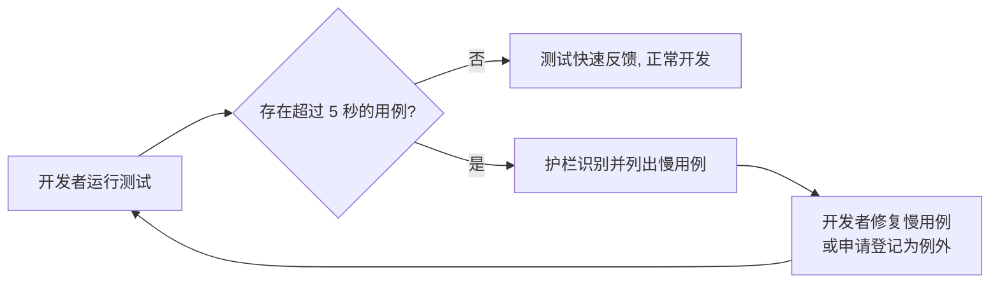

# 测试运行性能优化

**功能名称**: 测试运行性能优化
**PRD 版本**: v1.0
**创建日期**: 2026-09-30
**作者**: AI Agent

## 背景与目标

### 1.1 背景

项目的自动化测试套件当前运行得非常慢。测试是本项目的核心质量保障手段（TDD 开发、核心逻辑覆盖率不低于 80%、合并前必须 review 且测试通过），但随着业务功能持续增长，一次完整测试运行的耗时已经严重影响开发节奏：

- 开发者本地跑一次测试需要长时间等待，很多人因此选择「少跑、不跑」，TDD 的「红-绿-重构」循环被拉长甚至失效；
- 合并前的测试验证成为流水线瓶颈，提交到反馈的周期变长；
- 慢测试往往伴随脆弱性（依赖等待时长、环境时序），测试越慢越容易出现间歇性失败，进一步降低团队对测试的信任。

### 1.2 目标

1. **定位慢的根源**：产出一份可复现的测试耗时基线报告，明确指出耗时的主要构成（哪些用例、哪类开销占了大部分时间）；
2. **修复并达标**：完成优化后，**单个测试用例的执行耗时不超过 5 秒**（经评审登记的特殊例外除外）；
3. **整体提速**：完整测试套件的总运行时长显著下降，恢复「随时跑全量测试」的开发体验；
4. **长效护栏**：建立机制防止未来新增的测试再次拖慢套件。

### 1.3 成功标准

| 指标 | 现状 | 目标 |
|------|------|------|
| 单个测试用例耗时 | 存在远超 5 秒的用例 | ≤ 5 秒（例外清单内用例除外） |
| 慢用例可见性 | 无 | 每次测试运行可输出按耗时排序的用例清单 |
| 新增慢用例防控 | 无 | 有自动化机制识别/拦截超时的测试用例 |
| 例外管理 | 无 | 例外用例有显式清单与理由，可评审 |

## 用户分析

### 2.1 目标用户

- **项目开发者**：日常编写、运行、调试测试的工程师；
- **代码评审者 / 维护者**：依赖测试结果判断合并质量的成员；
- **持续集成流水线**：每次提交自动执行测试的自动化环境。

### 2.2 用户场景

| 场景 | 用户角色 | 目标 | 痛点 |
|--|--|--|--|
| 本地开发循环 | 开发者 | 改完代码立刻跑相关测试验证 | 测试太慢，等待打断心流，索性不跑 |
| 提交前全量验证 | 开发者 | 提交前跑一遍全量测试确认无回归 | 全量耗时过长，验证被跳过或只做部分 |
| 合并前检查 | 评审者 / CI | 快速得到可靠的测试结果 | 反馈周期长，且慢测试易间歇失败 |
| 新增功能开发 | 开发者 | 为新功能补充测试 | 无性能约束意识，新测试可能再次拖慢套件 |

## 功能需求

### 3.1 功能概述

对现有自动化测试体系做一次性能专项治理：先量化定位慢在哪里，再针对性修复，最后以「单 case 5 秒」为硬性基线建立长期护栏。

### 3.2 功能列表

#### 功能点 1: 测试耗时基线与慢因分析报告

- **描述**: 以可复现的方式测量当前测试套件中每个用例的执行耗时，输出按耗时排序的报告，并归纳出导致缓慢的主要原因类别。
- **用户价值**: 让优化工作有的放矢，避免凭猜测改动；报告同时作为优化前后对比的基准。
- **验收标准**:
  - [ ] 产出一份测试耗时报告，包含每个用例的耗时与整体分布
  - [ ] 报告明确指出耗时占比最高的原因类别
  - [ ] 报告可重复生成（有固定的生成方式说明）

#### 功能点 2: 慢测试修复

- **描述**: 依据分析报告，逐项消除导致测试缓慢的根源，使单用例耗时收敛到 5 秒以内。
- **用户价值**: 直接缩短测试反馈周期，恢复 TDD 工作流。
- **验收标准**:
  - [ ] 除例外清单外，所有测试用例单次执行耗时 ≤ 5 秒
  - [ ] 优化过程中不删除、不弱化任何既有测试断言的验证力度
  - [ ] 全量测试在优化后全部通过，且无新增的间歇性失败

#### 功能点 3: 例外清单管理

- **描述**: 对确实无法压缩到 5 秒以内的用例（如涉及真实外部等待的场景），建立显式的例外清单，每条例外附带理由。
- **用户价值**: 基线规则保持刚性的同时，为真实约束留出可评审的出口。
- **验收标准**:
  - [ ] 例外以清单形式显式登记，逐条说明理由
  - [ ] 例外数量保持最小化，新增例外需随代码评审说明

#### 功能点 4: 慢测试长效护栏

- **描述**: 建立自动化机制，在测试运行或提交检查中识别超过 5 秒的用例并给出明显提示或拦截。
- **用户价值**: 防止套件随功能增长再次变慢，让「5 秒基线」成为持续生效的约束而非一次性治理。
- **验收标准**:
  - [ ] 新增的超过 5 秒的用例能被自动识别出来
  - [ ] 护栏机制本身对测试总时长的影响可忽略

### 3.3 用户操作流程

### 3.4 页面/界面描述

本需求不涉及用户界面，产出物为测试运行报告与检查机制的输出信息。

| 输出 | 描述 | 关键元素 |
|------|------|---------|
| 测试耗时报告 | 优化前基线与优化后对比 | 用例名、耗时、排序 |
| 慢用例提示 | 护栏机制的检测结果 | 超时用例列表、阈值、例外标记 |

### 3.5 异常与边界情况

| 情况 | 预期行为 |
|------|---------|
| 用例确需超过 5 秒（如真实等待外部资源） | 登记到例外清单并附理由，不强行压缩 |
| 慢用例在不同环境耗时波动大 | 以稳定的测量方式判定，避免因机器性能差异误报 |
| 优化导致测试失去原有验证能力 | 不允许；优化前后测试的验证语义必须等价 |
| 测试运行环境缺少依赖资源 | 按既有约定处理，不在本需求范围内新增环境依赖 |

## 四、非功能需求

### 4.1 性能要求

- 单测试用例执行耗时 ≤ 5 秒（例外清单除外）；
- 全量套件总时长在优化后应有可感知的显著下降（以基线报告对比为准）。

### 4.2 安全性要求

无特殊安全要求。

### 4.3 兼容性要求

- 不改变任何产品功能的对外行为；
- 不破坏既有测试用例的验证语义与覆盖范围。

## 五、依赖与约束

### 5.1 依赖

- 现有自动化测试套件及其运行环境（本地与 CI）。

### 5.2 约束

- 这是纯工程优化，不涉及任何面向终端用户的功能变更；
- 优化不得以删除测试、降低断言强度的方式达成指标；
- 例外用例必须显式登记且保持最小化。

## 六、相关文档

- 技术提案：`docs/engineering/proposals/20260930-proposal-test-perf-optimization.md`
- 开发规范：`docs/engineering/common-rules.md`
