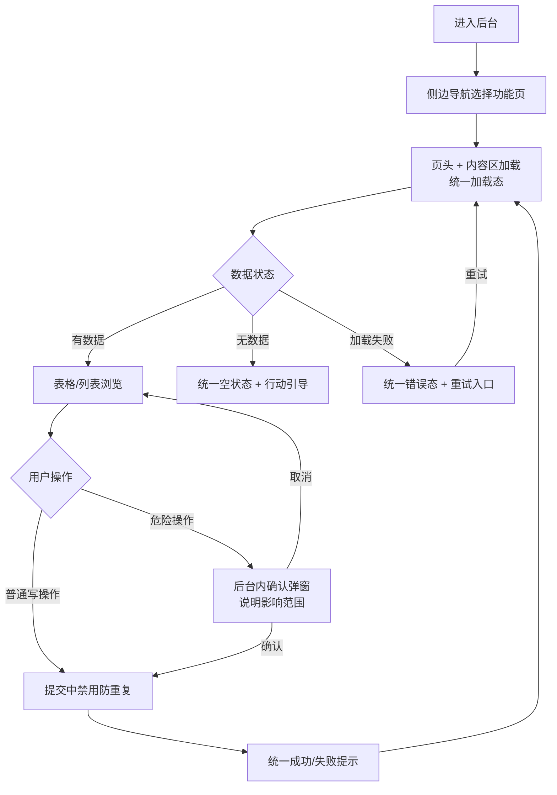

# 管理后台 UI 重设计（全站视觉与交互升级）

**功能名称**: 管理后台 UI 重设计（全站视觉与交互升级）
**PRD 版本**: v1.0
**创建日期**: 2026-10-01
**作者**: AI Agent

## 背景与目标

### 1.1 背景

管理后台自「订阅管理 + Cookie 管理」两个页面起步（见《管理后台初版》PRD），至今已扩展出订阅管理、录制状态、Transcripts、Cookie 管理、通知、训练数据集六大模块。但界面是逐期零散叠加出来的，从未有过一次整体的视觉与交互设计，当前观感与体验问题集中在：

- **视觉不统一**：颜色、字号、间距、圆角、边框各页面各画各的，同一种「按钮」「表格」「输入框」在不同页面长得不一样；深色背景下的层级关系混乱，大片区域缺乏留白与分组；
- **交互反馈缺失**：加载只有一个「加载中...」文字，成功/失败提示是散落在页面各处的彩色小字，容易错过；删除与取消类操作混用浏览器原生弹窗和页面内两步确认，风格与后台完全割裂；
- **状态表达随意**：空状态、错误状态、禁用状态、加载中的表达方式不统一，长文本截断、列宽拥挤、表格对不齐等细节问题普遍；
- **可访问性弱**：焦点态不明显，部分交互缺少语义标签，键盘操作体验差。

「后台 UI 太丑」是本次需求的直接触发原因。本次不做任何功能新增，只做一次彻底的 UI 重设计。

### 1.2 目标

1. **建立统一的设计语言**：明确色彩层级、字体排版、间距节奏、圆角与描边、状态语义（成功/警告/错误/信息）与按钮层级（主操作/次操作/危险操作），全站一致应用；
2. **重做全部六个模块页面的界面**：订阅管理、录制状态、Transcripts、Cookie 管理、通知、训练数据集，功能、数据口径与文案零变更；
3. **统一体验反馈体系**：加载态、空状态、错误态、操作成功/失败提示、危险操作确认，形成全站一致的模式；
4. **提升可访问性**：键盘可达、焦点可见、语义完整、对比度达标。

### 1.3 成功标准

| 指标 | 现状 | 目标 |
|------|------|------|
| 视觉一致性 | 同类元素各页面样式不一 | 全站同类元素外观一致，符合统一设计语言 |
| 操作反馈覆盖 | 提示散落、易错过 | 每个写操作都有统一的即时成功/失败提示 |
| 危险操作确认 | 原生弹窗与行内确认混用 | 全部统一为后台内确认交互，且说明影响范围 |
| 加载/空/错误态 | 纯文字、样式随意 | 全部列表与区块具备统一的加载、空、错误三态 |
| 可访问性 | 焦点态弱、语义不全 | 键盘可达全部操作，焦点可见，深色主题正文对比度 ≥ 4.5:1 |
| 功能回归 | - | 既有全部功能、数据口径与操作文案与重做前一致 |

## 用户分析

### 2.1 目标用户

- **运营/管理员（Deliay）**：负责订阅、录制、转写、凭证、通知与训练数据的日常维护，是后台的唯一用户；
- 使用环境为内网、长时间使用、熟练用户，对重复操作的效率与信息密度敏感。

### 2.2 用户场景

| 场景 | 用户角色 | 目标 | 痛点 |
|--|--|--|--|
| 日常巡检各模块状态 | 运营/管理员 | 快速扫一眼订阅、录制、任务队列是否正常 | 各页样式混乱、状态色含义不一致，扫读成本高 |
| 执行删除/取消等危险操作 | 运营/管理员 | 明确知道会删掉什么再确认 | 原生弹窗风格割裂且不说明影响范围，行内确认又各写一套 |
| 提交表单后确认结果 | 运营/管理员 | 立刻知道成功还是失败 | 成功/失败提示是散落小字，经常没看到 |
| 长时间操作复杂页面（数据集、任务列表） | 运营/管理员 | 稳定、清晰、不疲劳 | 字号间距随意、长文本截断无提示、层级混乱导致视觉疲劳 |
| 界面异常时排查 | 运营/管理员 | 分清是没数据、加载失败还是服务不可用 | 空态、错误态、加载态表达不统一，难以区分 |

## 功能需求

### 3.1 功能概述

在功能、数据与文案完全不变的前提下，为整个管理后台做一次统一的视觉与交互重设计：先定义全站统一的设计语言与布局骨架，再将表格、表单、操作、反馈、确认等界面模式统一起来，最后把六个模块页面逐一按新规范重做。

### 3.2 功能点

#### 功能点 1: 统一设计语言与视觉规范

- **描述**: 定义全站统一的视觉规范并应用到所有页面：以深色为主的专业控制台风格，中性深灰蓝背景搭配单一品牌强调色，层级靠明度与留白表达；统一字号阶梯与行高、间距节奏、圆角、描边与分隔方式；统一定义主操作、次操作、危险操作三级按钮外观与使用规则；成功/警告/错误/信息四类状态色全站含义一致；表格、输入框、下拉、弹窗等元素外观全站一致。
- **用户价值**: 页面观感从「零散拼凑」变为「一套体系」，扫读与操作不再需要逐页重新适应。
- **验收标准**:
  - [ ] 全站同类元素（按钮、表格、输入框、下拉、弹窗、提示）外观一致，有明确的层级与状态表达；
  - [ ] 深色主题下文字与背景对比度达标（正文 ≥ 4.5:1），次要信息与主要信息层级分明；
  - [ ] 危险操作统一使用危险色按钮/入口，且不与主操作混淆；
  - [ ] 全站不再出现未纳入规范的「野生」样式（自行其是的颜色、间距、圆角）。

#### 功能点 2: 全局布局骨架

- **描述**: 全后台统一「侧边导航 + 内容区」骨架：侧边栏顶部为产品品牌区（产品名），下方为分组菜单（既有菜单项保持不变，「训练」仍为独立分组），当前页面菜单项高亮；内容区顶部统一「页头」，包含页面标题、一句话说明与主操作按钮区；内容区的留白、最大宽度与滚动行为全站一致。
- **用户价值**: 用户在任何页面都有稳定的空间认知与操作预期，新增页面时沿用同一骨架即可。
- **验收标准**:
  - [ ] 所有页面共享同一侧边导航与内容区骨架，菜单项与分组与现状一致；
  - [ ] 当前页面菜单项高亮，点击菜单切换内容区，默认进入「订阅管理」；
  - [ ] 每个页面顶部有统一页头（标题 + 说明 + 主操作区），页面主操作位置固定可预期；
  - [ ] 侧边导航与内容区在常见桌面窗口宽度下比例协调，窄窗口下不破版。

#### 功能点 3: 表格与列表统一

- **描述**: 全站表格/列表统一为同一模式：统一表头样式、行悬浮反馈、单元格内边距与对齐规则；列宽可控，长文本截断并在悬浮时可查看完整内容；统一空状态（说明 + 行动引导）与加载状态；多选与批量操作（如批量删除条目）的入口与反馈统一；展开行（波形试听、历史录播、识别结果等）与表格视觉一体。
- **用户价值**: 数据密集页面变得整齐可扫读，长文本不再挤乱版面。
- **验收标准**:
  - [ ] 全站表格表头、行悬浮、单元格间距与对齐规则一致；
  - [ ] 长文本列截断展示，悬浮可见完整内容；
  - [ ] 每个表格在无数据时展示统一空状态，加载中展示统一加载态；
  - [ ] 多选、批量操作、展开行的交互与视觉全站一致，展开内容与表格风格统一。

#### 功能点 4: 表单与操作统一

- **描述**: 全站表单（新增订阅、录入/绑定、模型与设置编辑、内联编辑、播放偏移等）统一为同一模式：输入框、下拉、多行文本的外观与尺寸一致；标签、说明文字、必填标记与校验提示的位置与样式一致；按钮层级（主操作/次操作/危险操作/文本按钮）使用规则一致；提交中的禁用与「进行中」文案一致；内联编辑（数据集条目）与弹窗表单风格统一。
- **用户价值**: 任何表单都能凭既有经验快速完成，校验错误一眼定位。
- **验收标准**:
  - [ ] 全站输入类控件外观、尺寸、聚焦态一致；
  - [ ] 校验错误提示统一出现在对应控件旁，样式与文案规则一致；
  - [ ] 按钮层级与用法全站一致，提交中状态统一展示且防重复提交；
  - [ ] 内联编辑与弹窗表单风格统一，保存/取消操作反馈一致。

#### 功能点 5: 反馈与确认体系统一

- **描述**: 建立全站统一的反馈体系：写操作成功/失败以统一的轻量提示展示（自动消失、不遮挡操作区、可区分成功与失败）；所有危险操作（取消订阅、删除帐号/通知绑定/数据集/数据集条目/模型/Provider/识别设置等）统一使用后台内的确认交互，明确说明影响范围，取消全部浏览器原生确认弹窗；页面内两步行内确认也收敛为同一种确认交互；加载中统一使用局部加载态，不阻塞整页；请求失败给出可读错误与重试引导。
- **用户价值**: 操作结果不再错过，危险操作不再有割裂感与误操作风险。
- **验收标准**:
  - [ ] 每个写操作后都有统一的即时成功/失败提示；
  - [ ] 全部危险操作使用统一的后台内确认交互，且提示中说明影响范围（如「其下 N 个模型将一并删除」）；
  - [ ] 全站不再出现浏览器原生确认弹窗与页面内行内两步确认；
  - [ ] 列表/区块加载中展示统一局部加载态，失败展示统一错误态并提供重试入口。

#### 功能点 6: 六大模块页面重做

- **描述**: 依次按新设计语言重做六个模块页面：订阅管理、录制状态、Transcripts（任务列表 / 设置）、Cookie 管理、通知、训练（音频数据集 / 模型设置）。所有既有功能、数据口径、操作路径与文案保持不变；复杂交互（识别结果实时跟随与试听、波形试听、扫码登录、轮询刷新）的行为保持不变，仅统一外观与反馈。
- **用户价值**: 整个后台焕然一新且零学习成本，老用户无需重新熟悉任何操作。
- **验收标准**:
  - [ ] 六个模块全部页面完成重做，视觉与交互符合本 PRD 功能点 1–5 的规范；
  - [ ] 既有功能逐项回归通过：订阅增删、扫码登录、通知绑定、录制状态与下载、识别任务与试听与字幕下载、数据集导入/编辑/批量删除/波形/情绪识别、模型管理等，行为与重做前一致；
  - [ ] 页面文案与数据口径与重做前一致，无功能增减；
  - [ ] 复杂交互（SSE 实时追加与自动跟随、波形/片段试听、扫码轮询）行为不变且外观统一。

#### 功能点 7: 可访问性与易用性

- **描述**: 全站补齐可访问性：所有交互键盘可达且焦点可见；菜单、表格、弹窗、表单具备完整语义与标签；弹窗打开后焦点进入弹窗、关闭后归还；状态不只依赖颜色区分（配以文字/图标）；悬浮提示与完整信息对键盘用户同样可达。
- **用户价值**: 键盘流用户可完成全部操作，长时间使用更省力。
- **验收标准**:
  - [ ] 全部交互可通过键盘完成，焦点态清晰可见；
  - [ ] 弹窗具备完整语义（可识别为对话框、有名称），焦点管理正确；
  - [ ] 状态信息不只依赖颜色，均有文字或图标辅助表达；
  - [ ] 深色主题下正文对比度 ≥ 4.5:1，非文本控件对比度 ≥ 3:1。

### 3.3 用户操作流程

统一的「查看 → 操作 → 反馈」流程：

### 3.4 页面/界面描述

| 页面 | 描述 | 关键元素 |
|------|------|---------|
| 全局骨架 | 全后台统一布局 | 侧边导航（品牌区 + 分组菜单 + 选中高亮）、内容区页头（标题 + 说明 + 主操作区）、统一留白与滚动 |
| 订阅管理 | 订阅的查看、新增、取消 | 页头、新增订阅表单（平台/主播标识/类型）、订阅表格（平台、昵称、标识、类型、时间、操作）、取消确认弹窗 |
| 录制状态 | 录制三态、实例/场次/文件、历史录播 | 状态标识（未开播/录制中/出错）、轮询刷新、展开区（实时音频入口、历史录播列表与下载）、加载/空/错误态 |
| Transcripts | 任务列表与设置双 Tab | Tab 切换、任务表格、识别结果区（实时追加、限高滚动、试听控件、字幕下载、播放偏移）、发起识别表单、场次任务与重试、设置区（自动识别开关、模型表单） |
| Cookie 管理 | 帐号查看与扫码登录 | 帐号表格（平台、昵称、ID、状态、时间）、新增扫码弹窗（QR 码、轮询状态、失败重试）、删除确认 |
| 通知 | 群维度通知绑定 | 绑定表格、新增绑定表单（类型/群下拉）、删除确认 |
| 训练 | 音频数据集与模型设置双 Tab | 数据集选择器、导入弹窗、条目可编辑表格（多选/批量删除/分组/列显隐/展开波形）、情绪识别确认与任务队列、模型双表与 Provider 弹窗 |
| 反馈与确认层 | 全站统一浮层 | 操作成功/失败提示、危险操作确认弹窗、通用弹窗（新增/编辑）、局部加载态、空状态、错误态 |

### 3.5 异常与边界情况

| 情况 | 预期行为 |
|------|---------|
| 后台服务不可达 / 请求失败 | 统一错误态 + 可读错误信息 + 重试入口，不白屏 |
| 列表为空 | 统一空状态 + 行动引导（如「新增订阅」「导入数据」） |
| 加载中 | 局部统一加载态，不阻塞整页其他区域 |
| 危险操作确认后服务拒绝 | 统一失败提示并保留真实状态，不出现「已删除」假象 |
| 提交中重复点击 | 防重复提交（按钮进入进行中并禁用） |
| 长文本（文件名、URL、错误信息、描述） | 截断展示 + 悬浮/展开可看全文，不挤乱版面 |
| 数据量较大（成百条列表） | 列表滚动流畅，展开/分组等操作不卡顿 |
| 窗口较窄 / 缩放 | 布局不破版，内容可滚动可达 |
| 扫码登录超时 / 二维码失效 | 弹窗内明确状态与重试入口 |
| 实时识别结果断连 | 自动重连行为保持，界面给出连接状态表达 |
| 表单非法输入 | 控件旁统一校验提示，不产生脏数据 |

## 四、非功能需求

### 4.1 性能要求

- 页面常规操作（打开页面、列表加载、提交反馈）在 2 秒内给出可见反馈；
- 重做后不得引入可感知的性能退化：百级列表渲染与滚动流畅，局部加载不阻塞整页；
- 提示、确认弹窗等交互即时响应。

### 4.2 安全性要求

- 任何界面不展示 Cookie 明文内容；
- 危险操作一律需显式确认，且说明影响范围；
- 内网免鉴权的使用方式不变，部署侧仍需保证仅内网可达。

### 4.3 兼容性要求

- 支持主流现代浏览器（Chrome / Edge 最新两个大版本）；
- 面向桌面使用，1280px 及以上宽度为主场景，窗口变窄不破版；本期不做移动端适配；
- 不影响任何既有接口调用方，不改变任何接口行为。

## 五、依赖与约束

### 5.1 依赖

- 现有全部后台功能与数据能力（订阅、录制、转写、Cookie、通知、训练），能力零变更；
- 现有页面的功能逻辑与操作路径作为重做基准。

### 5.2 约束

- 功能、数据口径、操作路径与页面文案零变更，本期不新增任何功能；
- 本期以深色为唯一主题，不做明暗切换、不做个性化换肤；
- 不做登录鉴权、不做地址栏路由定位等新能力；
- 重做后的界面需保持既有自动化测试的语义断言可通过（文案与操作语义稳定）。

## 六、相关文档

- 技术提案: `docs/engineering/proposals/20261001-proposal-admin-console-ui-redesign.md`
- 相关 PRD: [20260822-admin-console-prd.md](20260822-admin-console-prd.md)（管理后台初版）
