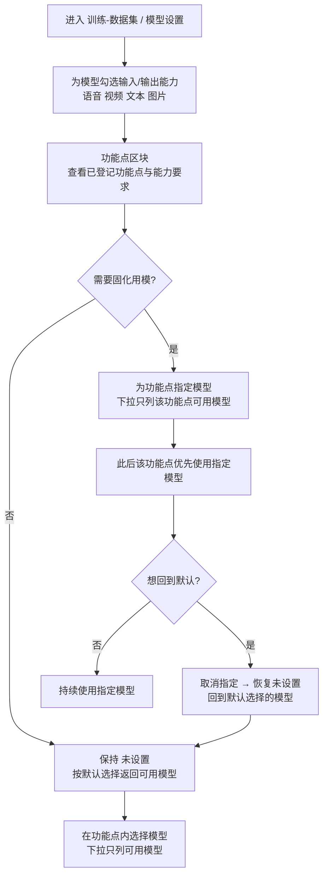

# AI 训练 - 数据集模型设置支持模型能力（模型能力 / 功能点模型指定）

**功能名称**: 训练 - 数据集模型设置支持模型能力
**PRD 版本**: v1.0
**创建日期**: 2026-10-01
**作者**: Z.Vtuber Workflow Agent

## 背景与目标

### 1.1 背景

「训练-数据集」已具备统一的模型设置（Providers / Models 管理，见 [[20260928-training-dataset-emotion-prd]]），但模型只有「启用 / 停用」一个开关，无法表达「这个模型能处理什么形态的数据」。随着数据加工功能增多，不同功能对模型的输入输出形态要求并不相同：

1. **模型用途靠记忆**：数据清洗（重新识别清洗识别文本）、情绪识别等加工能力对模型形态要求不同（有的要吃音频，有的只吃文本），目前哪个模型配哪个功能只能靠人工记住；
2. **会选到不匹配的模型**：把不支持音频的模型用于音频识别，要到调用失败才暴露（如提示模型不支持音频输入），缺少事前的能力约束；
3. **功能点用模型无法固化**：每个功能点当前只能在每次使用时手动选模型，做不到「一次指定、长期生效」，也没有「回到系统默认」的手段。

本期为模型补充「能力」维度（语音、视频、文本、图片），让功能点按能力查询可用模型，并提供功能点维度的模型设置（自动登记、指定、取消指定）。

### 1.2 目标

1. 模型设置中的模型支持「能力」配置：能力分为语音、视频、文本、图片四种，每个模型支持手动设置输入能力与输出能力；存量模型一次性清洗为「输入：语音、文本；输出：文本」；
2. 既有功能点按能力查询可用模型：
   - 功能点「输入语音识别情绪」：需要能力 输入「语音、文本」、输出「文本」；
   - 功能点「输入文本识别情绪」：需要能力 输入「文本」、输出「文本」；
3. 提供功能点维度的模型设置：功能点请求模型时携带功能点标识（slug）并自动登记；可为功能点指定模型，指定后优先返回指定模型；可取消指定恢复为未设置，即恢复此前默认选择的模型；功能点默认为未设置。

### 1.3 成功标准

- 用户可在模型设置中为任一模型勾选输入能力与输出能力，模型列表可见每个模型的能力；
- 升级完成后存量模型自动具备「输入：语音、文本；输出：文本」，无人工干预；
- 「输入语音识别情绪」「输入文本识别情绪」的模型选择处只列出能力满足要求的可用模型，选不到能力不匹配的模型；
- 新功能点无需人工维护：首次请求模型即自动出现在模型设置的功能点列表中（含能力要求）；
- 为功能点指定模型后，该功能点后续请求模型返回指定模型；取消指定后返回的模型与指定前完全一致（默认选择的模型）。

## 用户分析

### 2.1 目标用户

平台运营者 / 训练数据维护者（自用场景）。

### 2.2 用户场景

| 场景 | 用户角色 | 目标 | 痛点 |
|--|--|--|--|
| 标注模型能力 | 数据维护者 | 说清每个模型能吃/能出什么形态 | 模型用途靠记忆，换人维护就失传 |
| 按能力挑模型 | 数据维护者 | 功能点只看到能用的模型 | 会选到不匹配的模型，调用失败才暴露 |
| 固化功能点用模 | 数据维护者 | 功能点长期用指定模型 | 每次使用都要手动选一遍 |
| 回到默认选择 | 数据维护者 | 一键取消指定、回到系统默认 | 没有「恢复默认」手段，改错了回不去 |
| 新功能点接入 | 功能开发者 | 传个标识就能取到可用模型 | 新功能点要人工登记、要改配置 |

## 功能需求

### 3.1 功能概述

模型设置中的模型增加「输入能力 / 输出能力」配置（语音、视频、文本、图片四种，多选）；功能点按能力匹配可用模型；新增功能点维度的模型设置（功能点自动登记、指定模型优先返回、取消指定恢复默认）。

### 3.2 功能列表

#### 功能点 1: 模型能力设置

- **描述**:
  - 模型能力共四种：**语音、视频、文本、图片**；
  - 每个模型支持手动设置「输入能力」与「输出能力」，两者均为多选（同一模型可同时具备多种输入能力、多种输出能力）；
  - 模型设置的模型列表展示每个模型的输入能力与输出能力；新增、编辑模型时均可勾选设置；
  - **存量数据清洗**：升级完成后，对已存在的模型一次性补齐能力为「输入：语音、文本；输出：文本」（与既有数据加工口径一致）；清洗幂等、只补未设置能力的模型，不覆盖用户已手动调整的能力；用户可随时自行修改。
- **用户价值**: 模型「能处理什么」显式可见、可维护，功能点据此自动挑模型，不再靠记忆。
- **验收标准**:
  - [x] 模型的输入能力、输出能力均可从语音、视频、文本、图片中多选；
  - [x] 模型列表可见每个模型的输入能力与输出能力；
  - [x] 新增、编辑模型可设置能力，保存后立即生效；
  - [x] 升级后存量模型自动具备「输入：语音、文本；输出：文本」，无需人工干预；
  - [x] 存量清洗幂等（重复升级/重启不重复处理），且不覆盖用户已调整的能力；
  - [x] 能力被全部取消勾选的模型，不出现在任何功能点的可用模型中。

#### 功能点 2: 功能点按能力查询可用模型

- **描述**:
  - **可用模型**定义：已启用，且输入能力覆盖功能点所需输入能力、输出能力覆盖功能点所需输出能力的模型；
  - 既有功能点的能力要求：

    | 功能点 | 所需输入能力 | 所需输出能力 |
    |--|--|--|
    | 输入语音识别情绪 | 语音、文本 | 文本 |
    | 输入文本识别情绪 | 文本 | 文本 |
    | 数据清洗（既有数据加工，清洗识别文本） | 语音、文本 | 文本 |

  - 「输入语音识别情绪」「输入文本识别情绪」两个功能点的模型选择处只列出各自的可用模型（能力不匹配、已停用的模型不出现）；
  - 「数据清洗」按同一口径接入（能力要求：输入「语音、文本」、输出「文本」），其模型选择处同样只列可用模型；
  - 无可用模型时不给空白下拉，而是给出引导提示（先在模型设置中配置模型与能力）；
  - 模型的能力、启用状态变化后，可用模型列表随之变化。
- **用户价值**: 在选择处就不可能选到能力不匹配的模型，模型调用失败大幅减少。
- **验收标准**:
  - [x] 「输入语音识别情绪」的模型下拉只含：启用，且输入能力含语音、文本，输出能力含文本的模型；
  - [x] 「输入文本识别情绪」的模型下拉只含：启用，且输入能力含文本，输出能力含文本的模型；
  - [x] 「数据清洗」的模型下拉只含：启用，且输入能力含语音、文本，输出能力含文本的模型；
  - [x] 无可用模型时展示引导提示；
  - [x] 修改模型能力或启用状态后，可用模型列表立即反映变化。

#### 功能点 3: 功能点模型设置（自动登记 + 指定 / 取消指定）

- **描述**:
  - **自动登记**：功能点请求模型时会携带自己的功能点标识（slug），系统据此自动把该功能点登记进「模型设置 - 功能点」列表（含名称、标识与能力要求），无需人工维护；同一功能点再次请求时，能力要求以最新声明为准；
  - 功能点列表展示：功能点名称、标识（slug）、所需输入/输出能力、当前模型（未设置 / 指定的模型）；
  - **指定模型**：可从该功能点的可用模型中选择一个作为指定模型；指定后，该功能点请求模型时**优先返回指定模型**；
  - **取消指定（恢复未设置）**：恢复为未设置状态，即恢复此前默认选择的模型，行为与指定前完全一致；功能点默认即为「未设置」；
  - **默认选择**：未设置时，返回该功能点可用模型中默认的一个（按添加时间最早的可用模型，与现状默认口径一致）；
  - **指定模型失效**：指定的模型被删除、停用，或能力调整后不再满足该功能点要求时，该功能点请求模型时按默认选择返回，并在功能点列表标注「指定模型不可用」；指定模型恢复可用后，重新优先返回指定模型（指定本身不被清除）。
- **用户价值**: 功能点用模「一次指定、长期生效」，也能一键回到默认；新功能点零登记成本。
- **验收标准**:
  - [x] 功能点首次请求模型后自动出现在功能点列表，含名称、标识与能力要求；
  - [x] 可为功能点指定模型，指定后该功能点请求模型返回指定模型；
  - [x] 可取消指定，取消后返回默认选择的模型，与指定前一致；默认状态展示「未设置」；
  - [x] 指定模型不可用时返回默认模型，并在功能点列表标注「指定模型不可用」；恢复可用后重新优先返回指定模型；
  - [x] 指定模型只能从该功能点的可用模型中选择；
  - [x] 无可用模型时，功能点请求得到「无可用模型」，各功能点按既有降级口径处理（如合成情绪降级为中性情绪）。

### 3.3 用户操作流程

### 3.4 页面/界面描述

| 页面 | 描述 | 关键元素 |
|------|------|---------|
| 训练-数据集 / 模型设置（变更） | 模型能力展示与设置 | 模型列表新增「输入能力」「输出能力」两列（能力标签展示，未设置显示空态）；新增/编辑模型时的能力勾选（语音/视频/文本/图片 × 输入/输出） |
| 训练-数据集 / 模型设置 / 功能点区块（新增） | 功能点与模型指定 | 功能点列表：名称、标识（slug）、所需输入/输出能力、当前模型（未设置/指定的模型）；「指定模型」下拉（只列可用模型）与「恢复默认」按钮；指定模型不可用时的标注 |
| 功能点的模型选择入口（变更） | 按能力选模型 | 模型下拉只列可用模型，默认选中当前返回的模型（指定优先，默认兜底）；无可用模型时引导提示 |

界面说明：功能点区块位于模型设置内（Providers、Models 同级），随模型设置一并加载；能力以标签（如「语音」「文本」）展示，保持既有表格列宽与截断悬浮口径。

### 3.5 异常与边界情况

| 情况 | 预期行为 |
|------|---------|
| 模型能力被全部取消勾选 | 该模型不进入任何功能点的可用模型；仍可在模型设置中管理与重新勾选 |
| 某功能点无可用模型 | 模型下拉展示引导提示（先配置模型与能力）；功能点请求得到「无可用模型」，调用方按既有降级口径处理 |
| 指定的模型被删除 | 指定不失效清除，运行时按默认选择返回，并在功能点列表标注「指定模型不可用」 |
| 指定的模型被停用 / 能力被调整为不匹配 | 同上（运行时回退默认并标注）；恢复可用后重新优先返回指定模型 |
| 存量模型重复清洗（重复升级/重启） | 幂等，只补未设置能力的模型，不重复处理、不覆盖用户调整 |
| 功能点首次请求即被登记 | 自动登记，能力要求以请求方声明为准；再次请求时能力要求按最新声明更新 |
| 同名不同标识（slug）的功能点 | 视为不同功能点（标识是功能点的唯一身份） |
| 新增模型未勾选能力 | 模型可保存，但不进入任何功能点的可用模型；列表显示能力空态提示补全 |
| 指定模型与手动临时选择并存 | 选择入口默认选中当前返回的模型（指定优先），用户可临时改选，本次以所选为准 |

## 四、非功能需求

### 4.1 性能要求

- 能力匹配与功能点模型解析均为低频配置查询，界面即时反馈即可，无并发/吞吐要求；
- 模型设置页加载功能点区块不阻塞 Providers、Models 主流程。

### 4.2 安全性要求

- 不涉及 API key 的读写变更，沿用既有「密钥只进不出、永不回显」口径；
- 不新增公开访问面，沿用现有管理后台访问口径。

### 4.3 兼容性要求

- 不改变既有模型启用/停用语义，不改变各功能点本身的加工行为（只改变「用哪个模型」的选择口径）；
- 存量模型补齐能力后，其可用范围与现状一致（数据清洗、情绪识别均可用），升级前后默认选择的模型不变化；
- 能力取值固定四种，标签文案统一为「语音、视频、文本、图片」。

## 五、依赖与约束

### 5.1 依赖

- 既有模型设置（Providers / Models 管理，见 [[20260928-training-dataset-emotion-prd]]）；
- 既有数据加工功能：数据清洗（重新识别清洗识别文本）、情绪识别（语音输入 / 文本输入两种用法）。

### 5.2 约束

- 能力取值固定为语音、视频、文本、图片四种，本期不扩展自定义能力；
- 能力由人工设置，系统不自动识别模型能力（存量一次性清洗除外）；
- 功能点标识（slug）由功能点自行声明并保证稳定，系统不做命名校验；功能点需先请求过一次模型才会出现在功能点列表（自动登记）；
- 默认选择规则本期固定为「可用模型中添加时间最早的一个」；
- 本期只做「按能力选模型 / 指定模型」，不改变各功能点的识别/加工逻辑本身。

## 六、相关文档

- 技术提案：[[20261001-proposal-dataset-model-capability]]（docs/engineering/proposals/20261001-proposal-dataset-model-capability.md）
- 关联 PRD：[[20260928-training-dataset-emotion-prd]]（数据集工具优化：模型设置 / 情绪识别）
- 关联 PRD：[[20260927-training-audio-dataset-prd]]（音频数据集）
