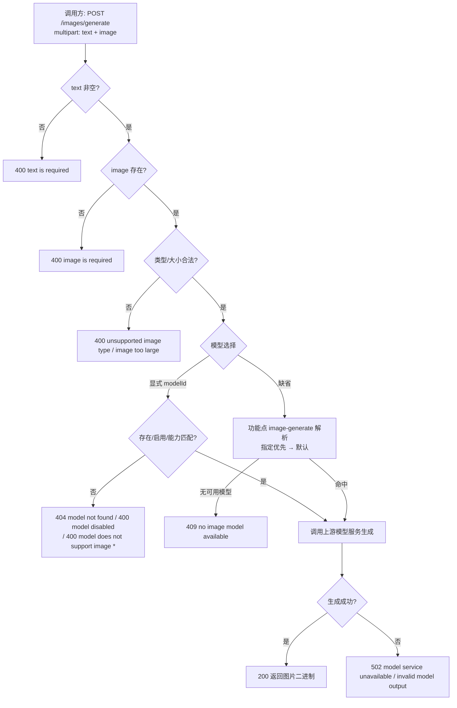

# AI 训练 - 对外提供绘图接口

**功能名称**: 训练 - 对外提供绘图接口（文本 + 图片 → 图片）
**PRD 版本**: v1.0
**创建日期**: 2026-10-01
**作者**: Z.Vtuber Workflow Agent

## 背景与目标

### 1.1 背景

AI 训练模块已具备模型管理基建（见 [[20261001-dataset-model-capability-prd]]）：Provider/Model 可配置 OpenAI-like / Claude-like 端点，模型按**输入/输出能力**（语音/视频/文本/图片四值白名单）标注，功能点可按能力要求解析「指定模型 / 默认模型」。同时，音频生成接口（[[20260929-training-audio-synthesize-prd]]）已验证「training 提供生成能力、z-vtuber 代理对外暴露」的链路。

目前缺少对外**绘图（图像生成/编辑）能力**：调用方希望给定一段文本与一张参考图片，由「输入为文本+图片、输出为图片」的模型生成图片并直接取回结果，而不必了解上游模型服务的鉴权与调用契约。本需求提供统一的**绘图接口**：multipart 上传文本与图片，生成完成返回图片，失败返回明确报错信息。

### 1.2 目标

- training 服务提供绘图接口 `POST /api/training/images/generate`，以 `multipart/form-data` 输入「文本（text）+ 图片文件（image）」，成功返回生成的图片数据；z-vtuber（`servers/api`）在既有 `/api/training/**` 代理面内暴露该接口；
- 使用「输入能力覆盖 文本+图片、输出能力覆盖 图片」的**可用模型**生成图片：支持显式指定模型（`modelId`），缺省按功能点 `image-generate` 解析（指定模型优先 → 默认模型）；
- 生成失败时返回**明确报错信息**（统一 `{"error": "..."}` 错误体 + 语义化状态码），不返回损坏图片。

### 1.3 成功标准

- 调用方以 multipart 传入文本与图片即可得到生成图片，无需了解上游模型服务契约；
- 模型选择可预期：显式 `modelId` 优先，缺省走功能点 `image-generate` 的指定/默认解析；
- 关键异常（文本为空、图片缺失/类型不支持/超限、模型不存在/停用/能力不符、无可用模型、模型服务不可用、模型输出非法）均返回明确错误码与错误信息。

## 用户分析

### 2.1 目标用户

平台运营者 / 绘图能力调用方（自用场景，如 VTuber 配图生成、图像二创等）。

### 2.2 用户场景

| 场景 | 用户角色 | 目标 | 痛点 |
|--|--|--|--|
| 文本+参考图生成图片 | 能力调用方 | 给定文本与参考图片，生成图片 | 自行对接模型服务鉴权/multipart 契约成本高 |
| 统一走内部 API 面 | 能力调用方 | 与既有 training 能力同口径经 z-vtuber 代理访问 | 直连 training/上游模型服务破坏统一入口 |
| 失败可诊断 | 能力调用方 | 生成失败时拿到可读错误信息 | 上游错误形态各异，难以定位 |

## 功能需求

### 3.1 功能概述

training 服务新增**绘图接口**：以 `multipart/form-data` 接收「文本 + 图片文件」，解析并选择具备「输入 文本+图片 / 输出 图片」能力的可用模型，调用上游模型服务生成图片，将图片二进制透传返回调用方。接口经 z-vtuber `/api/training/**` 代理统一暴露。

### 3.2 功能列表

#### 功能点 1: 绘图接口（multipart 输入 / 图片输出）

- **描述**: training 提供 `POST /api/training/images/generate`，请求为 `multipart/form-data`：字段 `text`（文本，必填）、`image`（图片文件，必填）、`modelId`（可选，指定模型）。成功返回生成图片二进制（`200`，`Content-Type: image/*`）。
- **用户价值**: 一个接口完成「文本 + 图片 → 图片」，屏蔽上游模型服务细节。
- **验收标准**:
  - [x] multipart 传入 `text` 与 `image` 返回生成图片二进制；
  - [x] `text` 缺失/为空返回 400，图片缺失返回 400；
  - [x] 该接口经 z-vtuber `/api/training/**` 代理同样可访问（multipart 请求体与图片响应透传，与既有 training API 同口径）。

#### 功能点 2: 模型选择（指定模型 / 功能点默认解析）

- **描述**: 生成所用模型必须满足「输入能力覆盖 文本+图片、输出能力覆盖 图片」。显式传入 `modelId` 时使用该模型（须存在、启用且能力匹配）；缺省时按功能点 `image-generate`（输入 文本+图片 → 输出 图片）解析：指定模型优先，其次默认模型（首个启用且能力匹配的模型）；无可用模型则返回明确错误。
- **用户价值**: 与既有「模型设置 / 功能点模型设置」管理面打通，调用方无需关心用哪个模型，运营者可在管理面调整默认模型。
- **验收标准**:
  - [x] 显式 `modelId` 非法/不存在返回 404 `model not found`，停用返回 400 `model disabled`，能力不满足返回 400 `model does not support image input`/`model does not support image output`；
  - [x] 缺省时命中功能点 `image-generate` 的指定模型（可用时）或默认模型；
  - [x] 无任何可用模型时返回明确错误（不返回图片）。

#### 功能点 3: 输入图片校验

- **描述**: 对上传图片做类型与大小校验：类型白名单（`image/png`/`image/jpeg`/`image/webp`），大小不超过配置上限（默认 10MB）；非法输入在进入模型调用前拦截。
- **用户价值**: 失败前置、报错明确，避免无效上游调用。
- **验收标准**:
  - [x] 非白名单类型返回 400 `unsupported image type`；
  - [x] 超过大小上限返回 400 `image too large`；
  - [x] 校验失败不发起上游模型调用。

#### 功能点 4: 生成结果与错误返回

- **描述**: 调用上游模型服务生成图片，成功将图片二进制透传返回；失败按语义映射状态码与错误信息（统一 `{"error": "..."}` 错误体）。
- **用户价值**: 成功即拿图，失败可诊断。
- **验收标准**:
  - [x] 成功返回 `200` + 图片二进制（`Content-Type: image/*`）；
  - [x] 模型服务不可达/超时/非成功返回 502 `model service unavailable`；
  - [x] 模型返回内容无法解析出图片返回 502 `invalid model output`；
  - [x] Provider 类型不支持图片输出（如 Claude-like）返回 400 `model does not support image output`。

### 3.3 用户操作流程

### 3.4 接口/交互描述

本需求为**后端绘图能力**，不新增 Web 页面；对外交互即 REST 接口（详见技术提案 §3 API 设计）。

| 项 | 描述 |
|------|------|
| 接口 | `POST /api/training/images/generate`（training 服务；z-vtuber `/api/training/**` 代理暴露） |
| 请求 | `multipart/form-data`：`text`（必填）、`image`（文件，必填）、`modelId`（可选） |
| 响应 | 成功 `200` 图片二进制（`image/*`）；错误 `{"error": "..."}` |
| 模型选择 | 显式 `modelId` 优先；缺省按功能点 `image-generate`（输入 文本+图片 / 输出 图片）解析 |

### 3.5 异常与边界情况

| 情况 | 预期行为 |
|------|---------|
| `text` 缺失或为空 | 400 `text is required` |
| `image` 缺失 | 400 `image is required` |
| 图片类型非白名单 | 400 `unsupported image type` |
| 图片超过大小上限 | 400 `image too large` |
| 显式 `modelId` 非法/不存在 | 404 `model not found` |
| 模型停用 | 400 `model disabled` |
| 模型能力不满足（输入无文本/图片，或输出无图片；Claude-like Provider） | 400 `model does not support image input` / `model does not support image output` |
| 缺省解析无任何可用模型 | 409 `no image model available` |
| 模型服务不可达 / 超时 / 非成功 | 502 `model service unavailable` |
| 模型返回内容无法解析出图片 | 502 `invalid model output` |
| 生成耗时较长 | 接口超时按配置（默认 120s），代理超时预算高于该值；超时返回 502 |

## 四、非功能需求

### 4.1 性能要求

- 生成延迟由上游模型服务（图像推理）主导，接口需设置合理超时（默认 120s）并在超时返回明确错误；z-vtuber 代理超时预算须高于该值；
- 请求体与响应体流式/按需读取，图片大小受上限约束，不做全量冗余拷贝。

### 4.2 安全性要求

- 沿用现有管理后台/内网访问口径，不新增公开访问面；
- 复用既有模型服务的 apiKey 不回显、日志不打印密钥与图片/文本内容；
- 图片类型/大小白名单校验，防止异常大文件与非法内容进入上游。

### 4.3 兼容性要求

- 不影响既有数据集管理、情绪识别、音频生成与模型/功能点管理功能；
- 复用既有能力白名单（`image` 已在白名单内）与功能点解析机制，不改动其语义；
- 生成结果为纯新增输出，不入库/不缓存（本期）。

## 五、依赖与约束

### 5.1 依赖

- 既有模型管理（Providers/Models）与功能点模型解析（`ITrainingModelResolver`）；
- 「输入 文本+图片、输出 图片」的可用模型服务（OpenAI-like 图像编辑/生成接口）；
- z-vtuber（`servers/api`）`/api/training/**` 代理面。

### 5.2 约束

- **API 由 training 服务提供，api 代理出去**：新增端点落在 training，对外统一经 z-vtuber `/api/training/**` 代理暴露，web/调用方不直连 training；
- **输入为 multipart（文件 + 文本）**：请求体固定 `multipart/form-data`，字段 `text` + `image`；
- **模型口径**：输入能力须覆盖 文本+图片、输出能力须覆盖 图片（能力白名单四值 `audio`/`video`/`text`/`image`）；
- **成功返回图片、失败返回报错信息**：成功为图片二进制透传，失败为统一 `{"error": "..."}` 错误体，不返回损坏图片；
- 本期只做「生成并返回图片」，不含生成结果入库/缓存、批量生成、Web 绘图界面。

## 六、相关文档

- 技术提案：[[20261001-proposal-training-image-generate]]（docs/engineering/proposals/20261001-proposal-training-image-generate.md）
- 关联 PRD：[[20261001-dataset-model-capability-prd]]（docs/product/draft/20261001-dataset-model-capability-prd.md，模型能力标注与功能点）
- 关联 PRD：[[20260929-training-audio-synthesize-prd]]（docs/product/draft/20260929-training-audio-synthesize-prd.md，生成接口 + 代理暴露同链路）
