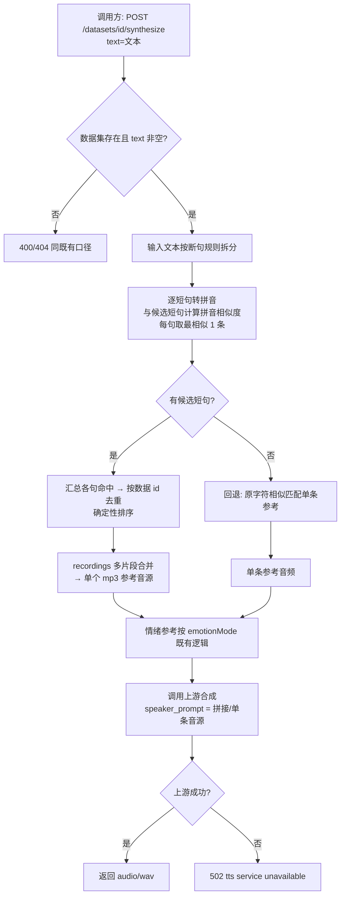

# AI 训练 - 音频生成（拼音匹配与断句拼接参考音源）

**功能名称**: 训练 - 音频生成（拼音匹配与断句拼接参考音源）
**PRD 版本**: v1.1
**创建日期**: 2026-10-01
**作者**: Z.Vtuber Workflow Agent

## 背景与目标

### 1.1 背景

音频生成接口 `POST /api/training/datasets/{datasetId}/synthesize`（见 [[20260929-training-audio-synthesize-prd]]）目前的音色参考选取方式是：把**整段输入文本**与数据集内各条目的文本做**字符相似度**匹配（归一化编辑距离），取最相似的 **1 条**，用其音频作为克隆参考（speaker_prompt）。实际使用中暴露出两个问题：

- **字符相似 ≠ 发音相似**：字符匹配只看字面，同音/近音但字面不同的内容（如「的/得/地」、同音词）无法互相命中，而音色克隆参考的关键是**发音内容的覆盖度**；
- **单条参考对长文本覆盖不足**：整段长文本只能命中一条最相似的条目，参考音频的发音内容与输入文本大部分句子无关，长文本合成时音色稳定性与还原度受限。

因此将音色参考的匹配方式升级为**拼音匹配 + 断句拼接**：数据集条目与输入文本都按标点/空白**断句**为短句；匹配时把文本转为**拼音**后计算**拼音相似度**（音节级编辑距离），同音/近音即可高分命中；输入文本的多个短句**各自独立匹配**，从而获得更多符合的候选短句，把这些命中数据的音频**拼接为一段参考音源**，作为推理（上游合成）的音色参考。

### 1.2 目标

- 数据集条目文本按断句规则拆分为**候选短句**，并存储其**拼音**形成**反向索引**（候选短句 → 所属数据），可重建；
- 提供**重建（rebuild）能力**：一键清空反向索引并对数据集候选短句全量重建；
- 输入文本按同一断句规则拆分，**每条短句分别**与数据集候选短句计算**拼音相似度**并取最相似匹配，从而产出**多条命中短句**；
- 命中结果按**数据 id 去重**，将对应多条数据的音频**拼接为一段音频**（recordings 提供多片段合并能力）；
- 推理（上游合成）使用**断句匹配 + 拼接后的音源**作为音色参考。

### 1.3 成功标准

- 同音/近音不同字的输入短句能够高分命中数据集中对应发音的候选短句（字面不同但拼音相近即可命中）；
- 长文本输入时，**每条输入短句都能独立获得最相似的候选短句**，整体命中条数显著多于整段匹配，最终参考音源为多条命中数据音频的**拼接**（而非单条）；
- 同一数据集 + 同一文本 + 同一索引数据 → 命中与拼接结果**稳定可复现**（相似度排序 + 确定性 tie-break）；
- rebuild 后反向索引与数据集条目内容一致（条目增删改可通过 rebuild 重新对齐）；
- 关键异常（数据集不存在、无可用候选、拼接音频不可用、上游不可用等）返回明确错误码，不返回损坏音频。

## 用户分析

### 2.1 目标用户

平台运营者 / 语音合成能力调用方（自用场景，如下游 VTuber 台词播报、语音试听等）；数据维护者（维护数据集并触发索引重建）。

### 2.2 用户场景

| 场景 | 用户角色 | 目标 | 痛点 |
|--|--|--|--|
| 按发音内容匹配参考 | 能力调用方 | 输入文本按发音命中数据集内容 | 字符匹配对同音不同字的内容不命中 |
| 长文本合成 | 能力调用方 | 长文本各句都有对应发音的参考覆盖 | 单条参考对长文本覆盖不足，音色不稳 |
| 数据集更新后对齐索引 | 数据维护者 | 条目增删改后让匹配索引重新对齐 | 缺少一键重建索引的手段 |

## 功能需求

### 3.1 功能概述

synthesize 的音色参考由「整段文本字符相似匹配单条」升级为「断句 + 拼音相似度匹配多条 + 音频拼接」：数据集条目文本按断句规则拆为候选短句并存储拼音形成反向索引；输入文本同样断句后，**每条短句分别**与候选短句计算拼音相似度（音节级编辑距离）取最相似匹配，获得更多符合的短句；命中数据去重后把多条音频拼接为一段参考音源，作为上游合成的音色参考。配套提供反向索引 rebuild 能力与 recordings 多片段音频合并能力。

### 3.2 功能列表

#### 功能点 1: 数据集候选短句拆分与拼音反向索引

- **描述**: 将数据集内每条数据的文本按断句规则（中/英文逗号、中/英文句号、空白，即 `[，。,.\s]`）拆分为多条**候选短句**，单独存储为数据集候选结构；每条候选短句记录其**拼音**与所属数据 id，形成**反向索引**（候选短句/拼音 → 所属数据），供匹配时按数据集加载检索。
- **用户价值**: 让数据集的匹配粒度从「整条数据」细化到「短句」，匹配键从字面升级为发音，匹配更准、召回更全。
- **验收标准**:
  - [ ] 条目文本按 `[，。,.\s]` 拆分，拆分结果忽略空白/空段，短句保留原始文字；
  - [ ] 每条候选短句的拼音可稳定生成（同一文本 → 同一拼音），以音节序列形式存储；
  - [ ] 可按数据集加载全部候选短句及其拼音、所属数据 id 用于相似度匹配；
  - [ ] 拼音归一化口径统一（不带声调、小写、按音节分词）。

#### 功能点 2: 反向索引重建（rebuild）

- **描述**: 提供 rebuild 能力：清空现有反向索引，并对数据集的候选短句做**全量重建**。供数据集条目增删改后手工对齐索引使用。
- **用户价值**: 数据集变化后一键恢复索引一致性，无需了解内部结构。
- **验收标准**:
  - [ ] 调用 rebuild 后反向索引被清空并全量重建，返回重建数量；
  - [ ] 重建完成后，拼音匹配结果与当前数据集条目内容一致；
  - [ ] 数据集不存在时返回明确错误。

#### 功能点 3: 输入文本断句与拼音相似度匹配

- **描述**: 合成时，输入文本按同一断句规则拆分为多条待匹配短句；**每条短句分别**转为拼音后，与数据集全部候选短句计算**拼音相似度**（音节级归一化编辑距离，兼顾发音内容与长度），取**最相似的 1 条**候选短句作为该句的命中；各句命中汇总成多条命中结果。
- **用户价值**: 输入文本的每个句子都能独立命中发音最接近的数据内容——断句带来更多符合的短句，拼音距离让同音/近音也能命中，匹配结果随句子粒度显著增多、更贴合发音。
- **验收标准**:
  - [ ] 输入文本按 `[，。,.\s]` 拆分，空段忽略；
  - [ ] 每条待匹配短句独立按拼音相似度匹配，取最相似 1 条候选，汇总多条命中；
  - [ ] 相似度计算兼顾内容与长度（归一化编辑距离，同分确定性 tie-break）；
  - [ ] 同一数据集 + 同一文本 + 同一索引 → 命中集合稳定可复现；
  - [ ] 数据集无候选短句（未重建索引或条目全为空文本）时，回退为原字符相似匹配单条参考（不因此失败）。

#### 功能点 4: 多数据音频拼接（recordings 合并能力）

- **描述**: 命中结果按**数据 id 去重**（同一数据被多个短句命中只取一次），按去重后的数据 id 集合调用 recordings 新增的**多片段合并接口**（POST，传入多个片段请求），recordings 将多个音频片段合并为**一个 mp3** 返回。
- **用户价值**: 多条命中数据的音频合并成一段完整参考音源，供推理使用。
- **验收标准**:
  - [ ] 合并接口接受多个片段请求（文件 + 起止时间），按请求顺序合并输出单个 mp3；
  - [ ] 合并结果可正常播放、时长约为各片段之和；
  - [ ] 请求为空/片段过多/文件不存在/时间区间非法等返回明确错误码；
  - [ ] synthesize 侧对命中数据去重后再调用合并，去重与拼接顺序确定。

#### 功能点 5: 推理音源切换为拼接音源

- **描述**: synthesize 推理（调用上游合成）的音色参考改为使用**断句匹配 + 拼接之后的音源**；其余合成行为（情绪参考、语种、上游契约、返回 audio/wav）不变。
- **用户价值**: 长文本合成时参考音源覆盖输入各句的发音内容，克隆效果与稳定性提升。
- **验收标准**:
  - [ ] 拼音匹配有候选时，speaker 参考为多条命中数据音频的拼接结果；
  - [ ] 响应命中头可体现参与拼接的数据（多个音频 key）；
  - [ ] 情绪参考（`llm`/`dataset`/`none`）行为不变；
  - [ ] 拼接音源取数失败时按既有口径降级/报错（合并整体失败按序用首个可用单片段兜底、全部命中条目音频不可用 → 502 `audio unavailable`），不返回损坏音频。

### 3.3 用户操作流程

rebuild 流程：

### 3.4 接口/交互描述

本需求为**后端能力增强**，不新增 Web 页面；对外交互即 REST 接口（详见技术提案 §3 API 设计）。

| 项 | 描述 |
|------|------|
| 合成接口 | `POST /api/training/datasets/{datasetId}/synthesize`（既有；音色参考匹配口径升级，契约描述与命中头更新） |
| 索引重建 | 新增 rebuild 接口：清空并全量重建数据集候选短句拼音反向索引（详见技术提案） |
| 音频合并 | recordings 新增 `POST` 合并接口：传入多个片段请求，ffmpeg 合并为单个 mp3 返回（详见技术提案） |

### 3.5 异常与边界情况

| 情况 | 预期行为 |
|------|---------|
| 数据集不存在 / `text` 为空 | 404 / 400，同既有口径 |
| 数据集无候选短句（条目全为空文本、或未重建索引） | 回退原字符相似匹配；仍无候选 → 409 `no speaker reference` |
| 输入文本拆分后为空（纯标点/空白） | 400 `text is required`（同既有空文本口径） |
| 某输入短句与所有候选相似度都很低 | 仍取该句最相似 1 条（与现字符匹配「总取 top-1」同口径；相似度阈值调优留待后续） |
| 命中数据的音频取数失败 | 该数据跳过；合并整体失败按序用首个可用单片段兜底；全部命中条目音频不可用 → 502 `audio unavailable` |
| 合并接口片段数超上限 / 参数非法 | 400 明确错误 |
| 合并接口任一文件不存在 | 404 明确错误 |
| 情绪向量检索不可用 / 无情绪标注 | 降级中性合成（既有行为，不变） |
| 上游 TTS 不可用 / 超时 | 502 `tts service unavailable` |

## 四、非功能需求

### 4.1 性能要求

- 拼音相似度匹配按数据集加载候选短句后内存计算（与现字符匹配同构），单数据集千级短句 × 十级输入短句规模下延迟可忽略；
- 音频拼接由 recordings 以 ffmpeg 完成，片段数设上限（防止过大合并请求拖垮服务）；
- 合成接口整体超时沿用既有口径（默认 120s）。

### 4.2 安全性要求

- 沿用现有内网/代理访问口径，不新增公开访问面；
- 拼音索引数据为条目文本的派生数据，不含敏感信息；日志不打印音频内容。

### 4.3 兼容性要求

- synthesize 接口路径、请求体、情绪参考行为、返回类型不变；仅音色参考匹配口径升级与命中头扩展；
- 不影响既有数据集管理、导入、编辑、情绪识别、`vectors/rebuild` 与 recordings 既有端点；
- 拼音反向索引为全新派生数据，首期需对存量数据集执行一次 rebuild 方可参与拼音匹配（未重建时自动回退字符相似匹配，行为不劣化）。

## 五、依赖与约束

### 5.1 依赖

- 音频数据集（条目具备文本 + 音频地址，候选短句拆分与拼音索引的数据来源）；
- recordings 服务（既有音频片段抽取能力；本期新增多片段合并能力）；
- 内网 index-tts-api 上游合成（`speaker_prompt` 接受拼接后的参考音源）；
- 拼音转换能力（中文转拼音，技术选型见技术提案）。

### 5.2 约束

- 断句规则固定为 `[，。,.\s]`（中/英文逗号、中/英文句号、空白）；
- 拼音归一化为不带声调的音节序列，同音字拼音相同；相似度为**音节级归一化编辑距离**（兼顾内容与长度）；
- 每条输入短句取拼音最相似的 1 条候选短句；命中去重以**数据 id** 为单位（同一数据多条短句命中只取一次音频）；
- 候选短句拆分为**文本粒度**（不做句级音频时间轴切分；拼接粒度为整条数据音频）；
- 升级后需对存量数据集执行 rebuild 以启用拼音匹配（未重建自动回退原匹配，不阻断）；
- 本期不含 Web 界面、批量合成、句级时间轴对齐、多音字消歧与相似度阈值调优。

## 六、相关文档

- 技术提案：[[20261001-proposal-training-synthesize-pinyin-match]]（docs/engineering/proposals/20261001-proposal-training-synthesize-pinyin-match.md）
- 实现 Plan：`docs/engineering/plans/20261001-plan-training-synthesize-pinyin-match.md`
- 关联 PRD：[[20260929-training-audio-synthesize-prd]]（docs/product/draft/20260929-training-audio-synthesize-prd.md）
- 关联提案：[[20261001-proposal-training-synthesize-char-match]]（docs/engineering/proposals/20261001-proposal-training-synthesize-char-match.md）
