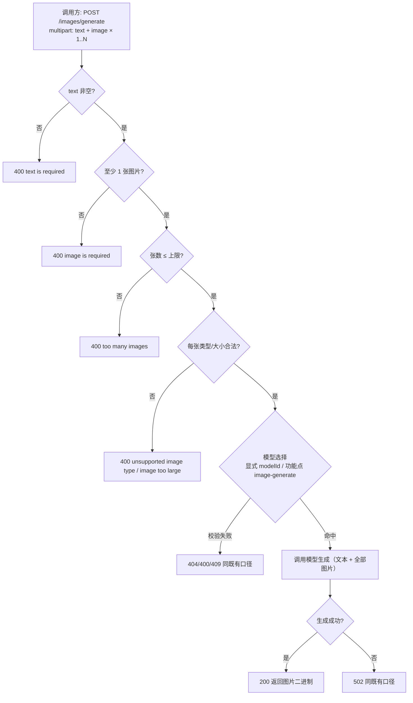

# AI 训练 - 绘图接口支持多张图片输入

**功能名称**: 训练 - 绘图接口支持多张图片输入（文本 + 多图片 → 图片）
**PRD 版本**: v1.0
**创建日期**: 2026-10-02
**作者**: Z.Vtuber Workflow Agent

## 背景与目标

### 1.1 背景

绘图接口已上线（见 [[20261001-training-image-generate-prd]]）：调用方以 multipart 提交「一段文本 + 一张参考图片」，由「输入 文本+图片、输出 图片」的可用模型生成图片并返回。

实际使用中，单张参考图表达力不足：调用方常需要**融合多张参考图**（如同时提供角色立绘 + 场景参考 + 风格示例）来约束生成结果，上游模型服务本身也支持多图输入。目前调用方只能多次调用单图接口自行取舍，或先将多图线下拼接成一张再上传，效果与效率都差。本需求将绘图接口升级为**支持一次提交多张参考图片**。

### 1.2 目标

- 绘图接口支持一次提交**多张参考图片**，与文本一起参与生成；生成成功仍返回图片二进制；
- 多张图片**逐张校验**（类型白名单、大小上限），并对张数设置上限，非法输入在调用模型前拦截并返回明确错误；
- **完全兼容既有单图调用**：原有只传一张图片的调用方式行为不变，模型选择（显式指定 / 缺省解析）与错误口径不变。

### 1.3 成功标准

- 调用方一次提交 2 张及以上参考图片即可获得生成图片，无需多次调用或线下拼图；
- 只传 1 张图片的既有调用方零改动、行为与升级前一致；
- 任一图片非法（类型不支持/超限）或张数超上限时返回明确错误，且不发起模型调用。

## 用户分析

### 2.1 目标用户

平台运营者 / 绘图能力调用方（自用场景，如 VTuber 配图生成、图像二创等）。

### 2.2 用户场景

| 场景 | 用户角色 | 目标 | 痛点 |
|--|--|--|--|
| 多参考图融合生成 | 能力调用方 | 同时提供角色/场景/风格等多张参考图，一次生成 | 单图接口需多次调用或线下拼图，效果差、成本高 |
| 既有单图调用 | 能力调用方 | 升级后原有调用不受影响 | 接口变更导致存量调用方被迫改造 |
| 失败可诊断 | 能力调用方 | 某张图片非法时明确知道问题 | 多图场景下错误定位更困难 |

## 功能需求

### 3.1 功能概述

绘图接口的参考图片输入由「恰好 1 张」升级为「1 张到 N 张（N 为张数上限）」：调用方在 multipart 表单中以同一字段重复提交多个图片文件，每张图片独立校验后与文本一起交给模型生成；只传 1 张时行为与现状完全一致。

### 3.2 功能列表

#### 功能点 1: 多图片输入

- **描述**: 绘图接口接受 1 张到多张参考图片（multipart 同名字段重复上传），张数超过上限（默认 10 张，可配置）返回明确错误；图片张数为 0（缺失）仍返回「图片缺失」错误，与现状一致。
- **用户价值**: 一次调用即可融合多张参考图约束生成结果。
- **验收标准**:
  - [ ] 一次提交 2 张及以上合法图片可正常生成并返回图片；
  - [ ] 只提交 1 张图片时行为与升级前完全一致；
  - [ ] 张数超过上限返回 400 明确错误（不发起模型调用）；
  - [ ] 未提交任何图片仍返回 400 `image is required`。

#### 功能点 2: 逐张图片校验

- **描述**: 每张图片独立做类型白名单（`image/png`/`image/jpeg`/`image/webp`）与大小上限校验（默认单张 10MB，可配置）；任一图片非法即整体拒绝，错误口径与单图一致。
- **用户价值**: 失败前置、报错明确，避免无效模型调用。
- **验收标准**:
  - [ ] 任一图片类型非白名单返回 400 `unsupported image type`；
  - [ ] 任一图片超过大小上限返回 400 `image too large`；
  - [ ] 校验失败不发起模型调用。

#### 功能点 3: 模型选择与错误口径不变

- **描述**: 模型选择（显式 `modelId` 优先、缺省按功能点 `image-generate` 解析）、成功返回图片二进制、失败统一 `{"error": "..."}` 错误体、经 z-vtuber 代理暴露等既有行为均不因多图输入而改变。
- **用户价值**: 调用方仅需关注「多传了几张图」，其余心智模型不变。
- **验收标准**:
  - [ ] 显式 `modelId` 非法/停用/能力不符、缺省解析无可用模型等错误码与现状一致；
  - [ ] 模型服务不可用、模型输出非法等失败口径与现状一致；
  - [ ] 多图请求经 z-vtuber `/api/training/**` 代理同口径可访问。

### 3.3 用户操作流程

### 3.4 接口/交互描述

本需求为**后端绘图能力增强**，不新增 Web 页面；对外交互即既有 REST 接口的输入放宽。

| 项 | 描述 |
|------|------|
| 接口 | 既有绘图接口（training 服务提供，z-vtuber `/api/training/**` 代理暴露），路径与方法不变 |
| 请求 | `multipart/form-data`：`text`（必填）、`image`（文件，**1 张到多张**，同名字段重复提交）、`modelId`（可选） |
| 响应 | 成功 `200` 图片二进制（`image/*`）；错误 `{"error": "..."}`，口径与现状一致 |
| 兼容性 | 只传 1 张图片的既有调用零改动 |

### 3.5 异常与边界情况

| 情况 | 预期行为 |
|------|---------|
| `text` 缺失或为空 | 400 `text is required`（同现状） |
| 未提交任何图片 | 400 `image is required`（同现状） |
| 图片张数超过上限 | 400 `too many images`（不发起模型调用） |
| 任一图片类型非白名单 | 400 `unsupported image type` |
| 任一图片超过大小上限 | 400 `image too large` |
| 存在 0 字节空文件图片 | 视为无效，按 `image is required`/类型校验口径拒绝 |
| 显式 `modelId` 非法/停用/能力不符 | 404/400（同现状） |
| 缺省解析无任何可用模型 | 409 `no image model available`（同现状） |
| 模型服务不可达 / 输出非法 | 502（同现状） |
| 多图生成耗时较长 | 接口超时按既有配置（默认 120s），超时返回 502 |

## 四、非功能需求

### 4.1 性能要求

- 请求体总大小随图片张数增长，受「张数上限 × 单张上限」约束（默认 10 × 10MB）；逐张校验，不做全量冗余拷贝；
- 生成延迟仍由上游模型服务主导，多图可能增加上游耗时，超时口径沿用既有配置。

### 4.2 安全性要求

- 沿用现有管理后台/内网访问口径，不新增公开访问面；
- 张数上限防止异常超大表单与资源滥用；日志不打印密钥与图片/文本内容（同现状）。

### 4.3 兼容性要求

- 只传 1 张图片的既有调用方零改动、行为不变；
- 模型能力口径不变（输入 文本+图片 / 输出 图片），功能点 `image-generate` 语义不变；
- 不影响既有数据集管理、情绪识别、音频生成与模型/功能点管理功能。

## 五、依赖与约束

### 5.1 依赖

- 既有绘图接口与模型选择基建（见 [[20261001-training-image-generate-prd]]、[[20261001-dataset-model-capability-prd]]）；
- 上游模型服务支持多图输入的绘图能力（OpenAI-like 图像编辑接口）；
- z-vtuber（`servers/api`）`/api/training/**` 代理面。

### 5.2 约束

- **接口路径与请求形态不变**：仍为 `multipart/form-data`，通过同名字段重复提交表达多张图片；
- **单图行为完全兼容**：升级不改变既有单图调用的任何可观察行为；
- **失败前置**：所有输入校验在调用模型前完成；
- 本期不含：生成结果入库/缓存、批量生成、Web 绘图界面、每张图片独立的角色/权重标注。

## 六、相关文档

- 技术提案：[[20261002-proposal-training-image-multi-input]]（docs/engineering/proposals/20261002-proposal-training-image-multi-input.md）
- 关联 PRD：[[20261001-training-image-generate-prd]]（docs/product/draft/20261001-training-image-generate-prd.md，绘图接口初版）
- 关联 PRD：[[20261001-dataset-model-capability-prd]]（docs/product/draft/20261001-dataset-model-capability-prd.md，模型能力标注与功能点）
