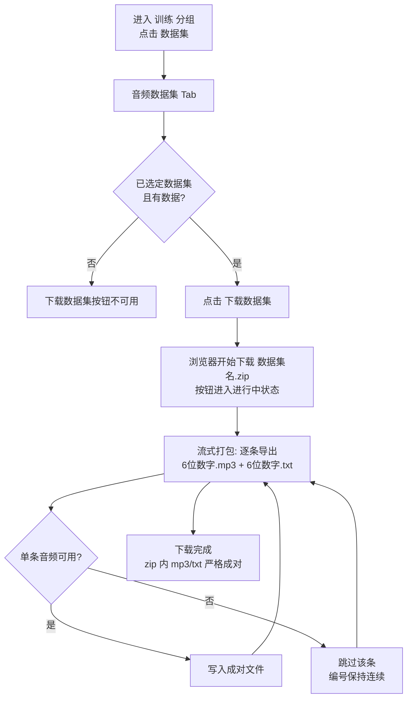

# 训练 - 数据集导出 ZIP

**功能名称**: 训练 - 数据集导出 ZIP
**PRD 版本**: v1.0
**创建日期**: 2026-10-07
**作者**: Z.Vtuber Workflow Agent

## 背景与目标

### 1.1 背景

「数据集」模块已支持把识别完成的 Transcript 沉淀为音频数据集，并完成查看、修订、试听校对与批量清理（见 [[20260927-training-audio-dataset-prd]]），数据集内的音频数据已具备训练可用的质量。但这些数据目前只能停留在平台内逐条查看与试听，**无法批量取走**——要把数据集交给外部训练环境使用时，缺少一个「一键导出」的出口。

### 1.2 目标

- 「数据集」页面提供「下载数据集」按钮，点击后将**当前选中的数据集**整体打包为一个 zip 文件下载到本地；
- zip 内每条音频数据导出为一对文件：6 位数字编号的 mp3（该条数据的音频）与同编号的 txt（该条数据的文本）；
- 打包与下载流式进行，下载随打包进度即时开始，无需等待整个 zip 生成完毕。

### 1.3 成功标准

- 用户在页面上一次点击即可获得可直接用于外部训练的 zip 包，无需借助任何外部工具；
- zip 内 mp3 与 txt 严格成对、命名规范（6 位数字），编号连续，音频内容与文本一一对应；
- 大数据集（千级条目）也能稳定完成下载，下载过程不阻塞页面其他操作。

## 用户分析

### 2.1 目标用户

平台运营者 / 训练数据维护者（自用场景）。

### 2.2 用户场景

| 场景 | 用户角色 | 目标 | 痛点 |
|--|--|--|--|
| 交付训练数据 | 数据维护者 | 把校对完成的数据集交给外部语音训练环境 | 平台内无导出能力，数据只能逐条查看，无法批量取走 |
| 归档/备份数据集 | 数据维护者 | 将某个数据集整体留存一份本地副本 | 无整体打包下载手段 |
| 核对导出结果 | 数据维护者 | 确认下载的 zip 内音频与文本一一对应、无缺漏 | 缺少规范的命名与配对约定时人工核对成本高 |

## 功能需求

### 3.1 功能概述

「数据集」页面新增「下载数据集」按钮：点击后将当前选中的数据集流式打包为 zip 下载，zip 内每条音频数据为一对「6 位数字.mp3 + 6 位数字.txt」文件，mp3 为该条数据的音频，txt 为该条数据的文本。

### 3.2 功能列表

#### 功能点 1: 下载数据集按钮

- **描述**: 「数据集」页面的「音频数据集」Tab 顶部操作区新增「下载数据集」按钮，与既有数据集管理操作并列展示。按钮作用于**当前选中的数据集**；未选定数据集、或当前数据集内没有任何音频数据时，按钮不可用。点击后立即开始下载，下载文件名为「数据集名.zip」。
- **用户价值**: 出口与数据管理同处一个页面，选中哪个数据集就下载哪个，心智成本为零。
- **验收标准**:
  - [ ] 「音频数据集」Tab 顶部出现「下载数据集」按钮；
  - [ ] 未选定数据集时按钮不可用；
  - [ ] 当前数据集无数据时按钮不可用；
  - [ ] 点击后浏览器开始下载，文件名为「数据集名.zip」。

#### 功能点 2: ZIP 内容规范

- **描述**: zip 内的文件按数据集内音频数据的固有顺序（与数据集列表的展示顺序一致）从 `000001` 起连续编号，每条数据产出一对文件：
  - `000001.mp3`：该条数据的音频，按该条数据的起止时间圈定的区间（与页面试听口径一致）；
  - `000001.txt`：该条数据的文本（UTF-8 编码）。

  编号连续递增，mp3 与 txt 严格成对、同名不同后缀。
- **用户价值**: 命名规范、配对明确的 zip 可直接投喂外部训练流程，也便于人工抽查核对。
- **验收标准**:
  - [ ] zip 内仅有「6 位数字.mp3」与「6 位数字.txt」两类文件；
  - [ ] 每个 mp3 都有同名 txt 与之配对，编号从 000001 起连续无缺号；
  - [ ] mp3 的音频内容与该条数据的起止区间一致（与页面试听口径一致）；
  - [ ] txt 内容与该条数据的文本一致，且为 UTF-8 编码。

#### 功能点 3: 流式打包下载

- **描述**: 打包与下载流式进行：点击下载后浏览器即开始接收数据，随打包进度持续写入，而不是等待整个 zip 生成完毕才出现下载。下载进行期间按钮呈现进行中状态，避免重复点击发起多个下载。
- **用户价值**: 大数据集下载有即时反馈，等待可感知；下载由浏览器接管，期间可继续页面其他操作。
- **验收标准**:
  - [ ] 点击后下载即时开始（无需等待全量打包完成）；
  - [ ] 下载期间按钮呈进行中状态且不可重复触发；
  - [ ] 千级条目的数据集可完整下载完成。

#### 功能点 4: 不可用音频兜底

- **描述**: 打包过程中，个别数据因音频地址失效等原因无法取得音频时，**跳过该条数据**（不产生残缺的 mp3/txt 文件），不中断整体打包下载；其余数据的编号保持连续，zip 内不会出现不配对的文件。
- **用户价值**: 少量脏数据不影响整体交付，下载到的 zip 永远是「完整可用」的配对集合。
- **验收标准**:
  - [ ] 含不可用音频的数据集仍可完成下载；
  - [ ] 被跳过的数据不产生任何文件，剩余文件编号连续、mp3/txt 仍严格成对。

### 3.3 用户操作流程

### 3.4 页面/界面描述

| 页面 | 描述 | 关键元素 |
|------|------|---------|
| 训练 - 数据集（变更） | 「音频数据集」Tab 顶部操作区新增「下载数据集」按钮 | 数据集下拉框与新建/重命名/删除等既有操作；「下载数据集」按钮（未选定数据集或数据集为空时禁用，下载期间呈进行中状态） |

界面说明：「下载数据集」按钮与既有数据集操作按钮同处一行操作区；点击后由浏览器接管下载，页面不跳转。

### 3.5 异常与边界情况

| 情况 | 预期行为 |
|------|---------|
| 未选定数据集 | 「下载数据集」按钮不可用 |
| 当前数据集为空 | 「下载数据集」按钮不可用 |
| 个别数据音频不可用 | 跳过该条，不产生残缺文件，编号保持连续，下载不中断 |
| 数据集名含特殊字符 | 下载文件名做安全处理，保证浏览器可正常保存 |
| 数据集数据量大（千级） | 流式下载持续进行直至完成，期间页面其他操作不受影响 |
| 下载过程中网络中断 | 浏览器按自身机制提示下载失败，用户可重新点击下载，平台侧无残留状态 |

## 四、非功能需求

### 4.1 性能要求

- 单数据集千级音频数据量级下可稳定完成导出下载；
- 打包流式进行，内存占用不随数据集规模线性增长；
- 下载过程不阻塞页面其他操作。

### 4.2 安全性要求

- 沿用现有管理后台访问口径，不新增公开访问面；
- 下载内容仅限当前选中的数据集，不提供跨数据集打包。

### 4.3 兼容性要求

- 不影响既有数据集管理（新建/重命名/删除）、导入、列表编辑、波形试听等功能；
- zip 使用通用格式与通用编码（UTF-8 文本），主流解压工具与训练流程均可直接消费。

## 五、依赖与约束

### 5.1 依赖

- 既有「数据集」模块：音频数据集及其音频数据（音频地址、起止时间、文本）；
- 既有音频试听能力：按起止时间获取单条数据音频的口径与页面试听一致。

### 5.2 约束

- 本期仅支持「音频数据集」的导出，一次仅导出当前选中的一个数据集；
- 导出内容为「音频 + 文本」成对文件，不包含数据集的其他加工信息（如情感标注等）；
- 不提供导出任务的断点续传与历史记录，下载失败重新点击即可。

## 六、相关文档

- 技术提案：[[20261007-proposal-training-dataset-export-zip]]（docs/engineering/proposals/20261007-proposal-training-dataset-export-zip.md）
- 关联 PRD：[[20260927-training-audio-dataset-prd]]（docs/product/draft/20260927-training-audio-dataset-prd.md）
