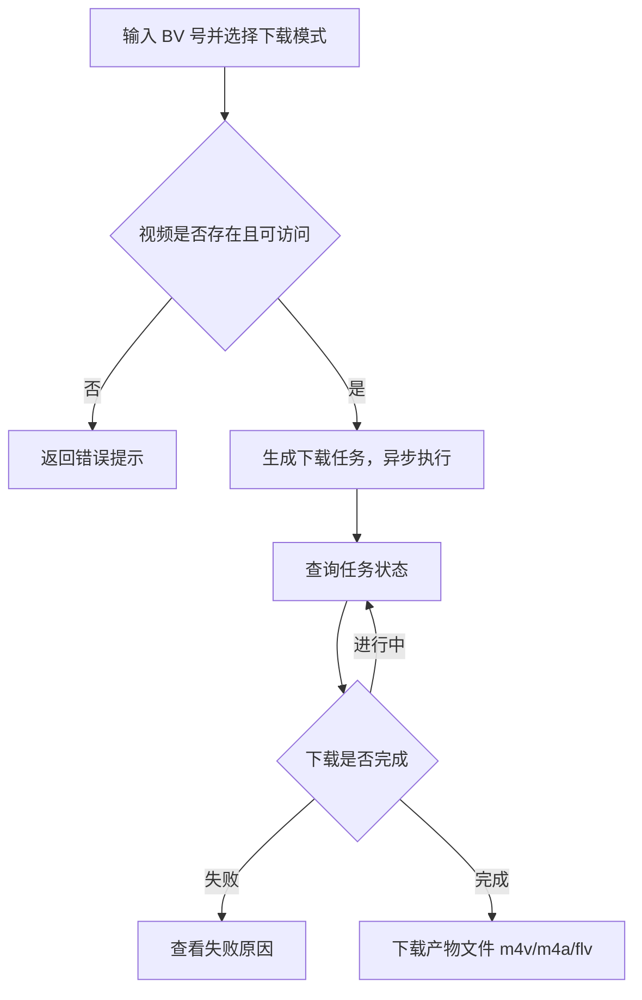

# B 站视频下载

**功能名称**: B 站视频下载
**PRD 版本**: v1.0
**创建日期**: 2026-10-08
**作者**: Z.Vtuber Workflow Agent

## 背景与目标

### 1.1 背景

平台已具备 B 站直播录制能力（见 [[20260913-live-recording-prd]]），可以把直播流落盘归档。但对于 B 站上已发布的**投稿视频**（点播内容），目前没有任何获取手段——当需要把某个视频的原始素材取回本地做进一步加工（如切片、数据集制作）时，只能依赖第三方工具，流程割裂且不可控。

### 1.2 目标

- 用户提供一个 B 站视频（BV 号）并选择下载内容，即可把该视频的**原始流文件**取回并归档到平台；
- 下载内容支持三种模式：**只下载视频流**、**只下载音频流**、**视频流与音频流都下载**；
- 产物一律为 B 站返回的**原始流文件**（m4v/m4a 或 flv），平台不做任何转码、合并或重封装；
- 下载完成的文件可以直接从平台取走。

### 1.3 成功标准

- 对任意可正常播放的公开视频，三种下载模式都能正确产出对应的原始流文件：只下视频得到视频流文件、只下音频得到音频流文件、都下载得到视频与音频两个文件；
- 产物文件内容与服务端原始流一致（未经转码），可被常见播放器直接播放；
- 下载失败时任务有明确的失败状态与原因，用户可据此判断是视频不存在、无权限还是需要登录高清晰度；
- 同一视频重复提交下载不会产生冲突或重复扣占存储，结果可追溯。

## 用户分析

### 2.1 目标用户

- 平台运营/素材整理人员：需要把指定 B 站视频素材取回本地；
- 数据集制作者：需要视频原始音频流作为数据集素材来源。

### 2.2 用户场景

| 场景 | 用户角色 | 目标 | 痛点 |
|--|--|--|--|
| 取回某个投稿视频的画面素材 | 素材整理人员 | 拿到该视频的视频流文件 | 第三方工具流程割裂，质量不可控 |
| 提取某视频的音频做数据集 | 数据集制作者 | 只拿音频流，不要画面 | 整包下载后还要自行抽音频，浪费带宽与存储 |
| 完整归档某视频 | 运营人员 | 视频流与音频流都留存 | 需要两个文件分别对应画面与声音，缺一不可 |

## 功能需求

### 3.1 功能概述

提供「B 站视频下载」能力：用户提交一个 BV 号并选择下载模式（仅视频 / 仅音频 / 全部），平台异步完成下载并归档原始流文件；用户可以查询任务进度，并在完成后下载产物文件。

### 3.2 功能列表

#### 功能点 1: 提交下载任务

- **描述**: 用户输入视频的 BV 号（或包含 BV 号的视频链接），选择下载模式：仅视频流、仅音频流、视频与音频都下载；可选指定分 P（多 P 视频默认下载第 1 P）。提交后生成一个下载任务，进入队列异步执行。
- **用户价值**: 一次提交即可完成取回，无需人工值守；按需选择只下音频或只下视频，避免下载不需要的内容。
- **验收标准**:
  - [ ] 输入合法 BV 号并选择任一模式，提交后返回一个任务标识，任务初始状态为等待/进行中
  - [ ] 输入非法或不存在视频的 BV 号时，给出明确错误提示，不产生任务
  - [ ] 对同一视频同一模式的重复提交，不产生两个并发下载同一文件的冲突任务（幂等或明确拒绝）
  - [ ] 多 P 视频不指定分 P 时默认下载第 1 P

#### 功能点 2: 查询下载任务

- **描述**: 用户可以查看下载任务列表与单个任务详情，包括：目标视频（BV 号、标题、分 P）、下载模式、当前状态（等待中/下载中/已完成/失败）、失败原因、产物文件清单（文件类型、格式、大小）。
- **用户价值**: 下载是异步过程，用户需要随时了解任务进展与结果。
- **验收标准**:
  - [ ] 任务列表可按创建时间倒序查看，展示关键信息
  - [ ] 任务详情展示状态流转与产物文件清单
  - [ ] 失败任务展示可读的中文失败原因（如视频不存在、需要登录、风控受限等）

#### 功能点 3: 下载产物文件

- **描述**: 任务完成后，用户可以按文件逐个下载产物原始流文件（m4v/m4a 或 flv）。下载支持断点续传（分段下载）。
- **用户价值**: 原始流文件可能较大，断点续传保证大文件下载可靠。
- **验收标准**:
  - [ ] 已完成的产物文件可下载，内容与 B 站原始流一致，播放器可直接播放
  - [ ] 支持分段下载（Range），中断后可续传
  - [ ] 未完成任务或不存在任务的文件不可下载，返回明确错误

### 3.3 用户操作流程

### 3.4 页面/界面描述

本期**不新增前端页面**，仅提供平台接口能力，供后续管理端页面或外部脚本调用。

| 页面 | 描述 | 关键元素 |
|------|------|---------|
| 无 | 本期仅接口能力 | — |

### 3.5 异常与边界情况

| 情况 | 预期行为 |
|------|---------|
| BV 号不存在或视频已删除/设为私密 | 任务失败，原因提示视频不存在或不可访问 |
| 视频需要登录/大会员才能获取高清晰度 | 在平台已配置可用账号时按该账号可获取的最高清晰度下载；无法获取时任务失败并说明原因 |
| 多 P 视频 | 默认下载第 1 P；指定分 P 超出范围时提交失败并提示 |
| 下载过程中 B 站触发风控/限流 | 任务失败并提示受限原因，不静默重试到死 |
| 下载中断（网络异常、服务重启） | 不产出半成品文件充当完成品；失败原因可辨识 |
| 重复提交同一视频同一模式 | 幂等返回已有任务，或明确提示已有进行中/已完成任务 |

## 四、非功能需求

### 4.1 性能要求

- 下载以异步任务执行，提交接口快速返回，不阻塞调用方；
- 大文件（GB 级）下载支持断点续传（Range）。

### 4.2 安全性要求

- 下载依赖的平台账号凭据不出现在任何接口响应中；
- 产物文件下载需防止路径穿越等非法文件名访问。

### 4.3 兼容性要求

- 产物文件为 B 站原始流封装（DASH 的 m4v/m4a，或整段 flv），与平台现有录播文件（flv）的下载体验保持一致。

## 五、依赖与约束

### 5.1 依赖

- 平台已有的 B 站账号凭据（Cookie）管理能力，用于以登录态获取视频流地址；
- 平台已有的本地文件归档与按文件下载能力（与录播文件同一套使用方式）。

### 5.2 约束

- 不做转码、合并、重封装：产物严格为原始流文件；
- 本期不含批量下载、合集/追剧下载、清晰度选择（默认取账号可获得的最高清晰度）；
- 本期不含前端页面。

## 六、相关文档

- [[20260913-live-recording-prd]]
- 技术提案：docs/engineering/proposals/20261008-proposal-bilibili-video-download.md
