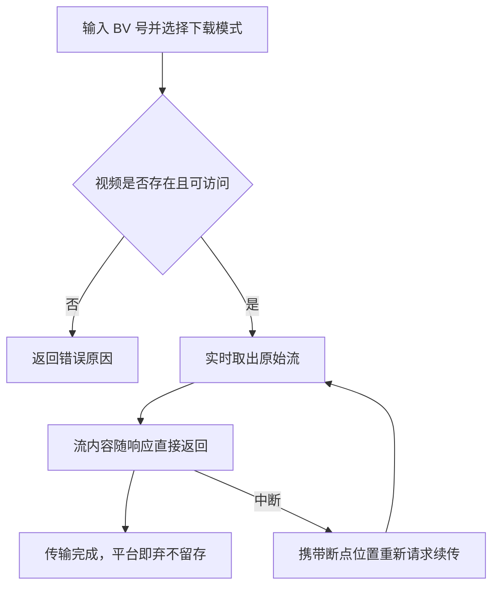

# B 站视频下载

**功能名称**: B 站视频下载
**PRD 版本**: v1.1
**创建日期**: 2026-10-08
**作者**: Z.Vtuber Workflow Agent

## 背景与目标

### 1.1 背景

平台已具备 B 站直播录制能力（见 [[20260913-live-recording-prd]]），可以把直播流落盘归档。但对于 B 站上已发布的**投稿视频**（点播内容），目前没有任何获取手段——当需要把某个视频的原始素材取回本地做进一步加工（如切片、数据集制作）时，只能依赖第三方工具，流程割裂且不可控。

### 1.2 目标

- 用户提供一个 B 站视频（BV 号）并选择下载内容，即可实时获得该视频的**原始流内容**；
- 下载内容支持三种模式：**只下载视频流**、**只下载音频流**、**视频流与音频流都下载**；
- 产物一律为 B 站返回的**原始流**（m4v/m4a 或 flv），平台不做任何转码、合并或重封装；
- 平台**不落盘、不归档**：原始流内容随响应直接返回给调用方，传输结束后即弃，平台不留存任何副本。

### 1.3 成功标准

- 对任意可正常播放的公开视频，三种下载模式都能正确返回对应的原始流内容：只下视频得到视频流、只下音频得到音频流、都下载得到视频与音频两份流内容；
- 返回的内容与 B 站原始流一致（未经转码），保存为文件后可被常见播放器直接播放；
- 下载失败时调用方获得明确的失败原因（视频不存在、无权限、风控受限等），而非超时或截断的静默失败；
- 平台侧不产生任何视频内容落盘残留（可从存储与日志层面验证）。

## 用户分析

### 2.1 目标用户

- 平台运营/素材整理人员：需要把指定 B 站视频素材取回本地；
- 数据集制作者：需要视频原始音频流作为数据集素材来源。

### 2.2 用户场景

| 场景 | 用户角色 | 目标 | 痛点 |
|--|--|--|--|
| 取回某个投稿视频的画面素材 | 素材整理人员 | 即时拿到该视频的视频流内容 | 第三方工具流程割裂，质量不可控 |
| 提取某视频的音频做数据集 | 数据集制作者 | 只拿音频流，不要画面 | 整包下载后还要自行抽音频，浪费带宽 |
| 完整取回某视频 | 运营人员 | 视频流与音频流都拿到 | 需要两份流内容分别对应画面与声音，缺一不可 |

## 功能需求

### 3.1 功能概述

提供「B 站视频下载」能力：用户提交一个 BV 号并选择下载模式（仅视频 / 仅音频 / 两者都下），平台实时从 B 站取出对应原始流并直接透传给调用方；传输完成即弃，平台不留存。

### 3.2 功能列表

#### 功能点 1: 按模式下载原始流

- **描述**: 用户输入视频的 BV 号（或包含 BV 号的视频链接），选择下载模式：仅视频流、仅音频流、视频与音频都下载；可选指定分 P（多 P 视频默认第 1 P）。平台实时取流并把原始流内容作为响应直接返回。「都下载」模式下，视频流与音频流作为两次独立下载分别返回（各自一份流内容）。
- **用户价值**: 一次请求即可拿到素材，无需等待异步任务；按需只取音频或只取视频，不浪费带宽。
- **验收标准**:
  - [ ] 输入合法 BV 号选择仅视频模式，响应返回视频原始流（m4v 或 flv），保存后可直接播放
  - [ ] 输入合法 BV 号选择仅音频模式，响应返回音频原始流（m4a），保存后可直接播放
  - [ ] 选择都下载模式，可分别获得视频流与音频流两份内容，互不缺失
  - [ ] 返回内容与 B 站原始流字节一致，未经任何转码或重封装
  - [ ] 多 P 视频不指定分 P 时默认第 1 P；指定分 P 超出范围时返回明确错误
  - [ ] 输入非法或不存在视频的 BV 号时，返回明确错误提示

#### 功能点 2: 大文件可靠传输

- **描述**: 下载响应支持分段获取（断点续传）：传输中断后，调用方可从中断位置继续获取剩余内容。
- **用户价值**: 原始流文件可能较大（GB 级），断点续传保证大文件下载可靠、不必从头再来。
- **验收标准**:
  - [ ] 响应声明支持字节分段，调用方携带分段范围请求时返回对应区间内容
  - [ ] 中断后续传得到的内容与完整下载拼接后字节一致
  - [ ] 越界的分段请求返回明确错误

#### 功能点 3: 失败原因可见

- **描述**: 视频不存在、需要更高权限、触发风控受限等情况，响应返回明确可读的中文失败原因。
- **用户价值**: 用户可据此判断是视频本身问题还是平台账号受限，决定下一步操作。
- **验收标准**:
  - [ ] 视频不存在或已删除/设为私密时，返回「视频不存在或不可访问」类原因
  - [ ] 因权限无法获取流时，返回权限受限类原因
  - [ ] 触发 B 站风控/限流时，返回受限类原因，不无限重试

### 3.3 用户操作流程

### 3.4 页面/界面描述

本期**不新增前端页面**，仅提供平台接口能力，供后续管理端页面或外部脚本调用。

| 页面 | 描述 | 关键元素 |
|------|------|---------|
| 无 | 本期仅接口能力 | — |

### 3.5 异常与边界情况

| 情况 | 预期行为 |
|------|---------|
| BV 号不存在或视频已删除/设为私密 | 返回明确错误：视频不存在或不可访问 |
| 视频需要登录/大会员才能获取高清晰度 | 在平台已配置可用账号时按该账号可获取的最高清晰度返回；无法获取时返回权限受限原因 |
| 多 P 视频 | 默认第 1 P；指定分 P 超出范围时返回明确错误 |
| 取流时 B 站触发风控/限流 | 返回受限原因，不静默重试到死 |
| 传输中断（网络异常、客户端断开） | 支持断点续传；平台不产生任何残留文件 |
| 同一视频被并发重复下载 | 各自独立实时取流返回，互不影响 |

## 四、非功能需求

### 4.1 性能要求

- 取流与透传以流式进行，响应即时开始输出，无需等平台收完整段内容；
- 大文件（GB 级）下载支持断点续传（分段获取）。

### 4.2 安全性要求

- 下载依赖的平台账号凭据不出现在任何接口响应中；
- 接口仅接受 BV 号等必要入参，不接受任意外部地址，避免被用作开放代理。

### 4.3 兼容性要求

- 返回内容为 B 站原始流封装（DASH 的 m4v/m4a，或整段 flv），保存为对应后缀文件即可播放。

## 五、依赖与约束

### 5.1 依赖

- 平台已有的 B 站账号凭据（Cookie）管理能力，用于以登录态获取视频流地址。

### 5.2 约束

- 不做转码、合并、重封装：返回内容严格为原始流；
- **不落盘、不归档**：平台不留存任何视频内容副本；
- 本期不含批量下载、合集/追剧下载、清晰度选择（默认取账号可获得的最高清晰度）；
- 本期不含前端页面。

## 六、相关文档

- [[20260913-live-recording-prd]]
- 技术提案：docs/engineering/proposals/20261008-proposal-bilibili-video-download.md
