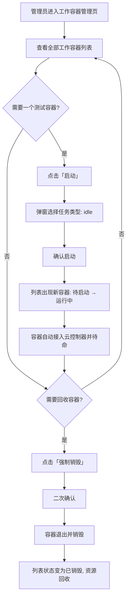

# 云Agent二期

**功能名称**: 云Agent二期（云上工作容器托管与管控）
**PRD 版本**: v1.0
**创建日期**: 2026-10-14
**作者**: Z.Vtuber Workflow Agent

## 背景与目标

### 1.1 背景

平台正在向「云 Agent」方向演进：管理后台用户的任务（一般为构建）、前台用户的工作流、以及普通用户的独立会话，都需要在云端获得一个专属的执行环境来运行。当前平台没有云端执行环境的托管能力，任务与会话无处落地，也没有任何可视化手段观察与回收这些环境。

二期聚焦「工作容器」这层基础设施：由**云控制器（cloud-controller）**在 k8s 上按需拉起**工作容器**，每个工作容器与一个来源对象（后台任务 / 用户工作流 / 独立会话）建立关联；容器启动后自动接入云控制器待命并接受其控制；管理后台提供统一的管控入口。

### 1.2 目标

- 云控制器接管指定范围内全部工作容器的生命周期：按需启动、统一观察、可靠销毁；
- 每个工作容器与一个来源对象一一关联，可追溯：管理后台任务（一般为构建）/ 前台用户的工作流 / 独立会话；
- 工作容器提供平台统一维护的标准化工作环境（AI 编程代理工具与常用构建工具），启动后自动接入云控制器、保持待命；
- 管理后台可视化管理工作容器：查看全部容器、启动空闲测试容器、强制销毁容器。

### 1.3 成功标准

- 管理员在管理后台能看到云控制器管理的**全部**工作容器（含状态、关联来源），列表与实际运行情况一致；
- 点击「启动」并选择任务后，数分钟内得到一个待命的空工作容器并出现在列表中；
- 触发「强制销毁」后，目标容器退出并被回收，列表中不再作为存活容器展示，k8s 侧无残留；
- 工作容器启动后自动接入云控制器并保持待命；后台触发销毁后容器自行退出并销毁；
- 每个工作容器都能查到其关联的来源对象类型；无法关联或关联对象不存在时有明确标注，不产生误导性数据。

## 用户分析

### 2.1 目标用户

- **管理员/运维**（本期唯一使用者）：负责管理工作容器的启停与回收，验证工作容器环境可用性；
- **前台普通用户**（本期不直接接触）：其工作流/独立会话是工作容器的来源对象之一，本期仅建立关联预留，不开放自助入口。

### 2.2 用户场景

| 场景 | 用户角色 | 目标 | 痛点 |
|--|--|--|--|
| 验证工作容器环境是否可用 | 管理员 | 一键启动一个空闲（idle）容器并观察其状态流转 | 没有测试入口，只能等真实任务触发 |
| 了解当前云端有哪些工作容器 | 管理员 | 一览全部容器：状态、关联来源、启动时间 | 无统一视图，情况不可见 |
| 回收测试容器 / 异常容器 | 管理员 | 对指定容器强制销毁，资源立即释放 | 容器无人回收，长期占用集群资源 |
| 后台构建任务需要执行环境 | 管理员 | 任务自动获得专属工作容器，事后可追溯 | 无托管环境，无法关联任务与执行环境 |
| 用户工作流 / 独立会话需要执行环境 | 前台用户（本期预留） | 会话/工作流自动获得工作容器 | 同上，且无法区分环境归属 |

## 功能需求

### 3.1 功能概述

本期交付「工作容器托管 + 管理后台管控」两部分：云控制器在 k8s 指定范围内按需拉起工作容器并与每个容器建立控制联系；管理后台新增工作容器管理页，查看云控制器管理的全部工作容器、启动空闲测试容器、强制销毁容器。工作容器启动后处于待命状态，本期不执行任何具体业务（idle）。

### 3.2 功能列表

#### 功能点 1: 工作容器托管与生命周期管理
- **描述**: 云控制器在指定范围内按需拉起工作容器（每个容器是一次独立的执行单元），并统一管理其生命周期：启动、运行中、结束、销毁。容器启动后自动接入云控制器、保持待命；销毁触发后容器退出并被回收。
- **用户价值**: 任务/工作流/会话获得云端专属执行环境，且环境可管可回收，不遗留垃圾。
- **验收标准**:
  - [ ] 启动请求成功后，一个工作容器被拉起并进入「运行中」，出现在管理列表中
  - [ ] 容器启动后自动接入云控制器并保持待命（列表可见接入状态）
  - [ ] 销毁触发后容器自行退出并被回收，k8s 侧无残留
  - [ ] 启动失败（如镜像不可用、集群不可用）时列表可见失败状态与可读原因

#### 功能点 2: 工作容器与来源对象的关联
- **描述**: 每个工作容器记录其来源对象类型与标识：管理后台的一个用户任务（一般为构建）、前台一个用户的工作流、或独立会话（普通用户的工作流 / 独立会话）。本期在启动与展示环节建立并呈现该关联；测试容器允许无关联。
- **用户价值**: 执行环境与业务对象一一对应，可追溯、可审计，为后续按任务/工作流/会话自动分配环境打底。
- **验收标准**:
  - [ ] 每个工作容器在列表中展示其关联来源（类型 + 标识），无关联的测试容器明确标注
  - [ ] 关联信息在容器整个生命周期内可查询
  - [ ] 来源对象被销毁后，关联关系仍可追溯（不静默丢失）

#### 功能点 3: 标准化工作环境
- **描述**: 工作容器使用平台统一维护的默认工作环境：以通用 Linux 发行版为基础，内置常用开发工具（git、GitHub CLI、Node.js 生态）、容器构建能力（docker 构建工具）以及主流 AI 编程代理工具（agent-gear、opencode、Codex、Claude Code、Gemini CLI 等），依赖一律经内网镜像源获取，保证内网可用与可复现。工具的获取与更新由平台统一负责，使用者无需自行配置。
- **用户价值**: 任何任务拿到的工作环境一致、开箱即用，不受公网网络条件影响。
- **验收标准**:
  - [ ] 启动的工作容器内可用 git、GitHub CLI、Node.js/npm、docker 构建能力与上述 AI 编程代理工具
  - [ ] 构建/安装全程走内网镜像源，不依赖公网连通
  - [ ] 同一版本默认环境在多次启动的容器间行为一致

#### 功能点 4: 管理后台——工作容器列表
- **描述**: 管理后台新增「工作容器」管理页，展示云控制器管理的全部工作容器（job）：容器标识、任务类型、关联来源、运行状态、接入状态、启动时间等，并周期刷新。
- **用户价值**: 管理员对云端工作容器的全局态势一目了然，无需登录集群查询。
- **验收标准**:
  - [ ] 列表覆盖云控制器管理的全部容器，与实际一致
  - [ ] 状态（待启动/运行中/已结束/失败/已销毁）与接入状态实时性满足周期刷新
  - [ ] 空态、加载态、加载失败态均有明确提示与重试入口

#### 功能点 5: 启动空闲测试容器
- **描述**: 列表页提供「启动」按钮，点击后弹出对话框让管理人员选择要启动的任务类型，目前仅提供「idle」（空闲，什么都不做）一种任务；确认后拉起一个空工作容器用于环境验证。
- **用户价值**: 无需等真实任务，随时可验证工作容器环境与链路可用。
- **验收标准**:
  - [ ] 「启动」弹出任务选择对话框，任务列表当前仅「idle」
  - [ ] 确认后容器被拉起并出现在列表中，最终进入「运行中」待命
  - [ ] 启动过程有进行中反馈，失败有明确错误提示

#### 功能点 6: 强制销毁容器
- **描述**: 列表每行提供「强制销毁」按钮，二次确认后立即销毁该工作容器：容器退出、资源回收，列表中不再作为存活容器展示（保留销毁记录以便追溯）。
- **用户价值**: 测试容器与异常容器随时可一键回收，杜绝资源泄漏。
- **验收标准**:
  - [ ] 「强制销毁」有二次确认，防误触
  - [ ] 销毁后容器退出并回收，k8s 侧无残留，列表状态变为已销毁
  - [ ] 对已退出/已销毁容器重复销毁为幂等操作，不报错

### 3.3 用户操作流程

### 3.4 页面/界面描述

| 页面 | 描述 | 关键元素 |
|------|------|---------|
| 管理后台 - 工作容器 | 云控制器管理的全部工作容器（job）一览与管控入口 | 「启动」按钮（弹窗选任务类型，当前仅「idle」）；容器列表（容器标识 / 任务类型 / 关联来源 / 状态 / 接入状态 / 启动时间）；每行「强制销毁」按钮（二次确认）；周期自动刷新；空态/加载/失败三态与重试 |

### 3.5 异常与边界情况

| 情况 | 预期行为 |
|------|---------|
| 启动失败（镜像拉取失败、集群资源不足、集群不可用） | 列表可见失败状态与可读原因；对话框给出错误提示；可重新启动 |
| 容器启动后未接入云控制器（如网络异常） | 列表接入状态显示「未接入」，容器仍可见可销毁 |
| 销毁时容器已自行退出 | 幂等成功，状态置为已销毁，不报错 |
| 销毁时容器未接入云控制器 | 仍能销毁（直接回收容器），不因未接入而卡住 |
| 重复点击「启动」 | 每次确认各拉起一个容器，互不影响 |
| 重复点击「强制销毁」 | 幂等，仅第一次生效 |
| 容器异常退出 / 被集群回收 | 列表状态显示为已结束/失败，可强制销毁清理记录 |
| 列表刷新期间有容器状态变化 | 以后到的最新数据为准，不出现状态回跳 |

## 四、非功能需求

### 4.1 性能要求

- 工作容器列表为管理页主数据，周期自动刷新（约 5~10 秒级），单次刷新体感即时；
- 「启动」到容器「运行中」受镜像拉取与调度影响，目标数分钟内完成，全过程在页面可见状态流转；
- 「强制销毁」到容器退出/回收目标分钟级内完成；
- 并发存活工作容器数量可设上限，避免失控占用集群资源。

### 4.2 安全性要求

- 管理后台为内网可信环境使用（延续现状免鉴权）；
- 工作容器与云控制器之间的控制通道必须鉴权：容器持有专属凭证方可接入，凭证可区分容器、可撤销；
- 工作容器与云控制器限定在指定范围内工作，不越权操作其他范围的资源。

### 4.3 兼容性要求

- 本期为纯新增能力，不影响平台既有功能与页面；
- 管理后台交互风格与现有页面保持一致（布局、弹窗、二次确认、提示方式）；
- 工作容器基础环境版本由平台统一升级管理，出现不兼容工具版本时以平台默认版本为准。

## 五、依赖与约束

### 5.1 依赖

- k8s 集群（工作容器的运行载体）；
- 内网软件源与镜像仓库（工作环境工具与基础镜像的获取渠道）；
- 云控制器（本期交付）：工作容器的编排者与控制方；
- 标准工作环境镜像（本期交付）：含 AI 编程代理工具 agent-gear 等工具链。

### 5.2 约束

- 本期工作容器启动后**什么都不做**（idle），仅待命与响应销毁；实际业务执行（构建、工作流、会话）留待后续迭代；
- 本期任务类型仅「idle」一种，任务选择弹窗按可扩展设计；
- 管理后台本期不新增鉴权，依赖内网可信环境；
- 工作容器销毁即回收，不在集群侧保留容器实例（销毁记录保留在列表用于追溯）。

## 六、相关文档

- 技术提案：[[20261014-proposal-cloud-agent-phase2]]
- 相关产品文档：[[20260822-admin-console-prd]]（管理后台交互基线）、[[20261001-admin-console-ui-redesign-prd]]（后台 UI 规范）
