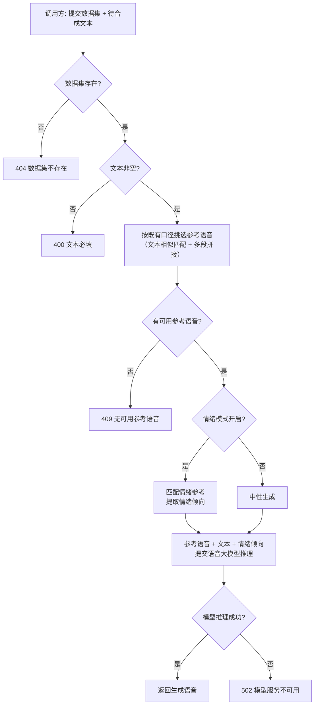

# AI 训练 - 音频生成（语音大模型推理改造）

**功能名称**: 训练 - 音频生成（语音大模型推理改造）
**PRD 版本**: v1.1（2026-10-14 修订：按评审意见彻底移除 Milvus，产品行为不变）
**创建日期**: 2026-10-14
**作者**: Z.Vtuber Workflow Agent

> **返工修订说明（2026-10-14，评审意见）**：彻底移除 Milvus——情绪参考匹配不再依赖向量检索服务（Milvus）及其索引维护链路，改为数据集情绪标注的内存精确匹配，产品行为不变；内部向量索引重建维护端点（`vectors/rebuild`）随之下线（无前端调用方）。

## 背景与目标

### 1.1 背景

平台已上线「音频生成」能力（见 [[20260929-training-audio-synthesize-prd]]）：给定数据集与文本，自动从数据集挑选音色参考与情绪参考，调用内网 TTS 服务合成并返回音频。

现需对该能力做底层改造：**不再支持之前的 TTS 服务**，改为使用一个**支持「语音 + 文本」输入、「语音」输出的大模型**进行推理并返回语音。其中：

- 传入大模型的**语音**即既有链路自动挑选出的**参考语音**（数据集条目音频）；
- 传入大模型的**文本**即调用方提交的待合成文本（以及参考语音对应的文本等上下文）；
- 大模型据此推理，输出目标音色的语音并返回给调用方。

### 1.2 目标

- 语音生成的推理上游从既有 TTS 服务切换为「语音 + 文本输入、语音输出」的大模型，原 TTS 服务的调用与配置完全移除、不再支持；
- **调用方使用方式不变**：仍给定数据集与文本，即可获得以命中参考语音为音色的合成语音；
- 参考语音的自动挑选链路沿用既有口径，挑选结果可预期、可复现。

### 1.3 成功标准

- 调用方传入某数据集与文本，即可得到一段以该数据集命中参考语音为音色、由语音大模型生成的语音，无需自行挑选参考、无需了解上游模型细节；
- 同一数据集 + 同一文本 → 命中的参考语音稳定一致（参考挑选口径不回退）；
- 关键异常（数据集不存在、文本为空、无可用参考语音、模型不可用等）返回明确错误，不返回损坏音频；
- 系统不再依赖原 TTS 服务：相关调用、配置全部移除。

## 用户分析

### 2.1 目标用户

平台运营者 / 语音合成能力调用方（自用场景，如下游 VTuber 台词播报、语音试听等）。

### 2.2 用户场景

| 场景 | 用户角色 | 目标 | 痛点 |
|--|--|--|--|
| 按文本生成克隆语音 | 能力调用方 | 给定数据集与文本，生成该音色的语音 | 自行挑参考语音、对接语音大模型成本高 |
| 带情绪的台词合成 | 能力调用方 | 让合成语音带有贴近文本或数据集的情绪倾向 | 手工组织情绪上下文门槛高 |
| 复用训练语料 | 数据维护者 | 让已校对/已标注的数据集直接服务合成 | 数据与语音大模型之间缺少桥梁 |

## 功能需求

### 3.1 功能概述

将「音频生成」能力的推理上游从既有 TTS 服务切换为**支持「语音 + 文本输入、语音输出」的大模型**：沿用既有链路自动挑选参考语音，把参考语音（连同其文本）与待合成文本一并提交给大模型推理，返回生成的语音。原 TTS 服务不再支持。

### 3.2 功能列表

#### 功能点 1: 语音生成推理切换为语音大模型

- **描述**: 音频生成接口的底层推理改为调用「语音 + 文本输入、语音输出」的大模型：输入为自动挑选出的参考语音与待合成文本，输出为生成的语音并返回给调用方。所使用的模型由平台模型管理中配置的可用模型承接。
- **用户价值**: 以能力更强的语音大模型替代原 TTS 服务，一个接口完成「文本 → 克隆语音」，屏蔽参考挑选与模型对接细节。
- **验收标准**:
  - [ ] 传入数据集与文本，返回由语音大模型生成的语音数据；
  - [ ] 文本缺失/为空返回明确错误，数据集不存在返回明确错误；
  - [ ] 无可用语音模型时返回明确错误，不返回损坏音频；
  - [ ] 该接口经既有代理面同样可访问（与既有数据集 API 同口径）。

#### 功能点 2: 参考语音沿用既有挑选链路

- **描述**: 参考语音的挑选保持既有口径：以输入文本与数据集条目文本的相似匹配挑选候选条目，取其音频作为参考语音（多段命中时按既有规则拼接合并）；参考语音对应的条目文本一并作为上下文提供给大模型。
- **用户价值**: 音色参考选取可预期、可复现，与既有行为一致，用户无需重新学习。
- **验收标准**:
  - [ ] 同一数据集 + 同一文本 → 稳定命中同一参考语音（与改造前口径一致）；
  - [ ] 数据集内无任何可用参考条目时返回明确错误（不返回音频）；
  - [ ] 参考语音对应文本随参考语音一并传入大模型。

#### 功能点 3: 情绪倾向保持

- **描述**: 沿用既有情绪模式开关：选择带情绪生成时，将匹配到的情绪参考的情绪倾向一并传达给大模型，使生成语音带有贴近的情绪表现；无情绪参考或未开启时按中性生成，不阻断返回。
- **用户价值**: 改造后情绪增强能力不回退，合成语音仍可带贴近内容的情绪倾向。
- **验收标准**:
  - [ ] 带情绪模式时，生成语音体现命中情绪参考的情绪倾向；
  - [ ] 数据集内无情绪标注数据 / 情绪推断失败时降级为中性生成，仍返回语音；
  - [ ] 情绪模式开关的取值与缺省行为与改造前一致。

#### 功能点 4: 原 TTS 服务下线

- **描述**: 原 TTS 服务的调用与相关配置完全移除，不再支持以原 TTS 服务为上游的合成方式。
- **用户价值**: 上游能力收敛到语音大模型，避免双上游并存带来的口径分裂与维护成本。
- **验收标准**:
  - [ ] 音频生成链路中不再存在对原 TTS 服务的任何调用；
  - [ ] 原 TTS 服务相关配置项移除，配置残留不影响系统启动与运行。

### 3.3 用户操作流程

### 3.4 接口/交互描述

本需求为**后端能力改造**，不新增 Web 页面；对外交互即既有音频生成接口，调用方式保持不变。

| 项 | 描述 |
|------|------|
| 接口 | 既有音频生成接口（给定数据集 + 文本，返回合成语音），路径与请求参数保持不变 |
| 请求 | 待合成文本（必填）；可选语种、情绪模式等既有参数语义不变 |
| 响应 | 成功返回合成语音（音频数据）；错误返回明确错误信息 |
| 推理上游 | 由「语音 + 文本输入、语音输出」的大模型承接（模型管理配置），原 TTS 服务不再支持 |

### 3.5 异常与边界情况

| 情况 | 预期行为 |
|------|---------|
| 数据集不存在 | 404，返回明确错误 |
| 文本缺失或为空 | 400，返回明确错误 |
| 数据集为空 / 无任何可用参考条目 | 409，返回明确错误（无法确定音色，不返回音频） |
| 参考语音取数失败（条目音频地址失效） | 按既有口径跳过该候选；全部失败返回明确错误 |
| 情绪参考缺失 / 情绪推断失败 | 降级为中性生成，仍返回语音 |
| 无可用语音模型 / 指定模型不可用 | 返回明确错误（409 / 400 / 404），不返回音频 |
| 语音大模型不可用 / 超时 / 输出异常 | 502，返回明确错误，不返回损坏音频 |
| 输入文本极长 | 按模型能力限制处理，超出时返回明确错误；不做额外截断策略（本期） |

## 四、非功能需求

### 4.1 性能要求

- 生成延迟由语音大模型推理主导，接口需设置合理超时并在超时时返回明确错误；代理层超时口径与模型调用预算保持既有对齐关系；
- 参考语音挑选为既有内存计算 + 音频取数，性能口径不回退。

### 4.2 安全性要求

- 沿用现有管理后台/内网访问口径，不新增公开访问面；
- 模型密钥不回显，日志不打印密钥、文本与音频内容（沿用既有日志口径）。

### 4.3 兼容性要求

- 调用方使用方式与接口形态保持不变；参考挑选、情绪模式等既有行为口径不回退；
- **已知破坏性变更**：不再支持原 TTS 服务作为上游（上游切换为本需求的既定目标）；
- **已知破坏性变更**：向量索引重建维护端点（`vectors/rebuild`）随向量检索依赖（Milvus）一并下线（评审意见：彻底移除 Milvus）；该端点为内部维护接口、无前端调用方，情绪参考匹配改为内存精确匹配后产品行为不变；
- 不影响既有数据集管理、导入、编辑、情绪识别与波形试听功能。

## 五、依赖与约束

### 5.1 依赖

- **语音大模型服务**：支持「语音 + 文本输入、语音输出」，由平台模型管理（Providers/Models）配置为可用模型；
- 音频数据集（条目具备音频 + 文本）：参考语音语料来源；
- 既有情绪标注数据：情绪倾向匹配候选（可选增强，缺失可降级）。

### 5.2 约束

- **不再支持原 TTS 服务**：相关调用与配置整体移除，不保留双上游开关；
- **不再引入向量检索服务依赖（评审意见：彻底移除 Milvus）**：情绪参考匹配为数据集情绪标注的内存精确匹配，不维护向量索引、不保留索引重建维护入口；
- 参考语音沿用既有挑选口径，本需求不改变匹配规则本身；
- 模型选择沿用平台既有「模型管理 + 功能点」口径，不新增独立的模型配置体系；
- 本期只做「推理上游替换」，不含流式输出、合成结果入库/缓存、批量合成、Web 合成界面与模型训练。

## 六、相关文档

- 技术提案：[[20261014-proposal-training-audio-synthesize-llm]]（docs/engineering/proposals/20261014-proposal-training-audio-synthesize-llm.md）
- 既有 PRD：[[20260929-training-audio-synthesize-prd]]（docs/product/draft/20260929-training-audio-synthesize-prd.md）
- 关联 PRD：[[20260927-training-audio-dataset-prd]]（docs/product/draft/20260927-training-audio-dataset-prd.md）
- 关联 PRD：[[20260928-training-dataset-emotion-prd]]（docs/product/draft/20260928-training-dataset-emotion-prd.md）
