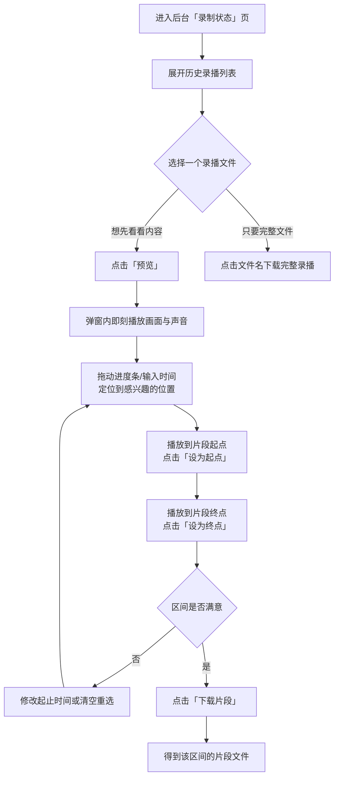

# 后台录播预览与切片下载（recording-preview-clip）

**功能名称**: 后台录播预览与切片下载
**PRD 版本**: v1.1
**创建日期**: 2026-10-21
**作者**: Z.Vtuber Workflow Agent

> v1.1 修订：预览定位播放改为「进度条拖动 + 关键帧定位」交互口径（跳转落点为最近关键帧、跳转后约 1 秒内起播、拖动不卡死），并明确不支持在线预览的编码与浏览器边界。

## 背景与目标

### 1.1 背景

「B站直播录播」功能（PRD：`docs/product/draft/20260913-live-recording-prd.md`）已上线，后台「录制状态」页的历史录播列表可以查看并下载录播文件。

录播文件普遍长达数小时、体积数百 MB 至数 GB，当前只有「下载完整文件」一种消费方式：

- 想确认某场录播录得是否正常（画面、声音、起止位置），必须先下载完整文件才能播放确认；
- 想只要其中一段内容（某段话题、某个片段、一段素材），只能下载完整文件后再用本地工具剪切，费时费流量；
- 判断「要哪一段」本身也需要先看一遍录播，目前只能离线完成，无法在后台直接完成「找段 → 截取 → 下载」的闭环。

### 1.2 目标

- 后台可直接在线预览录播（画面 + 声音），无需下载完整文件，进入即播、原始画质；
- 预览中可通过进度条/时间输入定位到录播的任意位置继续观看，拖动跳转不卡死；
- 预览的同时可选定起点与终点，只下载这一段内容，得到一个可独立播放的片段文件；
- 不影响既有能力：完整文件下载、实时音频、音频试听等行为保持不变。

### 1.3 成功标准

- 在历史录播列表中点击「预览」，约 1 秒内开始播放录播画面与声音，无需下载完整文件、无需等待转码；
- 拖动进度条或输入时间跳转到任意位置（包括从未加载过的位置），约 1 秒内从最近的关键帧继续播放，操作全程不卡死；
- 选定起点与终点后点击「下载片段」，得到的文件内容即为所选区间（含画面与声音），时长与所选区间一致（落点为关键帧、允许秒级偏差），而不是完整录播；
- 录制中的文件不能预览、不能截取，并给出明确提示；既有下载、音频试听行为不回归。

## 用户分析

### 2.1 目标用户

平台运营者 / 主播内容归档用户（自用场景），在后台管理录播内容的人。

### 2.2 用户场景

| 场景 | 用户角色 | 目标 | 痛点 |
|--|--|--|--|
| 抽查录播质量 | 运营者 | 快速确认某场录播画面/声音是否正常 | 只能下载数 GB 文件后本地播放确认 |
| 截取精彩片段 | 运营者 | 只取某一段内容做素材/分享 | 只能下载完整文件再本地剪切 |
| 核对某段内容 | 运营者 | 拖动进度条定位到某个时间点查看当时的情况 | 下载后本地拖动进度，等待时间长 |
| 控制下载成本 | 运营者 | 只下载需要的那部分 | 录播体积大，整文件下载慢且占空间 |

## 功能需求

### 3.1 功能概述

在后台「录制状态」页的历史录播中，为每个录播文件提供在线预览：像本地播放器一样播放并拖动进度条定位；预览内选定起点与终点后，只下载该区间的片段内容。

### 3.2 功能列表

#### 功能点 1: 录播在线预览与定位播放

- **描述**: 历史录播列表中的录播文件提供「预览」入口，点击后在后台弹出播放器，直接在线播放该录播的画面与声音，原始画质、无需下载完整文件。播放器提供进度条与时间显示：可拖动进度条或输入时间定位到录播任意位置（含从未加载过的位置）继续观看，跳转落点为该位置最近的关键帧（通常在 1~2 秒内），拖动操作全程不卡顿、不冻结。播放过程中可暂停、继续、调节音量、全屏。
- **用户价值**: 不下载即可确认录播内容与质量，像本地播放器一样快速定位到想看的位置。
- **验收标准**:
  - [ ] 历史录播中支持预览的文件展示「预览」入口，点击后约 1 秒内开始播放画面与声音；
  - [ ] 播放为原始画质，无需等待完整文件下载或转码；
  - [ ] 拖动进度条到任意位置（含未加载位置）约 1 秒内继续播放，落点为最近关键帧（秒级偏差），全程不卡死；
  - [ ] 输入时间点跳转与拖动进度条等效；
  - [ ] 播放过程中可暂停、继续、调节音量、全屏。

#### 功能点 2: 切片区间选择

- **描述**: 预览播放器内提供切片区间选择：可「设为起点」「设为终点」把当前播放位置设为区间端点，也可手动输入时间（支持 `m:ss` / `m:ss.S` 格式）微调；区间以所选起止点与区间时长的形式展示，可清空重选。所选区间即为待下载内容，下载片段的起止与预览定位一致。
- **用户价值**: 边看边选段，精确定位要下载的内容范围。
- **验收标准**:
  - [ ] 「设为起点」「设为终点」按下后记录当前播放位置，区间展示随之更新；
  - [ ] 起点、终点支持手动输入时间修改，格式非法或起点不早于终点时给出提示且不接受该值；
  - [ ] 区间可清空重选；未选择完整区间（缺起点或终点）时下载入口不可用并提示；
  - [ ] 起点与预览定位一致（落点为关键帧），界面明确提示起点会对齐到关键帧。

#### 功能点 3: 切片内容下载

- **描述**: 选定区间后点击「下载片段」，只下载该区间的片段内容，得到一个含画面与声音、可独立播放的片段文件；无需先下载完整录播。下载产物为所选区间的原始内容（不改变画质/音质）。片段即时生成并开始下载，无需排队等待任务完成。
- **用户价值**: 只下载需要的部分，节省时间与流量；片段可直接分享或二次使用。
- **验收标准**:
  - [ ] 点击「下载片段」得到片段文件而非完整录播，文件时长与所选区间一致（关键帧落点允许秒级偏差，界面有提示）；
  - [ ] 片段文件可独立播放，包含画面与声音；
  - [ ] 片段内容为原始画质/音质（不因截取而降质）；
  - [ ] 单个片段时长超过上限时拒绝下载并提示上限值；
  - [ ] 下载过程与结果不改动原录播文件。

### 3.3 用户操作流程

### 3.4 页面/界面描述

| 页面 | 描述 | 关键元素 |
|------|------|---------|
| 录制状态页 - 历史录播 | 录播文件列表，支持下载完整文件，并新增预览入口 | 文件名（下载完整文件）、大小、所属场次、「预览」入口；录制中的文件不提供预览；不支持预览的文件入口置灰并说明原因 |
| 录播预览弹窗 | 在线播放选定录播、定位并选择切片区间 | 播放器（画面+声音、可拖动进度条、时间显示、音量、全屏）、跳转时间输入、「设为起点」「设为终点」、区间展示（起点/终点/时长）与清空、「下载片段」按钮、关键帧落点提示 |

### 3.5 异常与边界情况

| 情况 | 预期行为 |
|------|---------|
| 录制中的文件 | 不提供预览/截取；若已进入后开始录制，给出「文件正在录制中」提示 |
| 文件已被清理/不存在 | 提示文件不存在，刷新列表 |
| AV1 编码录播（二压文件） | 不支持在线预览，入口置灰并提示「AV1 编码暂不支持在线预览」；完整文件下载与切片下载仍可用 |
| 浏览器不支持在线播放（如未开启媒体扩展） | 提示「当前浏览器不支持在线预览」，下载不受影响 |
| 文件不支持快速定位（探测失败） | 禁用进度条拖动，仍可顺序播放；提示「该文件暂不支持跳转」 |
| 起点晚于或等于终点 / 时间格式非法 | 提示输入无效，不接受该值，不允许下载 |
| 未选择完整区间 | 「下载片段」不可用并提示先选择起止点 |
| 所选区间超过单片段时长上限 | 提示上限值，拒绝下载 |
| 跳转/起点落在两个关键帧之间 | 落点为最近关键帧，实际片段可能比所选区间略长，界面已提示 |
| 终点超出录播实际长度 | 片段输出到录播结尾（时长短于所选区间） |
| 片段生成失败 | 提示「片段生成失败，请重试」，不产生下载文件 |
| 预览播放中途失败 | 提示「预览暂不可用」，可重试；完整文件下载不受影响 |
| 预览/下载中断网 | 提示网络异常可重试；已下载的部分片段文件可正常使用 |

## 四、非功能需求

### 4.1 性能要求

- 预览进入后约 1 秒内开始播放，不等待完整文件下载、不产生转码等待；
- 跳转到任意位置后约 1 秒内继续播放；拖动过程不冻结界面；
- 预览过程内存占用有上限（长时间观看不随文件长度增长）；
- 片段下载边生成边传输，开始下载无需等待整个片段生成完毕；
- 预览/下载期间不影响正在进行的录制与其他后台操作。

### 4.2 安全性要求

- 预览与片段下载仅能访问该房间已归档的录播文件，不能借此访问其他文件；
- 预览与截取均不修改、不删除原录播文件。

### 4.3 兼容性要求

- 在线预览要求浏览器支持媒体扩展（MSE）：Chrome / Edge / Firefox / Safari 桌面版近两年版本；不支持时降级提示且下载不受影响；
- 既有完整文件下载、断点续传、音频试听行为完全不变；
- 切片下载产物为通用视频文件（MP4 封装、原始编码），主流播放器可播。

## 五、依赖与约束

### 5.1 依赖

- 既有录播归档与历史录播列表能力（PRD：`docs/product/draft/20260913-live-recording-prd.md`、`docs/product/draft/20260914-recording-file-list-metadata-prd.md`）；
- 录播文件的分段下载能力（PRD：`docs/product/draft/20260914-recording-download-range-prd.md`），在线预览与跳转定位建立在该能力之上。

### 5.2 约束

- 只对已归档、未在录制中的录播文件提供预览与截取；
- 在线预览仅支持原画（RAW）录播；AV1 二压录播不支持在线预览（见 3.5）；
- 定位与切片起止点受视频关键帧限制，落点为最近关键帧（秒级偏差），本期不做逐帧精确剪切；
- 单个片段时长设上限，防止长时间占用生成能力；
- 片段即时生成、下载完即弃，不提供片段的长期保存与管理。

## 六、相关文档

- 技术提案: `docs/engineering/proposals/20261021-proposal-recording-preview-clip.md`
- 录播功能 PRD: `docs/product/draft/20260913-live-recording-prd.md`
- 录播文件下载支持 Range PRD: `docs/product/draft/20260914-recording-download-range-prd.md`
- 录播列表元信息 PRD: `docs/product/draft/20260914-recording-file-list-metadata-prd.md`
