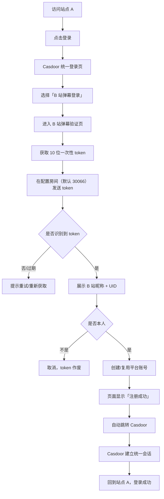
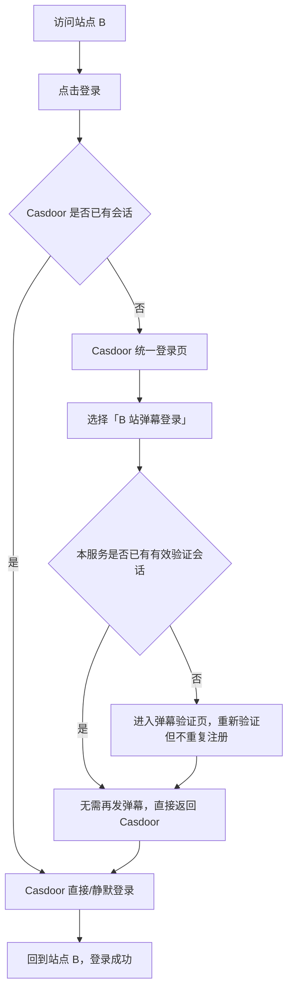
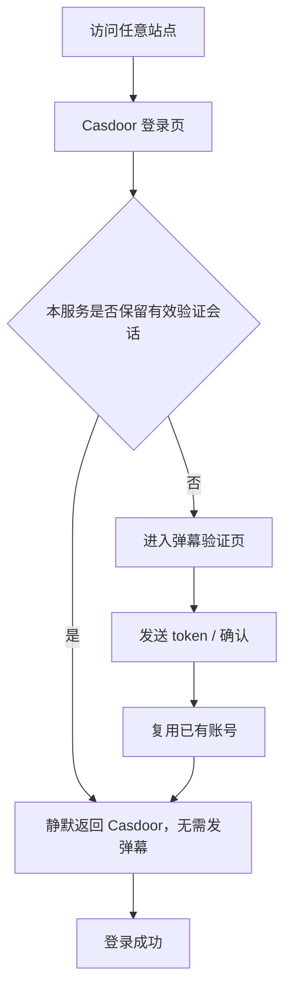
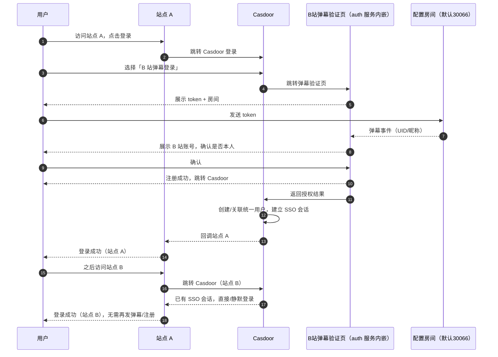

# B站弹幕帐号认证（多站点统一登录）

**功能名称**: B站弹幕帐号认证（多站点统一登录）
**PRD 版本**: v2.1（返工修订）
**创建日期**: 2026-11-19
**作者**: Z.Vtuber Workflow Agent
**关联技术提案**: `docs/engineering/proposals/20261119-proposal-danmaku-account-auth.md`

> v2.0 修订说明：v1.0 把 Casdoor 设计成「无页面、直接换 token」的受信任外部身份源，没有解决「多个网站共享一套登录、注册一次后跳转 Casdoor、之后所有站点漫游」的核心诉求。v2.0 改为：**Casdoor 是统一登录/SSO 中心；B站弹幕是 Casdoor 的一个自定义登录方式；弹幕验证/注册页由 auth 服务内嵌（或独立登录服务）提供；首次注册成功后跳转 Casdoor 建立统一会话，其余站点通过 Casdoor SSO 直接登录，不再重复注册或发弹幕。**
>
> v2.1 修订说明：按 PR inline comment，**apps/web 是后台管理前端，只有内部 endpoint，没有互联网 endpoint**，不能作为互联网登录页。弹幕验证/注册页改为 **auth 服务内嵌页面**（也可选择独立 login 服务）；`apps/web` 零改动。
>
> v2.0 同时按 PR inline comment 修订：**不修改 crawler、不增加 crawler 默认常驻房间**；改为在 auth 服务配置 `RoomIds`（JSON 字符串数组，默认 `["30066"]`），auth 为每个房间建立独立事件源订阅，可从多个房间拿到登录 token。

## 背景与目标

### 1.1 背景

需求方有**多个网站**，希望它们共享同一套用户与登录状态：

- 用户在任意一个网站登录一次后，访问其他网站不需要再次注册/登录；
- 账号只需要注册一次；
- 注册方式希望沿用 B 站直播间身份：用户在直播间（默认 30066 房间，可配置多个房间）发送一次性 token，证明自己拥有该 B 站账号；
- 注册成功后，页面显示「注册成功」，然后跳转到 **Casdoor** 完成统一登录；
- 之后所有接入 Casdoor 的网站都能「漫游」这个账号，看到同一个用户、同一份资料、同一登录态。

当前平台没有面向观众的账号体系，也没有多站点统一登录。若每个网站各自注册、各自登录，会出现：

- 用户重复注册，账号无法互通；
- 无法证明「网站账号就是直播间里的那个 B 站账号」；
- 每个站点都要重复实现弹幕验证、风控、会话，成本高且体验不一致；
- 后续接入更多站点时，账号体系再次分裂。

因此，本需求要做的不是「单个网站的弹幕登录」，而是「**以 B 站弹幕作为注册/绑定方式的多站点统一登录**」。Casdoor 作为统一身份平台，负责登录页、统一用户、统一会话与 SSO；本服务负责「B 站弹幕身份验证」这一种登录方式。

### 1.2 目标

- **一套账号**：多个网站共享同一套用户，同一个 B 站 UID 只对应一个平台账号；
- **只注册一次**：用户第一次在任意站点通过弹幕完成注册/绑定后，后续站点不再注册、不再发弹幕；
- **统一登录**：首次注册成功后跳转 Casdoor 建立统一登录态；之后所有接入 Casdoor 的站点通过 SSO 直接登录；
- **弹幕验证**：默认监听 30066 房间，且支持配置多个房间；用户在任意配置房间发送 10 位一次性 token 即可完成验证；
- **注册成功可见**：验证通过后页面明确显示「注册成功/绑定成功」，并自动跳转 Casdoor；
- **安全可控**：token 一次性、短有效期、不可重放、不明文存储；有频率限制、审计与异常提示；
- **可扩展**：新增网站只需要在 Casdoor 注册一个应用并接入标准登录，不需要改弹幕服务；
- **明确 Casdoor 结论**：Casdoor 不能直接作为「弹幕登录插件」；本需求把它作为统一 IdP/SSO 中心，把 B 站弹幕实现为 Casdoor 的一种自定义登录方式。

### 1.3 成功标准

- 用户第一次在站点 A 发起登录，完成一次弹幕验证后：
  - 页面在 **1 秒内**显示「注册成功/绑定成功」；
  - 自动跳转 Casdoor，并在 **10 秒内**回到站点 A 且处于登录状态；
- 用户随后访问站点 B（同一 Casdoor 组织下的另一个应用）：
  - 不需要再发弹幕、不需要再注册；
  - 在 Casdoor 已有会话时，**3 秒内**完成登录（或通过静默登录自动完成）；
- 同一个 B 站 UID 在多个站点看到的是**同一个平台账号**（同一用户 ID、同一份统一资料；账号中心展示最新 B 站资料，统一资料同步策略见技术提案）；
- **0** 次重复注册；**0** 次 token 重复使用成功；**0** 次 token 明文落库；
- 默认 30066 房间可用；配置多个房间时，用户在任意一个配置房间发送 token 都能完成验证；
- 配置的房间事件源部分不可用时，其他房间仍可完成登录；全部不可用时给出明确提示，不产生「假等待」；
- 用户可以退出登录；退出后再次登录可以复用已有账号，不重复注册；
- 新增一个网站接入时，只需在 Casdoor 增加应用与回调地址，不需要修改弹幕服务代码。

## 用户分析

### 2.1 目标用户

- **多站点用户**：在需求方的多个网站之间活动，希望一次注册、处处登录；
- **B 站直播间观众**：已经在 B 站登录，愿意用「发一条弹幕」证明身份；
- **站点运营/接入方**：希望快速给自己的网站接入统一登录，不想重复做账号、验证码、弹幕验证；
- **平台运维/安全**：关注账号唯一性、token 滥用、跨站登录状态与审计。

### 2.2 用户场景

| 场景 | 用户角色 | 目标 | 痛点 |
|--|--|--|--|
| 第一次使用站点 A | 新用户 | 不注册密码，用 B 站身份快速注册/登录 | 平台没有账号；注册密码麻烦且无法证明 B 站身份 |
| 第一次使用站点 B | 已注册用户 | 直接进入，不再注册/发弹幕 | 每个站点各自注册，账号不互通 |
| 在站点 A 登录后打开站点 B | 已登录用户 | 自动识别为同一账号 | 需要重新登录、重新填资料 |
| 昵称/头像变更 | 老用户 | 各站点看到同一份资料；账号中心可查看最新 B 站资料 | 各站点资料不一致 |
| 直播间 token 被旁观 | 用户 | 不被别人抢登录 | 口令一旦泄露，谁先发谁就可能被绑定 |
| 多房间运营 | 运营 | 在 30066 或其他配置房间都能验证 | 只支持单房间，主播换房间/多房间场景不可用 |
| 新站点接入 | 接入方 | 只接统一登录，不重复做弹幕 | 每个站点重复开发验证、会话、风控 |
| 登录失败排查 | 运维 | 判断是 token、房间事件源还是 Casdoor 问题 | 缺少状态与审计，用户只说「登不上」 |

## 功能需求

### 3.1 功能概述

提供一套「B 站弹幕注册/登录 + Casdoor 统一 SSO」能力：

1. 用户在任意接入站点点击登录，进入 Casdoor 统一登录页；
2. 选择「B 站弹幕登录」，进入本服务的弹幕验证/注册页；
3. 用户获取 10 位一次性 token，在配置的直播间（默认 30066）发送；
4. 本服务识别 token，展示发送者 B 站昵称/UID，用户确认是本人；
5. 页面显示「注册成功/绑定成功」，并为该 B 站账号建立/复用平台账号；
6. 自动跳转 Casdoor，由 Casdoor 建立统一登录会话；
7. 回到原站点，站点通过 Casdoor 拿到统一凭证，完成登录；
8. 用户访问其他站点时，Casdoor 已有会话，直接 SSO 登录，不再发弹幕、不再注册。

### 3.2 功能列表

#### 功能点 1: 多站点统一登录入口

- **描述**: 每个接入站点不自己实现登录表单，而是在需要登录时跳转到 Casdoor 统一登录页。Casdoor 登录页展示该站点可用的登录方式，其中包含「B 站弹幕登录」。用户在任意站点登录成功后，Casdoor 建立统一会话；同一 Casdoor 组织下的其他站点在用户访问时可直接复用该会话完成登录。
- **用户价值**: 一次登录，多站通用；站点不需要重复做账号与登录页。
- **验收标准**:
  - [ ] 站点 A 登录成功后，访问站点 B（同一 Casdoor 组织）无需再次输入账号/发弹幕；
  - [ ] 站点 B 在 Casdoor 已有会话时可直接完成登录，或通过静默登录自动完成；
  - [ ] 各站点看到同一用户 ID 与同一份统一资料；账号中心可查看最新 B 站昵称/头像；
  - [ ] 新增站点只需在 Casdoor 增加应用/回调地址，不需要修改弹幕服务；
  - [ ] 站点不要求用户设置平台密码。

#### 功能点 2: 首次弹幕注册/绑定

- **描述**: 用户第一次使用「B 站弹幕登录」时，进入本服务的弹幕验证页。用户获取 10 位一次性 token（仅 `[A-Za-z0-9]`），在页面提示的直播间发送；本服务从配置的房间事件源中识别 token，取发送者 B 站 UID/昵称，展示给用户确认。用户确认后，平台以 B 站 UID 为唯一键创建/复用账号，页面显示「注册成功/绑定成功」，并自动跳转 Casdoor 完成统一登录。
- **用户价值**: 不需要注册密码；一条弹幕完成「证明 B 站身份 + 注册平台账号」。
- **验收标准**:
  - [ ] 首次用户能看到清晰的「获取 token → 去直播间发送 → 确认账号 → 注册成功 → 跳转 Casdoor」流程；
  - [ ] token 为 10 位 `[A-Za-z0-9]`，默认 5 分钟有效，用完即弃；
  - [ ] 识别后展示 B 站昵称 + UID（可选头像），用户确认后才创建/绑定账号；
  - [ ] 注册成功后页面明确显示成功，并自动跳转 Casdoor；
  - [ ] 同一 B 站 UID 不会创建第二个平台账号；
  - [ ] 用户拒绝/超时后 token 作废，可重新获取。

#### 功能点 3: 多房间 token 验证

- **描述**: 系统默认监听 30066 房间，并支持通过配置增加/修改监听的房间列表（配置为字符串数组，默认 `["30066"]`）。每个房间独立建立事件订阅、独立重连与健康状态；用户在任意一个已配置且可用的房间发送 token，都可以完成验证。页面会展示当前可用于发送的房间；全部房间不可用时明确提示。
- **用户价值**: 不只绑定一个房间；主播换房间、多直播间运营时仍可使用同一套注册/登录。
- **验收标准**:
  - [ ] 默认配置下，用户在 30066 发送 token 可完成验证；
  - [ ] 配置多个房间时，用户在任意一个配置房间发送 token 都可完成验证；
  - [ ] 某个房间事件源断开时，其他房间不受影响；
  - [ ] 页面展示可发送的房间列表/主房间与状态；
  - [ ] 全部房间不可用时，不发放 token 或明确提示稍后重试；
  - [ ] token 在非配置房间发送不会被识别。

#### 功能点 4: 账号确认与防冒用

- **描述**: 识别到 token 后，不立即完成注册/登录，而是展示实际发送者的 B 站昵称与 UID，让用户确认「这是我」。用户确认后才创建/复用账号并继续跳转 Casdoor；用户选择「不是我」则取消，token 作废。识别后长时间不确认（默认 2 分钟）自动失效。
- **用户价值**: 即使 token 被旁人看到并抢先发送，真正用户也能拒绝陌生账号，避免账号被冒用。
- **验收标准**:
  - [ ] 识别后展示昵称 + UID（可选头像）；
  - [ ] 确认后继续注册/登录；拒绝后取消并作废 token；
  - [ ] 同一 token 被多个账号发送时，只允许最先被系统确认的一条生效；
  - [ ] 识别后 2 分钟不确认自动失效，需重新获取 token；
  - [ ] 页面明确提示「请确认这是你的 B 站账号」。

#### 功能点 5: Casdoor 统一登录与 SSO

- **描述**: 本服务把「B 站弹幕」实现为 Casdoor 的一种自定义登录方式。用户在弹幕验证页确认成功后，页面跳转 Casdoor；Casdoor 通过标准登录流程识别该 B 站账号，首次自动创建/绑定 Casdoor 用户，建立统一登录会话，然后回到原站点。之后用户访问同一 Casdoor 组织下的其他站点时，Casdoor 复用已有会话完成 SSO，不再触发弹幕验证。
- **用户价值**: 用户只注册一次；所有站点共享同一账号与登录态；站点只接标准统一登录。
- **验收标准**:
  - [ ] 首次注册成功后，页面自动跳转 Casdoor，并最终回到原站点登录成功；
  - [ ] Casdoor 中能看到该用户，且同一 B 站 UID 只对应一个 Casdoor 用户；
  - [ ] 用户访问第二个站点时，不再次出现弹幕验证页；
  - [ ] Casdoor 会话有效时，第二个站点可直接登录；
  - [ ] Casdoor 不可用时，弹幕验证结果不丢失，页面提示稍后重试，不产生半注册/半登录；
  - [ ] 非弹幕登录方式（密码/验证码/第三方账号等）仍可使用 Casdoor 统一登录页，不受影响。

#### 功能点 6: 账号中心与账号复用

- **描述**: 提供一个账号中心/绑定页，展示当前 B 站账号（昵称、UID、头像）与统一账号状态；用户可以在此发起「B 站弹幕绑定/重新验证」、查看已接入的站点、退出统一登录。已经注册过的用户再次进入弹幕验证页时，系统复用原账号，不重复创建。
- **用户价值**: 用户知道自己的账号绑定了什么；换设备/会话过期后可重新验证，但不会重复注册。
- **验收标准**:
  - [ ] 账号中心展示 B 站昵称、UID、可选头像与绑定状态；
  - [ ] 已注册用户再次验证后复用原账号，不产生新账号；
  - [ ] 可查看/跳转已接入站点（可选）；
  - [ ] 可退出统一登录；退出后其他站点按 Casdoor 会话策略失效；
  - [ ] 账号被禁用时，验证/登录被拒绝并给出明确提示。

#### 功能点 7: 安全、风控与可运营

- **描述**: 对获取 token、发送 token、确认、Casdoor 回调等环节做防护：按来源/账号限流；token 一次性、短有效期、只存摘要；登录/注册/失败/过期可审计；房间事件源与 Casdoor 状态可观测；异常有明确提示。
- **用户价值**: 降低 token 被枚举、账号被冒用、服务不可用而无人知晓的风险。
- **验收标准**:
  - [ ] 获取 token 有频率限制，超限提示稍后再试；
  - [ ] 同一 B 站账号短时间大量发送 token 被限流；
  - [ ] token 错误/过期/已使用时返回统一、不可枚举的提示；
  - [ ] 注册成功、失败、取消、过期均有审计记录（不含 token 明文）；
  - [ ] 可查看每个房间事件源的连接/最近事件时间；
  - [ ] Casdoor 登录/回调失败有日志与指标，不把内部错误直接暴露给用户。

### 3.3 用户操作流程

#### 3.3.1 首次注册（站点 A）

#### 3.3.2 第二个站点（站点 B，不再注册/发弹幕）

#### 3.3.3 会话过期后的再次登录

### 3.4 页面/界面描述

| 页面 | 描述 | 关键元素 |
|--|--|--|
| 站点登录入口 | 各站点只需要一个「登录」入口，跳转 Casdoor | 「登录」按钮、可选「B 站弹幕登录」直达；不自己做账号密码表单 |
| Casdoor 统一登录页 | 统一登录/注册入口，展示可用登录方式 | 账号密码/验证码/第三方登录（按配置）、「B 站弹幕登录」、站点品牌 |
| B 站弹幕验证页（auth 服务内嵌） | 首次注册/重新验证的核心页面，由 auth 服务直接托管（互联网可访问） | 标题与说明、10 位 token（等宽、可复制）、有效期倒计时、可发送房间列表（默认 30066）、状态区（等待/已识别/已过期/已使用/事件源异常）、「重新获取」、隐私提示 |
| 账号确认弹窗/区块 | 展示实际发送者，确认是否本人 | B 站昵称、UID、可选头像、粉丝牌/大航海（可选）、「这是我」「不是我」、剩余确认时间 |
| 注册成功页 | 明确告知 B 站账号绑定成功，并自动跳转 Casdoor 建立统一登录 | 「B 站账号绑定成功」、B 站昵称/UID、即将跳转 Casdoor 的提示、手动「继续」按钮（跳转失败时可用）、Casdoor 暂不可用时的重试提示 |
| 账号中心（auth 服务内嵌） | 查看/管理绑定与统一账号 | B 站昵称、UID、头像、绑定状态、已接入站点（可选）、重新验证、退出统一登录 |
| 错误页/提示 | 针对不同失败原因给出可操作提示 | token 过期、token 已使用、房间事件源不可用、频率限制、账号禁用、Casdoor 暂不可用 |
| 站点回调页 | 站点接收 Casdoor 回调并建立自己的会话 | 由各站点实现；不展示登录表单 |

> **前端职责结论**：
> - **Casdoor 统一登录页**由 Casdoor 提供，站点只负责跳转/回调；
> - **B 站弹幕验证页/账号中心**由 **auth 服务内嵌托管**（同一个互联网服务，同源，便于 Provider Session/Ticket），或后续拆成独立登录服务；因为 Casdoor 无法监听弹幕、无法托管 token 验证流程；
> - **`apps/web` 不参与登录页**：它是后台管理前端，只有内部 endpoint，没有互联网 endpoint；本需求对 `apps/web` 零改动；
> - **各站点**只接入 Casdoor 标准登录（跳转、回调、静默登录），不需要自己实现弹幕验证、token、B 站账号解析；
> - 第三方若想复用弹幕登录，可跳转 auth 服务提供的验证页，或按 auth 服务 API 自行实现 UI；不建议改 Casdoor 前端做自定义登录页。

### 3.5 异常与边界情况

| 情况 | 预期行为 |
|--|--|
| token 过期 | 页面提示已过期，提供重新获取；不创建账号 |
| token 已使用 | 不生效；提示重新获取；不重复创建账号 |
| 用户在非配置房间发送 | 不识别；页面提示检查房间号 |
| 用户在某个配置房间发送，但该房间事件源断开 | 其他可用房间仍可识别；页面显示房间状态；全部不可用时明确提示 |
| 同一 token 被多个账号发送 | 仅最先被系统确认的一条生效；确认页展示实际发送者 |
| 用户看到别人 token 并抢发 | 真正用户看到陌生账号后选择「不是我」，不会注册到错误账号 |
| 识别后长时间不确认 | 默认 2 分钟失效，token 作废，需重新获取 |
| 用户点击「不是我」 | 取消本次注册/登录，token 作废；不创建账号 |
| 同一 B 站 UID 已注册 | 复用原账号；平台/账号中心更新昵称/头像；Casdoor 统一资料按首次填充策略，后续同步可作为增强；不重复注册 |
| B 站昵称变更 | 下次验证/登录更新展示；UID 不变，账号不迁移 |
| 用户已登录站点 A，访问站点 B | Casdoor 已有会话时直接/静默登录；不要求再发弹幕 |
| Casdoor 会话过期，但本服务验证会话仍有效 | 可静默通过 Casdoor 重新登录；不要求再发弹幕 |
| 本服务验证会话也过期 | 需重新发弹幕验证，但复用原账号，不重复注册 |
| Casdoor 暂不可用 | B 站账号绑定结果保留（本地账号已创建/复用），页面提示「统一登录暂不可用，请稍后重试」；不产生重复账号 |
| B 站账号已绑定但 Casdoor 统一登录未完成 | 用户重试统一登录即可；不需要重新发弹幕；如超过本服务验证会话有效期，则重新验证但仍复用原账号 |
| 用户在 Casdoor 取消登录 | 返回站点登录页/原页面，不创建站点会话；本地 B 站绑定关系可保留，下次直接重试统一登录 |
| 新站点未在 Casdoor 配置 | 无法登录；接入方需先在 Casdoor 增加应用/回调 |
| 账号被禁用 | 验证/登录被拒绝，提示账号已禁用 |
| 频率超限 | 提示稍后再试，不泄露内部阈值 |
| 多设备/多站点同时登录 | 允许；同一 Casdoor 用户可多会话；退出策略按 Casdoor 会话管理 |
| 系统时间异常 | 以服务端时间为准；客户端倒计时仅展示 |

## 四、非功能需求

### 4.1 性能要求

- 首次注册：token 创建 P95 ≤ 300ms；从发送弹幕到页面显示识别结果 P95 ≤ 3s、P99 ≤ 5s；
- 注册成功页到 Casdoor 的跳转在 1 秒内开始；从 Casdoor 回到站点 P95 ≤ 5s（不含用户交互）；
- 第二个站点 SSO：Casdoor 已有会话时，登录完成 P95 ≤ 3s；
- 单个房间事件源处理能力至少覆盖该房间峰值弹幕量的 3 倍；多房间并行互不阻塞；
- 房间事件源断线后 30 秒内自动重连；重连后补回窗口默认 10 分钟；
- Casdoor 登录/回调失败时，错误在 2 秒内反馈给用户。

### 4.2 安全性要求

- token 为 10 位 `[A-Za-z0-9]`，密码学安全随机；服务端只存带服务端密钥的摘要，不存明文；
- token 一次性、默认 5 分钟有效；成功识别即作废；过期/取消/失败不可复用；
- 获取 token 按来源限流；发送/确认按账号与来源限流；防枚举；
- 识别后必须由发起端确认；未持有发起端凭证的第三方不能领取注册/登录结果；
- 账号以 B 站 UID 唯一；同一 UID 不能创建多个平台/Casdoor 用户；
- Casdoor 与站点之间使用标准 OAuth2/OIDC；回调地址白名单；state 校验；不使用隐式流；
- 会话/token 不出现在 URL、日志、错误信息中；日志与审计不含 token 明文；
- 支持按 UID 禁用账号；禁用后不能注册/登录；
- 全链路 HTTPS；跨域仅允许配置来源。

### 4.3 可用性要求

- 统一登录可用性目标 99.9%（按月）；Casdoor 短时不可用不影响已建立会话的本地校验（按各站点策略）；
- 多个房间事件源中部分不可用时，其他房间仍可完成验证；全部不可用时明确提示；
- 认证服务单实例故障不影响整体：token/账号/验证会话持久化，任意实例可继续处理；
- 支持优雅停机与多实例滚动；房间事件源消费者可被其他实例接管；
- 依赖（Mongo/Redis/Casdoor/房间事件源）短时不可用时，给出可重试错误，不产生脏数据。

### 4.4 兼容性要求

- 第一方 Web 支持 Chrome / Edge / Firefox / Safari 近两年桌面与移动版本；
- 各接入站点可使用任意前端框架，通过标准 OAuth2/OIDC 接入 Casdoor；
- Casdoor 使用官方标准能力（自定义 OAuth Provider、应用、组织、SSO），不修改 Casdoor 源码；
- 不改变 30066 等房间现有弹幕、直播、录播能力；不影响既有 SSE 订阅方。

### 4.5 隐私与合规要求

- 仅收集完成注册/登录所必需的信息：B 站 UID、昵称、可选头像、登录时间、来源 IP/UA、来源房间；
- 不采集弹幕全文用于登录以外的目的；审计只保留必要字段；
- 提供账号注销/数据删除的人工入口（本期可走运营工单）；
- 明确告知用户「发送 token 即表示同意平台读取该条弹幕的发送者 UID/昵称用于注册/登录」；
- 数据保留期限可配置；过期验证请求、授权码、访问令牌与审计数据按策略清理。

## 五、依赖与约束

### 5.1 依赖

- **Casdoor**：统一身份平台，提供登录页、用户/组织/应用、标准 OAuth2/OIDC、SSO；需部署并配置；
- **房间事件源**：为配置的每个房间提供弹幕事件（默认 30066）；本需求不修改 crawler，也不新增 crawler 默认常驻房间；事件源需由部署/上游服务保证；
- **MongoDB**：验证请求、账号、验证会话、授权码、访问令牌、审计；
- **Redis**：频率限制、多实例房间消费者协调；
- **HTTPS 与域名**：本服务、Casdoor、各站点回调地址；
- **各站点**：接入 Casdoor 标准登录（客户端 ID/Secret、回调地址、会话）。

### 5.2 约束

- token 固定 10 位、字符集 `[A-Za-z0-9]`，不加入额外前后缀要求；
- 注册/登录依据必须是配置房间的弹幕发送者信息，不能由用户手工填写 UID/昵称替代；
- 不要求用户在平台注册密码；不要求 B 站 OAuth 授权；
- 不修改 B 站客户端/直播间；不要求主播配合；
- Casdoor 不能直接验证弹幕；弹幕验证必须由本服务完成；
- 房间列表是字符串数组（JSON `Array<string>`），默认 `["30066"]`；roomId 以字符串处理；
- 登录/验证页由 auth 服务内嵌（或独立登录服务）提供，**不放入 `apps/web`**；`apps/web` 是后台管理前端，只有内部 endpoint；
- 首次版本不做账号合并/迁移/自助注销；不做完整管理后台；
- 不把 Casdoor 改造成弹幕验证器；不修改 Casdoor 源码。

### 5.3 不在本期范围

- 手机号/邮箱注册、密码登录、找回密码；
- B 站 OAuth/扫码登录；
- 多平台（抖音/微博/YouTube 等）弹幕认证；
- 账号合并/迁移/自助注销；
- 完整管理后台与可视化报表；
- 弹幕内容审核、抽奖、互动玩法；
- 在 Casdoor 登录页内嵌弹幕验证（需要改 Casdoor 前端/插件，本期不做）。

## 六、Casdoor 调研结论

### 6.1 直接结论

1. **Casdoor 不能作为「弹幕登录插件」直接验证 B 站弹幕。** 它是 IAM/SSO 身份平台，负责统一登录页、用户/组织/应用、OAuth2/OIDC/SAML/CAS 与会话；它没有 B 站弹幕监听能力，也没有「发弹幕即登录」的内置能力。
2. **推荐做法：把「B 站弹幕」实现为 Casdoor 的一种自定义登录方式（Custom OAuth Provider）。** Casdoor 作为统一 IdP/SSO 中心；本服务作为该登录方式的 OAuth Provider，负责弹幕 token、B 站账号解析、注册/绑定；Casdoor 负责创建/关联统一用户、签发统一凭证、维护 SSO 会话。
3. **需要多做一个页面，但不是 Casdoor 登录页，也不放在 `apps/web`。** 由 **auth 服务内嵌**一个小小的「B 站弹幕验证/注册页」（账号中心的一部分），或后续拆成独立登录服务；`apps/web` 是后台管理前端、只有内部 endpoint，不承担互联网登录页。Casdoor 统一登录页仍由 Casdoor 提供。用户首次注册成功后，从这个验证页跳转 Casdoor。
4. **多站点共享一套登录是 Casdoor 的原生能力。** 同一 Casdoor 组织下的多个应用，用户登录其中一个后，访问其他应用无需再次登录；每个站点是一个 Casdoor Application，只需配置自己的回调地址。
5. **只注册一次。** 第一次弹幕验证会创建/绑定一个 Casdoor 用户；之后所有站点复用这个用户与 Casdoor 会话，不再注册、不再发弹幕。只有 Casdoor 会话和本服务验证会话都失效时，才需要重新发弹幕验证，但仍然复用原账号，不会重复注册。
6. **前端职责**：
   - Casdoor 统一登录页：Casdoor 提供；
   - B 站弹幕验证页/账号中心：auth 服务内嵌托管（或独立登录服务）；`apps/web` 不参与；
   - 各站点：只接 Casdoor 标准登录（跳转/回调/静默登录），不重复做弹幕验证与账号注册；
   - 第三方若想复用：跳转平台验证页，或按平台 API 自行实现 UI；不建议改 Casdoor 前端做自定义登录页。
7. **另一个「无页面」方案不适合本场景。** Casdoor 的受信任外部身份源（Federated credentials）+ JWT Bearer 可以在没有 Casdoor 页面的情况下换取凭证，但它是服务端/无头模式，不负责建立 Casdoor 浏览器 SSO 会话，不能让多个网站在浏览器里自然漫游。本场景需要浏览器 SSO，因此选择 Custom OAuth Provider。

### 6.2 方案对比

| 方式 | 做法 | 多站点 SSO | 是否需要弹幕验证页 | 结论 |
|--|--|--|--|--|
| Casdoor 作为第三方 OAuth 登录提供方 | 站点跳 Casdoor，Casdoor 再跳 B 站 OAuth | 是 | 否，但 B 站无可用 OAuth 链路 | 不可行 |
| Casdoor 自定义登录页/插件 | 在 Casdoor 登录页内嵌弹幕流程 | 是 | 需要改 Casdoor 前端/插件 | 不采用 |
| Casdoor 管理 API 预创建用户 | 本服务建用户后调 Admin API | 是 | 否 | 不适合作为登录/SSO 链路 |
| **Casdoor Custom OAuth Provider（推荐）** | 本服务作为「B 站弹幕」OAuth Provider，Casdoor 统一登录 | **是** | **是（平台提供验证页）** | **采用** |
| Casdoor Federated credentials | 本服务签发断言，Casdoor 换 token | 否（无浏览器 SSO 会话） | 否 | 仅适合无头/API 场景 |
| 本服务本地 JWT，不接 Casdoor | 本服务自签自验 | 否 | 是 | 仅作为单站点降级 |

### 6.3 职责边界

| 能力 | 本服务（弹幕认证/登录页） | Casdoor | 各站点 |
|--|--|--|--|
| 监听配置房间弹幕 | 负责 | 不负责 | 不负责 |
| 生成/校验一次性 token | 负责 | 不负责 | 不负责 |
| 解析 B 站 UID/昵称 | 负责 | 接收 OAuth 用户信息 | 不负责 |
| 弹幕验证/注册页 | 负责（平台页面） | 不负责（不内嵌） | 跳转使用 |
| 统一登录页 | 不负责 | 负责 | 跳转 |
| 统一用户/组织/应用 | 不负责 | 负责 | 不负责 |
| 多站点 SSO 会话 | 不负责 | 负责 | 使用 |
| 各站点自身会话 | 不负责 | 签发统一凭证 | 负责换取/保存 |
| 账号禁用/审计 | 负责 B 站侧 | 负责统一用户状态 | 展示错误 |

### 6.4 多站点 SSO 产品级时序

> 说明：图中「B 站弹幕验证页」由 auth 服务内嵌托管（或独立登录服务），不是 Casdoor 登录页，也不是 `apps/web`；Casdoor 统一登录页只负责展示登录方式与建立 SSO 会话。

## 七、相关文档

- 技术提案: `docs/engineering/proposals/20261119-proposal-danmaku-account-auth.md`
- 既有直播事件与 SSE 能力：`servers/api/Controllers/BilibiliLiveController.cs`、`servers/api/Live/LiveEventBus.cs`
- 既有弹幕归一化与发送者信息提取：`servers/crawler/Live/DanmakuEventNormalizer.cs`、`servers/common/live/Live/LiveEventTextExtractor.cs`
- 既有服务开发规范：`docs/engineering/common-rules.md`、`docs/engineering/backend-rules.md`
- Casdoor 概览：<https://casdoor.ai/docs/overview/>
- Casdoor 应用与组织：<https://casdoor.ai/docs/application/overview/>
- Casdoor 单点登录：<https://casdoor.ai/docs/session/single-sign-on/>
- Casdoor 自定义 OAuth Provider：<https://casdoor.ai/docs/provider/oauth/CustomProvider/>
- Casdoor OAuth 用户映射：<https://casdoor.ai/docs/provider/oauth/user-mapping/>
