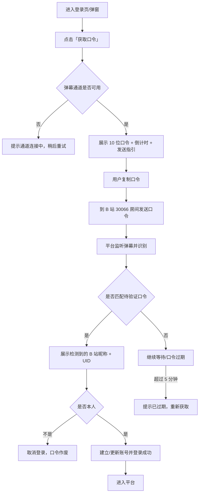
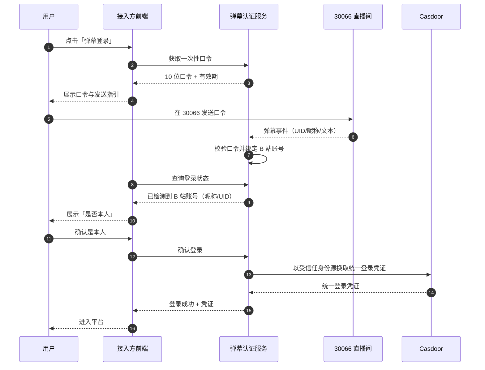

# B站弹幕帐号认证

**功能名称**: B站弹幕帐号认证
**PRD 版本**: v1.0
**创建日期**: 2026-11-19
**作者**: Z.Vtuber Workflow Agent
**关联技术提案**: `docs/engineering/proposals/20261119-proposal-danmaku-account-auth.md`

## 背景与目标

### 1.1 背景

平台目前没有面向观众/用户的账号体系。目标用户主要来自 B 站直播间 30066，他们已经在 B 站完成了实名与登录，但在我们的平台上是匿名的：

- 无法知道「当前操作者对应哪一个 B 站账号」，也就无法做个性化、权限、收藏、订阅、额度等依赖身份的能力；
- 让用户在平台再注册一套账号/密码，既增加流失，也无法证明「这个平台账号就是直播间里的那个 B 站账号」；
- 直播间弹幕本身带有稳定的发送者 UID 与昵称，是天然的「账号所有权证明」载体：只有能登录该 B 站账号的人，才能在 30066 房间发出指定内容。

因此，本需求希望用「在 30066 房间发送一次性口令」的方式完成无密码登录：用户证明自己能在直播间发言，平台据此把该弹幕的发送者 UID/昵称绑定为平台账号，并建立登录会话。

同时，平台正在评估 **Casdoor** 作为统一身份平台。需要明确：Casdoor 能否以「第三方登录插件」的方式直接接入弹幕认证；是否需要额外做一个登录跳转页；以及前端到底由谁来实现。

### 1.2 目标

- **无密码登录**：用户不需要在平台注册密码，只要能在 30066 房间发送指定口令，即可完成登录；
- **一次性口令**：每次登录生成 10 位 `[A-Za-z0-9]` 口令，用完即弃，过期/已使用/错误房间均不可用；
- **默认监听**：认证服务启动后自动监听 30066 房间的弹幕流，无需人工开启；连接中断自动恢复；
- **稳定绑定**：以 B 站 UID 作为平台账号的唯一身份键，昵称/头像可随登录更新，但 UID 不变；
- **可确认**：识别到发送者后，先向用户展示「检测到的 B 站账号」，用户确认后才真正建立登录会话，避免口令被他人抢用；
- **统一身份**：给出 Casdoor 的明确接入结论，并保证无论是否启用 Casdoor，用户侧的弹幕登录流程都不变；
- **安全可运营**：口令不落明文、不可重放；有频率限制、审计与健康检查，异常可定位。

### 1.3 成功标准

- 用户在页面点击「获取口令」后，**1 秒内**拿到 10 位一次性口令，口令在 **5 分钟**内有效；
- 用户在 30066 房间发送正确口令后，**P95 ≤ 3 秒、P99 ≤ 5 秒**内页面显示检测到的 B 站账号（昵称 + UID）；
- 用户确认后成功建立登录会话，登录成功率（发送了正确口令的用户）**≥ 95%**；
- **0** 次口令重复使用成功；**0** 次口令明文落库；**0** 次同一 B 站 UID 生成重复平台账号；
- 认证服务启动后自动监听 30066；断线后 **30 秒内**自动重连，重连期间不产生错误登录；
- Casdoor 接入结论明确：不把 Casdoor 当作弹幕登录插件；采用「本服务验证弹幕身份 + Casdoor 统一签发登录凭证」的方式，弹幕登录**不需要**新增 Casdoor 登录跳转页；
- 用户可主动退出登录；会话过期后可重新走弹幕登录，流程不劣化。

## 用户分析

### 2.1 目标用户

- **30066 房间观众**：希望在平台获得一个与 B 站账号对应的身份，用于后续互动、订阅、收藏、额度等能力；
- **平台运营者**：希望以低成本获得真实、可验证的用户身份，并能排查登录失败；
- **接入方（其他产品/前端）**：希望复用平台的弹幕认证能力，而不重复实现 B 站账号验证；
- **平台安全/运维**：关注口令滥用、账号冒用、服务可用性与审计。

### 2.2 用户场景

| 场景 | 用户角色 | 目标 | 痛点 |
|--|--|--|--|
| 第一次登录平台 | 30066 观众 | 不用注册密码，证明自己是某个 B 站账号 | 平台没有账号体系；注册密码既麻烦又无法证明 B 站身份 |
| 换设备/换浏览器登录 | 老用户 | 快速恢复自己的平台身份 | 忘记密码、验证码收不到；希望沿用 B 站身份 |
| 昵称/头像变更 | 老用户 | 登录后看到最新的 B 站昵称/头像 | 平台资料与 B 站不一致 |
| 口令被他人看到 | 用户 | 不让别人用自己的口令登录 | 口令一旦发出，谁先发谁就可能被绑定 |
| 接入方复用登录 | 其他产品前端 | 不重复做 B 站账号验证 | 每个产品都接一遍弹幕/风控成本高 |
| 登录失败排查 | 运营/运维 | 快速判断是口令过期、发错房间还是弹幕通道断了 | 缺少状态与审计，用户只说「登不上」 |

## 功能需求

### 3.1 功能概述

提供一个「弹幕登录」能力：用户在平台获取一条 10 位一次性口令，把口令发送到 B 站 30066 房间；平台默认监听该房间弹幕，识别到口令后展示发送者 B 站账号（昵称 + UID），用户确认后完成登录并建立会话。平台以 B 站 UID 作为账号唯一身份键；Casdoor 作为统一身份平台时，由本服务完成弹幕身份验证，再交由 Casdoor 统一签发登录凭证。

### 3.2 功能列表

#### 功能点 1: 获取一次性弹幕口令

- **描述**: 用户在登录页/登录弹窗点击「获取口令」，平台生成一条 10 位、仅包含 `[A-Za-z0-9]` 的一次性口令，并展示口令、有效期倒计时和发送指引。口令默认 5 分钟有效；同一口令只能成功使用一次，成功识别后立即作废；过期、已使用、主动取消后均不可复用。用户可复制口令，也可重新获取（重新获取会使旧口令失效或自然过期，页面只展示最新一条）。
- **用户价值**: 不需要注册密码；一条短口令即可完成身份证明。
- **验收标准**:
  - [ ] 点击获取后 1 秒内展示 10 位 `[A-Za-z0-9]` 口令；
  - [ ] 页面明确展示有效期倒计时与「请到 B 站 30066 房间发送」的指引；
  - [ ] 口令可一键复制；复制内容与展示内容完全一致；
  - [ ] 口令过期后页面明确提示已过期，并提供「重新获取」；
  - [ ] 同一口令不能第二次成功登录；
  - [ ] 口令在平台侧不以明文长期保存（安全要求见 4.2）。

#### 功能点 2: 默认监听 30066 房间并识别口令

- **描述**: 认证服务启动后自动监听 B 站 30066 房间的弹幕流，不需要运营手动开启。用户发送的弹幕文本与待验证口令完全一致（去除首尾空白后）时，系统识别为一次有效验证；其他房间、错误口令、普通聊天内容不影响登录。弹幕通道断开后自动重连，并在重连后尽量补回短时间内的漏收弹幕。
- **用户价值**: 用户发完弹幕即可在页面看到结果，无需刷新或等待人工处理。
- **验收标准**:
  - [ ] 服务启动后无需人工操作即可监听 30066；
  - [ ] 用户在 30066 发送正确口令后，P95 ≤ 3 秒内页面显示检测结果；
  - [ ] 在非 30066 房间发送同一口令不会被识别；
  - [ ] 发送错误口令、普通聊天、表情弹幕不会触发登录；
  - [ ] 弹幕通道断开后 30 秒内自动重连；重连后短时间内（默认 10 分钟）的漏收口令仍可被补回识别；
  - [ ] 同一口令被多个账号同时发送时，只允许最先被系统确认的一条生效，其余不产生登录。

#### 功能点 3: 账号绑定与登录确认

- **描述**: 系统识别到口令后，不立即登录，而是先在页面展示「检测到的 B 站账号」：昵称、UID（可选头像）。用户确认「这是我」后，平台建立/更新账号并完成登录；用户选择「不是我」则取消本次登录，口令作废，需重新获取。平台以 B 站 UID 作为账号唯一键：同一 UID 永远对应同一个平台账号；昵称/头像在每次登录时更新为最新值。
- **用户价值**: 即使口令被旁人看到并抢先发送，用户也能在看到陌生账号时拒绝，避免账号被冒用。
- **验收标准**:
  - [ ] 识别成功后展示发送者昵称与 UID，并明确询问是否本人；
  - [ ] 用户确认后完成登录；拒绝后本次登录取消，口令不可复用；
  - [ ] 同一 B 站 UID 重复登录不会创建第二个平台账号；
  - [ ] 昵称变更后再次登录，平台展示最新昵称；UID 不变；
  - [ ] 识别后长时间不确认（默认 2 分钟）会自动失效，需重新获取口令。

#### 功能点 4: 登录会话与退出

- **描述**: 登录成功后建立会话，用户在有效期内保持登录；会话到期后可重新走弹幕登录。用户可主动退出登录；退出后当前会话失效。支持同一账号在多设备登录，但可限制同时有效的会话数量（默认最多 5 个，超出时最早会话失效）。
- **用户价值**: 登录状态可持续使用；退出行为明确；多设备可用。
- **验收标准**:
  - [ ] 登录成功后刷新页面仍保持登录（会话有效期内）；
  - [ ] 主动退出后当前设备立即变为未登录；
  - [ ] 会话过期后访问受保护能力时提示重新登录；
  - [ ] 同一账号多设备登录可用；超过上限时最早会话失效，并在下次请求时提示重新登录；
  - [ ] 退出/会话失效不影响其他设备（除非触发上限淘汰）。

#### 功能点 5: Casdoor 统一登录接入

- **描述**: 平台需要给出 Casdoor 的接入结论，并在产品上保证「是否启用 Casdoor」不改变用户的弹幕登录步骤。Casdoor 作为统一身份平台时，本服务负责验证「这个 B 站账号确实能发弹幕」，Casdoor 负责统一签发和校验登录凭证；弹幕登录不新增 Casdoor 登录跳转页。其他登录方式（密码、验证码、第三方账号等）仍可使用 Casdoor 的托管登录页，由接入方跳转。
- **用户价值**: 用户只感知「发一条弹幕就登录」；平台内部获得统一的身份与凭证体系，便于多产品复用。
- **验收标准**:
  - [ ] 弹幕登录流程在 Casdoor 开启/关闭两种模式下步骤一致，用户不需要额外跳转；
  - [ ] 启用 Casdoor 后，登录成功后平台其他系统可使用统一凭证识别用户；
  - [ ] 弹幕登录不要求用户进入 Casdoor 登录页；
  - [ ] 非弹幕登录方式可由接入方跳转 Casdoor 托管登录页完成；
  - [ ] Casdoor 不可用时，弹幕验证结果不丢失，用户可重试确认，不产生半登录状态；
  - [ ] 接入方前端职责在文档中明确（见 3.4 与第六章）。

#### 功能点 6: 安全与风控

- **描述**: 对获取口令、发送口令、确认登录等环节做基本防护：按来源限制获取频率；同一账号短时间大量尝试时限制；口令错误不泄露「是否存在」；所有登录事件可审计；异常登录可追踪。口令只在创建时展示一次，平台不以明文长期保存。
- **用户价值**: 降低口令被暴力枚举、恶意刷取、账号冒用的风险。
- **验收标准**:
  - [ ] 单来源获取口令有频率上限，超限提示稍后再试；
  - [ ] 同一 B 站账号短时间大量发送口令时被限流，不影响正常用户；
  - [ ] 口令错误/过期/已使用时，返回统一、不可用于枚举的提示；
  - [ ] 登录成功、失败、取消、过期均有审计记录（不含口令明文）；
  - [ ] 管理侧可按 UID/时间/来源排查登录记录。

#### 功能点 7: 运营可观测性与异常提示

- **描述**: 提供认证服务的健康状态与关键指标：弹幕通道是否连接、最近一次收到弹幕时间、口令创建/验证/过期数量、登录成功率、Casdoor 交换失败次数。用户侧对「通道未连接」「口令过期」「口令已被使用」「账号已禁用」等情况给出明确、可操作的提示。
- **用户价值**: 运营能快速判断「是用户问题还是服务问题」；用户知道下一步该做什么。
- **验收标准**:
  - [ ] 弹幕通道断开时，健康检查可反映；页面提示「弹幕通道连接中，请稍后重试」；
  - [ ] 可按时间查看口令创建/验证/成功/失败数量；
  - [ ] 口令过期、已使用、账号禁用等错误有明确文案；
  - [ ] Casdoor 交换失败有日志与指标，不把内部错误直接暴露给用户。

### 3.3 用户操作流程

### 3.4 页面/界面描述

| 页面 | 描述 | 关键元素 |
|------|------|---------|
| 弹幕登录页/弹窗（第一方） | 完成「获取口令 → 发送 → 确认 → 成功」的完整流程 | 标题与说明、10 位口令（等宽字体、可复制）、有效期倒计时、发送房间号与指引、状态区（等待中/已检测/已过期/已使用/通道异常）、「重新获取」、隐私提示 |
| 检测确认弹窗 | 展示识别到的 B 站账号，让用户确认是否本人 | B 站昵称、UID、可选头像、粉丝牌/大航海等信息（可选）、「这是我」「不是我」、剩余确认时间 |
| 登录成功态 | 告知登录成功并展示当前账号 | 昵称、UID、可选头像、「进入平台」「退出登录」 |
| 错误态 | 针对不同失败原因给出可操作提示 | 口令过期、口令已使用、通道未连接、频率限制、账号禁用、服务异常 |
| 第三方接入方登录页（接入方实现） | 接入方按自己的品牌与布局实现弹幕登录 UI，调用平台能力 | 由接入方决定；平台提供状态语义与文案建议，不强制页面样式 |
| Casdoor 托管登录页（非弹幕方式） | 密码/验证码/第三方账号等通用登录 | 由 Casdoor 提供，接入方只做跳转与回跳处理 |

> 前端职责结论：弹幕登录需要一个**轻量的验证界面**（展示口令、倒计时、检测结果、确认按钮），但它不是 Casdoor 的登录跳转页。第一方 `apps/web` 由平台提供可复用页面/组件；第三方接入方按自己的 UI 实现，平台只提供能力与状态语义。Casdoor 托管登录页只服务于非弹幕登录方式。

### 3.5 异常与边界情况

| 情况 | 预期行为 |
|------|---------|
| 用户获取口令后 5 分钟内未发送 | 口令过期；页面提示已过期，提供重新获取 |
| 用户在错误房间发送口令 | 不识别、不登录；页面保持等待或提示检查房间号 |
| 用户发送错误口令 | 不泄露「该口令是否存在」；按普通未匹配处理，必要时提示检查口令 |
| 同一口令被多个账号发送 | 仅最先被系统确认的一条生效；其余不产生登录；用户确认时展示实际发送者 |
| 同一账号重复发送同一口令 | 只生效一次；重复消息被忽略 |
| 用户看到别人的口令并抢先发送 | 页面展示的是抢先发送者的账号；真正用户可选择「不是我」，不会登录到错误账号 |
| 识别成功后用户长时间不确认 | 默认 2 分钟后失效，口令不可复用，需重新获取 |
| 用户点击「不是我」 | 取消本次登录，口令作废；不建立账号/会话 |
| 弹幕通道断开 | 页面提示通道异常；服务自动重连；重连后补回短时间内的漏收口令 |
| 认证服务重启 | 已发出的口令仍可在有效期内被补回识别（默认补回窗口 10 分钟）；超出窗口则过期 |
| 口令已使用后再次发送 | 不生效；页面提示口令已使用，请重新获取 |
| 同一 B 站 UID 已有平台账号 | 复用原账号，更新昵称/头像；不创建新账号 |
| B 站昵称变更 | 下次登录更新展示昵称；UID 不变，账号不迁移 |
| B 站账号被平台禁用 | 识别后拒绝登录，提示账号已禁用；不建立会话 |
| Casdoor 不可用 | 弹幕验证结果保留，确认时提示稍后重试；不产生半登录状态 |
| 用户网络中断/刷新页面 | 未完成的口令可继续在有效期内使用；已确认成功但未收到结果的，可在短时间内在同一设备重试确认 |
| 多设备同时登录 | 允许，默认最多 5 个会话；超过上限淘汰最早会话 |
| 会话过期 | 受保护能力提示重新登录；用户可重新走弹幕登录 |
| 频率超限 | 提示稍后再试，不泄露内部阈值 |
| 系统时间异常 | 以服务端时间为准；客户端倒计时仅作展示 |

## 四、非功能需求

### 4.1 性能要求

- 口令创建接口 P95 ≤ 300ms、P99 ≤ 800ms（不含网络）；
- 从弹幕发出到页面可看到检测结果 P95 ≤ 3s、P99 ≤ 5s（弹幕通道健康时）；
- 单房间弹幕处理能力至少覆盖 30066 房间峰值流量的 3 倍；
- 登录确认到返回会话 P95 ≤ 1s（不含 Casdoor 外部延迟）；Casdoor 交换 P95 ≤ 2s；
- 认证服务重启后 30 秒内恢复弹幕监听；重连补回窗口默认 10 分钟。

### 4.2 安全性要求

- 口令为 10 位 `[A-Za-z0-9]`，使用密码学安全随机源生成；服务端只保存不可逆摘要（带服务端密钥），不保存明文；
- 口令一次性使用；成功识别即作废；过期、取消、失败均不可复用；
- 口令默认 5 分钟有效，可通过配置调整（建议 2~10 分钟）；
- 获取口令按来源限流；发送/确认按账号与来源限流；防暴力枚举；
- 登录确认必须由发起端完成，未持有发起端凭证的第三方不能领取会话；
- 会话凭证不得出现在 URL、日志、错误信息中；刷新令牌轮换，复用旧令牌触发会话撤销；
- 账号以 B 站 UID 唯一；同一 UID 不能绑定到多个平台账号；
- 所有登录事件可审计，审计内容不含口令/会话明文；
- 支持按 UID 禁用账号；禁用后不能登录，已有会话可被撤销；
- 传输层使用 HTTPS；跨域仅允许配置的来源。

### 4.3 可用性要求

- 认证服务可用性目标 99.9%（按月）；弹幕通道断开不影响已建立会话的校验；
- 弹幕通道异常时，页面明确提示，不把「等待中」伪装成「处理中」；
- 单实例故障不影响整体：口令/会话数据持久化，任意实例可继续处理；
- 支持优雅停机：停机前完成在途请求；弹幕监听可被其他实例接管；
- 依赖（数据库、Casdoor）短时不可用时，给出可重试错误，不产生脏数据。

### 4.4 兼容性要求

- 第一方 Web 支持 Chrome / Edge / Firefox / Safari 近两年桌面与移动版本；
- 第三方接入方通过标准 HTTP/JSON 接入，不依赖特定前端框架；
- 若启用 Casdoor，遵循其标准 OIDC/OAuth2 能力，不修改 Casdoor 源码；
- 不改变 30066 房间现有弹幕、直播、录播等能力；不影响现有 SSE 订阅方。

### 4.5 隐私与合规要求

- 仅收集完成登录所必需的信息：B 站 UID、昵称、可选头像、登录时间、来源 IP/UA；
- 不采集弹幕全文用于登录以外的目的；审计只保留必要字段；
- 提供账号注销/数据删除的人工入口（本期可走运营工单）；
- 明确告知用户「发送口令即表示同意平台读取该条弹幕的发送者 UID/昵称用于登录」；
- 数据保留期限可配置；过期登录请求与审计数据按策略清理。

## 五、依赖与约束

### 5.1 依赖

- 既有 B 站直播弹幕能力与 30066 房间的弹幕流（技术提案中给出具体订阅方式与地址）；
- 30066 房间处于可正常接收弹幕的状态；B 站账号可正常发言（未被禁言/风控）；
- MongoDB 用于登录请求、账号、会话与审计持久化；
- Redis 用于频率限制与多实例协调（技术提案中说明）；
- Casdoor（可选但推荐）：统一身份与凭证签发；未启用时认证服务可独立完成登录；
- 部署环境提供 HTTPS 与内部服务发现。

### 5.2 约束

- 口令固定 10 位、字符集 `[A-Za-z0-9]`，不可加入额外前缀/后缀要求；
- 认证依据必须是 30066 房间的弹幕发送者信息，不能由用户手工填写 UID/昵称替代；
- 不要求用户在平台注册密码；不要求用户授权 B 站 OAuth；
- 不修改 B 站客户端/直播间；不要求主播配合；
- 不把 Casdoor 当作弹幕验证器；Casdoor 只做统一身份与凭证；
- 本期不做账号合并、跨平台账号绑定、账号申诉自动化；
- 本期不做完整的后台管理界面（仅保留必要运维/审计能力）。

### 5.3 不在本期范围

- 手机号/邮箱注册、密码登录、找回密码；
- B 站 OAuth 授权登录、扫码登录；
- 多平台（抖音/微博/YouTube 等）弹幕认证；
- 账号等级、经验、积分、权限模型；
- 账号合并/迁移/自助注销；
- 完整的管理后台与可视化报表；
- 弹幕内容审核、抽奖、互动玩法。

## 六、Casdoor 调研结论

### 6.1 结论

1. **Casdoor 不能作为「弹幕登录插件」直接接入。** Casdoor 是身份与访问管理（IAM）/单点登录（SSO）平台，负责把用户带到登录页、校验身份、再通过 OAuth 2.0 / OIDC / SAML / CAS 把身份交回应用；它本身不监听 B 站弹幕，也没有「发送弹幕即登录」的内置能力。
2. **推荐把 Casdoor 作为统一身份平台，而不是弹幕验证器。** 由本服务完成「B 站弹幕身份验证」，再把验证结果以受信任的外部身份源方式交给 Casdoor，由 Casdoor 统一签发/校验登录凭证。这样既保留弹幕登录体验，又能让平台其他系统复用 Casdoor 的统一身份。
3. **弹幕登录不需要新增 Casdoor 登录跳转页。** Casdoor 支持受信任外部身份源直接完成登录/注册，不需要用户进入 Casdoor 页面；弹幕登录的验证界面由接入方前端实现。第一方 `apps/web` 由平台提供可复用的登录页/弹窗；第三方接入方按自己的品牌实现，平台提供能力与状态语义。
4. **非弹幕登录方式仍可使用 Casdoor 托管登录页。** 密码、验证码、第三方账号等通用登录由 Casdoor 提供页面，接入方只负责跳转与回跳，不需要自己实现登录页。
5. **Casdoor 不是必选项。** 未启用 Casdoor 时，认证服务可以独立签发登录会话；启用 Casdoor 后，用户侧弹幕登录步骤不变，平台内部切换为统一凭证。建议按「先可用、再统一」的节奏推进。

### 6.2 接入方式对比

| 方式 | 做法 | 是否适合弹幕登录 | 结论 |
|--|--|--|--|
| Casdoor 作为第三方 OAuth 登录提供方 | 应用跳转 Casdoor，Casdoor 再跳 B 站 OAuth | 不适合：B 站没有可用的 OAuth 授权链路，弹幕也不是 OAuth | 不采用 |
| Casdoor 自定义登录页/插件 | 在 Casdoor 登录页中嵌入弹幕口令流程 | 技术上可做，但需要改 Casdoor 前端/插件，耦合深，升级成本高 | 不采用 |
| Casdoor 管理 API 预创建用户 | 本服务验证后调用管理 API 建用户，再想办法签发凭证 | 管理 API 适合同步用户，不适合作为登录凭证签发链路；容易产生半登录 | 不作为主方案 |
| Casdoor 受信任外部身份源（推荐） | 本服务验证弹幕后签发短期身份断言，Casdoor 信任该断言并直接签发统一凭证 | 适合：不需要 Casdoor 页面，标准 OIDC/OAuth2，用户流程不变 | **采用** |
| 本服务独立签发会话（不接 Casdoor） | 本服务自己签发/校验登录凭证 | 适合快速上线；但多产品无法统一身份 | 作为 Casdoor 未就绪时的可用模式 |

### 6.3 职责边界

| 能力 | 本认证服务 | Casdoor | 接入方前端 |
|--|--|--|--|
| 监听 30066 弹幕 | 负责 | 不负责 | 不负责 |
| 生成/校验一次性口令 | 负责 | 不负责 | 展示/复制 |
| 绑定 B 站 UID/昵称 | 负责 | 接收身份 | 展示确认 |
| 统一登录凭证签发 | 可独立签发（未启用 Casdoor） | 启用后负责签发 | 使用凭证 |
| 弹幕验证界面 | 提供第一方可复用组件 | 不提供 | 第一方使用组件；第三方自行实现 |
| 非弹幕登录页 | 不负责 | 提供托管页 | 跳转/回跳 |
| 账号禁用/审计 | 负责 | 可同步状态 | 展示错误 |

### 6.4 产品级时序（Casdoor 启用）

> 说明：图中没有「跳转 Casdoor 登录页」这一步。Casdoor 只在服务端完成身份信任与凭证签发；用户始终停留在接入方的弹幕登录界面。若接入方还提供密码/验证码等登录方式，那部分才跳转 Casdoor 托管登录页。

## 七、相关文档

- 技术提案: `docs/engineering/proposals/20261119-proposal-danmaku-account-auth.md`
- 既有直播事件与 SSE 能力：`servers/api/Controllers/BilibiliLiveController.cs`、`servers/api/Live/LiveEventBus.cs`
- 既有弹幕归一化与发送者信息提取：`servers/crawler/Live/DanmakuEventNormalizer.cs`、`servers/common/live/Live/LiveEventTextExtractor.cs`
- 既有服务开发规范：`docs/engineering/common-rules.md`、`docs/engineering/backend-rules.md`
- Casdoor 官方文档：<https://casdoor.ai/docs/overview/>
- Casdoor 受信任外部身份源/联合身份能力：<https://casdoor.ai/docs/how-to-connect/oauth/>
