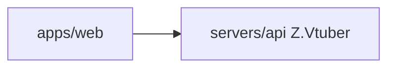

# Z.Vtuber API

## 技术栈说明

- 语言：C# (.NET 10)
- 框架：ASP.NET Core Web API
- API 文档：Microsoft.AspNetCore.OpenApi

## 项目模块示意图

## 开发流程

- TDD 开发
- 契约式开发（OpenAPI）
- 参考：`docs/engineering/common-rules.md`

## 相关规范引用

- `docs/engineering/common-rules.md`
- `docs/engineering/backend-rules.md`
