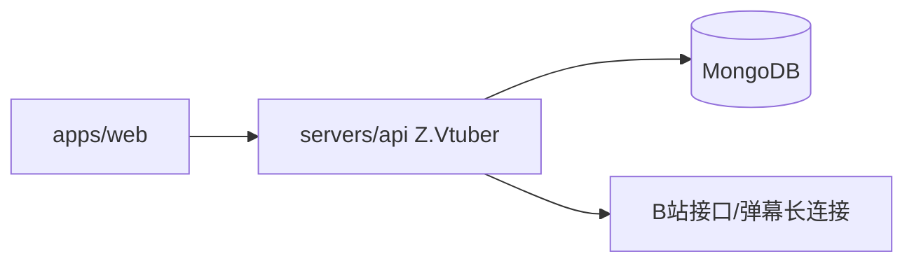

# Z.Vtuber API

## 技术栈说明

- 语言：C# (.NET 10)
- 框架：ASP.NET Core Web API
- API 文档：Microsoft.AspNetCore.OpenApi
- 数据库：MongoDB（Aspire 编排，`Aspire.MongoDB.Driver` + `MongoDB.Driver`）
- 抓取库：Mikibot.Crawler（NuGet 1.0.8）

## 项目模块示意图

## 模块结构

- `Controllers/`：对外 API（Health + BilibiliSubscription/BilibiliUser/BilibiliLive，统一前缀 `/api/b`）
- `Configuration/`：`BilibiliCrawlerOptions`（抓取周期等配置，节 `BilibiliCrawler`）
- `Crawlers/`：`IBiliApiClient`/`BiliApiClient`（per-cookie HTTP 抓取封装）、`BiliRawCrawler`
- `Jobs/`：`PeriodicJobBase`、`CrawlLockProvider`（per-key 锁）、`CookieProbeJob`/`AccountInfoJob`/`LiveStatusJob`/`SpaceTimelineJob`
- `Live/`：`LiveEventSource`（弹幕长连接）、`DanmakuClientFactory`、`DanmakuEventNormalizer`、`ILiveEventBus`/`LiveEventBus`（SSE 订阅门控）、`LiveEvent`
- `Persistence/`：6 个 MongoDB 集合实体、仓储、`MongoDbInitializer`（索引初始化）、`BsonConvert`
- `Services/`：`ICookiePoolService`（round-robin）、`ISubscriptionService`、`ILiveSessionTracker`、`LiveStatusStateMachine`（场次划分）、`SpaceTimelinePaging`

## 开发流程

- TDD 开发（单元测试：`tests/Z.Vtuber.Tests`，Testcontainers 集成测试）
- 契约式开发（OpenAPI）：契约 `contracts/bilibili-crawler.openapi.yaml`
- 参考：`docs/engineering/common-rules.md`

## 相关规范引用

- `docs/engineering/common-rules.md`
- `docs/engineering/backend-rules.md`
- 契约：`contracts/bilibili-crawler.openapi.yaml`
