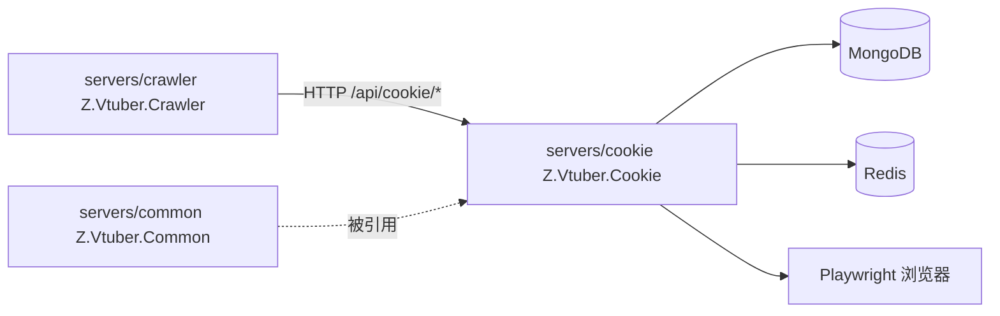

# Z.Vtuber.Cookie

## 技术栈说明

- 语言：C# (.NET 10)
- 框架：ASP.NET Core Web API
- 浏览器自动化：Playwright（Firefox/Chromium，headless）
- 数据库：MongoDB（`Aspire.MongoDB.Driver` + `MongoDB.Driver`）
- 消息通道：Redis（`Aspire.StackExchange.Redis`，连接串 `ConnectionStrings:messaging`）
- 分布式锁：Redis（`RedisDistributedLockProvider` 实现 `IDistributedLockProvider`）

## 项目模块示意图

## 模块结构

独立 Cookie 管理服务：负责帐号 session 管理（扫码登录）、Cookie 池调度（checkout/dispatch）、session 刷新与失效检测。**支持多平台（bilibili / weibo）**：平台差异经 `Platform/ICookiePlatformProfile` 抽象，双平台并行 Mongo 集合（`bilibili_*` / `weibo_cookies`+`weibo_cookie_sessions`）与独立锁空间。

- `Platform/`：平台差异抽象（登录页/二维码定位/登录态检测信号/cookie 域/锁前缀/身份解析）
  - `ICookiePlatformProfile`：`Platform`/`LoginUrl`/`QrCodeSelector`/`HomeUrl`/`CookieDomainUrl`/`LoginStateObservedUrlFragment`/`LoginStateProbeUrl`/`LockKeyPrefix`/`IsLoggedIn`/`ExtractIdentity`
  - `BilibiliCookiePlatformProfile`：网页版扫码，登录态以 `/x/web-interface/nav` 的 `data.isLogin:true` 为准，身份取 `data.mid`/`data.uname`
  - `WeiboCookiePlatformProfile`：`passport.weibo.com` 扫码，登录态以 `m.weibo.cn/api/config` 的 `data.login==true` 为准，身份取 `data.uid`/昵称，cookie 域 `m.weibo.cn`
  - `CookiePlatformContext`/`CookiePlatformRegistry`：按平台聚合仓储/池/浏览器/发布器，供后台任务覆盖双平台
- `Controllers/`：REST API 控制器
  - `CookieAccountController`：B 站帐号 session CRUD（`/api/cookie/accounts*`，列表项 `platform=bilibili`）
  - `CookieDispatchController`：B 站 Cookie 调度（`/api/cookie/{available,checkout,report-invalid,cooldown}`）
  - `WeiboCookieAccountController`：微博帐号 session CRUD（`/api/cookie/weibo/accounts*`，列表项 `platform=weibo`）
  - `WeiboCookieDispatchController`：微博 Cookie 调度（`/api/cookie/weibo/{available,checkout,report-invalid,cooldown}`）
  - `HealthController`：健康检查（`GET /health`）
- `Browser/`：Playwright 浏览器 session 管理（Profile 驱动）
  - `IBrowserSessionManager`：浏览器 session 抽象（创建/等待登录态/提取 cookie/删除/刷新）
  - `BrowserSessionManager`：按 `ICookiePlatformProfile` 驱动；被动观察（bilibili nav）与主动探测（weibo `api/config`，经 `context.APIRequest`）两种登录态信号；二维码元素等待超时改为告警 + 整页截图兜底（不再抛错，行为变更已在此明示）；提取 cookie 后按 Profile `RequiredCookieNames`（微博 SUB/SUBP）做存在性校验并告警。context 采用**按需惰性打开 + 用后空闲延时关闭**（`PageIdleCloseDelaySeconds`，默认 60s）：`ExtractCookiesAsync`/`RefreshSessionAsync` 在 context 不存在时冷启动（依赖 userDataDir 磁盘持久化恢复登录态），使用完毕启动 per-account 空闲计时，期间再次使用则顺延，到期关闭 context 释放进程；扫码登录 pending 阶段保持打开、不参与空闲关闭；per-account `SemaphoreSlim` 保证打开/使用/关闭互斥
  - `IdleCloseScheduler`：per-key 空闲延时关闭调度组件（`Touch` 重置计时、`Cancel` 取消、到期回调异常仅记日志），供 `BrowserSessionManager` 使用
  - `LoginSessionWorker`：后台 hosted service，遍历 `CookiePlatformRegistry` 处理双平台扫码登录 session 的 cookie 提取与身份回填入库
- `Refresh/`：Cookie 刷新与失效检测
  - `SessionRefreshJob`：遍历 `CookiePlatformRegistry` 定时刷新双平台活跃 session 的 Cookie
  - `InvalidationService`：按 Profile 实例化，锁 key 带平台段（`lock:cookie-refresh:weibo:{id}`；bilibili 保持 `lock:cookie-refresh:{id}`）
  - `ICookieInvalidEventPublisher`：Cookie 失效事件发布契约（`PublishAsync(cookieId, reason)`）
  - `RedisCookieInvalidEventPublisher`：基于 Redis pub/sub（频道 `cookie-invalid`），按平台填充 `CookieInvalidEvent.platform`；bilibili 身份经 account-info 集合反查，weibo 身份取自微博 session 记录
- `Pool/`：Cookie 池调度
  - `CookieDispatchService`（`ICookieDispatchService`）：Cookie checkout/dispatch 逻辑，集合名参数化
- `Locking/`：分布式锁
  - `RedisDistributedLockProvider`：Redis 分布式锁实现（`IDistributedLockProvider`）
- `Persistence/`：MongoDB 持久化
  - `CookieSessionRecord`：session 实体
  - `CookieSessionRepository`（`ICookieSessionRepository`）：session 仓储，集合名参数化
- `Configuration/`：配置
  - `CookieServiceOptions`：服务配置（`BrowserSessionDataDir` 等，双平台通用）
- `Program.cs`：`WebApplication` 宿主；注册 Mongo/Redis、Playwright；bilibili 以非 keyed 注册保持既有行为，weibo 以 `AddKeyedSingleton("weibo", ...)` 注册；`CookiePlatformRegistry` 聚合双平台供 hosted service（`SessionRefreshJob`/`LoginSessionWorker`）使用；幂等索引初始化；`/health` + `MapControllers()`

## API 面

所有接口挂载在 `/api/cookie` 路径下（bilibili）与 `/api/cookie/weibo`（微博平行端点，语义逐一对应）：

| 方法 | 路径 | 说明 |
|------|------|------|
| GET | `/api/cookie/accounts` | 列出全部 B 站帐号 session（列表项 `platform=bilibili`） |
| POST | `/api/cookie/accounts` | 新增 B 站帐号（扫码登录） |
| GET | `/api/cookie/accounts/{accountId}` | 获取单个 B 站帐号状态 |
| DELETE | `/api/cookie/accounts/{accountId}` | 删除 B 站帐号 session |
| GET | `/api/cookie/available` | 查询可用 B 站 Cookie |
| POST | `/api/cookie/checkout` | 领取一个可用 B 站 Cookie（round-robin） |
| POST | `/api/cookie/report-invalid` | 报告 B 站 Cookie 失效（阻塞式自愈） |
| POST | `/api/cookie/cooldown` | 将 B 站 Cookie 标记为冷却 |
| GET | `/api/cookie/weibo/accounts` | 列出全部微博帐号 session（列表项 `platform=weibo`） |
| POST | `/api/cookie/weibo/accounts` | 新增微博帐号（扫码登录） |
| GET | `/api/cookie/weibo/accounts/{accountId}` | 获取单个微博帐号状态 |
| DELETE | `/api/cookie/weibo/accounts/{accountId}` | 删除微博帐号 session |
| GET | `/api/cookie/weibo/available` | 查询可用微博 Cookie |
| POST | `/api/cookie/weibo/checkout` | 领取一个可用微博 Cookie（round-robin，无可用返回 404） |
| POST | `/api/cookie/weibo/report-invalid` | 报告微博 Cookie 失效（阻塞式自愈） |
| POST | `/api/cookie/weibo/cooldown` | 将微博 Cookie 标记为冷却 |
| GET | `/health` | 健康检查 |

## 配置

- `ConnectionStrings:mongo`：MongoDB 连接串
- `ConnectionStrings:messaging`：Redis 连接串
- `CookieService` 节：`BrowserSessionDataDir`（浏览器 session 数据目录，必填）
- `CookieService:PageIdleCloseDelaySeconds`：刷新/提取完成后关闭浏览器 context 的空闲延时时长（秒，默认 60，须 > 0）；`BrowserSessionDataDir` 与该项经 `CookieServiceOptionsValidator` 在启动时校验

## 开发流程

- TDD 开发（单元测试：`tests/Z.Vtuber.Tests`）
- 参考：`docs/engineering/common-rules.md`、`docs/engineering/backend-rules.md`
