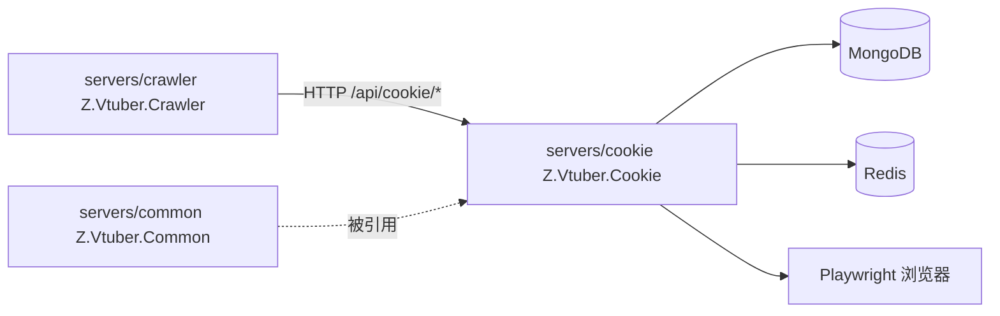

# Z.Vtuber.Cookie

## 技术栈说明

- 语言：C# (.NET 10)
- 框架：ASP.NET Core Web API
- 浏览器自动化：Playwright（Firefox/Chromium，headless）
- 数据库：MongoDB（`Aspire.MongoDB.Driver` + `MongoDB.Driver`）
- 消息通道：Redis（`Aspire.StackExchange.Redis`，连接串 `ConnectionStrings:messaging`）
- 分布式锁：Redis（`RedisDistributedLockProvider` 实现 `IDistributedLockProvider`）

## 项目模块示意图

## 模块结构

独立 Cookie 管理服务：负责帐号 session 管理（扫码登录）、Cookie 池调度（checkout/dispatch）、session 刷新与失效检测。

- `Controllers/`：REST API 控制器
  - `CookieAccountController`：帐号 session CRUD（`GET/POST /accounts`、`GET/DELETE /accounts/{accountId}`）
  - `CookieDispatchController`：Cookie 调度接口（`GET /available`、`POST /checkout`、`POST /report-invalid`、`POST /cooldown`）
  - `HealthController`：健康检查（`GET /health`）
- `Browser/`：Playwright 浏览器 session 管理
  - `IBrowserSessionManager`：浏览器 session 抽象（创建/等待导航/提取 cookie/删除/刷新）
  - `BrowserSessionManager`：基于 Playwright 的实现
  - `LoginSessionWorker`：后台 hosted service，处理扫码登录 session 的 cookie 提取与入库
- `Refresh/`：Cookie 刷新与失效检测
  - `SessionRefreshJob`：定时刷新活跃 session 的 Cookie
  - `InvalidationService`：Cookie 失效检测与清理
  - `ICookieInvalidEventPublisher`：Cookie 失效事件发布契约
  - `RedisCookieInvalidEventPublisher`：基于 Redis pub/sub 的实现（频道 `cookie-invalid`）
- `Pool/`：Cookie 池调度
  - `CookieDispatchService`（`ICookieDispatchService`）：Cookie checkout/dispatch 逻辑
- `Locking/`：分布式锁
  - `RedisDistributedLockProvider`：Redis 分布式锁实现（`IDistributedLockProvider`）
- `Persistence/`：MongoDB 持久化
  - `CookieSessionRecord`：session 实体
  - `CookieSessionRepository`（`ICookieSessionRepository`）：session 仓储
- `Configuration/`：配置
  - `CookieServiceOptions`：服务配置（`BrowserSessionDataDir` 等）
- `Program.cs`：`WebApplication` 宿主；注册 Mongo/Redis、Playwright、所有服务与 hosted service（`SessionRefreshJob`/`LoginSessionWorker`）；幂等索引初始化；`/health` + `MapControllers()`

## API 面

所有接口挂载在 `/api/cookie` 路径下：

| 方法 | 路径 | 说明 |
|------|------|------|
| GET | `/api/cookie/accounts` | 列出全部帐号 session |
| POST | `/api/cookie/accounts` | 新增帐号（扫码登录） |
| GET | `/api/cookie/accounts/{accountId}` | 获取单个帐号状态 |
| DELETE | `/api/cookie/accounts/{accountId}` | 删除帐号 session |
| GET | `/api/cookie/available` | 查询可用 Cookie 数量 |
| POST | `/api/cookie/checkout` | 领取一个可用 Cookie（round-robin） |
| POST | `/api/cookie/report-invalid` | 报告 Cookie 失效 |
| POST | `/api/cookie/cooldown` | 将 Cookie 标记为冷却 |
| GET | `/health` | 健康检查 |

## 配置

- `ConnectionStrings:mongo`：MongoDB 连接串
- `ConnectionStrings:messaging`：Redis 连接串
- `CookieService` 节：`BrowserSessionDataDir`（浏览器 session 数据目录，必填）

## 开发流程

- TDD 开发（单元测试：`tests/Z.Vtuber.Tests`）
- 参考：`docs/engineering/common-rules.md`、`docs/engineering/backend-rules.md`
