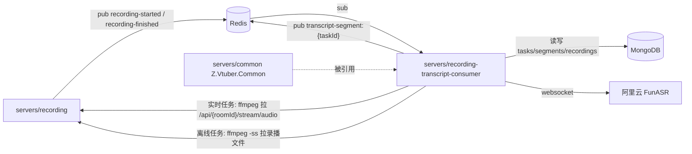

# Z.Vtuber.RecordingTranscript.Consumer

## 技术栈说明

- 语言：C# (.NET 10)
- 框架：ASP.NET Core Web（`Microsoft.NET.Sdk.Web`，挂最小 Kestrel 提供 `/health`，主体为多个 `BackgroundService`）
- 音频转码：ffmpeg 外部进程（`System.Diagnostics.Process`，实时流跟随 / 文件 `-ss` seek，统一输出 16kHz mono s16le pipe）
- ASR：websocket 直连 FunASR realtime（`System.Net.WebSockets.ClientWebSocket`，仅 `sentence_end=true` 成句）
- 数据库：MongoDB（`Aspire.MongoDB.Driver` + `MongoDB.Driver`，读写 `recordings`/`transcript_*`/`recording_status`；segment+position 顺序落库，唯一索引幂等）
- 分布式锁 / 事件：Redis（`Aspire.StackExchange.Redis`，任务锁 SET NX PX + 续期 + Lua 释放 + fencing；pub/sub 订阅 started/finished、发布 segment）
- 依赖服务：recording 服务（`IRecordingServiceClient`，`RecordingService:BaseUrl`）

## 项目模块示意图

## 模块结构

录播转写消费服务：订阅开播/结束事件做幂等 enqueue，周期对账补建漏建场次；扫表抢 Redis 锁领取任务，经 ffmpeg 取音频（实时流或录播文件断点 seek）喂 FunASR 流式识别，segment 顺序落库并 Redis pub 供 SSE。

- `Configuration/`：`TranscriptConsumerOptions`（节 `TranscriptConsumer`）、`RecordingServiceOptions`（节 `RecordingService`，拼接 recording 内网 URL）
- `Events/`：`RecordingStartedSubscriber`（订阅 `recording-started`，roomId 启用自动识别时按默认模型建 mode=live/source=auto 任务）、`RecordingFinishedSubscriber`（订阅 `recording-finished` 补建 mode=file 任务）——均为 `BackgroundService` + `ChannelMessageQueue.ReadAsync` 循环，单条失败记 warning 继续
- `Enqueue/`：`TranscriptEnqueueService`（幂等建任务：同录播+模型唯一索引，File 优先 `[RAW]` 回退首个；开播/结束/对账/手动共用；重复冲突返回既有 taskId）
- `Reconcile/`：`TranscriptReconciler`（HostedService，`ReconcileIntervalSeconds` 周期 + 启动抖动：开播中漏建补 live、结束后漏建补 file；仅补「启用之后」的场次，唯一索引幂等）
- `Tasks/`：`TranscriptTaskScanner`（HostedService，周期扫描 PENDING / RUNNING 无锁任务，按 `_id` 升序抢锁接管，受模型 `MaxConcurrency` 门控）、`TranscriptTaskLock`（`RedisTranscriptTaskLockProvider`：key `transcript:task-lock:{taskId}`，SET NX PX + 续期 Lua + token 比对释放 + `CheckOwnershipAsync` fencing）、`TranscriptTaskRunner`（单任务编排：live 探测实时端点 200 接流 / 404 转 file 从 position seek 补尾，逐句 fencing 校验，EOF→DONE、异常→FAILED、finally 释放锁）、`TranscriptSegmentPersister`（顺序写：先 insert segment 再更新 position；`(TaskId, StartTime)` 唯一索引冲突幂等忽略）、`TranscriptSegmentPublisher`（pub `transcript-segment:{taskId}`）
- `Asr/`：`IStreamingAsrService`（`StreamingAsrSegment(Start, End, Text)` + `IAsyncEnumerable` 抽象）、`AliFunAsrService`（构造传入 offset，websocket 协议 run-task/音频帧/finish-task，仅成句 yield，时间 = 返回时间 + offset；连接/run-task/task-started/finish-task/task-finished/关闭等关键节点 Info 日志、成句进度节流日志；服务端 `AsrIdleTimeoutSeconds` 无消息即抛 TimeoutException 使任务 FAILED 可重试）、`FunAsrProtocol`（客户端指令 `header.action`＝run-task/finish-task、服务端事件 `header.event`＝task-started/result-generated/task-finished/task-failed；`task-failed` 解析 error_code/message）
- `Audio/`：`FfmpegAudioStream`（`FfmpegAudioArgs` 参数构造、`IAudioProcess`/`IAudioProcessFactory`、`IAudioSource`/`IAudioSourceFactory`；实时/live 与 file 双音源统一 s16le pipe，按 1 秒（32000B）分块、有界缓冲形成背压）
- `Services/`：`RecordingServiceClient`（`IRecordingServiceClient`：拼实时音频/录播文件 URL、HEAD 探测实时流可用性）
- `Program.cs`：注册 Mongo/Redis/Options（`ValidateOnStart`）/仓储/服务/HttpClient（`RecordingService:BaseUrl`）/HostedService，启动幂等索引初始化，`/health`
- `MongoDbHealthCheck.cs`：与 crawler 同模式
- `Properties/launchSettings.json`：本地 8085
- `Dockerfile`：两阶段构建（aspnet 运行时 + `apt-get install ffmpeg`，`EXPOSE 8080`）
- 镜像流水线：`.github/workflows/build-recording-transcript-consumer-image.yml`（`zero-tools/z-vtuber-recording-transcript-consumer`）

## API 面

无对外 REST 业务面；仅 `GET /health`（进程存活 + MongoDB 连通性）。所有状态经 Mongo 与 Redis 事件对外暴露（transcript-api 提供查询与 SSE）。

## 配置

- `ConnectionStrings:mongo`：MongoDB 连接串
- `ConnectionStrings:messaging`：Redis 连接串
- `RecordingService:BaseUrl`（节 `RecordingService`，默认 `http://recording/`）：recording 服务内网地址
- `TranscriptConsumer` 节（`ValidateOnStart`）：`ScanIntervalSeconds`(10)、`LockTtlSeconds`(30)、`LockRenewIntervalSeconds`(10)、`AudioBufferSeconds`(60)、`ReconcileIntervalSeconds`(300)、`ScanBatchSize`(50)、`FfmpegPath`(ffmpeg)、`AsrEndpoint`(`wss://dashscope.aliyuncs.com/api-ws/v1/inference/`)、`AsrModel`(fun-asr-realtime)、`AsrIdleTimeoutSeconds`(45，服务端停滞超时→任务 FAILED 可重试)
- 健康检查端口：本地 launchSettings 8085

## 部署要点

- runtime 镜像含 ffmpeg（Dockerfile 已装）；可多副本部署——Redis 任务锁保证同一任务单节点执行，宕机后锁 TTL 过期由他节点接管续跑
- FunASR API Key 由 `transcript_models` 页面配置注入，本服务按任务的模型读取，不经配置项下发

## 开发流程

- TDD 开发（单元测试与集成测试：`tests/Z.Vtuber.Tests`，Testcontainers MongoDB + Redis；ASR 以本地假 websocket server 契约测试，ffmpeg 测试在无 ffmpeg 环境 Skip）
- 参考：`docs/engineering/common-rules.md`、`docs/engineering/backend-rules.md`、`docs/engineering/proposals/20260916-proposal-recording-transcript.md`
