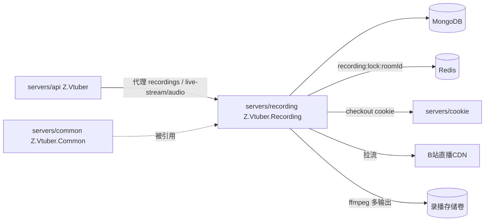

# Z.Vtuber.Recording

## 技术栈说明

- 语言：C# (.NET 10)
- 框架：ASP.NET Core Web（`Microsoft.NET.Sdk.Web`，挂最小 Kestrel 提供 `/health` 与自身 REST API）
- 录制：ffmpeg 外部进程（`System.Diagnostics.Process`，单进程多输出 RAW + AV1 二压 + 实时音频 pipe）
- 数据库：MongoDB（`Aspire.MongoDB.Driver` + `MongoDB.Driver`，读订阅/主播资料，写 `recording_status`）
- 分布式锁：Redis（`Aspire.StackExchange.Redis`，SET NX PX + 续期 + Lua 释放 + fencing）
- 依赖服务：cookie 服务（`ICookieServiceClient`，`CookieService:BaseUrl`）

## 项目模块示意图

## 模块结构

独立录播服务：消费「录播（recording）」类型订阅，开播自动录制、下播自动结束，产出 RAW + AV1 双文件与实时音频流。

- `Live/`：`LiveStatusPoller`（HostedService：读 Recording 订阅 → mid 解析 roomId → cookie checkout + room get_info → 未开播上报 not_live / 已开播交 `RecordingSession`；订阅取消则取消进行中的会话）、`StreamResolver`（playurl 候选流选取纯函数：排除 hevc，优先 http_stream+flv）、`BiliLiveApiClient`（直连 B 站 room get_info / getRoomPlayInfo）、`AnchorNameExtractor`（channel JSON 提取 uName）
- `Recording/`：`RecordingSession`（单场次编排：抢锁 → 选流 → 渲染文件名 → 启动 ffmpeg → stdout 泵喂 Audio Hub → 状态上报 → 退出处理 → 释放锁；每轮 fencing 校验失锁立即 kill）、`RecordingLock`（`RedisRecordingLockProvider`：per-room 锁 `recording:lock:{roomId}`，TTL 续期、Lua 比对释放、CheckOwnership fencing）、`FfmpegProcessBuilder`（多输出参数纯函数）、`RecordingProcess`（Process 封装与 stderr 泵）、`RecordingFileName`（文件名模板纯函数）、`RecordingStatusReporter`（状态 upsert/心跳）、`RecordingStates`
- `Audio/`：`AudioStreamHub`（每房间广播；无订阅者零缓冲丢弃；每订阅者按字节有界队列 DropOldest 等价语义）
- `Controllers/`：`RecordingController`（`GET /api/recording/status`、`GET /api/{roomId}/recordings[/{fileName}]`、`GET /api/{roomId}/stream/audio`），含文件名路径穿越防护
- `Services/`：`CookieServiceClient`（精简版 checkout + report-invalid）
- `Configuration/`：`RecordingOptions`（节 `Recording`）
- `Program.cs`：注册 Mongo/Redis/Options/仓储/服务/HostedService/HTTP 客户端，启动幂等索引初始化，`/health` + `MapControllers()`
- `MongoDbHealthCheck.cs`：与 crawler 同模式
- `Dockerfile`：两阶段构建（aspnet 运行时 + `apt-get install ffmpeg`，`EXPOSE 8080`）
- 镜像流水线：`.github/workflows/build-recording-image.yml`（`zero-tools/z-vtuber-recording`）

## API 面

契约：`contracts/recording.openapi.yaml`。

| 方法 | 路径 | 说明 |
|------|------|------|
| GET | `/health` | 进程存活 + MongoDB 连通性 |
| GET | `/api/recording/status` | 全部录制状态（state ∈ not_live/recording/error） |
| GET | `/api/{roomId}/recordings` | 录播文件名列表（无录播返回空数组） |
| GET | `/api/{roomId}/recordings/{fileName}` | 下载录播文件（平文件名，防路径穿越） |
| GET | `/api/{roomId}/stream/audio` | 实时音频流（录制中 200 `video/x-flv` chunked，未录制 404） |

对外统一经 api 代理（`/api/b/live/*`），web 不直连本服务。

## 配置

- `ConnectionStrings:mongo`：MongoDB 连接串
- `ConnectionStrings:messaging`：Redis 连接串
- `CookieService:BaseUrl`：cookie 服务地址
- `Recording` 节（`ValidateOnStart`）：`StorageDir`（默认 `/data/recordings`）、`PollIntervalSeconds`(30)、`LockTtlSeconds`(15)、`LockRenewIntervalSeconds`(5)、`FencingIntervalMilliseconds`(2000)、`AudioBufferBytes`(262144)、`DefaultBitrateKbps`(4000)、`StatusHeartbeatSeconds`(10)、`FfmpegPath`(ffmpeg)、`Referer`、`UserAgent`、`Av1:Enabled`(true)
- 健康检查端口：默认 8080（本地 launchSettings 8083）

## 部署要点

- 生产单副本 + Recreate 更新策略；录播存储挂持久卷（`/data/recordings`）
- 无 GPU/NVENC 环境置 `Recording__Av1__Enabled=false` 降级为仅 RAW + 音频
- 同一直播间同一时刻仅一个实例录制：单副本 + Redis per-room 锁（续期/fencing）兜底

## 开发流程

- TDD 开发（单元测试与集成测试：`tests/Z.Vtuber.Tests`，Testcontainers MongoDB + Redis）
- 契约式开发（OpenAPI）：`contracts/recording.openapi.yaml`
- 参考：`docs/engineering/common-rules.md`、`docs/engineering/backend-rules.md`
