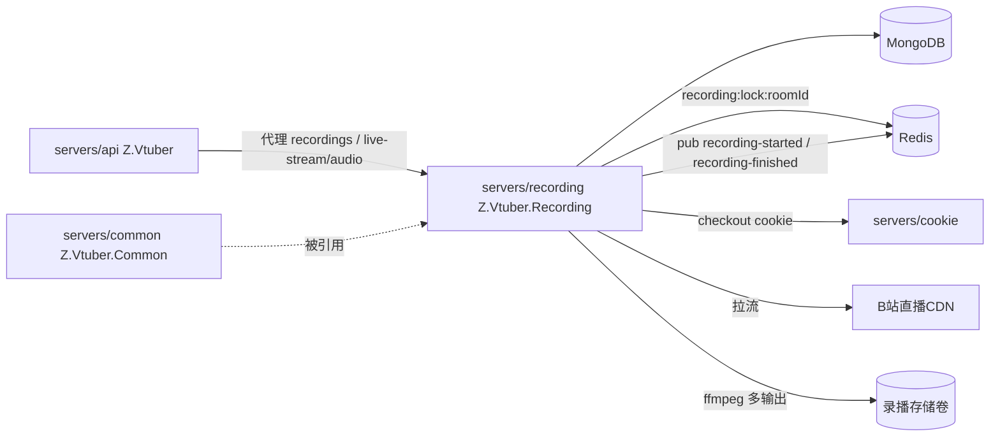

# Z.Vtuber.Recording

## 技术栈说明

- 语言：C# (.NET 10)
- 框架：ASP.NET Core Web（`Microsoft.NET.Sdk.Web`，挂最小 Kestrel 提供 `/health` 与自身 REST API）
- 录制：ffmpeg 外部进程（`System.Diagnostics.Process`，单进程多输出 RAW + AV1 二压 + 实时音频 pipe）
- 数据库：MongoDB（`Aspire.MongoDB.Driver` + `MongoDB.Driver`，读订阅/主播资料，写 `recording_status`）
- 分布式锁 / 事件：Redis（`Aspire.StackExchange.Redis`，SET NX PX + 续期 + Lua 释放 + fencing；pub/sub 发布 `recording-started`/`recording-finished`）
- 依赖服务：cookie 服务（`ICookieServiceClient`，`CookieService:BaseUrl`）

## 项目模块示意图

## 模块结构

独立录播服务：消费「录播（recording）」类型订阅，开播自动录制、下播自动结束，产出 RAW + AV1 双文件与实时音频流。

- `Live/`：`LiveStatusPoller`（HostedService：读 Recording 订阅 → mid 解析 roomId → cookie checkout + room get_info → 未开播上报 not_live / 已开播交 `RecordingSession`（透传 mid 供归档与事件载荷）；订阅取消则取消进行中的会话；轮询带抖动；无法启动录制（无可用 cookie / 轮询异常）且库中该房间 recording 状态已过 `StaleStatusThresholdSeconds` 未刷新时，上报 error 纠正陈旧残留）、`StreamResolver`（playurl 候选流选取纯函数：排除 hevc，优先 http_stream+flv）、`BiliLiveApiClient`（直连 B 站 room get_info / getRoomPlayInfo，校验 code）、`StreamBitrateProbe`（ffprobe 短时探测码率，缺失回退默认）、`AnchorNameExtractor`（channel JSON 提取 uName）
- `Recording/`：`RecordingSession`（单场次编排：抢锁 → 选流 → 渲染文件名 → 启动 ffmpeg → stdout 泵喂 Audio Hub → 归档 `recordings`（title/room_id/**mid**/files）+ pub `recording-started` → 状态上报 → 退出处理（exitCode==0 回写 `EndedAt` + pub `recording-finished`；停机/取消订阅分支回写 `EndedAt` + pub finished 后释放；fencingLost 分支不发布交由新持有者收尾）→ 释放锁；监控循环任何异常/失锁/停机都先 kill 并回收进程再处理状态；fencing 失锁不覆盖新持有者状态；优雅停机落 not_live 终态避免残留；error 保留已产出文件名）、`OrphanRecordingFinalizer`（幂等收尾孤儿场次：启动时收尾全部 `EndedAt=null`、新场次接管同房间前收尾该房间遗留；条件更新 EndedAt + 发布 finished，不覆盖新持有者）、`RecordingLock`（`RedisRecordingLockProvider`：per-room 锁 `recording:lock:{roomId}`，TTL 续期、Lua 比对释放、CheckOwnership fencing）、`RecordingEventPublisher`（`RedisRecordingEventPublisher`：pub started/finished，失败仅记日志由对账兜底）、`RecordingBackfillMigration`（启动时一次性幂等清洗存量录播：`{StorageDir}/{roomId}/*.flv` 按文件创建时间匹配 `bilibili_live_session` 窗口、无匹配回退 `bilibili_live_status`，同场次 RAW/AV1 聚合，RoomId+StartedAt 幂等键，marker `recording_backfill_v1`）、`FfmpegProcessBuilder`（多输出参数纯函数，含 `-y` 覆盖残留文件）、`RecordingProcess`（Process 封装与 stderr 泵）、`RecordingFileName`（文件名模板纯函数，北京时间日期）、`RecordingStatusReporter`（状态 upsert/心跳）、`RecordingStates`
- `Audio/`：`AudioStreamHub`（每房间广播；无订阅者时仅缓存首包 FLV 头供中途接入重放、其余分片直接丢弃；每订阅者按字节有界队列 DropOldest 等价语义；Subscribe 在锁内校验 Streaming，未录制返回已完成订阅）
- `Controllers/`：`RecordingController`（`GET /api/recording/status`、`GET /api/{roomId}/recordings[/{fileName}]`、`POST /api/recordings/file-stats`、`GET /api/{roomId}/stream/audio`），含文件名路径穿越防护；列表按 `recordings` 场次归档聚合（按场次 `StartedAt` 倒序、场内文件名升序），返回文件物理元信息（name/size/createdAt）与所属场次信息（info：recordingId/title/mid/startedAt/endedAt），磁盘缺失与未归档文件不列出，并按 `recording_status`（state=recording 且心跳未过期）排除录制中文件，下载录制中文件返回 400；下载经 `PhysicalFile(enableRangeProcessing: true)` 原生支持 HTTP Range 分段下载（206/Content-Range/Accept-Ranges，越界 416）；`POST /api/recordings/file-stats` 为磁盘权威批量端点：按 `{StorageDir}/{roomId}/{fileName}` 逐个判定 exists/size，复用下载端点路径穿越防护，非法文件名按 exists=false，items 上限 100 超限 400（供 transcript-api 过滤空录播）
- `Services/`：`CookieServiceClient`（精简版 checkout + report-invalid）
- `Configuration/`：`RecordingOptions`（节 `Recording`）
- `Program.cs`：注册 Mongo/Redis/Options/仓储/服务/HostedService/HTTP 客户端，启动幂等索引初始化 + 存量清洗迁移（失败不阻断启动），`/health` + `MapControllers()`
- `MongoDbHealthCheck.cs`：与 crawler 同模式
- `Dockerfile`：两阶段构建（aspnet 运行时 + `apt-get install ffmpeg`，`EXPOSE 8080`）
- 镜像流水线：`.github/workflows/build-recording-image.yml`（`zero-tools/z-vtuber-recording`）

## API 面

契约：`contracts/recording.openapi.yaml`。

| 方法 | 路径 | 说明 |
|------|------|------|
| GET | `/health` | 进程存活 + MongoDB 连通性 |
| GET | `/api/recording/status` | 全部录制状态（state ∈ not_live/recording/error） |
| GET | `/api/{roomId}/recordings` | 录播文件列表（按场次归档聚合，含文件元信息与所属场次信息 `info`；不含录制中文件；无录播返回空数组） |
| POST | `/api/recordings/file-stats` | 批量查询录播文件磁盘状态（磁盘权威，exists/size；非法文件名按不存在；items 上限 100 超限 400） |
| GET | `/api/{roomId}/recordings/{fileName}` | 下载录播文件（平文件名，防路径穿越；录制中文件返回 400；支持 Range 分段下载 206/416） |
| GET | `/api/{roomId}/stream/audio` | 实时音频流（录制中 200 `video/x-flv` chunked，未录制 404） |

对外统一经 api 代理（`/api/b/live/*`），web 不直连本服务。

## 配置

- `ConnectionStrings:mongo`：MongoDB 连接串
- `ConnectionStrings:messaging`：Redis 连接串
- `CookieService:BaseUrl`：cookie 服务地址
- `Recording` 节（`ValidateOnStart`）：`StorageDir`（默认 `/data/recordings`）、`PublicBaseUrl`（默认 `http://recording`，本服务可达基础地址，用于拼接 started/finished 事件中的实时音频与录播文件 URL）、`PollIntervalSeconds`(30)、`LockTtlSeconds`(15)、`LockRenewIntervalSeconds`(5)、`FencingIntervalMilliseconds`(2000)、`StaleStatusThresholdSeconds`(180)、`AudioBufferBytes`(262144)、`DefaultBitrateKbps`(4000)、`ProbeBitrate`(true)、`FfprobePath`(ffprobe)、`FfmpegPath`(ffmpeg)、`Referer`、`UserAgent`、`Av1:Enabled`(true)
- 健康检查端口：默认 8080（本地 launchSettings 8083）

## 部署要点

- 生产单副本 + Recreate 更新策略；录播存储挂持久卷（`/data/recordings`）
- 无 GPU/NVENC 环境置 `Recording__Av1__Enabled=false` 降级为仅 RAW + 音频
- 同一直播间同一时刻仅一个实例录制：单副本 + Redis per-room 锁（续期/fencing）兜底
- `Recording:PublicBaseUrl` 需配置为 transcript-consumer 可达的内网地址（事件载荷 URL 拼接）；启动执行存量清洗迁移（幂等 marker，失败不阻断）

## 开发流程

- TDD 开发（单元测试与集成测试：`tests/Z.Vtuber.Tests`，Testcontainers MongoDB + Redis）
- 契约式开发（OpenAPI）：`contracts/recording.openapi.yaml`
- 参考：`docs/engineering/common-rules.md`、`docs/engineering/backend-rules.md`
